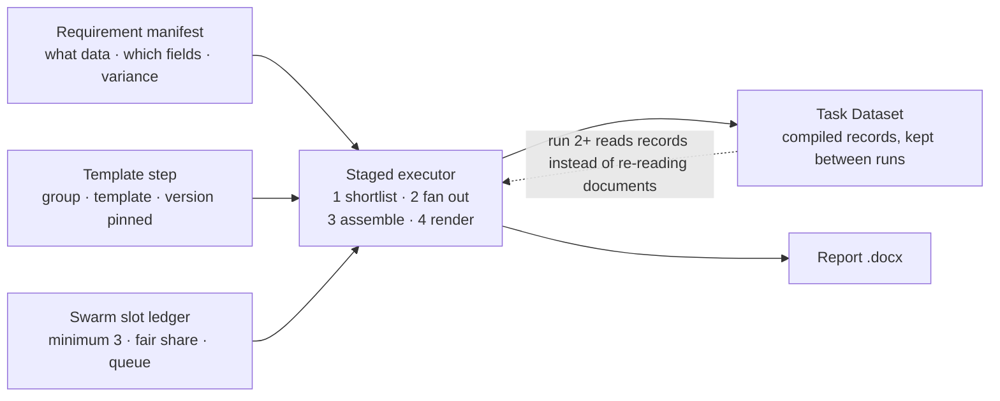
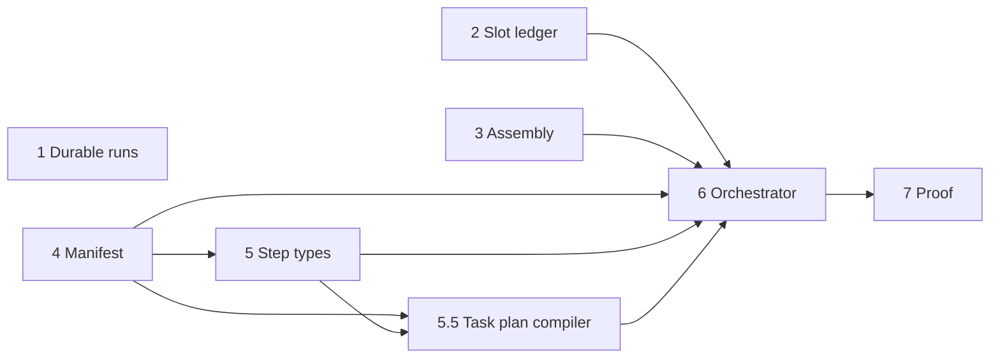

# Staged Extraction Rebuild

## Outcome

A template Extraction step currently takes over an hour and sometimes fails
outright. This document is the implementation plan that makes it minutes, and
makes every later report over the same corpus cheaper than the one before it.

The thesis in one sentence: **stop asking one model to perform the whole
pipeline in fifty sequential turns, and start asking many models to each do one
small thing that the server remembers.**

Nearly every mechanism required already exists on `dev`. What is missing is the
code that puts those mechanisms in order, the accounting that stops concurrent
runs fighting over the same worker pool, and the control surface that lets an
operator choose the staged path from a dropdown.

**Implementation status:** Stages 1 through 7, including the Stage 5.5 Task
plan compiler, are implemented on `dev`. Stage 1
added the durable saved-Task queue, lease recovery, direct worker runtime,
build-session/checkpoint schema, release contract, and worker image in migration
`20260831000200_staged_extraction_durable_runs`. Stage 2 adds the shared Swarm
slot ledger, FIFO admission, lease heartbeat/release handling, and the
minimum-slots configuration in migration
`20260901000100_swarm_slot_ledger`. Stage 4 adds immutable requirement-manifest
revisions, queryable requirement rows, transactional activation, time-variance
classification, and requirement-level digests in migration
`20260901000200_template_data_requirement_manifests`. Stage 5 adds typed Prompt
and Template steps, immutable template-version pins, run-item snapshots, the
silo-scoped selection catalog, staged routing, and visible deletion invalidation
in migration `20260901000300_extraction_task_template_steps`. Stage 5.5 and
Stage 6 add persisted run plans and nodes, exact requirement consolidation,
durable checkpoint capture/restore, source-restricted Swarm extraction,
read-only dataset assembly, a bounded gap check, and one final render in
migration `20260901000400_staged_task_execution_plans`. Stage 7 adds durable
per-item proof snapshots, run-level cache/Swarm summaries, live queue position,
and operator views without another migration. Stage 3 is code-only:
multi-section template reads and atomic multi-payload field-map application use
the existing workspace and renderer, so no migration is required.
Requirement/document checkpoint rows become an active reuse path in Stage 6,
when the manifest and compiled Task plan provide the exact requirement identity
needed to write them safely.

## Scope Note

This plan is filed here because Task Datasets are the durable store the whole
design turns on, but it deliberately spans four subsystems:

- **Task Datasets** — compiled records become the reuse boundary between runs.
- **Template ingestion** — the persistent data plan is promoted into a binding
  data requirement manifest.
- **Swarm configuration** — a minimum-slots setting and a Postgres slot ledger
  shared across concurrent Ask and Extraction runs.
- **Task execution** — a step type that routes a step to a staged executor
  instead of the free-form agentic loop.

## Decisions Locked

| Question                          | Decision                                        | Consequence                                                                                                                            |
| --------------------------------- | ----------------------------------------------- | -------------------------------------------------------------------------------------------------------------------------------------- |
| Slot ledger location              | Postgres leases                                 | Survives deploys; correct once runs move to the worker service.                                                                        |
| When the swarm pool is full       | Wait indefinitely                               | No timeout, no serial fallback. Makes the expiry guards in Stage 2 load-bearing.                                                       |
| Slot hold window                  | Per dispatch                                    | Slots return to the pool as workers finish, not when the run ends.                                                                     |
| Minimum slots default             | 3                                               | A fifteen-slot pool admits five concurrent tasks.                                                                                      |
| Failed Task dataset work          | Preserve validated source checkpoints           | A failed output never exposes an incomplete dataset as ready, but the next compatible run does not repeat completed source extraction. |
| Dataset activation                | Complete-generation promotion                   | A building generation becomes active only after every required source is complete or explicitly not applicable.                        |
| Re-ingested document              | Stable document ID remains covered              | Re-ingestion alone never reopens coverage. Clear/rebuild is required.                                                                  |
| Clear/rebuild                     | Logical generation reset                        | The old active generation remains readable until its complete replacement is promoted, then it is superseded and purged.               |
| Crash recovery                    | Reclaim the same run/build lease                | A worker resumes the same compatible job and checkpoints after lease expiry.                                                           |
| Execution boundary                | Shared worker-safe runtime                      | The worker invokes extraction code directly; it does not hold an internal HTTP request open.                                           |
| Template step routing             | Always staged                                   | Selecting a template expands the one visible step into persistent internal substeps.                                                   |
| Template step without file output | Dataset preparation                             | It completes after shortlist/extraction and skips assembly/rendering.                                                                  |
| Task input data                   | Raw text                                        | The exact bounded text is snapshotted and appended to assembly context; it is not a dataset/cache identity.                            |
| Period-scoped extraction          | Extract every period in each new source         | Later report periods filter stored facts instead of rereading documents.                                                               |
| Candidate completeness            | Full inventory plus conservative relevance gate | Ambiguous documents are extracted; only clearly irrelevant documents become `not_applicable`.                                          |
| Manifest evolution                | Immutable automatic revisions                   | Runtime gap findings may create validated successor revisions, never edit a pinned revision in place.                                  |
| Slot-ledger outage                | Queue and retry                                 | Never fall back to unmetered provider calls.                                                                                           |
| Capacity namespace                | Swarm configuration route                       | Capacity is owned by stable configured route IDs, even when providers or models overlap.                                               |
| Template deletion                 | Invalidate referencing steps                    | Never silently remove a Task step; block new runs until it is replaced or removed explicitly.                                          |
| Delivery                          | One independently testable stage at a time      | Stages 1 through 7 are implemented and each stage passed its relevant acceptance cases on `dev`.                                       |

## Stages At A Glance

| Stage                                   | Goal                                                                                                      | Depends on      | Value if shipped alone                                                                                   |
| --------------------------------------- | --------------------------------------------------------------------------------------------------------- | --------------- | -------------------------------------------------------------------------------------------------------- |
| 1 Durable runs and builds — implemented | Task runs execute on the worker queue; durable build/checkpoint storage is ready for the staged executor. | —               | Runs stop dying on deploy; Stage 6 can retain validated extraction without another persistence redesign. |
| 2 Slot ledger — implemented             | Shared slot accounting plus the minimum-slots setting.                                                    | —               | Concurrent runs stop oversubscribing the provider.                                                       |
| 3 Deterministic assembly — implemented  | One render from a complete field map instead of a turn per segment.                                       | —               | Largest single latency win. 40–60% off a template step.                                                  |
| 4 Requirement manifest — implemented    | Ingestion emits a binding manifest of the data the report needs.                                          | —               | New data, no behaviour change yet.                                                                       |
| 5 Step types — implemented              | Step type and template dropdowns in the step editor.                                                      | 4               | Control surface used by Stage 6.                                                                         |
| 5.5 Task plan compiler — implemented    | Expand every selected template, consolidate exact-compatible requirements and persist a dependency graph. | 4, 5            | Multi-template preparation steps extract shared facts once.                                              |
| 6 Staged orchestrator — implemented     | Shortlist, fan out, assemble, render — driven by the compiled Task plan.                                  | 2, 3, 4, 5, 5.5 | The payoff. Serial N becomes N ÷ parallelism.                                                            |
| 7 Proof — implemented                   | Instrumentation that shows the cache is actually working.                                                 | 6               | The only way to know a cache key is right.                                                               |

Stages 1 through 4 have no dependencies on each other and can proceed in
parallel. Stage 5 needs Stage 4's manifest shape to know what to pin. Stage 5.5
compiles all selected template steps into one server-owned dataflow. Stage 6
needs everything.

## 1. Baseline Behaviour Before Stage 1

### 1.1 The Serial Chain

```text
POST /api/tasks/{id}/run
  └─ createExtractionTaskRun()      inserts run + one row per step
  └─ startExtractionTaskRun()       void promise; 202 returned

runExtractionTaskRunItemsActive()
  └─ for (const item of runItems)   strictly serial, no concurrency
       └─ postExtractionTool()      in-process call, not HTTP
            └─ runExtractionModelWithWorkspace()
                 └─ while (toolCalls.length <= 120)
                      └─ await callTextModel(conversation)   one turn
```

Inside a template step the conversation follows a fixed shape that the contract
payload prescribes: read the outline with `get_template_contract`, run the
merged `searchPlan` queries with `rag_search` (capped at 24), open the workspace
with `create_document`, then for every segment in dependency order call
`get_template_section` and `edit_document`, then `inspect_document` until
nothing required is outstanding, then `finalize_document`.

That shape is correct. It is also, end to end, a straight line.

### 1.2 Where The Hour Goes

For a fifteen-page template with roughly twenty segments:

| Phase                  | Model turns | Parallel | Notes                                                                             |
| ---------------------- | ----------- | -------- | --------------------------------------------------------------------------------- |
| Read contract and plan | 1–2         | n/a      | Outline payload is deliberately small.                                            |
| Retrieval              | 4–10        | no       | Up to 24 searches; already cached seven days by `task_template_rag_search_cache`. |
| Open workspace         | 1           | n/a      |                                                                                   |
| Segment fill           | ~40         | **no**   | Two turns per segment. This is the run.                                           |
| Inspect and repair     | 2–6         | no       | Required before `finalize_document`.                                              |
| Finalize               | 1           | n/a      | Deterministic render; no model reasoning needed.                                  |
| **Per template step**  | **~50**     |          | Multiply by the number of steps in the task.                                      |

`DEFAULT_MODEL_TOOL_REQUEST_LIMIT` is 120 and the comment above it states that a
fifteen-page report with thirteen comments spends roughly fifty tool calls doing
its work correctly. Every turn re-sends the whole growing conversation, so late
turns cost more than early ones and the curve bends upward rather than staying
flat. Fifty serial calls at forty seconds is thirty-three minutes before a
single retry, and `DEFAULT_MODEL_CALL_TIMEOUT_MS` is fifteen minutes, so one
hung provider call absorbs a quarter of an hour without failing.

The load-bearing observation: about forty of those fifty turns exist to produce
`set_field` and `set_collection` values. They are not reasoning about the
document; they are typing a data structure into it one section at a time.

### 1.3 Why Runs Fail Outright

This is separate from slowness and is almost certainly what is observed when a
run "just fails". Three facts compound:

- Task runs execute as a detached promise inside the web service. There is no
  job row, no lease, no heartbeat — only an in-memory promise.
- `railway.web.json` sets `"sleepApplication": true`. Background work generates
  no inbound HTTP traffic, so a long run looks idle to the platform.
- Railway deploys the web service from GitHub, and its `watchPatterns` cover
  `/apps/web/**` and `/packages/rag-core/**` — most of what anyone edits.

The consequence is worse than a plain failure. Run items are individually
resumable, because the loop skips items whose status is `succeeded`, but nothing
ever calls `startExtractionTaskRun` again. There is no reaper and no stale-lease
sweep for task runs, so an interrupted run sits at `running` forever and reads
to the user as a hang rather than a failure.

Document ingestion already solved this. It runs on the worker service with a
queue, attempts, leases, a wake endpoint and lease-expiry requeue. Task runs are
the one long-running workload that never moved there.

### 1.4 What Already Exists

| Capability                               | Where                          | State                 |
| ---------------------------------------- | ------------------------------ | --------------------- |
| Parallel worker fan-out, leases, retries | `swarm-runtime.ts`             | Built, off by default |
| One document per worker, RAG auto-scoped | `workerInstructions()`         | Built                 |
| Cross-run fact store with freshness      | `task_dataset_*`               | Built                 |
| What data a template needs               | `template-persistent-data.ts`  | Built, advisory only  |
| Server RAG cache, seven-day TTL          | `template-rag-search-cache.ts` | Built                 |
| One-shot deterministic render            | `renderDocxTemplate()`         | Built, finalize only  |
| Resumable digest-cached passes           | `runTemplateIngestionPass()`   | Built, ingestion only |
| Segment dependency graph                 | `step.dependsOn`               | Built, ordering only  |
| Independent worker queues                | `apps/worker/src/index.ts`     | Built, five of them   |
| Cross-task slot accounting               | —                              | Missing               |
| Step type on a task item                 | —                              | Missing               |
| An orchestrator that runs stages         | —                              | Missing               |

The pattern in that table is the finding. Every mechanism exists, and every one
is invoked by _asking a model to consider using it_ in a system prompt.
`strict-task-dataset.ts` is the clearest case: five sentences of instruction
plus a server check that some qualifying operation happened. It cannot make the
model inventory before searching, claim sources in parallel, or reuse a compiled
record instead of re-reading a PDF. It can only object afterwards.

## 2. Target Architecture

The three workstreams are not three features. They are three inputs to one
executor: the manifest says what to gather, the step says which template and
version, and the ledger says how much of the machine may be used while doing it.



Two properties of the existing code shape everything downstream:

- **Swarm slots are typed, not fungible.** Each slot carries its route, so it is
  capacity on one specific provider and model. Any grant has to say which slots,
  or one route is oversubscribed while another idles.
- **The docx workspace already accumulates a field map.** `edit_document` writes
  into `workspace.document.fields` and `.collections`; `finalize_document` hands
  exactly those to `renderDocxTemplate()`. The assembly rework in Stage 3 is a
  new way of filling an existing structure, not a new renderer.

## 3. Stage 1 — Durable Runs And Builds

**Goal.** A Task run survives a deploy, idle sleep and crash. Validated source
work also survives a later model/output failure and is resumed by the next
compatible run without becoming a falsely complete active dataset.

**Depends on.** Nothing.

**Done when.** A run started before a redeploy completes after it without user
intervention; compatible build/checkpoint storage survives independently from
active dataset publication; and PostgreSQL proves lease reclaim, retry,
supersession and terminal cleanup. Stage 6 owns the end-to-end acceptance case
that a failed staged report actually writes and later reuses those checkpoints.

Durable jobs alone make nothing faster. Durable source checkpoints do: a failed
forty-document build can resume at document thirty-nine instead of starting at
one. Stage 1 creates that safe persistence boundary and proves its recovery
mechanics; Stage 6 supplies the manifest-aware writers and readers. Ship this
first because until failure, waiting and resumable progress are
distinguishable, no later measurement means anything.

### 3.1 Why A New Queue Table

`processing_jobs` is document-centric. Its `job_type` check constraint, its
`processing_job_stage` enum and the worker's batch planner all assume a
document, so overloading it would drag task runs through
`runAcceleratedJobBatch` and the document batching logic.

The worker already runs five independent claim branches in one poll loop —
`claimNextJob`, `claimNextTemplateIngestionJob`, `claimNextTemplateEmbeddingJob`,
`claimNextTaskDatasetRecordEmbeddingJob` and `claimNextPdfVisionPageGroup`.
Adding a sixth on its own table is the house pattern, not an exception to it.

```sql
create table public.extraction_task_run_jobs (
  id uuid primary key default gen_random_uuid(),
  tenant_id uuid not null references public.tenants(id) on delete cascade,
  task_run_id uuid not null
    references public.extraction_task_runs(id) on delete cascade,
  status text not null default 'queued'
    check (status in ('queued','running','succeeded','failed','cancelled')),
  attempts integer not null default 0,
  max_attempts integer not null default 3,
  progress jsonb not null default '{}'::jsonb,
  error_message text,
  queued_at timestamptz not null default now(),
  started_at timestamptz,
  finished_at timestamptz,
  lease_owner text,
  lease_expires_at timestamptz,
  created_at timestamptz not null default now(),
  updated_at timestamptz not null default now(),
  unique (task_run_id)
);

create index extraction_task_run_jobs_queue_idx
  on public.extraction_task_run_jobs (status, queued_at);
create index extraction_task_run_jobs_lease_idx
  on public.extraction_task_run_jobs (status, lease_expires_at);
```

The job does not persist `request_origin`. Stage 1 extracts a shared worker-safe
runtime from the web route and invokes it directly with the run's immutable
database snapshot. A private HTTP callback would restore the exact long-lived
web dependency this stage removes.

### 3.2 Work Items

1. **Enqueue instead of detach.** In `apps/web/src/app/api/tasks/[taskId]/run/route.ts`
   and its `/api/v1` twin, replace `startExtractionTaskRun(...)` with an insert
   into `extraction_task_run_jobs` followed by `wakeWorker("task run queued")`.
   Keep the `202` and the response body unchanged so Bubble and the API tester
   are unaffected.
2. **Claim branch.** Add `claimNextTaskRunJob()` beside the existing five,
   following `claimNextTemplateIngestionJob` line for line: requeue rows whose
   `lease_expires_at` has passed, select the oldest `queued`, conditionally
   update to `running` with an incremented `attempts` and a fresh lease.
3. **Move the executor.** `runExtractionTaskRun`, the extraction service behind
   `/api/extraction-tool`, and their server-only dependencies move behind a
   shared worker-safe runtime API. The Next route becomes validation/auth plus a
   call to that API; the queue worker calls the same API directly.
4. **Heartbeat.** Renew `lease_expires_at` on the same cadence as the existing
   Task Dataset coordinator lease renewal, which already runs inside the
   executor.
5. **Resume.** The item loop already skips items whose status is `succeeded`.
   Add an expired-lease takeover path that returns the same run transaction and
   build session with a new secret lease token. A live lease remains busy. Every
   stage, receipt and source checkpoint is idempotent under its digest.
6. **Sweep.** A run whose job row is `failed` with `attempts >= max_attempts`
   must move the `extraction_task_runs` row to `failed` with a clear message, so
   the UI stops showing `running` forever.

### 3.3 Durable Build Sessions

The existing Task-run transaction remains the coordinator for one attempt, but
it is no longer the lifetime of reusable extraction work. A durable build
session belongs to the Task Dataset Group and an exact compiled-plan identity:

```text
group + template versions + manifest revisions + dataset definition digests
```

It has states `building`, `paused_after_failure`, `ready`, `superseded` and
`cleared`. Each requirement/document checkpoint is independently complete only
after relevance, schema validation, source provenance and every required
extraction instruction for that pair succeed. Records are stored as bounded
JSONB rows under that checkpoint, never as one growing JSON document.

On failure, the run coordinator pauses the build and retains only complete
checkpoints. The next compatible run attaches them as a read-only build overlay
and excludes those exact requirement/document pairs from extraction. An
incompatible manifest or definition digest starts a new build.

A rebuild performs a logical clear: its target build inherits no coverage, so
every current stable document ID is eligible. The old active generation remains
readable until the replacement build is complete and atomically promoted. A
failed rebuild therefore does not leave the Task empty.

Explicit cancellation preserves complete checkpoints by default. A distinct
"cancel and discard staged data" action clears the build when the operator
intends to abandon it.

### 3.4 Check Before Building

Inventory the extraction route's server-only dependencies before moving code.
The shared runtime must not import Next request/session helpers. It accepts a
verified Supabase client, immutable execution input, cancellation signal and
optional verified Task Dataset context; the web route remains responsible for
HTTP parsing and authentication.

## 4. Stage 2 — Swarm Slot Ledger

**Implementation status.** Implemented on `dev` by migration
`20260901000100_swarm_slot_ledger`. Ask and Extraction dispatches now acquire
the same tenant-scoped, route-aware Postgres leases before starting workers,
wait in strict FIFO order when the minimum share is unavailable, heartbeat
while work is active, and release capacity after every dispatch. Ledger errors
fail closed and retry; they never fall back to unmetered local concurrency.

**Goal.** Concurrent Ask and Extraction runs share one worker pool fairly, with
a configurable minimum share per task.

**Depends on.** Nothing.

**Done when.** Five concurrent tasks each hold three slots on a fifteen-slot
pool and a sixth waits.

Today there is no cross-task accounting anywhere. Every call to
`createSwarmDispatcher` builds its own pool from scratch:

```ts
const slots = config.routes.flatMap((route) =>
  Array.from({ length: route.parallelCalls }, () => route),
);
```

Two runs executing at the same time each compute the full fifteen and each
dispatch fifteen workers, so the provider sees thirty. The only existing limiter
is `createConcurrencyGate(config.taskDatasetParallelCalls)`, which is in-process
and caps dataset-bound workers within a single dispatch.

### 4.1 The Allocation Model

| Term           | Definition                                                                                                                                           |
| -------------- | ---------------------------------------------------------------------------------------------------------------------------------------------------- |
| `capacity`     | Sum of `parallelCalls` across routes. Passed into the RPC by the caller, because `routes` lives in the settings service and Postgres cannot read it. |
| `effectiveMin` | `min(minSlotsPerTask, capacity)`. A pool smaller than the minimum would otherwise admit nobody.                                                      |
| `demand`       | Distinct owners holding slots, plus live waiters, plus this requester if new.                                                                        |
| `fairShare`    | `max(effectiveMin, floor(capacity / demand))`                                                                                                        |
| `available`    | `capacity` minus the sum of unexpired held leases.                                                                                                   |

```text
need  = min(requestedSlots, effectiveMin)   // a 2-worker dispatch needs 2, not 3
grant = min(requestedSlots, fairShare, available)

if caller already holds slots      -> return what it holds, never wait
if available < need                -> enqueue as waiter, return position
if caller is not the queue head    -> enqueue, return position
else                               -> grant, spread across routes by free capacity
```

Two details are easy to get wrong. The minimum is a floor on **entitlement**,
not on the request: a dispatch with two subtasks is admitted when two slots are
free, because blocking it until three exist wastes capacity for no benefit. And
a caller that already holds slots **never waits**, which is the reentrancy guard
in 4.5.

There is no preemption. Running workers are never cancelled. Task 1 keeps its
fifteen until its workers finish naturally, and the slots they release go to
whoever is waiting rather than back to task 1, because task 1's next dispatch is
now capped at its own fair share. On a fifteen-slot pool with a three-slot
minimum the split converges 15, then 8/7, then 5/5/5, then 4/4/4/3, then
3/3/3/3/3 — at which point a sixth task queues rather than squeezing everyone to
two. The concurrency ceiling is `floor(capacity / minSlotsPerTask)`.

### 4.2 The Setting

```ts
export const MAX_SWARM_MIN_SLOTS_PER_TASK = 32;

minSlotsPerTask: z.number().int().min(1)
  .max(MAX_SWARM_MIN_SLOTS_PER_TASK)
  .default(3),
```

Add a rule to `validateSwarmConfiguration`: when the swarm is enabled and
`minSlotsPerTask` exceeds total route capacity, raise an issue on that path. The
runtime clamps defensively anyway, but a configuration that can only ever admit
one task should not save silently.

| File                                      | Change                                                                                                                                             |
| ----------------------------------------- | -------------------------------------------------------------------------------------------------------------------------------------------------- |
| `packages/rag-core/src/index.ts`          | Field, max constant, validation rule. `SwarmConfigurationRequestSchema` inherits it.                                                               |
| `apps/web/src/lib/swarm-configuration.ts` | `min_slots_per_task?: number` on the row type; map in `toConfig` and `upsertSwarmConfiguration`. Optional so stored settings parse to the default. |
| `apps/web/src/app/configuration/page.tsx` | Number input beneath _Task Dataset source workers_; add to `swarmDraft`, the save payload and the summary line.                                    |
| `apps/web/src/lib/field-help.ts`          | Entry keyed `swarm.minSlotsPerTask`, matching the `pdf.parallelCalls` pattern.                                                                     |

Proposed label and helper text:

> **Minimum slots per task** — The smallest share of the worker pool a single
> task is given before another task has to wait. A task that arrives when every
> share is already at this minimum joins a queue instead of shrinking the
> others.

Show the derived ceiling live beneath it — "15 parallel calls ÷ 3 = up to 5
tasks swarming at once" — so the trade-off is visible while the number is chosen
rather than discovered in production.

### 4.3 The Ledger

Two tables. Leases record held capacity per route; waiters record the FIFO
queue. Splitting them keeps a waiting row from carrying meaningless route and
slot columns.

```sql
create table public.swarm_slot_leases (
  id uuid primary key default gen_random_uuid(),
  tenant_id uuid not null references public.tenants(id) on delete cascade,
  owner_key text not null check (length(owner_key) between 1 and 200),
  task_kind text not null check (task_kind in ('ask','extraction')),
  parent_run_id uuid,
  route_id text not null check (length(route_id) between 1 and 120),
  slot_count integer not null check (slot_count between 1 and 200),
  granted_at timestamptz not null default now(),
  lease_expires_at timestamptz not null,
  created_at timestamptz not null default now(),
  updated_at timestamptz not null default now(),
  unique (tenant_id, owner_key, route_id)
);

create table public.swarm_slot_waiters (
  id uuid primary key default gen_random_uuid(),
  tenant_id uuid not null references public.tenants(id) on delete cascade,
  owner_key text not null check (length(owner_key) between 1 and 200),
  task_kind text not null check (task_kind in ('ask','extraction')),
  parent_run_id uuid,
  requested_slots integer not null check (requested_slots between 1 and 200),
  needed_slots integer not null check (needed_slots between 1 and 200),
  queued_at timestamptz not null default now(),
  heartbeat_expires_at timestamptz not null,
  created_at timestamptz not null default now(),
  updated_at timestamptz not null default now(),
  unique (tenant_id, owner_key)
);

create index swarm_slot_leases_live_idx
  on public.swarm_slot_leases (tenant_id, lease_expires_at, route_id);
create index swarm_slot_waiters_queue_idx
  on public.swarm_slot_waiters (tenant_id, queued_at, heartbeat_expires_at);
```

Both get `enable row level security`, a `service_role_all_...` policy, a
`set_updated_at` trigger and the revoke/grant pair, exactly as
`task_template_rag_search_cache` does.

Three functions, all `security definer` with
`set search_path = public, extensions, pg_temp`, execute granted to
`service_role` only:

```sql
create or replace function public.swarm_claim_slots(
  p_tenant_id uuid, p_owner_key text, p_task_kind text,
  p_parent_run_id uuid, p_requested_slots integer, p_min_slots integer,
  p_routes jsonb,                -- [{"routeId":"r1","parallelCalls":10}, ...]
  p_lease_seconds integer default 120,
  p_waiter_seconds integer default 60
) returns jsonb

create or replace function public.swarm_heartbeat_slots(
  p_tenant_id uuid, p_owner_key text, p_lease_seconds integer default 120
) returns jsonb

create or replace function public.swarm_release_slots(
  p_tenant_id uuid, p_owner_key text,
  p_route_id text default null,      -- null releases every route
  p_slot_count integer default null  -- null releases the whole lease
) returns jsonb
```

`swarm_claim_slots` returns one of two shapes:

```json
{
  "granted": true,
  "grants": [
    { "routeId": "r1", "slotCount": 2 },
    { "routeId": "r2", "slotCount": 1 }
  ],
  "leaseExpiresAt": "2026-09-01T14:22:10Z",
  "capacity": 15,
  "fairShare": 3,
  "available": 0,
  "demand": 5
}
```

```json
{
  "granted": false,
  "queuePosition": 1,
  "waitingCount": 1,
  "capacity": 15,
  "fairShare": 3,
  "available": 0,
  "needed": 3
}
```

Inside the claim function, in order: validate and clamp, raising
`swarm_claim_invalid` with errcode `22023` as `task_dataset_claim_sources` does;
delete expired leases and waiters for the tenant; return existing leases if this
owner already holds any; compute the five quantities under `for update` on the
tenant's live leases; upsert the waiter row preserving `queued_at` on conflict;
then grant or queue.

Capacity is an argument rather than a lookup because `routes` lives in the
settings service. Passing it in keeps a single source of truth and avoids a
mirror table that can drift. Every caller is service-role server code, and the
functions are unreachable by `anon` or `authenticated`.

### 4.4 Runtime Integration

```ts
ownerKey = `${input.taskKind}:${input.parentRunId ?? dispatcherId}:${swarmRunId}`;

const grant = await acquireSwarmSlots(supabase, {
  tenantId,
  ownerKey,
  taskKind,
  parentRunId,
  requestedSlots: tasks.length,
  minSlots: config.minSlotsPerTask,
  routes: config.routes,
  signal: input.signal,
  onWaiting: (status) => emit(input, "swarm.slots.waiting", status),
});

const slots = grant.slots; // same shape the old flatMap produced
const taskDatasetGate = createConcurrencyGate(
  Math.min(config.taskDatasetParallelCalls, slots.length),
);
```

`parentRunId` is `extractionRunId` for Extraction and `questionLogId` for Ask;
both are optional in their call paths, hence the `dispatcherId` fallback minted
in `createSwarmDispatcher`. Including `swarmRunId` keeps successive dispatches
inside one run as separate owners, which is what makes per-dispatch release
work.

Because `grant.slots` matches the old shape, the fan-out loop, the dataset gate
and the retry path below it are untouched. Clamping the dataset gate to the
granted slot count is the one behavioural correction: a task holding three slots
should not lease four dataset documents.

A new module, `apps/web/src/lib/swarm-slot-ledger.ts`, owns the poll loop.
Claim; on a grant start a heartbeat at half the lease and return a `release()`;
on a queue emit `swarm.slots.waiting`, sleep two seconds plus or minus 500 ms of
jitter, and retry. Jitter matters — waiters polling in lockstep collide on the
same lock every cycle. Aborting `input.signal` deletes the waiter row and
rethrows through `throwIfRunCancelled`.

### 4.5 Deadlock Guards

Indefinite waiting removes the safety net a timeout would have given, so these
are requirements, not refinements.

| Guard                                     | Prevents                                                                                                                            |
| ----------------------------------------- | ----------------------------------------------------------------------------------------------------------------------------------- |
| A holder never queues                     | A run holding three slots blocking for more, behind a waiter that can only be served by those same three slots. Neither ever moves. |
| Lease expiry 120 s, heartbeat 60 s        | A redeploy killing the process mid-dispatch and leaving orphan leases that shrink the pool permanently.                             |
| Waiter expiry 60 s, refreshed per poll    | An abandoned waiter sitting at the head of a FIFO queue and blocking everything behind it.                                          |
| Strict FIFO, oldest live waiter only      | Starvation: a task needing eight slots waiting forever while three-slot tasks take capacity as it trickles back.                    |
| `effectiveMin` clamped to capacity        | A two-slot pool with a three-slot minimum admitting nobody — the swarm looks broken rather than misconfigured.                      |
| Single-statement claim under `for update` | Two claims reading the same `available` and both granting — the exact bug the ledger exists to fix.                                 |

### 4.6 Failure Posture

If `swarm_claim_slots` errors — migration not applied or database unreachable —
do not dispatch unmetered work. Keep the job queued, refresh its Task/job leases,
emit `swarm.slots.unavailable`, and retry with bounded exponential backoff. A
local fallback cannot account for other processes and would recreate the
provider-overload failure the ledger exists to prevent. The UI must distinguish
this state from ordinary FIFO capacity waiting.

## 5. Stage 3 — Deterministic Assembly

**Implementation status.** Implemented on `dev` without a schema migration.
`get_template_section` now accepts up to twelve dependency-compatible segment
requests under one shared context budget and returns an exact continuation when
anything is paged. `edit_document` accepts segment payload batches and merges
them atomically through `applyTemplateFieldPayloads`; all existing operation,
sentinel, size, and required-binding checks remain in force. The merged field
map is evaluated once with `templateRequirementStatus()`, after which the model
inspects once and repairs only bindings that remain outstanding. Singular
section reads and ordinary edit operations remain available for compatibility
and focused correction.

**Goal.** Fill the document from one complete field map instead of a model turn
per segment.

**Depends on.** Nothing. Largest single win available.

**Done when.** A template step's turn count roughly halves with identical
output.

The current template flow spends about two turns per segment:
`get_template_section` to learn what a segment needs, then `edit_document` to
write it. Those `edit_document` calls carry `set_field` and `set_collection`
operations, which land in `workspace.document.fields` and
`workspace.document.collections`. At the end, `finalize_document` passes exactly
those two objects to `renderDocxTemplate()`.

The renderer already accepts a complete map in one call. The work is producing
the map in fewer turns, not changing how it is rendered.

1. **A batch apply seam.** Add `applyTemplateFieldPayloads(workspace, payloads)`
   to `docx-workspace.ts`, doing exactly what N `edit_document` calls do — same
   validation, same "Not Available from Source" sentinel handling, same
   required-binding rules — for an array of operations at once. This is the seam
   Stage 6 fans out into, and it is worth building even before there is anything
   to fan out.
2. **Batch the section reads.** Extend the contract payload so a single
   `get_template_section` can return several segments. The outline is
   deliberately small precisely so this is affordable; the per-segment fetch
   exists to keep field detail out of context, not to force serialisation.
3. **Validate once.** `templateRequirementStatus()` already reports missing
   required fields and collections. Call it after the batch apply and issue a
   repair turn only for what is genuinely outstanding, instead of the current
   inspect-after-every-edit loop.
4. **Keep `edit_document`.** Blank-document mode and single-field corrections
   still need it. This adds a fast path; it does not remove the slow one.

No swarm, no new schema, no manifest is required. Even fully serial this removes
roughly one turn per segment plus most inspect-and-repair cycles, because a
complete field map is validated in one pass rather than discovered
incrementally. On a twenty-segment template that is around twenty-five turns
saved out of fifty.

## 6. Stage 4 — Requirement Manifest

**Implementation status.** Implemented on `dev` in
`20260901000200_template_data_requirement_manifests`. The retrieval-planning
specialist must classify every new suggestion as `static`, `period_scoped`, or
`run_supplied`; contradictory classifications are rejected as review findings.
The server computes a requirement digest independently from the broader
suggestion digest, compiles a stable manifest digest, and publishes the complete
revision plus all requirement rows in one PostgreSQL transaction. Exact retries
reuse the active revision. Older immutable execution plans remain readable as
legacy static suggestions, but only newly ingested versions publish a manifest.

**Goal.** Template ingestion emits a binding statement of what data the report
needs and how it varies with time.

**Depends on.** Nothing. Additive data only.

**Done when.** Re-ingesting a template produces a manifest whose requirements
map to real Task Dataset definitions.

Ingestion already produces most of this. `TemplatePersistentDataSuggestion`
carries a dataset key, record schema, extraction contract, source queries,
`servedFieldIds`, `servedCollectionIds` and a `semanticDigest`. Two things
change: it becomes something the server executes rather than advice the model
may follow, and each requirement gains a time-variance class.

### 6.1 Time Variance

This is the field that makes "a report for the dates between X and Y" work
without re-reading a single document.

| Class           | Meaning                                                               | Cache behaviour                                                                                                           |
| --------------- | --------------------------------------------------------------------- | ------------------------------------------------------------------------------------------------------------------------- |
| `static`        | A grant's award amount, a project's scope, a fund's enabling statute. | Cached until explicit clear/rebuild. Re-ingestion under the same stable document ID does not reopen it.                   |
| `period_scoped` | Figures belonging to a fiscal year or quarter.                        | Extract every period present in each new source once. Store normalized dates/period keys and filter them during assembly. |
| `run_supplied`  | Report date, town name, the person signing it.                        | Never cached or extracted. The raw Task input text is appended to assembly context every run.                             |

`run_supplied` keeps the existing Task-run input data meaningful alongside the
cache. The exact text is snapshotted, bounded to 8,000 characters, placed at the
bottom of assembly context and given factual precedence over conflicting source
values. It never enters a dataset identity or retrieval-cache key. Extraction
workers normally do not receive it: they collect all reusable periods, while
assembly workers apply the requested dates and report-specific facts.

### 6.2 Work Items

1. **Extend the suggestion type.** Add `timeVariance` and a stable
   `requirementDigest` — over the record schema, extraction contract and served
   bindings, _not_ over the whole template — to
   `TemplatePersistentDataSuggestionDraft`. The digest is what lets a template
   edit invalidate only the requirements it actually changed.
2. **Ask for it in the analysis pass.** `semantic_review_retrieval_planning` is
   already the pass that plans retrieval, so classifying variance belongs there
   rather than in a new pass. Add the field to that pass's output contract and
   its validation.
3. **Validate.** Extend `TemplatePersistentDataValidationIssue` with a category
   for an unclassified or contradictory requirement — a `static` requirement
   whose served fields are all dates, for instance.
4. **Persist immutable revisions.** Store append-only manifest revisions under
   the template version. A Task run snapshots the exact revision it compiled.
   A bounded gap check may propose and validate a successor revision, but never
   edits the run's pinned revision in place. Schema/identity/merge changes start
   a replacement dataset build; the prior active dataset stays readable until
   the replacement is complete.
5. **Persist requirements.** Store the requirements for each revision. A dedicated table is
   easier to query than a JSON blob when you later want "which reports depend on
   the grants dataset".

```sql
create table public.template_data_manifest_revisions (
  id uuid primary key default gen_random_uuid(),
  tenant_id uuid not null references public.tenants(id) on delete cascade,
  template_id uuid not null
    references public.document_templates(id) on delete cascade,
  template_version_id uuid not null
    references public.document_template_versions(id) on delete cascade,
  parent_revision_id uuid
    references public.template_data_manifest_revisions(id) on delete set null,
  revision integer not null check (revision > 0),
  manifest_digest text not null check (manifest_digest ~ '^[0-9a-f]{64}$'),
  state text not null check (state in ('proposed','active','superseded','invalid')),
  change_reason text,
  created_task_run_id uuid
    references public.extraction_task_runs(id) on delete set null,
  created_at timestamptz not null default now(),
  updated_at timestamptz not null default now(),
  unique (template_version_id, revision)
);

create table public.template_data_requirements (
  id uuid primary key default gen_random_uuid(),
  tenant_id uuid not null references public.tenants(id) on delete cascade,
  template_id uuid not null
    references public.document_templates(id) on delete cascade,
  template_version_id uuid not null
    references public.document_template_versions(id) on delete cascade,
  manifest_revision_id uuid not null
    references public.template_data_manifest_revisions(id) on delete cascade,
  requirement_key text not null check (requirement_key ~ '^[a-z][a-z0-9_]{0,62}$'),
  requirement_digest text not null check (requirement_digest ~ '^[0-9a-f]{64}$'),
  time_variance text not null
    check (time_variance in ('static','period_scoped','run_supplied')),
  dataset_definition jsonb not null
    check (jsonb_typeof(dataset_definition) = 'object'),
  source_queries jsonb not null default '[]'::jsonb,
  served_field_ids jsonb not null default '[]'::jsonb,
  served_collection_ids jsonb not null default '[]'::jsonb,
  created_at timestamptz not null default now(),
  updated_at timestamptz not null default now(),
  unique (manifest_revision_id, requirement_key)
);
```

`document_templates`, `document_template_versions` and
`document_template_groups` are all created in
`20260816000200_document_template_catalog.sql`, so those foreign-key targets are
correct as written. That migration declares them without the `public.` prefix;
they are in `public` regardless, and new migrations should keep the explicit
prefix used by the recent ones.

## 7. Stage 5 — Step Types And Template Selection

**Status: implemented on `dev`.** Migration
`20260901000300_extraction_task_template_steps` adds the typed saved-step and
immutable run-snapshot columns. The API test editor uses the silo-scoped plain
catalog exposed by the existing Template Group read routes, saves an exact
template-version pin plus manifest summary, and keeps deleted references visible.
The runtime dispatch seam routes Template steps to `staged_template`; until
Stage 6 supplies that executor, a run fails with an explicit actionable status
instead of silently falling back. The installation-only
`STAGED_TEMPLATE_EXECUTION_LEGACY_FALLBACK` flag is the documented emergency
rollback path and is never stored on a Task.

**Goal.** A task step can be a template execution chosen from dropdowns, which
routes it to the staged executor.

**Depends on.** Stage 4, for the manifest the pinned version carries.

**Done when.** Saving a template step stores a pinned `template_version_id` and
the run routes to the staged path.

Today every step is a free-text `request` plus four output controls. The step
type turns that into a choice, and the choice is what cues staged execution —
no separate switch, no hidden flag.

### 7.1 The Step Editor

The editor gains a step-type selector, two dependent dropdowns and a pinned
version summary. The two existing toggles, the output controls and the step name
are unchanged. The request textarea becomes optional guidance.

```text
Editing step 2                         Task · Quarterly town report
--------------------------------------------------------------------
Step type          [ Template execution                          v ]
                   Prompt runs the free-form extraction request, as
                   today. Template fills an ingested document
                   template using the staged pipeline.

Template group     [ Town reporting        v ]
Template           [ Town Manager Report v1 v ]

  Pinned to version 4 · 6 data requirements · 21 segments.
  Editing the template later will not change this step until you
  re-select it.

Step name          [ Build the quarterly report ]
Output file        [ town-manager-report        ]
Output type        [ Word document (DOCX)     v ]

Additional instructions — optional
                   [ Emphasise projects funded after January.     ]
                   The template drives the work. Use this only for
                   guidance the template cannot carry.

Create file output                                          [ on ]
Staged template extraction                         [ always on ]
```

### 7.2 Schema

```sql
alter table public.extraction_task_items
  add column step_type text not null default 'prompt'
    check (step_type in ('prompt','template')),
  add column template_group_id uuid
    references public.document_template_groups(id),
  add column template_id uuid references public.document_templates(id),
  add column template_version_id uuid
    references public.document_template_versions(id);

-- identical columns on extraction_task_run_items, as the immutable run snapshot
```

Pin the version. A saved task must not change behaviour because someone
re-ingested a template, and Stage 6 needs a stable manifest to plan against.
Offer "update to version 5" in the editor as an explicit action, never silently.

```ts
// discriminated union on stepType; shared output controls on both arms
const BaseItem = z.object({
  id: z.string().uuid().optional(),
  name: z.string().trim().min(1).max(160),
  outputFileEnabled: z.boolean().default(true),
  outputFileName: z.string().trim().max(180).default(""),
  outputFormat: ExtractionTaskOutputFormatSchema.default("json"),
  metadata: z.record(z.string(), z.unknown()).optional(),
});

export const ExtractionTaskItemInputSchema = z
  .discriminatedUnion("stepType", [
    BaseItem.extend({
      stepType: z.literal("prompt"),
      strictTaskDataset: z.boolean().default(false),
      request: ModelRequestTextSchema, // required, as today
    }),
    BaseItem.extend({
      stepType: z.literal("template"),
      templateGroupId: z.string().uuid(),
      templateId: z.string().uuid(),
      templateVersionId: z.string().uuid(),
      request: ModelRequestTextSchema.optional(), // supplementary guidance
    }),
  ])
  .superRefine(/* keep the existing outputFileName rule */);
```

Template selection is the staged-execution switch. There is no per-step legacy
mode. Keep one installation-level emergency kill switch so an operator can
temporarily route template steps through the existing agentic executor while a
deployment is repaired; that switch is operational rollback, not saved Task
behaviour.

When `outputFileEnabled` is false, the template step is a dataset-preparation
producer. It executes manifest resolution, inventory, relevance and extraction,
then succeeds without assembly or render. Later steps in the same Task consume
its ready or same-run sealed dataset overlay.

**Backward compatibility.** Existing stored items have no `stepType`. Default
the parse to `"prompt"` before the union discriminates, or every saved task
fails validation on read. `step_type` defaults to `'prompt'` in the migration
for the same reason. Bubble clients posting the old body shape must keep working
unchanged.

### 7.3 Work Items

1. **Two read routes** for the dropdowns: template groups for the silo, and
   templates within a group with their current version and requirement count.
   `resolveTemplateGroupTools` is the wrong shape — it returns model tools — so
   this needs a plain catalog sibling.
2. **Snapshot the columns.** `createExtractionTaskRun` copies `step_type` and
   the three template ids into the run item alongside `request` and
   `output_format`.
3. **Route on type.** In the item loop, `step_type === "template"` always
   dispatches to the staged executor; anything else takes today's path. The
   installation kill switch is the only temporary fallback.
4. **Editor state.** The `ExtractionTaskItem` type, the new-item defaults, the
   step summary line and the save mapping in
   `apps/web/src/app/apitest/page.tsx` all need the new fields.
5. **Visible invalidation on template deletion.** A deleting template blocks new
   runs, lets an already-snapshotted run finish or be cancelled explicitly, and
   marks referencing saved steps `template_deleted`. Preserve their position,
   name and deleted template/version summary; never cascade-delete a step and
   silently change Task behaviour.

All five work items are implemented. Existing request-only payloads are parsed
as `stepType: prompt`, so saved Tasks and Bubble clients remain compatible.
Template choices are validated before the old sequence is replaced, and new
runs also verify that each pinned Template Group is assigned to the selected
silo. Soft deletion invalidates saved steps while leaving already-created run
snapshots valid; physical version removal invalidates both before foreign keys
are cleared, preserving their human-readable snapshots for audit.

## 7.5 Stage 5.5 — Task Plan Compilation

**Goal.** Compile every visible Task step into one durable server-owned
execution graph before any model work begins.

**Depends on.** Stages 4 and 5.

**Status.** Implemented in migration
`20260901000400_staged_task_execution_plans` and
`apps/web/src/lib/task-execution-plan.ts`.

**Done when.** Several dataset-preparation templates plus one final template
produce one graph in which exact-compatible extraction happens once and every
internal node is independently observable and resumable.

For each run the compiler snapshots selected template versions and active
manifest revisions, expands their requirements, consolidates only exact
compatible definition digests, and connects dataset producers to consumers.
Never use fuzzy model similarity to merge requirements: different schema,
identity, source, extraction or merge digests mean different datasets.

Persist the plan and its nodes. Suggested node kinds are
`manifest`, `inventory`, `relevance`, `extract`, `assemble`, `gap_check` and
`render`. A single visible template step may own many internal nodes. Nodes
carry dependency IDs, input/output digests, build-session/checkpoint IDs,
status, attempts, lease information, timings and bounded progress. Resumption
skips a node only when its successful output digest still matches.

Raw Task input is snapshotted in run provenance and supplied to assembly and
gap-check nodes. It does not participate in requirement consolidation or
dataset/cache identity.

## 8. Stage 6 — The Staged Orchestrator

**Status.** Implemented in
`apps/web/src/lib/staged-template-executor.ts`, with Task dispatch integration
in `apps/web/src/lib/extraction-tasks.ts`.

**Goal.** A template step runs as four server-driven stages, calling models only
where judgment is required.

**Depends on.** Stages 2, 3, 4, 5 and 5.5.

**Done when.** The same report run twice over an unchanged corpus reads zero
documents the second time.

A new `runTemplateStep()` executes the stages as code. It reuses the
digest-and-reuse pattern from `runTemplateIngestionPass()` so a stage that
already succeeded is never re-run when a step resumes, which is what makes Stage
1's retry safe here.

| Stage       | What it does                                                                                                                                                                                                                                                                                                                                                            | Model calls |
| ----------- | ----------------------------------------------------------------------------------------------------------------------------------------------------------------------------------------------------------------------------------------------------------------------------------------------------------------------------------------------------------------------- | ----------- |
| 1 Shortlist | Page every eligible stable document ID in scope. For each manifest requirement, use its source queries plus metadata/vector evidence as a conservative relevance gate. Diff against active coverage and compatible durable build checkpoints at the current `source_scope_revision`; mark only clearly irrelevant sources `not_applicable`, and extract ambiguous ones. | 0           |
| 2 Extract   | One worker per uncovered _(document × requirement)_ pair. Each gets the document, the record schema and the extraction contract, nothing else. RAG is already server-restricted to that document; writes are already bound to a claimed source batch. Returns structured records, never prose.                                                                          | N parallel  |
| 3 Assemble  | Segment workers read compiled dataset records and return `set_field` / `set_collection` payloads. Segments with no `dependsOn` edge run concurrently — the topological plan already computes which.                                                                                                                                                                     | M parallel  |
| 4 Render    | Merge payloads via Stage 3's `applyTemplateFieldPayloads`, validate with `templateRequirementStatus()`, then `finalize_document`.                                                                                                                                                                                                                                       | 0           |

For `period_scoped` requirements, Stage 2 extracts every period stated in a new
source. Each record carries normalized effective dates or a canonical fiscal
period key alongside the raw source-stated label. Stage 3 applies raw Task input
as the report filter and factual override; changing the requested reporting
period does not reopen source extraction.

A template step with file output disabled stops successfully after Stage 2. Its
complete source checkpoints and same-run sealed overlay become inputs to later
nodes in the compiled Task plan.

**Do not let workers write the document.** `edit_document` is in
`UNSAFE_PARALLEL_TOOLS` for good reason: concurrent writers would corrupt a
shared workspace. Stage 3 workers _return_ field payloads and the server merges
them through the Stage 3 seam. Same parallelism, no corruption risk, no need to
relax the guard.

**Keep a way to notice.** Once the orchestrator drives the stages, nothing can
spot that the template needs something the manifest missed. That is a real loss.
Keep one bounded gap-check after Stage 3 that may request additional retrieval
for outstanding required bindings, budgeted at two or three turns rather than a
reopened 120-turn loop. Log every firing. It may create a proposed immutable
manifest revision with its parent, reason, run, changed requirements and digest.
Validation promotes the successor for later runs; the current run remains
auditable against the revision it started with. A schema/identity/merge change
starts a complete replacement build and cannot partially supersede the prior
active definition.

**Partial failure.** A source checkpoint becomes durable only after all required
extraction instructions for that requirement/document pair succeed, its records
pass schema validation and provenance is attached. On model, assembly or output
failure, pause the compatible build and keep those checkpoints; leave unfinished
pairs uncovered. Do not mark the building generation ready and do not replace a
prior active generation. The next compatible run resumes the build. Final output
may succeed only when every requirement it consumes is complete or explicitly
not applicable.

## 9. Stage 7 — Proof And Tuning

**Goal.** Show, with numbers, that the cache is working and the pool is sized
right.

**Depends on.** Stage 6.

**Done when.** Run three of the same report is dramatically faster than run one,
and you can point at why.

**Implementation.** Every staged item now maintains a versioned
`stagedExecutionProof` snapshot in its existing progress JSON. It records the
first covered/uncovered source boundary for each exact requirement digest, the
final boundary, checkpoint restores, newly processed sources, extraction
rounds, workers dispatched, provider/model turns, tool calls, requested and
granted slots, slot waits, queue position, gap-check firings, phase and elapsed
wall-clock time. The run APIs aggregate item snapshots and deduplicate a shared
requirement by digest so a no-output producer followed by a final consumer does
not count the same source scope twice. The main Task-run dialog and API tester
show the summary and expandable per-requirement coverage. No schema migration
is required because run-item progress was already the durable, bounded status
surface.

Without this, a subtly broken cache key looks exactly like a working one.
Instrument every run with sources covered versus uncovered per requirement,
workers dispatched, model turns, wall clock and slot wait time. Then run the
same report three times over an unchanged corpus.

| Signal                         | Where                         | Reads as trouble when                                                             |
| ------------------------------ | ----------------------------- | --------------------------------------------------------------------------------- |
| Covered vs uncovered sources   | Run progress, per requirement | Uncovered stays high across identical runs — the cache key is wrong.              |
| Gap-check firings              | Model trace                   | The same requirement triggers it every run — the manifest is incomplete.          |
| `slotWaitMs` / `slotWaitCount` | Swarm `aggregate`             | Consistently high — the pool is too small for the workload, not unfairly shared.  |
| Granted vs requested slots     | Swarm `aggregate`             | Granted sits far below requested for hours — raise capacity or lower the minimum. |
| Waiting position               | Run item progress             | Any run waiting with no position change — a lease is stuck; check expiry.         |

Surface the wait in the UI, not only in telemetry. With indefinite waiting a
queued run and a hung run are indistinguishable from outside, and a genuinely
hung run is a thing that happens here. `reportModelStatus` already writes status
updates from inside the execution loop, so the plumbing exists: the run item
should be able to say "waiting for swarm slots — 2nd in queue".

## 10. Migrations

Five migrations across the plan, each independently applicable. Stage 1's job
and build-session tables ship together because recovery must never be enabled
without the durable checkpoint target it is designed to preserve.

| ID  | Contents                                                                                                                 | Stage | Risk     |
| --- | ------------------------------------------------------------------------------------------------------------------------ | ----- | -------- |
| A   | `extraction_task_run_jobs`, lease recovery, `task_dataset_build_sessions`, source checkpoints and checkpoint record rows | 1     | additive |
| B   | `swarm_slot_leases`, `swarm_slot_waiters`, route-scoped functions                                                        | 2     | additive |
| C   | immutable template manifest revisions and their data requirements                                                        | 4     | additive |
| D   | `step_type`, template columns and visible invalidation state on both task item tables                                    | 5     | additive |
| E   | compiled Task plans and persistent internal substep nodes                                                                | 5.5   | additive |

All five are new tables or defaulted columns touching nothing existing, so each
should be declared `additive` under `migrationOverrides` in the release manifest
rather than inheriting the `high_risk` default — which also means none requires
a verified backup to apply.

### 10.1 The Five-File Checklist, Per Migration

A migration here is five coordinated edits, not one file. Missing any of the
last four passes local tests and fails the deploy.

1. `supabase/migrations/<stamp>_<name>.sql` — DDL, RLS policies,
   `set_updated_at` triggers, functions, the revoke/grant block, and the
   `platform_installations` update setting `migration_head` plus a metadata key.
2. `platform/migration-checksums.v1.json` — append
   `{ migrationHead, fileName, sha256 }`. The checksum is over the file bytes,
   so regenerate after the last edit to the SQL, not before.
3. `platform/data-plane-release.v1.json` — bump `schemaPackageId`,
   `migrationHead` and `createdAt`. The current id follows
   `rag-railway-0.1.0-<slug>-<stamp>-r1`. Add the `additive` override here.
4. `packages/rag-core/src/index.ts` — update
   `RAG_RAILWAY_EXPECTED_MIGRATION_HEAD`. The health endpoint, the setup status
   route and `apps/maintenance/src/migrations.ts` all read it.
5. Tests that pin the head — `data-plane-runtime.test.ts` and
   `schema-execution.test.ts` both hardcode the current head string.

### 10.2 Several Stages, One Migration Head

The head is a single string that every migration must bump, so two stages
merging on the same day will conflict in four files. Land migrations one at a
time on `dev`, in the order A, B, C, D, E, and rebase rather than merge when a
second is in flight. This is the most likely source of a broken deploy in the
whole plan.

### 10.3 Active-model database resilience

Railway PostgreSQL remains sleep-enabled. Web and Worker each own a
reference-counted model-work keepalive: the first active model operation sends
an immediate service-role `model_work_database_ping` RPC, receives `pong`, and
starts a 30-second timer. Concurrent Ask, Extraction, ingestion, embedding, and
saved-Task work share the process timer. The last active operation releases it,
so an idle installation becomes sleep-eligible again. Ping failure is visible
in service logs but does not itself cancel a model call; the next interval
retries.

Template ingestion treats PostgreSQL connection-class failures, including
`57P01` administrative shutdown, as temporary only while the job still has an
attempt available. `settle_template_ingestion_job_failure` locks and settles
the job, version, progress, and event in one idempotent database transaction.
It requeues a transient interruption and records that the next attempt must
resume successful pass rows. Permanent failures, or exhausted attempts, are
settled atomically as failed. Retrying a settlement after a lost response cannot
create a second event.

Every worker attempt loads the last event sequence before appending events.
Successful pass outputs are reused by `(job_id, pass_key, input_digest)`;
therefore a shutdown between the content and layout calls replays neither the
structure nor content model work. Only a pass that never reached durable
`succeeded` state is run again. Structured PostgREST errors retain their
message, SQLSTATE, details, and hint instead of being coerced to
`[object Object]`.

## 11. Risks

**Cache correctness is the whole design.** A checkpoint is reusable only under
the exact Task Dataset Group, compiled-plan digest, manifest revision,
requirement digest, dataset definition revision and stable document ID that
produced it. Content hashes remain provenance and diagnostic evidence. They do
not silently reopen stable-ID coverage; clear/rebuild is the only operation that
makes a re-ingested stable document eligible again.

**"Unless something dramatically changes" has a hard definition.** A validated
successor manifest revision invalidates only changed requirement digests. A
schema, identity or merge change creates a complete replacement definition and
logical rebuild. Re-ingestion under the same stable ID changes provenance but
not eligibility. Operator clear/rebuild creates a target generation with no
inherited coverage.

**Small models fail differently in a swarm.** Sixteen workers on a sixteen-turn
budget will return malformed batches, hallucinated fields and the occasional
paragraph of apology where a record array belongs. Schema-validate every worker
return; fail the source rather than accept partial records. If it is not
schema-valid it did not happen.

**Numbers must survive the round trip.** Extracting fund and grant amounts into
records and re-rendering them into a table is where silent corruption lives: a
rounded figure, a dropped separator, a total that no longer sums. Store the raw
value plus a source reference on every record. Make the renderer format, never
re-derive. Totals in the report come from `aggregateTaskDatasetRecords` over
stored records, not from a model.

**Parallelism converts wall-clock into concurrent spend.** Forty workers is
forty simultaneous provider calls, and a first run over a large corpus will find
both the rate limits and the budget. Tune per route, and make Stage 2 of the
orchestrator resumable at source granularity so a rate-limited run continues
rather than restarting.

**Dataset drift across silos and templates.** A dataset scoped a little too
broadly gets reused for a report it should not serve, and the reuse is invisible
because it looks like a cache hit. Enforce the `templatePersistentDataDigest`
binding in the Task plan compiler rather than letting a model judge datasets
"compatible". Consolidate only exact-compatible digests. A mismatch means a
separate definition or replacement build.

**Slot scope is the configured route.** Key leases on the stable Swarm
configuration and route IDs, not provider/model display text. Different
providers may offer the same model and one provider may expose several routes;
the configured `parallelCalls` values remain authoritative. Reducing/removing a
route prevents new grants but does not cancel live holders. Claims under a new
configuration revision must still count those live leases until release/expiry.

**Several people are working in this repository.** This plan touches schema, API
contracts, orchestration and UI at once. Use additive migrations only and keep
`step_type` defaulting to `prompt`. Template selection always chooses staged
execution; retain one installation-level emergency kill switch for operational
rollback while the path is proven on real templates. Ship Stage 1 on its own
first: independent and immediately valuable.

## 12. Sequencing



Stage 1 gates nothing technically, but until runs stop dying unpredictably no
later measurement can be trusted, so it goes first regardless.

| Lane            | Stages                                    | Skills it wants                                                        |
| --------------- | ----------------------------------------- | ---------------------------------------------------------------------- |
| Platform        | 1, then migration coordination throughout | Worker service, Railway, queue and lease mechanics.                    |
| Concurrency     | 2                                         | Postgres functions, locking, the swarm runtime.                        |
| Documents       | 3, then 4                                 | The docx engine, template contracts, ingestion passes.                 |
| Product surface | 5, then Stage 7's UI                      | Next.js, the configuration and API-tester pages.                       |
| Task planning   | 5.5, then 6 with the Documents lane       | Exact digest consolidation, persistent DAGs, resumable build sessions. |

Whoever owns Stage 3 should also own Stage 6, because the assembly seam and the
orchestrator that fans into it are the same design idea seen twice.

## 12.1 Acceptance Matrix

Do not advance a stage on `dev` until its relevant cases pass in automated tests
and the staging environment.

| Case                                                    | Required result                                                                                                                                                            |
| ------------------------------------------------------- | -------------------------------------------------------------------------------------------------------------------------------------------------------------------------- |
| Worker process dies during extraction                   | The job lease expires, the replacement worker reclaims the same run/build, and completed nodes/source checkpoints are not repeated.                                        |
| Model or output fails after some sources complete       | The Task fails visibly; validated checkpoints remain in a paused build; no incomplete generation is reported ready.                                                        |
| PostgreSQL sleeps or restarts during template ingestion | The job is requeued transactionally, resumes its successful pass rows, keeps event ordering, and surfaces a structured interruption message rather than `[object Object]`. |
| Compatible Task is run again                            | It reuses paused checkpoints and dispatches only unfinished requirement/document pairs.                                                                                    |
| Operator clears/rebuilds                                | The target build inherits no coverage and every stable document is eligible; the old active generation remains readable until replacement promotion.                       |
| Same stable document is re-ingested without clear       | It remains covered and excluded; its changed hash is diagnostic only.                                                                                                      |
| Several no-output templates precede one final template  | The compiler consolidates exact-compatible requirements once, persists producer/consumer dependencies and the final template consumes their datasets.                      |
| Manifest gap is found                                   | An immutable proposed successor revision is recorded; the current run remains bound to its snapshot; incompatible definition changes start a replacement build.            |
| Relevance is ambiguous                                  | The source is extracted, never marked `not_applicable` merely to save work.                                                                                                |
| Swarm ledger is unavailable                             | The run stays queued/retrying with a visible reason and dispatches no unmetered workers.                                                                                   |
| Template is deleted while saved Tasks reference it      | New runs are blocked; affected steps remain visible and invalid until replaced/removed; no step disappears silently.                                                       |
| Template step has no file output                        | It completes after extraction without creating, assembling or persisting a generated document.                                                                             |
| Final template has incomplete required datasets         | Assembly/render does not report success; the run shows the exact incomplete requirements.                                                                                  |

## 13. Expected Outcome

Structural estimates derived from turn counts, not measurements. Treat them as
the shape of the curve; Stage 7 exists to replace them with real numbers.

| After                         | Model turns | Longest serial chain | Wall clock, indicative       |
| ----------------------------- | ----------- | -------------------- | ---------------------------- |
| Today                         | ~50         | ~50                  | 45–70 min per template step  |
| Stage 3                       | ~25         | ~25                  | 20–30 min                    |
| Stage 6, cold corpus          | ~65         | ~12                  | 8–15 min                     |
| Stage 6, warm corpus          | ~22         | ~6                   | 3–6 min                      |
| Stage 6, warm, new date range | ~22         | ~6                   | 3–6 min, zero document reads |

Note the third row: on a cold corpus the total number of model calls goes _up_,
because forty documents are read properly instead of being sampled through
twenty-four RAG searches. That is the intended trade — a longer, more thorough
first run in exchange for cheap subsequent ones — and it is also why the output
should get more accurate, not only faster. Twenty-four searches across a
forty-document corpus was never seeing all of it.
