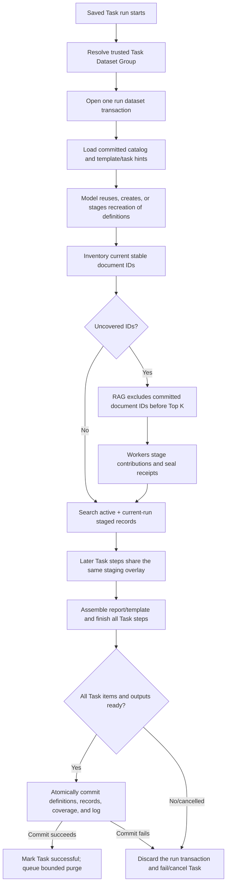

# Task Dataset Tool — Incremental, Task-Private Compiled Data

**Status:** Proposed 2026-08-24; product decisions updated 2026-08-25; Phases 1
through 9 implemented on `dev` through 2026-08-26.
**Primary objective:** Avoid repeating expensive document-to-structured-data
work when the same saved Task runs again against a silo whose stable document
IDs have already been processed.
**Applies to:** Saved Tasks, including saved Task items that generate DOCX from
an ingested template.
**Does not apply to:** Standalone Ask, standalone Extraction, template
ingestion by itself, or a template used outside a saved Task.

---

## 1. Executive Summary

The platform already makes the first retrieval step inexpensive: vector search
can locate a relevant table, section, or page quickly. The repeated cost appears
after retrieval. A model may need to read a large Markdown range, reconstruct a
complete table, normalize rows, reconcile fields, and assemble a JSON, CSV,
Markdown, or DOCX deliverable. A saved Task that runs again often repeats that
work for every old source even when only one new document was added.

The proposed **Task Dataset Tool** makes that structured intermediate result
durable. It is always available to a verified saved Task run, although an
installation-level rollout flag may temporarily bypass it while the feature is
being proven:

1. Every `Task + silo + explicit project-or-no-project` scope owns a **Task
   Dataset Group**. All steps/items in that Task run share the group.
2. The group owns one or more logical dataset definitions created by the model
   when they will make future runs more efficient.
3. Each definition describes what one record means, why it is being stored,
   its JSON schema, how records are identified and deduplicated, which fields
   are searchable, and how source documents should be evaluated.
4. The service inventories stable document IDs in the current source scope and
   compares them with document coverage already committed for each dataset.
5. Already-covered document IDs require no RAG search and no model formatting.
6. When `rag_search` receives the Task Dataset ID, retrieval excludes document
   IDs already committed for that dataset before ranking and Top K. Its
   response lists the excluded documents without page detail and links newly
   returned documents to one dataset-search receipt.
7. Newly seen document IDs are claimed and processed, optionally by multiple
   swarm workers in parallel.
8. Removed sources have their contributions withdrawn without asking a model
   to rediscover the deletion.
9. All definitions, records, document coverage, receipt seals, and
   withdrawals written during a Task run remain staged. Later steps in the
   same run can read that staging overlay, but future runs cannot.
10. Only successful completion of the entire Task atomically publishes its
    staged dataset transaction. Failure or cancellation discards it, so a
    partial run can never cause future RAG exclusion.
11. Once the run-local view is complete, the report or template is populated
    from indexed dataset records. Exact, full-text, filtered, and planned
    semantic/vector reads keep even very large datasets useful.

The persistent store should be Supabase Postgres `jsonb`, not one JSON object or
one generated JSON file. The model experiences a coherent JSON dataset through
the tool, but the database stores records, source contributions, document-ID
coverage, run transactions, provenance digests, revisions, and search indexes
separately. That is the difference between a cache that becomes slower and more
fragile as it grows and a durable incremental data product.

The recommended model-facing surface is one fixed `task_dataset` tool with an
operation discriminator. It presents the current Task Dataset Group's catalog
while avoiding one additional function tool per dataset. Dataset descriptions
are included in the saved-Task runtime context, so a returning model sees what
has already been compiled before it decides to search source documents.

Its tool instructions should explicitly encourage use for expensive or
multi-stage retrieval: large tables, repeated RAG searches, whole-section
reads, reconciliation, normalization, and other high-effort retrieval that
would otherwise be repeated. The preferred loop is “read the dataset catalog,
query the dataset first, pass its ID to RAG to discover only uncovered
documents, save the delta, then finish the Task.”

---

## 2. Problem Statement

Consider a Task that produces a recurring capital-project report:

- The first RAG search finds references to projects, budgets, milestones, and
  risks.
- A follow-up search locates the relevant table in each monthly report.
- The model reads full Markdown ranges because table rows cross chunk
  boundaries.
- It converts each row into a normalized project record.
- It reconciles project names, dates, amounts, and status wording.
- It formats those records into the requested report or template.

On the first run, that work is necessary. If the silo contains 50 source
documents, all 50 may need to be interpreted.

On the second run, the silo may contain the same 50 documents plus one new
monthly report. The useful delta is one document, but a stateless extraction
can repeat interpretation and formatting for all 51. Runtime and model usage
therefore grow with the corpus rather than with the change.

The desired cost curve is:

```text
Current repeated extraction:
  work(run n) ~= every eligible document currently in scope

Task Dataset:
  first run  ~= every eligible document
  later run  ~= newly seen + newly in-scope document IDs
  no-change  ~= inventory + indexed dataset reads + final rendering
```

Vector retrieval speed alone cannot produce this curve. The platform needs
durable knowledge that one Task Dataset has already incorporated a stable
document ID. Re-ingesting a document under the same ID does not make it new;
an intentional dataset reset is required to reconsider it.

---

## 3. Goals

The first implementation should satisfy all of the following.

### 3.1 Reuse

- Reuse structured data across runs of the same saved Task.
- Perform no source-document search or reformatting when every relevant source
  is already covered and the dataset definition is still compatible.
- Refresh only newly seen, newly in-scope, or deliberately reset sources.

### 3.2 Isolation

- Keep data private to one saved Task.
- Keep definitions and records private to one silo and either one selected
  project or the explicit no-project/whole-silo scope.
- Never allow a project-scoped run to read a silo-wide dataset containing
  documents outside that project.
- Never expose task datasets to standalone Ask or Extraction.

### 3.3 Multiple coherent datasets

- Let one Task Dataset Group own multiple datasets.
- Require a meaningful description for every dataset.
- Let the model split record types when their identities, schemas, update
  rules, or search patterns differ.
- Give returning runs a catalog that explains each existing dataset before
  source retrieval begins.
- Let all Task steps/items in the same Task Dataset Group create, populate, and
  query the same datasets.

### 3.4 Scale

- Store individual indexed JSONB records, not a monolithic JSON body.
- Support bounded reads, projections, filters, full-text search, exact identity
  lookup, source lookup, semantic/vector retrieval, and continuation-based
  paging.
- Support large data volumes without moving the entire dataset into model
  context.

### 3.5 Correctness

- Track stable source document IDs for coverage, plus file/Markdown digests for
  evidence and diagnostics rather than automatic invalidation.
- Preserve source/page/range evidence for cached facts.
- Withdraw contributions from a source that is deleted or leaves project
  scope.
- Surface conflicting contributions rather than silently choosing one.
- Preserve when each contribution entered the dataset and the source
  document's own date when available.

### 3.6 Parallelism and recovery

- Permit swarm workers to process independent source documents concurrently.
- Prevent two workers from corrupting the same source contribution.
- Make writes idempotent across retries.
- Fence writes from a stale run after a clear, recreation, task deletion, or
  definition change.
- Resume abandoned work after a bounded lease expires.
- Publish all writes for one Task run atomically, while allowing later steps in
  that same run to read the staged overlay.

### 3.7 Lifecycle and operations

- Provide APIs to inspect definitions, coverage, counts, and recent use.
- Provide explicit APIs to clear one dataset or the current Task Dataset Group,
  including definitions, records, coverage, receipts, and indexes.
- Make the next Task run recreate the cleared design and rebuild from scratch.
- Remove all related definitions and data when the saved Task is deleted.
- Record enough telemetry to prove that work was reused.
- Show asynchronous Task deletion state and purge progress clearly in the UI.

### 3.8 Template integration

- Extend template analysis with persistent-data suggestions when a template
  has repeated, expensive, stable retrieval needs.
- Keep those suggestions inert during standalone generation.
- Use them only when the template is selected within a saved Task.
- Cache semantic facts or Agent Data, not the presentation-owned DOCX package.
- Support an optional authoring hint such as
  `task-dataset: store grant item data`, while still allowing the template
  analyzer to propose useful datasets when no hint exists.

---

## 4. Non-Goals

The first version is not:

- a replacement for document RAG;
- a second copy of Federated Data;
- a globally shared cache across Tasks;
- a permanent memory available to Ask;
- one JSON file in Supabase Storage;
- a general-purpose arbitrary SQL or JSONPath endpoint;
- an uncontrolled semantic vector index over every dataset field (curated
  dataset-record vector search is a planned capability);
- an external data synchronization platform;
- a guarantee that model-authored facts are correct without source evidence;
- an automatic fuzzy merge system;
- an audit history of every intermediate token or chain of thought;
- a reason to persist sensitive source data beyond the Task and silo boundary;
- a way for template ingestion to create data without knowing a Task and silo.

Cross-Task reuse is deliberately excluded. Two Tasks may ask similar questions
but apply different definitions, transformations, identities, and reporting
rules. Sharing compiled records implicitly would make invalidation and
provenance ambiguous. Cross-Task sharing would require a separate future
proposal and is not part of this roadmap.

---

## 5. Fit With the Current System

The proposal builds on existing capabilities but is not equivalent to any one
of them.

| Existing capability     | Lifecycle                                    | Scope                               | Useful precedent                                                                             | Why it is not the Task Dataset                                                                                 |
| ----------------------- | -------------------------------------------- | ----------------------------------- | -------------------------------------------------------------------------------------------- | -------------------------------------------------------------------------------------------------------------- |
| `cache_file`            | One model run; cleared on success or failure | Ask or Extraction run               | Incremental JSON editing, revisions, owner-labelled swarm slots, publish without re-emitting | It intentionally disappears and has no document coverage                                                       |
| Generated JSON file     | Durable output artifact                      | Silo/run provenance                 | Storage, download, stable file IDs                                                           | Rewriting or reading one huge file is not indexed record storage and cannot safely accept parallel appends     |
| Federated Data          | Durable canonical registry                   | Shared definition; per-silo entries | Dynamic tool resolution, paging, lookup, atomic IDs, model write safety                      | It represents stable real-world identities across unrelated runs, not source-derived state private to one Task |
| Document RAG            | Durable source index                         | Silo/project/document               | Fast vector/keyword retrieval and exact Markdown ranges                                      | It retrieves evidence but does not remember the Task-specific normalized interpretation                        |
| Saved Task              | Durable workflow definition                  | Run selects silo/project            | Sequential item snapshots, background execution, cancellation, status, webhook provenance    | It currently recreates every Extraction item without durable compiled facts                                    |
| Template execution plan | Durable, digest-pinned generation plan       | Template version                    | Search-plan consolidation, dependency ordering, semantic Agent Data                          | It describes what a template needs but currently has no Task-specific persistent data store                    |

### 5.1 Current code paths this proposal extends

- [`apps/web/src/lib/extraction-tasks.ts`](../../apps/web/src/lib/extraction-tasks.ts)
  creates Task runs, snapshots ordered Task items, and executes them.
- [`apps/web/src/app/api/extraction-tool/route.ts`](../../apps/web/src/app/api/extraction-tool/route.ts)
  resolves the selected silo/project and starts the Extraction model loop for
  standalone and Task-driven extraction.
- [`apps/web/src/lib/extraction-model-execution.ts`](../../apps/web/src/lib/extraction-model-execution.ts)
  dispatches fixed tools, Template Group tools, Federated Data tools, and the
  Swarm Tool.
- [`apps/web/src/lib/model-tools.ts`](../../apps/web/src/lib/model-tools.ts) and
  [`apps/web/src/lib/rag-retrieval.ts`](../../apps/web/src/lib/rag-retrieval.ts)
  enforce tenant/silo/project/document retrieval scope.
- [`apps/web/src/lib/swarm-runtime.ts`](../../apps/web/src/lib/swarm-runtime.ts)
  provides the current bounded parallel-worker model.
- [`packages/rag-core/src/agent-workspace.ts`](../../packages/rag-core/src/agent-workspace.ts)
  establishes revision-checked writes and ready handoffs for transient slots.
- [`apps/web/src/lib/federated-data-tool.ts`](../../apps/web/src/lib/federated-data-tool.ts)
  is a precedent for model-facing pagination, bounded reads, search, and
  recoverable tool errors.
- [`docs/Templates/template_execution_plan_spec.md`](../Templates/template_execution_plan_spec.md)
  defines retrieval plans, segment dependencies, and digest-pinned template
  execution.
- `documents`, `document_files.sha256`, `document_markdown`, and project
  memberships provide most of the source identity and scope information needed
  for inventory.

### 5.2 Important current behavior

Saved Task definitions are tenant-owned and are not bound to a silo. A Task run
selects one silo and optionally one project. Task Dataset definitions therefore
belong inside the exact run-scope group rather than directly under the reusable
Task definition. The minimum safe namespace is:

```text
tenant_id
  + task_id
  + silo_id
  + project_id or explicit silo-wide marker
  + task_dataset_group_id
  + dataset_id
```

The project component is not optional in the data model merely because it is
optional in the run request. A null project means “the complete silo,” not
“unknown project.”

---

## 6. Product Model And Terminology

```text
Tenant
  └── Saved Task
        └── Task Dataset Group
              ├── silo
              ├── explicit whole-silo or one project scope
              ├── active publication generation
              ├── Task Dataset Definition(s)
              │     ├── description and record semantics
              │     ├── JSON schema and identity/search/vector policy
              │     └── document-ID coverage
              ├── Task Run Dataset Transaction(s)
              │     └── staged definitions, contributions, and coverage
              └── Materialized Record
                    ├── JSONB payload
                    ├── deterministic identity
                    ├── conflict state and dated source variants
                    └── one or more source contributions
```

### 6.1 Task Dataset Group

The complete isolation and sharing boundary identified by:

```text
tenant + saved Task + silo + (explicit whole-silo | project)
```

A different Task, silo, project, or whole-silo selection receives a different
group and cannot read the first group's definitions or records. All steps/items
inside one Task run share its group. This makes it practical for step 1 to
compile data and step 2 to write a report from it.

### 6.2 Task Dataset Definition

A logical, group-owned description of one kind of durable record. Examples:

- `capital_projects`;
- `grant_awards`;
- `department_metrics`;
- `template_agent_data`.

It says what one record represents, which evidence is relevant, how to derive
an identity, which JSON shape is legal, and which fields may be searched or
filtered.

### 6.3 Source Snapshot

The fact that one stable document ID was evaluated for one dataset definition
and active publication generation. A snapshot can be:

- `pending`;
- `claimed`;
- `processing`;
- `sealed`;
- `committed`;
- `not_applicable`;
- `failed`;
- `superseded`;
- `removed`.

`not_applicable` is first-class coverage only after its Task transaction
commits. If a new invoice is unrelated to a capital-project dataset, the
relevance gate records that decision so the next run does not reconsider the
same document ID.

File and canonical-Markdown digests are retained on the snapshot for evidence,
audit, and debugging, but they do not define RAG exclusion. Re-ingesting the
same document ID leaves it covered until the dataset/group is explicitly
cleared or the model stages a full recreation.

### 6.4 Task Run Dataset Transaction

The staging boundary shared by every item and swarm worker in one saved Task
run. It owns proposed definitions, dataset recreations, contributions,
document dispositions, receipt seals, and removals. Its states are
`open`, `sealed`, `committed`, `discarded`, and `commit_failed`.

Only a successful Task may commit it. A failed or cancelled Task discards it.
Reads by later items in the same run use an active-plus-staging overlay; all
other runs see only the last committed generation.

### 6.5 Contribution

One source-owned candidate record. Contributions are staged during processing
and become visible to the current Task run only when that staged source is
sealed. They become durable for future runs only when the Task transaction
commits. Keeping
contributions separate allows the system to:

- remove one source without deleting a logical record supported elsewhere;
- retain conflicting source values;
- prove which documents produced a materialized record.

### 6.6 Materialized Record

The searchable logical record presented to the model. It is deduplicated from
one or more contributions according to the definition's identity rules.

### 6.7 Generation

A visibility and write-fencing number on the Task Dataset Group. A committed
Task run advances it. Clear/recreation operations invalidate it. A write
captured under generation 4 cannot appear after an operator clears the group or
another run commits generation 5.

---

## 7. Key Architectural Decisions

### D1 — Postgres JSONB rows, not a JSON file

One large JSON value creates the worst properties for this problem:

- every append rewrites or reserializes a growing object;
- two workers cannot update it without locking or lost writes;
- searching requires loading or repeatedly scanning the blob;
- one malformed write can invalidate the whole file;
- source-level withdrawal and conflict tracking are unnatural;
- page reads still require parsing the complete body somewhere.

The durable unit is a JSONB record plus relational metadata. The tool provides
the JSON-dataset mental model.

### D2 — One fixed Task Dataset Tool

Federated Data reasonably creates one model tool per registry because each tool
is a curated, independently assigned product object. Task datasets are dynamic
and a complex Task may own several. Adding a native function per dataset would
inflate every provider call and make schema changes harder.

Use one `task_dataset` tool with `op` and `datasetKey` arguments. Inject a compact
catalog of names, descriptions, readiness, record counts, and definition
revisions into the saved-Task model context.

### D3 — Definitions and data belong to a Task Dataset Group

A Task can run in different silos and projects, but each exact
Task+silo+project-or-whole-silo combination receives a separate group,
definition catalog, and data. This permits definitions to reflect local
nuances and makes clearing a group a complete reset. Project runs never reuse
whole-silo definitions or records implicitly.

### D4 — Server inventory is authoritative

The model should not infer newness by listing filenames. The server enumerates
eligible stable document IDs in the trusted tenant/silo/project scope,
compares them with committed source snapshots, and returns the delta. Content
digests are diagnostic metadata, not the newness key.

### D5 — Relevance is explicit coverage

“New file” does not mean “relevant file.” The inventory identifies candidates;
a cheap metadata/vector relevance gate or an explicit all-in-scope policy
decides whether each candidate requires semantic extraction. An unchanged
irrelevant source is recorded as `not_applicable`.

### D6 — The Task run is the publication transaction

Workers do not directly mutate the canonical record set while reading a
document. They write contributions associated with their run and claim. A
source sealing only makes that source readable inside the run. Later steps in
the same Task can read the sealed overlay, but future runs cannot exclude or
reuse it until the entire Task succeeds and one server-owned commit publishes
all run changes atomically. Failure discards the staging transaction and leaves
the previous committed dataset untouched.

Publication should be a small visibility/manifest transaction over rows that
were already written and indexed in staging, not a replay or copy of the full
dataset. This keeps final commit cost proportional to definitions and logical
records affected by the delta rather than total historical dataset size.

### D7 — Deterministic identity first

Automatic deduplication uses definition-owned JSON pointers or exact canonical
payload hashes. Fuzzy similarity may surface candidates, but it does not merge
records by itself.

### D8 — Provenance travels with cached facts

Every contribution must name its stable source document ID, preserve the
observed source fingerprint for audit, and carry bounded
evidence locations such as page, table label, Markdown offsets, and an excerpt
hash. It also records `datasetAddedAt`/commit time and the source document's
declared/effective date when available. A report built without new RAG calls
remains auditable.

### D9 — Clear is generation-fenced

Clearing data is not implemented as “delete rows and hope no worker is still
writing.” It removes the selected dataset definition—or every definition in a
group—from the active catalog, advances the group generation, invalidates
leases, and queues bounded physical purge. The next run receives an empty
catalog and lets the model design the needed datasets again. Stale workers
receive an explicit error.

### D10 — Template ingestion emits suggestions, not Task data

A template version has no Task or silo. Its compiler may describe reusable
record sets that would accelerate recurring Task execution. The runtime binds
those suggestions to a Task Dataset only after a saved Task selects that
template.

### D11 — The model owns definition fitness and safe recreation

The model may create focused datasets on the first run and may later decide
that a definition is no longer sufficient. It does not mutate the active
definition in place or physically purge it during execution. Instead it stages
a complete recreation with a reason. The run rebuilds from every current
in-scope document ID, and successful Task commit atomically replaces the old
dataset; failed Task execution discards the recreation.

### D12 — Stable document ID is the RAG exclusion key

Once a document ID is committed as complete or not applicable for a dataset,
that ID remains excluded even if its file or Markdown is re-ingested. A user
who wants re-ingestion reconsidered clears/recreates the dataset. Digests remain
valuable for provenance and diagnostics, but do not silently change retrieval
behavior.

### D13 — Conflict variants stay visible and dated

Conflicting sources are preserved instead of collapsed by last-writer-wins.
The read result presents both variants, their document IDs, document dates when
available, and the time each variant was committed to the dataset. The model
may decide which is most current for the output without destroying evidence.

### D14 — Curated vector search is a planned core read path

Dataset definitions may declare a bounded semantic projection from selected
fields. The service embeds that projection and offers semantic or hybrid
record search. It never embeds arbitrary fields automatically, never crosses a
Task Dataset Group boundary, and keeps deterministic filters and provenance on
every result.

---

## 8. End-To-End Runtime



### 8.1 First run

1. The saved Task model always receives the Task Dataset tool and an empty
   catalog for this exact Task Dataset Group.
2. Its instructions explain that focused datasets should be used for expensive
   retrieval that is likely to be useful on future runs.
3. It interprets the Task steps and any selected template persistent-data
   suggestions or `task-dataset:` hints.
4. It stages one or more definitions, each with a required description of what
   is stored and why.
5. The service inventories all current ready document IDs in scope.
6. Each definition applies its source policy:
   - `all_in_scope` processes every eligible source; or
   - `relevance_gate` classifies candidates and records irrelevant ones.
7. Workers claim applicable sources and retrieval is fenced to those documents.
8. Workers stage schema-valid contributions and seal their claims/receipts.
9. Later Task steps query an active-plus-current-run overlay, allowing an early
   extraction step to feed later report steps.
10. The Task produces every requested deliverable.
11. Only after every Task item and output is otherwise ready does the
    coordinator commit the complete dataset transaction. That commit publishes
    the definitions,
    records, document-ID coverage, conflict variants, and transaction log
    together. The Task is marked successful only after this commit succeeds.

### 8.2 Unchanged second run

1. Inventory produces the same document-ID membership set.
2. The existing definitions remain adequate for the Task instructions.
3. Coverage is already committed.
4. No source claim is issued.
5. Dataset-aware RAG either is unnecessary or returns no old documents because
   exclusion happens before ranking.
6. The model pages, filters, full-text searches, or vector-searches the Task
   Dataset and renders the current output.

The run may still use RAG if the user explicitly asks for source verification
or asks for information outside every dataset's described coverage. That use is
an exception recorded in telemetry, not the default path.

### 8.3 One new document

1. Inventory reports one uncovered document ID and all old IDs covered.
2. Only the new document enters relevance evaluation.
3. Dataset-aware RAG excludes the committed IDs before Top K and returns only
   matching uncovered documents, together with a search receipt.
4. If applicable, the new source is claimed and processed.
5. Existing records are not regenerated.
6. New contributions are merged in the run overlay, conflicts are surfaced,
   and the final report reads the active-plus-staged view.
7. Task success commits the new records and coverage. Task failure discards
   both, so the same document is discoverable again on retry.

### 8.4 Re-ingested document with the same ID

A source file or its canonical Markdown can be re-ingested without changing its
stable document ID. This does **not** reopen coverage:

1. Inventory still sees that document ID as committed.
2. `rag_search(taskDatasetId)` continues to exclude it.
3. The recorded current file/Markdown digest may differ and is shown as a
   diagnostic, but it does not silently change dataset contents.
4. To reconsider the re-ingested content, an operator clears the dataset/group
   or the model stages a justified full recreation.

This deliberately favors predictable repeatability over automatic content
freshness. The same Task scope and committed document-ID set produce the same
compiled input until an explicit reset or a newly assigned document ID occurs.

### 8.5 Removed or out-of-project document

Membership comparison is sufficient; no model call is needed:

1. Stage a removal in the current run transaction.
2. Remove that source contribution from the run overlay.
3. Re-materialize identities that it supported.
4. Delete a materialized record only when no contribution still supports it.
5. Publish the withdrawal only if the whole Task succeeds; otherwise retain the
   prior committed dataset.

### 8.6 Model-requested dataset recreation

If later Task instructions, a template hint, or observed dataset quality show
that the current definition is insufficient, the model may call `recreate`:

1. provide a bounded reason and a complete replacement definition;
2. stage the replacement under the current Task transaction;
3. treat every current in-scope document ID as uncovered for that replacement;
4. build and validate it without mixing old and new definition semantics;
5. let later steps in the same run use the replacement overlay;
6. atomically swap it in only when the entire Task succeeds; and
7. queue the old definition/data for purge after commit.

The runtime instructs the model not to recreate a dataset for cosmetic output
changes, a new provider/model alone, or a single missing optional value.

### 8.7 Operator/API clear

An explicit clear:

1. removes one selected dataset definition and everything below it, or all
   definitions in the selected Task Dataset Group;
2. advances the group generation immediately;
3. invalidates old claims, receipts, transactions, embeddings, and cursors;
4. exposes an empty catalog for the cleared target;
5. queues physical cleanup of the removed framework; and
6. makes the next Task run ask the model to design and populate the datasets it
   now needs from scratch.

---

## 9. Source Inventory, Document Identity, And Dataset-Aware RAG

### 9.1 Eligible document set

For a whole-silo run:

- `documents.tenant_id` matches;
- `documents.silo_id` matches;
- `documents.status = 'ready'`;
- `documents.deleted_at is null`.

For a project run, the same conditions apply plus an active
`document_project_memberships` row for the selected project and silo.

The inventory must be performed server-side. The model never submits a list of
documents it is allowed to see.

### 9.2 Stable document identity and provenance digests

`documents.id` is the coverage and RAG-exclusion key. A dataset remembers that
the stable document was part of its completed build; it does not automatically
reopen that document when bytes, OCR, parser output, or canonical Markdown
change.

The implementation should still record the observed evidence digest:

```text
observedSourceFingerprint =
  sha256(
    document_id
    + original_file_sha256
    + canonical_markdown_sha256
  )
```

The current schema stores the original file SHA-256 in `document_files` and the
canonical Markdown in `document_markdown`, but not a persisted Markdown digest.
Adding `content_sha256` remains useful for provenance, debugging, duplicate
analysis, and operator warnings. It is not required for determining whether a
document is already covered.

Neither the observed fingerprint nor `documents.updated_at` changes coverage.
The UI may warn that the current observed digest differs from the one stored
when the dataset was built and offer the explicit clear/recreate action.

### 9.3 Scope membership identity

Project membership is not content. Inventory compares the current document-ID
set with committed coverage so a document entering or leaving a project becomes
a deterministic `new` or `removed` event for that group. The no-project group
and every project group are independent even when their document memberships
overlap.

### 9.4 Definition semantic digest

Each definition records a semantic digest for diagnostics, template-hint
matching, and recreation auditing:

```text
definitionSemanticDigest =
  sha256(canonical_json({
    datasetSchema,
    identityPolicy,
    searchableAndFilterablePaths,
    extractionInstructions,
    sourcePolicy,
    mergePolicy,
    systemContractVersion,
    relevantTaskContentDependency,
    templatePersistentDataDigest
  }))
```

Provider, model name, reasoning effort, Top K, and presentation layout are not
included. A digest mismatch does not partially reopen sources. The model must
either keep using the current definition or stage a complete recreation.

### 9.5 Relevance policy

Each dataset selects one:

| Policy                    | Behavior                                                                                                             |
| ------------------------- | -------------------------------------------------------------------------------------------------------------------- |
| `all_in_scope`            | Every eligible document must be processed or explicitly fail                                                         |
| `relevance_gate`          | Only uncovered document IDs are cheaply classified; applicable sources are processed, others become `not_applicable` |
| `explicit_document_types` | Metadata rules select MIME types, filename patterns, or document metadata before optional relevance search           |

The relevance decision is tied to dataset ID, publication generation, and
document ID. An explicit recreation produces a new dataset/generation and
reconsiders old `not_applicable` documents.

### 9.6 Retrieval fencing

Dataset-aware retrieval has two complementary filters:

1. **Exclusion/discovery.** A coordinator calls `rag_search` with a
   `taskDatasetId`. The server excludes document IDs already committed for the
   active dataset, then searches the remaining in-scope documents.
2. **Inclusion/processing.** During refresh, the dataset tool returns claim
   tokens tied to exact document IDs. RAG and exact-Markdown calls made by a
   worker are restricted to those claimed IDs through `sourceBatchId` or a
   single `documentId`.

The current `rag_search` contract accepts one optional `documentId`. The
implementation should add both `taskDatasetId` for exclusion/discovery and a
server-owned `sourceBatchId` for bounded inclusion/processing. A one-worker-per-
source path may continue to use `documentId`.

`sourceBatchId` is opaque, expires with the claim, and prevents a worker from
accidentally expanding its search back to the complete silo.

### 9.7 Dataset-aware RAG exclusion

The model-facing request is deliberately small:

```json
{
  "tool": "rag_search",
  "query": "capital project status and budget tables",
  "taskDatasetId": "task-dataset-uuid",
  "topK": 20
}
```

The runtime resolves the dataset's trusted Task Dataset Group, definition, and
active publication generation. The model does not provide any ownership or
scope values.

Suppose the scope contains A, B, C, and D. A previous completed dataset build
used B, C, and D. The vector/keyword/hybrid query must apply an indexed
anti-join against those committed document IDs **before similarity
ranking and Top K are calculated**:

```text
current scoped documents:       A, B, C, D
committed for dataset ID:          B, C, D
eligible retrieval candidates:  A
```

Filtering after Top K is incorrect. If B, C, and D occupy the first result
positions, a new relevant document X ranked immediately below them would never
surface. The exclusion must be part of the database candidate query.

If X is later added, the same request searches A and X. If X matches, ordinary
RAG chunks from X are returned. If nothing new matches, `results` is empty and
the response still explains which documents were excluded.

Coverage follows document identity:

- re-ingesting B under the same document ID leaves B excluded;
- uploading the revised material as a genuinely new document ID makes it
  searchable;
- clear or a staged full recreation makes every current document ID searchable
  for the replacement dataset;
- removed/out-of-project documents are outside the RAG scope independently;
- `pending`, `claimed`, `processing`, run-staged, and failed snapshots are not
  excluded for future/other runs;
- `not_applicable` may be excluded because the current recipe already evaluated
  that document ID and deliberately rejected it in a committed transaction.

Passing `taskDatasetId` with an explicit `documentId` still applies the
exclusion. If that document ID is committed, the result is empty and
the response identifies it as excluded. A caller performing deliberate
verification can omit `taskDatasetId` or use a future explicit
`includeCompletedDatasetSources` override that is recorded in telemetry.

### 9.8 RAG response and document-only summary

Dataset-aware RAG retains the normal result chunks, including page/range
evidence, but adds a separate document-only filter summary:

```json
{
  "results": [
    {
      "documentId": "document-x-uuid",
      "fileName": "August Progress Report.pdf",
      "pageNumber": 14,
      "text": "..."
    }
  ],
  "datasetFilter": {
    "taskDatasetId": "task-dataset-uuid",
    "definitionRevision": 3,
    "generation": 4,
    "mode": "exclude_completed_sources",
    "excludedDocumentCount": 3,
    "excludedDocuments": [
      { "documentId": "document-b-uuid", "fileName": "May Report.pdf" },
      { "documentId": "document-c-uuid", "fileName": "June Report.pdf" },
      { "documentId": "document-d-uuid", "fileName": "July Report.pdf" }
    ],
    "excludedDocumentsHasMore": false,
    "searchedUncoveredDocumentCount": 2,
    "returnedDocumentCount": 1,
    "returnedDocuments": [
      {
        "documentId": "document-x-uuid",
        "fileName": "August Progress Report.pdf"
      }
    ],
    "datasetSearchReceiptId": "receipt-uuid"
  }
}
```

`excludedDocuments` and `returnedDocuments` contain document identity only:
document ID, filename, and optional title. They intentionally contain no page
numbers, chunks, ranges, or excerpts. The normal `results` retain page-level
evidence because the model still needs it to build data from a newly returned
document.

For a large exclusion set, the inline list is bounded. The response always
returns the exact count and the first bounded page plus a continuation token or
`documentSummaryId`. The dataset's complete source-document summary is pageable
through the Task Dataset tool/API. It remains a document list, never a page
list.

### 9.9 Search receipts and safe completion

Appearing in a RAG result does **not** immediately make a document complete.
Otherwise a model could fail before saving the extracted data and the next run
would incorrectly exclude that source.

Every dataset-aware RAG call creates an immutable, run-scoped search receipt
inside the current Task dataset transaction containing:

- Task Dataset Group, dataset ID, definition revision, and generation;
- canonical query/request hash;
- unique returned document IDs and observed content fingerprints;
- created Task run/item and timestamp;
- seal/commit state.

The model tracks one `datasetSearchReceiptId` instead of reconstructing a
document list. When it saves the records built from those results,
`task_dataset.upsert_many` accepts the receipt ID. After all required work for
those results succeeds, `seal_search_receipt` seals the corresponding
source snapshots and document list inside the current run. It does **not** make
them reusable or excludable for a later run.

If exactly one compatible receipt is open for the dataset in the current run,
the runtime may attach it automatically. When compound or parallel searches
create several receipts, the model or coordinator must pass the intended
receipt explicitly.

Receipt sealing means the dataset definition's required extraction work for
those documents is done—not merely that one query was issued. A dataset with
several required retrieval questions must not seal the receipt until all
required facts have been staged or the source is explicitly marked not
applicable.

After every Task item and output succeeds, the coordinator commits the Task run
dataset transaction in one server-owned database operation. That commit makes
all sealed receipt document IDs eligible for later RAG exclusion. If any Task
item, model call, output persistence, or commit validation fails, the
transaction is discarded; its document IDs remain searchable on the next run.

This receipt is the simple bridge between `rag_search` and persistent dataset
coverage. No model-authored array of B, C, and D is trusted.

---

## 10. Dataset Definition Contract

Every dataset must have a durable definition. The saved-Task model normally
creates it from Task instructions, retrieval needs, and template hints; the
server validates the contract and owns its authoritative revision. The model
is instructed to create only datasets that are likely to avoid meaningful
future retrieval or formatting work.

### 10.1 Required fields

| Field                    | Purpose                                                                           |
| ------------------------ | --------------------------------------------------------------------------------- |
| `key`                    | Stable Task-local tool address such as `capital_projects`                         |
| `name`                   | Human-readable label                                                              |
| `description`            | Required model-facing explanation of what the dataset contains and when to use it |
| `recordSchema`           | Supported JSON Schema subset for one record                                       |
| `identityPolicy`         | How deterministic logical identity and deduplication work                         |
| `sourcePolicy`           | Which in-scope documents require evaluation                                       |
| `extractionInstructions` | What to extract and what not to infer                                             |
| `searchPolicy`           | Searchable, filterable, sortable, and summary JSON pointers                       |
| `semanticSearchPolicy`   | Optional bounded projection used to embed and vector-search records               |
| `mergePolicy`            | Default conflict behavior                                                         |

### 10.2 Description quality

The description must state:

1. what one record represents;
2. which Task outcome it supports;
3. which source evidence belongs;
4. which similar evidence does not belong;
5. the identity rule;
6. the important record fields;
7. whether coverage is all-in-scope or relevance-gated;
8. when a returning run should search this dataset instead of RAG;
9. why retaining it is expected to improve later Task runs.

Descriptions must be operational summaries written from the Task/template
contract, not verbatim source text. Source-derived content is untrusted data and
must not become persistent system instruction.

### 10.3 Example definition

```json
{
  "key": "capital_projects",
  "name": "Capital projects",
  "description": "One record per municipal capital project found in adopted plans and progress reports. Use this dataset for recurring project tables, totals, milestone summaries, and the capital-project sections of the Town Manager report. Do not store general policy goals without a named project. Identity is municipality plus project number when present, otherwise municipality plus normalized project name.",
  "recordSchema": {
    "type": "object",
    "required": ["municipality", "projectName"],
    "properties": {
      "municipality": { "type": "string" },
      "projectNumber": { "type": ["string", "null"] },
      "projectName": { "type": "string" },
      "department": { "type": ["string", "null"] },
      "status": { "type": ["string", "null"] },
      "budget": { "type": ["number", "null"] },
      "milestones": {
        "type": "array",
        "items": { "type": "string" }
      }
    },
    "additionalProperties": false
  },
  "identityPolicy": {
    "mode": "first_complete_rule",
    "rules": [
      ["/municipality", "/projectNumber"],
      ["/municipality", "/projectName"]
    ]
  },
  "sourcePolicy": { "mode": "relevance_gate" },
  "searchPolicy": {
    "searchablePaths": [
      "/projectName",
      "/department",
      "/status",
      "/milestones"
    ],
    "filterablePaths": [
      "/municipality",
      "/projectNumber",
      "/department",
      "/status"
    ],
    "sortablePaths": ["/projectName", "/budget"],
    "summaryPaths": ["/projectNumber", "/projectName", "/status", "/budget"]
  },
  "semanticSearchPolicy": {
    "enabled": true,
    "embeddingPaths": ["/projectName", "/department", "/status", "/milestones"]
  },
  "mergePolicy": { "mode": "preserve_conflicts" }
}
```

### 10.4 When to split datasets

Create separate datasets when records differ in one or more of:

- real-world identity;
- required JSON schema;
- source relevance policy;
- refresh or retention behavior;
- search/filter needs;
- conflict/merge semantics;
- template segments they serve.

Do not split merely because the final report has several headings. If grants,
budgets, and milestones are all attributes of the same project identity and
are refreshed from the same sources, one project dataset may be more coherent.
If grants have their own IDs and are reused independently, a separate grant
dataset is appropriate.

### 10.5 Definition revision and recreation

Minor metadata changes can create a revision without rebuilding, but a change
to record meaning, schema, identity, extraction, source, merge, or semantic
search policy requires a complete recreation. During a saved Task run the model
uses `recreate`, supplies the reason and full replacement contract, and rebuilds
every current document ID in a staging generation. The old definition remains
committed for other runs until Task success atomically replaces it.

A failed recreation never leaves the active dataset half-revised. A model or
provider change alone does not force recreation. The model may choose it when
the existing compiled data is demonstrably insufficient for the current Task.

### 10.6 Schema safety

Support a deliberately bounded JSON Schema subset:

- objects, arrays, strings, booleans, finite numbers, integers, and null;
- `required`, `properties`, `additionalProperties`, `items`, `enum`,
  `minLength`, `maxLength`, and numeric bounds;
- local `$defs`/`$ref` only if the validator can prove they are acyclic and
  bounded.

Reject remote references, executable formats, excessive depth, unbounded
recursive definitions, prohibited object keys, and schemas beyond the
configured byte limit.

---

## 11. Proposed Persistence Model

This is a relational design with JSONB payloads. Names are proposed and may be
adjusted during migration review, but group isolation and Task-run atomic
publication are required invariants.

### 11.1 `task_dataset_groups`

One group for an exact saved Task execution scope.

| Column                               | Notes                                                      |
| ------------------------------------ | ---------------------------------------------------------- |
| `id`                                 | UUID primary key                                           |
| `tenant_id` / `task_id`              | Ownership; Task deletion cascades through the group        |
| `silo_id`                            | Required silo                                              |
| `project_id`                         | Null is the explicit whole-silo/no-project group           |
| `active_generation`                  | Last committed publication generation                      |
| `state`                              | `empty`, `ready`, `publishing`, `deleting`, `purge_failed` |
| `record_sequence`                    | Atomic sequence for stable paging                          |
| counts                               | Definitions, documents, records, conflicts, staging, bytes |
| `last_used_at` / `last_committed_at` | Operational timestamps                                     |

Use partial uniqueness constraints so there is exactly one whole-silo group
per Task+silo and one group per Task+silo+project. Groups never share
definitions or records.

### 11.2 `task_dataset_definitions`

One logical definition per Task Dataset Group.

| Column                                              | Notes                                                   |
| --------------------------------------------------- | ------------------------------------------------------- |
| `id`                                                | UUID primary key and model-facing `taskDatasetId`       |
| `tenant_id`                                         | Tenant FK, cascade                                      |
| `group_id`                                          | Task Dataset Group FK; deletion removes the definition  |
| `key`                                               | Stable, unique within group                             |
| `name`                                              | Human label                                             |
| `description`                                       | Required model-facing description                       |
| `record_schema`                                     | JSONB                                                   |
| `identity_policy`                                   | JSONB                                                   |
| `source_policy`                                     | JSONB                                                   |
| `extraction_instructions`                           | Text                                                    |
| `search_policy`                                     | JSONB                                                   |
| `semantic_search_policy`                            | Bounded vector-search projection                        |
| `merge_policy`                                      | JSONB                                                   |
| `definition_revision`                               | Monotonic integer                                       |
| `semantic_digest`                                   | Server-generated SHA-256                                |
| `origin`                                            | `model`, `api`, `template_suggestion`, `task_directive` |
| `origin_template_id` / `origin_template_version_id` | Optional provenance                                     |
| `template_persistent_data_digest`                   | Optional semantic dependency                            |
| `created_transaction_id` / `committed_at`           | Publication provenance                                  |
| `state`                                             | `staged`, `active`, `superseded`, `deleting`            |
| timestamps                                          | Normal platform convention                              |

Constraints:

- unique active `(tenant_id, group_id, key)`;
- definition count per group bounded by a configurable safety limit;
- semantic digest is server-generated;
- description cannot be empty;
- policy JSON must validate before insert/update.

### 11.3 `task_dataset_run_transactions`

One atomic dataset publication transaction per Task run and group.

| Column                                                       | Notes                                                                     |
| ------------------------------------------------------------ | ------------------------------------------------------------------------- |
| `id`                                                         | UUID used internally by every staged write                                |
| `tenant_id` / `task_id` / `task_run_id` / `group_id`         | Trusted ownership                                                         |
| `base_generation` / `target_generation`                      | Optimistic publication boundary                                           |
| `state`                                                      | `open`, `sealed`, `committing`, `committed`, `discarded`, `commit_failed` |
| `dataset_mode`                                               | `auto`, `rebuild`, or rollout `bypass`                                    |
| `started_at` / `sealed_at` / `committed_at` / `discarded_at` | Lifecycle                                                                 |
| counts and manifest hash                                     | Definitions, documents, batches, records, removals, outputs               |
| `failure_code` / `failure_summary`                           | Bounded operational detail                                                |

The coordinator owns commit/discard; the model never calls it. A group-level
publication lease prevents two writing Task runs from committing incompatible
generations concurrently. Read-only reuse may continue while a writer stages.

### 11.4 `task_dataset_source_snapshots`

One dataset evaluation of one stable document ID.

| Column                                  | Notes                                            |
| --------------------------------------- | ------------------------------------------------ |
| `id`                                    | UUID                                             |
| `dataset_id` / `generation`             | Definition and publication generation            |
| `run_transaction_id`                    | Staging/publication owner retained as provenance |
| `document_id`                           | Nullable FK with a retained UUID/name snapshot   |
| `document_id_snapshot`                  | UUID value retained if source row is deleted     |
| `document_file_name` / `document_title` | Bounded provenance snapshot                      |
| `source_document_date`                  | Declared/effective source date when available    |
| `source_file_sha256`                    | Original source digest                           |
| `markdown_sha256`                       | Canonical Markdown digest                        |
| `observed_content_fingerprint`          | Combined diagnostic/evidence digest              |
| `state`                                 | State machine from `6.3`                         |
| `relevance_reason`                      | Why processed or ignored                         |
| `claim_token_hash`                      | Never store the bearer token itself              |
| `lease_owner` / `lease_expires_at`      | Parallel work claim                              |
| `attempts` / `last_error`               | Retry state                                      |
| `record_count` / `conflict_count`       | Completion summary                               |
| `created_run_id` / `committed_run_id`   | Provenance                                       |
| `dataset_added_at`                      | Derived from parent transaction commit time      |
| timestamps                              | Claim, sealing, completion, removal              |

Uniqueness prevents duplicate coverage for
`dataset + generation + document_id`. Fingerprints are deliberately absent from
the coverage key.

### 11.5 `task_dataset_search_receipts`

One immutable link between a dataset-aware RAG call and the stable document IDs
its result returned.

| Column                                                       | Notes                                                           |
| ------------------------------------------------------------ | --------------------------------------------------------------- |
| `id`                                                         | UUID returned as `datasetSearchReceiptId`                       |
| `tenant_id` / `task_id` / `task_run_id` / `task_run_item_id` | Trusted execution provenance                                    |
| `dataset_id` / `group_id` / `generation`                     | Dataset visibility boundary                                     |
| `run_transaction_id`                                         | Parent publication transaction                                  |
| `definition_revision`                                        | Definition compatibility                                        |
| `request_hash`                                               | Canonical RAG query/options hash                                |
| `state`                                                      | `open`, `sealed`, `committed`, `discarded`, `failed`, `expired` |
| `returned_document_count`                                    | Unique returned source count                                    |
| `created_at` / `completed_at` / `expires_at`                 | Lifecycle                                                       |

Receipt documents live in `task_dataset_search_receipt_documents`:

| Column                                 | Notes                                                                   |
| -------------------------------------- | ----------------------------------------------------------------------- |
| `receipt_id`                           | Receipt FK                                                              |
| `document_id` / `document_id_snapshot` | Current FK plus retained identity                                       |
| `file_name` / `title`                  | Document-only summary                                                   |
| `observed_content_fingerprint`         | Diagnostic/evidence digest                                              |
| `source_snapshot_id`                   | Pending/completed dataset source link                                   |
| `state`                                | `returned`, `staged`, `sealed`, `committed`, `not_applicable`, `failed` |

There is no page/chunk table for this summary. Page evidence belongs to record
contributions, not to the list used for RAG exclusion.

Sealed receipt rows become exclusion coverage only when the parent Task
transaction commits.

### 11.6 `task_dataset_contribution_batches`

A bounded, idempotent write batch.

| Column                                            | Notes                                  |
| ------------------------------------------------- | -------------------------------------- |
| `id`                                              | UUID                                   |
| `source_snapshot_id`                              | Owning claim                           |
| `run_transaction_id`                              | Parent publication transaction         |
| `idempotency_key`                                 | Worker/run supplied, unique per source |
| `payload_sha256`                                  | Detect same key with different bytes   |
| `record_count`                                    | Batch count                            |
| `status`                                          | `accepted` or `rejected`               |
| `task_run_id` / `task_run_item_id` / `worker_key` | Provenance                             |
| timestamps                                        | Audit and cleanup                      |

### 11.7 `task_dataset_contributions`

Staged or active source-owned records.

| Column                          | Notes                                       |
| ------------------------------- | ------------------------------------------- |
| `id`                            | UUID                                        |
| `source_snapshot_id`            | Source owner                                |
| `dataset_id` / `generation`     | Query and purge boundary                    |
| `run_transaction_id`            | Staging/publication owner                   |
| `logical_key`                   | Normalized identity input for diagnostics   |
| `dedupe_hash`                   | Server hash of canonical identity           |
| `payload`                       | Schema-valid JSONB                          |
| `payload_sha256`                | Canonical JSON digest                       |
| `evidence`                      | Bounded page/range/table/excerpt-hash array |
| `source_document_date`          | Document-declared/effective date            |
| `dataset_added_at`              | Derived from parent transaction commit time |
| `state`                         | `staged`, `active`, `superseded`            |
| `created_run_id` / `worker_key` | Provenance                                  |

Unique batch/item keys make retries idempotent.

### 11.8 `task_dataset_records`

The materialized, searchable logical view.

| Column                        | Notes                             |
| ----------------------------- | --------------------------------- |
| `id`                          | Immutable internal UUID           |
| `dataset_id` / `generation`   | Active namespace                  |
| `run_transaction_id`          | Current-run overlay when staged   |
| `record_seq`                  | Monotonic per dataset/generation  |
| `dedupe_hash` / `logical_key` | Identity                          |
| `payload`                     | Canonical or safely merged JSONB  |
| `payload_sha256`              | Change detection                  |
| `summary`                     | Small server-built projection     |
| `search_text` / `search_tsv`  | Configured searchable fields only |
| `conflict_state`              | `none`, `conflicted`, `resolved`  |
| `revision`                    | Optimistic concurrency number     |
| `source_count`                | Active contribution count         |
| timestamps                    | First/last seen and update        |

Indexes:

- unique `(dataset_id, generation, dedupe_hash)`;
- B-tree `(dataset_id, generation, record_seq)`;
- GIN on `search_tsv`;
- GIN `jsonb_path_ops` on payload only if measured workloads justify it;
- expression indexes for frequently filterable paths selected at definition
  creation, with a controlled maximum.

### 11.9 `task_dataset_record_embeddings`

The planned semantic-search index stores record/revision, embedding-policy
digest, model/dimensions, bounded server-built semantic-text digest, vector,
state, and timestamps. Queries always prefilter by tenant, group, dataset,
active-or-current-run generation, and deterministic filters before distance and
Top K.

Committed records may be embedded asynchronously. If step 2 needs vector search
over records staged by step 1, the runtime waits for a bounded run-local
embedding job or returns `semanticIndexPending` and lets the model use
full-text/filter search.

### 11.10 `task_dataset_record_resolutions`

Optional human/model-approved conflict resolution without overwriting source
facts:

- record ID and expected record revision;
- resolved payload;
- contributing payload hashes it resolves;
- Task run/operator provenance;
- state `active` or `stale`.

A resolution becomes stale when its contribution set changes.

This table can be deferred if first-version reads merely surface conflicts.

### 11.11 `task_dataset_run_usage` and commit log

One usage record per Task run item and dataset:

- inventory counts by document-ID delta kind;
- sources claimed/completed/ignored/failed;
- records read/written/reused/conflicted;
- dataset generation and definition revision;
- RAG calls fenced to refresh sources;
- dataset-aware RAG receipts, excluded document counts, and newly returned
  document counts;
- elapsed inventory/refresh/read time;
- whether the run committed, discarded, or failed publication;
- distinct source documents represented in the output;
- full-text/vector search use and embedding wait time.

The authoritative commit-log row is inserted in the same database transaction
that publishes definitions, records, coverage, and output provenance. A failed
or cancelled Task has a discarded staging transaction and no successful commit
entry.

### 11.12 `task_dataset_purge_jobs`

Bounded cleanup for cleared groups/definitions, discarded transactions,
superseded generations, and deleted Tasks. It avoids a request-time delete of
millions of rows. A purge job records target, generation range, status, counts,
cursor, attempts, heartbeat, and errors.

### 11.13 RLS and tenant consistency

Every table carries tenant identity and follows the existing service-role RLS
pattern. Database functions validate tenant consistency across Task, dataset,
silo, project, source, run, and run item. The model never supplies those
ownership fields.

---

## 12. Deduplication, Merge, And Provenance

### 12.1 Canonical identity

Identity is derived from one or more JSON pointers. For the first complete
identity rule:

1. read values in pointer order;
2. normalize by JSON type;
3. reject a rule with missing/empty required identity values;
4. encode a type-tagged canonical tuple;
5. hash it with the Task Dataset Group and dataset namespace.

Recommended normalization:

- Unicode NFKC;
- trim and collapse whitespace;
- case-fold strings unless a path is explicitly case-sensitive;
- normalize punctuation only when the definition opts in;
- encode integers and finite decimals canonically;
- encode dates only after schema validation;
- preserve boolean/null type identity.

### 12.2 Identity modes

| Mode                  | Use                                                                                                |
| --------------------- | -------------------------------------------------------------------------------------------------- |
| `first_complete_rule` | Prefer a stable code, fall back to a composite natural key                                         |
| `all_paths`           | All configured paths form one identity                                                             |
| `payload_hash`        | Exact canonical JSON dedupe only                                                                   |
| `source_local`        | Identity includes stable source document ID; no cross-document merge                               |
| `explicit_key`        | Model supplies a key, but server normalizes/hashes it and the definition explains its construction |

`explicit_key` should be a last resort. It is easier for two workers to apply
the same stored identity rule than to invent matching strings independently.

### 12.3 Write outcomes

For an incoming contribution:

- same source + same dedupe hash + same payload hash: idempotent no-op;
- same source + same dedupe hash + different payload: replace within the staged
  source snapshot, retaining the latest batch revision;
- different source + same dedupe hash + same payload: one materialized record,
  multiple provenance sources;
- different source + same dedupe hash + compatible fields: merge only according
  to an explicit deterministic policy;
- different source + same dedupe hash + conflicting fields: preserve both
  contributions and mark the logical record conflicted;
- no usable identity: reject the item with a recoverable error; do not invent a
  random identity that defeats future dedupe.

### 12.4 Safe default merge policy

`preserve_conflicts` is the default. The server may combine identical values
and unique array members when the schema/policy explicitly allows it, but it
must not silently apply “last writer wins” across two source documents.

Default reads return all conflicting variants with source document identity,
source document date when known, and dataset commit time. “Latest” is an output
decision for the model unless a deterministic field policy explicitly says
otherwise; preserving both variants is the stored-data decision.

Optional later field policies include:

- prefer non-null;
- union unique arrays by a nested identity;
- minimum/maximum numeric value;
- latest dated observation;
- authoritative source type;
- operator/model resolution with expected revision.

### 12.5 Evidence contract

Each contribution contains at least:

```json
{
  "documentId": "uuid",
  "observedDocumentFingerprint": "sha256",
  "sourceDocumentDate": "2026-07-31",
  "datasetAddedAt": "2026-08-25T14:30:00Z",
  "pageNumber": 14,
  "tableLabel": "Capital Improvement Program",
  "markdownStart": 48210,
  "markdownEnd": 49688,
  "excerptSha256": "sha256",
  "excerpt": "bounded optional evidence text"
}
```

Offsets or page numbers may be absent when a source format cannot provide them.
Document ID is required. The observed fingerprint is required when the source
pipeline can provide it, but it does not control coverage. `datasetAddedAt` is
server-assigned at successful Task commit, never supplied by the model.
Evidence excerpts are bounded and treated as untrusted source content.

`sourceDocumentDate` should be nullable and accompanied internally by a date
kind such as `document_effective_date`, `document_published_date`,
`document_metadata_date`, or `upload_date_fallback`. Prefer an explicit date
from trusted document metadata or clearly evidenced source content; never
invent one. Keeping the date kind prevents an upload timestamp from being
misrepresented as the date the source became effective.

### 12.6 Removed sources

Materialized records are derived from active contributions. Removing one
source:

- decrements source counts;
- rebuilds affected records;
- marks prior resolutions stale if their input set changed;
- deletes a record only when nothing still supports it.

This is why storing only the final merged JSON record is insufficient.

---

## 13. Concurrency And Swarm Safety

### 13.1 Claim protocol

Use an atomic database function with `FOR UPDATE SKIP LOCKED`:

1. select pending/expired source snapshots in a specific dataset, group,
   generation, and run transaction;
2. mark them `claimed`;
3. set lease owner and expiry;
4. return signed opaque claim tokens and source metadata.

One source snapshot has at most one valid lease within the Task run. Different
datasets or documents can be claimed independently by swarm workers.

### 13.2 Lease tokens

A claim token binds:

- tenant;
- Task and Task run;
- Task run item;
- Task Dataset Group and definition;
- generation and run transaction;
- source snapshot and stable document ID;
- worker key;
- expiry.

The database stores only a digest. Every staged write validates the token,
active Task, active run transaction, expected generation, stable document ID,
and lease. The observed fingerprint is validated as evidence metadata but is
not the coverage key.

### 13.3 Heartbeat and expiry

Long table extraction may exceed a short lease. Workers heartbeat through the
tool. Expired claims return to pending unless their source was sealed. A late
worker cannot complete after another worker reacquires the source because the
claim epoch/token changed.

### 13.4 Idempotent batched writes

`upsert_many` accepts a bounded batch and an idempotency key. The service hashes
canonical request content:

- same idempotency key + same hash returns the prior result;
- same key + different hash is an explicit conflict;
- accepted contributions remain staged until `seal_source`.

Partial item validation is reported per item. Correct items need not be
discarded, but source sealing fails until every required batch is resolved
or the worker explicitly finalizes with the accepted set.

### 13.5 Atomic source sealing

`seal_source` runs one small transaction that locks and validates the
claim, validates batches, seals the source contribution for the current run,
updates the run-local materialized overlay, releases the lease, and appends
staging telemetry. It does not activate coverage for later runs.

After every Task item and output succeeds, the coordinator executes the one
publication transaction that validates all sealed sources/receipts, applies
removals and recreations, publishes materialized records and coverage, stamps
`datasetAddedAt`, writes the successful commit log, and advances the group
generation. Any failure rolls that publication back.

“Publishes” means changing server-owned visibility and head/manifest pointers
for already staged rows. It must not copy every unchanged record or rewrite a
million JSONB payloads at Task completion. `datasetAddedAt` can be exposed from
the parent transaction's `committed_at`. Only affected logical-record heads,
coverage entries, definitions, and group metadata need final mutation.

Generated files or other external artifacts are prepared before this database
commit but the Task does not enter terminal `succeeded` state until publication
succeeds. If publication fails, mark the Task failed and place any prepared but
unpublished artifact on the existing cleanup path; never report a successful
Task whose datasets did not commit.

### 13.6 Clear and stale writers

Clear locks the group, removes the selected definition/catalog entries from
visibility, advances generation, invalidates active transactions and claims,
and commits. Every writer carries its captured generation and transaction, so
a late write fails with `task_dataset_generation_changed`. It cannot recreate
cleared records.

### 13.7 Swarm assignment pattern

The coordinator should assign independent source claims:

```text
worker A -> dataset capital_projects -> document 1 claim
worker B -> dataset capital_projects -> document 2 claim
worker C -> dataset grant_awards    -> document 1 claim
```

Workers may stage many record batches, but they do not share an editable JSON
slot. The coordinator waits for sealed/failed claim states and then searches
the active-plus-run-staged materialized view.

### 13.8 Future parallel Task items

Current saved Task items execute sequentially, and all of them share the same
group and Task run dataset transaction. Definition proposals, source claims,
record materialization, and status writes are independently keyed so future
parallel Task items can share the overlay without clobbering each other. One
coordinator alone owns final commit/discard.

---

## 14. Task Dataset Tool Contract

### 14.1 Availability

The `task_dataset` tool is always offered when all of these are true:

- the execution belongs to an existing saved Task run;
- the Task run, run item, tenant, silo, and project have been verified
  server-side;
- the saved Task is active and not being deleted;
- the installation rollout flag is enabled;
- the run is not in `bypass` mode.

There is no per-Task opt-in and no requirement for an administrator to
pre-create definitions. `bypass` is a temporary operational escape hatch, not
the long-term product default. The model may choose not to create a dataset
when the work is truly one-off or too small to justify persistence.

A standalone Extraction request cannot enable it by sending a Task run UUID.
The internal extraction handoff must validate that the run item belongs to the
run, the run belongs to the Task, the request matches the snapshotted item, and
the silo/project match the authoritative run. Prefer a signed internal
execution-context token over trusting request-body linkage fields.

The model never supplies `tenantId`, `taskId`, `siloId`, or `projectId` to this
tool.

The model-facing instructions should say, in substance:

> Use Task Datasets to retain structured facts produced by expensive,
> multi-search, table, whole-section, reconciliation, or other high-effort
> retrieval. On later runs, inspect and search the dataset first. Pass its
> Task Dataset ID to RAG so already committed document IDs are excluded before
> ranking. Save and seal only complete data. You may create several focused
> datasets, and you may stage a full recreation when an existing design is no
> longer sufficient.

This guidance encourages the optimization without forcing the model to cache
transient prose or low-value intermediate output.

If the product prompt uses the term **ultra retrieval**, define it here as
retrieval that combines several searches, large table/section reads,
normalization, reconciliation, or extensive formatting. Task Dataset is the
recommended persistence layer for the reusable structured result of that work,
used in conjunction with dataset-aware RAG rather than as a replacement for
RAG evidence.

### 14.2 Catalog context

At model start, the runtime supplies a compact catalog:

```text
Task Datasets for this exact Task + silo + project-or-whole-silo group:

- capital_projects (ready, definition r3, generation 4, 18,420 records)
  One record per municipal capital project ... Use before searching old source
  reports for project status, budget, milestones, or department.
  Coverage: 204 complete, 12 not applicable, 0 pending, 0 failed.

- grant_awards (refresh required, definition r1, generation 2, 812 records)
  One record per awarded grant ...
  Delta: 1 uncovered document ID, 203 covered.
```

Descriptions are delimited and labelled as stored operational metadata. Record
content and evidence are untrusted source data, never instructions.

If no definitions exist, the context says so and explains that the model should
create focused datasets when recurring high-effort retrieval will benefit. It
also presents validated template/task dataset hints, if any.

### 14.3 Operations

| `op`                  | Who normally calls it     | Purpose                                                                |
| --------------------- | ------------------------- | ---------------------------------------------------------------------- |
| `catalog`             | Coordinator               | List definitions and group readiness                                   |
| `create`              | Coordinator               | Stage a validated group-owned definition                               |
| `describe`            | Coordinator/worker        | Read one full definition, policies, coverage, and template origin      |
| `revise`              | Coordinator               | Stage a compatible metadata revision                                   |
| `recreate`            | Coordinator               | Stage a complete replacement definition and full rebuild with a reason |
| `inventory`           | Coordinator               | Refresh and return source delta                                        |
| `coverage`            | Coordinator               | Inspect ready/pending/failed/ignored counts and sources                |
| `source_documents`    | Coordinator/report author | Page through the dataset's completed document-only summary             |
| `claim_sources`       | Coordinator/worker        | Lease pending source snapshots                                         |
| `heartbeat`           | Worker                    | Extend a valid claim                                                   |
| `skip_source`         | Worker                    | Complete relevance as `not_applicable` with a reason                   |
| `upsert_many`         | Worker                    | Stage schema-valid, source-owned contributions                         |
| `seal_source`         | Worker                    | Seal one source in the current Task run overlay                        |
| `seal_search_receipt` | Coordinator               | Seal returned documents after their complete data is staged            |
| `fail_source`         | Worker                    | Record a recoverable/final failure                                     |
| `search`              | Coordinator/report author | Search active materialized records                                     |
| `list`                | Coordinator/report author | Enumerate records in stable pages                                      |
| `get`                 | Coordinator/report author | Fetch full payload/provenance for specific record IDs                  |
| `conflicts`           | Coordinator/report author | List or inspect conflicting identities                                 |
| `resolve_conflict`    | Optional later operation  | Add a revision-checked resolution layer                                |

The model tool exposes safe staged `recreate`, but not immediate clear, purge,
definition deletion, Task deletion, or run commit/discard. Those are
operator/API or coordinator actions.

### 14.4 `catalog`

Request:

```json
{ "op": "catalog" }
```

Response entries include:

- key, name, and description;
- definition revision and origin;
- schema summary rather than the entire schema;
- current group state and generation;
- record/conflict counts;
- committed, ignored, uncovered, removed, and failed document counts;
- recommended next operation;
- whether a template suggestion is available but not yet bound.

The model should call `describe` only for a dataset it will use or refresh.

### 14.5 `create`

Request includes the definition contract from `10`. The server:

- validates key uniqueness and tool-safe syntax;
- enforces definition/schema/policy limits;
- creates the definition inside the already verified group;
- generates revision 1 and the semantic digest;
- records model, Task run, Task item, and optional template-suggestion origin;
- returns the validated staged definition and empty coverage.

The response explicitly reminds the model that creating a definition does not
populate or publish it. A first-run definition disappears if the Task fails.

`recreate` accepts the complete definition contract plus a bounded rationale.
It stages a replacement dataset ID/generation, invalidates coverage only inside
the current run overlay, and requires all current documents to be reconsidered.
Successful Task commit swaps it in; failure retains the old committed dataset.

### 14.6 `inventory`

Request:

```json
{
  "op": "inventory",
  "datasetKey": "capital_projects"
}
```

Response:

```json
{
  "ok": true,
  "datasetKey": "capital_projects",
  "definitionRevision": 3,
  "generation": 4,
  "state": "refreshing",
  "delta": {
    "new": 1,
    "covered": 204,
    "removed": 0,
    "notApplicable": 12,
    "pending": 1,
    "failed": 0
  },
  "recommendedNext": "claim_sources"
}
```

Inventory is idempotent for the same group membership and committed dataset ID.
Re-ingestion under an existing document ID does not change this delta.

### 14.7 `claim_sources`

Request:

```json
{
  "op": "claim_sources",
  "datasetKey": "capital_projects",
  "limit": 8,
  "workerKey": "capital-refresh-a"
}
```

Response carries bounded source metadata, an opaque `claimToken`, an opaque
`sourceBatchId` for fenced retrieval, the current definition revision, and the
lease expiry. A claim never contains another group's documents.

### 14.8 `skip_source`

Used only after the defined relevance gate:

```json
{
  "op": "skip_source",
  "claimToken": "...",
  "reasonCode": "unrelated_document_type",
  "reason": "This document is a vendor invoice and contains no capital project status or budget table."
}
```

The reason is bounded and recorded. A worker may not skip an
`all_in_scope` dataset.

### 14.9 `upsert_many`

```json
{
  "op": "upsert_many",
  "claimToken": "...",
  "datasetSearchReceiptId": "receipt-uuid",
  "idempotencyKey": "page-14-table-1-batch-2",
  "records": [
    {
      "payload": {
        "municipality": "Example Town",
        "projectNumber": "CIP-104",
        "projectName": "Main Street Improvements",
        "status": "In construction",
        "budget": 2500000,
        "milestones": ["Substantial completion expected September 2026"]
      },
      "evidence": [
        {
          "pageNumber": 14,
          "tableLabel": "Capital Improvement Program",
          "markdownStart": 48210,
          "markdownEnd": 48690,
          "excerptSha256": "..."
        }
      ]
    }
  ]
}
```

The response reports each item independently:

- accepted and staged;
- idempotent replay;
- schema error;
- missing identity;
- same-source identity collision;
- payload/byte/depth limit;
- stale claim/generation;
- definition revision mismatch.

It also returns derived logical keys/dedupe hashes in a bounded diagnostic form
so the worker can correct identity mistakes without controlling the hash.
`datasetSearchReceiptId` is optional when a lower-level source claim already
provides the link, or when exactly one compatible open receipt can be attached
unambiguously by the runtime. It is never replaced with a model-authored
document-ID list.

### 14.10 `seal_source`

Request:

```json
{
  "op": "seal_source",
  "claimToken": "...",
  "expectedBatchCount": 3
}
```

Response reports sealed, deduplicated, changed, removed, and conflicted record
counts plus remaining run-local coverage. A source may seal with zero
records only when the source policy allows “applicable but no matching
records,” and the worker provides a reason.

### 14.11 `seal_search_receipt`

This is the high-level run-local sealing operation for the simple
`rag_search(taskDatasetId) -> save dataset` path:

```json
{
  "op": "seal_search_receipt",
  "datasetKey": "capital_projects",
  "datasetSearchReceiptId": "receipt-uuid"
}
```

The server verifies that:

- receipt and dataset belong to the current Task run/group/transaction;
- generation, definition revision, document IDs, and claims still match;
- every returned document has accepted staged data, an explicit zero-record
  completion, or a valid `not_applicable` disposition;
- no required batch is incomplete or failed.

It then seals those source snapshots and records the document-only summary in
the run transaction. If any document is incomplete, the response lists the
document IDs/names still pending and seals nothing. Only the coordinator's
successful end-of-Task commit promotes them for future reuse and RAG exclusion.

The operation exists so the model handles one receipt ID rather than B, C, and
D individually. Swarm processing may continue to use `seal_source` per
claim; the coordinator completes or reconciles the parent receipt when all
workers finish.

### 14.12 `source_documents`

Returns the exact document summary used by dataset-aware RAG exclusion:

```json
{
  "op": "source_documents",
  "datasetKey": "capital_projects",
  "pageSize": 200
}
```

```json
{
  "documents": [
    {
      "documentId": "document-b-uuid",
      "fileName": "May Report.pdf",
      "title": "May Capital Progress Report"
    }
  ],
  "documentCount": 204,
  "page": 1,
  "returned": 200,
  "hasMore": true,
  "nextCursor": "..."
}
```

It has no page numbers, source chunks, offsets, or excerpts. The summary exposes
only document identity. Advanced diagnostics may show observed digests and
whether they now differ, but coverage remains keyed by document ID.

### 14.13 `search`

Search is for targeted dataset retrieval, not arbitrary JSON execution:

```json
{
  "op": "search",
  "datasetKey": "capital_projects",
  "mode": "hybrid",
  "query": "bridge projects in construction",
  "where": [
    { "path": "/department", "op": "eq", "value": "Public Works" },
    { "path": "/budget", "op": "gte", "value": 1000000 }
  ],
  "select": ["/projectNumber", "/projectName", "/status", "/budget"],
  "pageSize": 100
}
```

The definition allowlists paths and operations. The server rejects:

- undeclared filter/sort paths;
- unbounded regular expressions;
- caller-supplied SQL;
- arbitrary JSONPath;
- cross-dataset joins;
- a projection that exceeds response budgets.

Search results include record ID, revision, projected payload/summary, conflict
state, source count, source/document dates, evidence summary, semantic score
when applicable, and a continuation token. `mode` supports `text`, `semantic`,
or `hybrid` when the definition enables semantic search; exact filters are
applied before vector Top K.

### 14.14 `list`

Use when the final output genuinely needs every record:

```json
{
  "op": "list",
  "datasetKey": "capital_projects",
  "select": ["/projectNumber", "/projectName", "/status", "/budget"],
  "pageSize": 200
}
```

The response has `page`, `returned`, `hasMore`, `nextCursor`, active generation,
and snapshot watermark. The model echoes `nextCursor`; it does not construct or
edit it.

### 14.15 `get`

Fetches full payload and provenance only for selected internal record UUIDs.
It accepts a small bounded list and applies a total response byte budget.
Descriptions, evidence excerpts, and conflict variants are not returned
incidentally by `list`.

### 14.16 Recoverable errors

Argument, validation, policy, stale claim, and conflict errors return:

```json
{
  "ok": false,
  "error": {
    "code": "task_dataset_generation_changed",
    "message": "This dataset was cleared or rebuilt after the worker claimed its source. No records were written. Refresh the catalog and do not retry with the old claim."
  }
}
```

The model can correct these without failing the entire Extraction loop.
Database unavailability, tenant-scope inconsistency, or corruption remains a
fatal execution error.

---

## 15. Search, Paging, And Large-Dataset Behavior

### 15.1 Why bounded projections matter

A million JSON records can be useful without ever fitting into one model
context. The report author should request only fields used by the current
section and should use aggregates or filtered searches when possible.

Every read has three independent bounds:

- record count;
- serialized byte count;
- model-tool-result character count.

Reaching a bound is explicit and returns continuation guidance; it is never
silent truncation.

### 15.2 Cursor design

Offset page numbers become progressively expensive and unstable on massive
datasets. Use keyset cursors internally while returning human/model-readable
page metadata:

```text
cursor payload (signed/opaque):
  Task Dataset Group and dataset ID
  active generation
  current run transaction ID when reading its staging overlay
  snapshot max record_seq
  query/filter/projection hash
  sort definition
  last sort values
  last record UUID
  page number
  expiry
```

A cursor fails if used with another group, dataset, generation, run overlay,
query, filter, projection, or sort. Clear/recreation therefore invalidates old
cursors naturally.

### 15.3 Snapshot behavior

The first page captures the maximum visible `record_seq` in either the committed
view or the current Task's active-plus-staging overlay. Later pages exclude
records inserted after that boundary. Another run never sees uncommitted rows.

For an exact export, the server can create a short-lived export snapshot or
generated file asynchronously rather than hold a database transaction across
model turns.

### 15.4 Search modes

Required base modes:

- exact logical-key/dedupe lookup;
- internal record UUID lookup;
- full-text search over configured paths;
- safe JSON field filters;
- source document-ID filter, plus optional observed-digest diagnostics;
- conflict state;
- created/updated run filter;
- allowlisted sorting.

Planned Goldilocks mode, designed into the contract and schema from the start:

- semantic vector search over a deliberate, bounded record projection;
- hybrid full-text + vector retrieval;
- deterministic JSON/source/conflict filters applied before vector Top K;
- current-run overlay support so a later Task step can retrieve data compiled
  by an earlier step.

Possible later additions:

- trigram search over selected short text paths;
- precomputed dataset aggregates;
- cross-dataset references within the same Task scope.

Vector search complements rather than replaces deterministic reads. Known
identities, totals, and precise fields should still use exact filters; semantic
or hybrid search is valuable when a later Task step needs the most relevant
subset of a very large compiled dataset.

### 15.5 Index budget

Definitions must not create unlimited database indexes. Set an installation
limit for:

- searchable text paths;
- filterable expression-index paths;
- sortable paths;
- total indexes per dataset;
- semantic embedding paths, text bytes, dimensions, and vector indexes;
- schema and payload size.

If a requested path is not indexed, the API may refuse it at scale rather than
allow an unbounded sequential scan.

### 15.6 Aggregates

Reports often need counts, sums, min/max, and grouping. Pulling every record
only to sum a budget defeats the fast path. A later `aggregate` operation is
strongly recommended:

```json
{
  "op": "aggregate",
  "datasetKey": "capital_projects",
  "groupBy": ["/department"],
  "measures": [
    { "op": "count", "as": "projects" },
    { "op": "sum", "path": "/budget", "as": "totalBudget" }
  ]
}
```

Only schema-declared numeric/groupable paths are allowed. This may be included
in the first implementation if recurring templates already require it.

---

## 16. Saved Task Integration

### 16.1 Task-run creation

Extend the saved Task run request with an optional policy:

| `datasetMode` | Behavior                                                                                          |
| ------------- | ------------------------------------------------------------------------------------------------- |
| `auto`        | Default. Reuse ready data, inventory, and refresh only the delta                                  |
| `reuse_only`  | Use committed datasets but perform no source refresh; fail if required document IDs are uncovered |
| `rebuild`     | Ask the model to stage fresh definitions and rebuild every current document ID                    |
| `bypass`      | Do not resolve Task Dataset capability; preserve current stateless behavior                       |

The long-term default is always `auto`; there is no Task opt-in. The
installation feature flag may temporarily force `bypass` during rollout. The
run snapshots effective policy in `requested_config` so a later configuration
change cannot rewrite history.

Each saved Task item also has an independent `strictTaskDataset` Boolean,
defaulting to `false`. This is not another dataset mode and does not alter the
Task+silo+project group boundary. It controls whether that particular step may
finish without using the always-available tool:

- `false`: preserve model-directed behavior; the model may use the catalog and
  decide no durable compilation is useful for this step;
- `true`: require at least one successful, meaningful Task Dataset operation,
  including inventory, reuse/search, applying a trusted template suggestion,
  definition creation/recreation, or record staging;
- catalog or describe-only calls do not satisfy strict mode;
- after bounded corrective reminders, an unsatisfied strict step fails; and
- because all steps share one transaction, that failure discards the entire
  run's staged dataset work rather than publishing an incomplete cache.

The value is stored with the Task item and copied into the immutable Task run
item snapshot. A Task edit made after run creation therefore cannot weaken or
strengthen an in-flight step. Strict mode is available only through a verified
saved Task execution; a standalone Extraction request cannot grant itself this
authority.

Run creation resolves exactly one Task Dataset Group from the Task, silo, and
explicit project-or-whole-silo selection and opens one dataset transaction
shared by every Task item.

### 16.2 Trusted execution context

Before an Extraction item receives the tool, resolve:

- authoritative tenant;
- Task and Task run;
- snapshotted Task run item;
- silo and project;
- Task Dataset Group and shared run transaction;
- dataset mode;
- definition catalog and group ID;
- generation/readiness state.

The current internal call includes `taskRunId` and `taskRunItemId`. The new
feature makes strict validation mandatory because those fields would otherwise
become a path to durable Task-private state.

### 16.3 Preflight location

Existing definitions should be inventoried at Task-run start so the run status
can show useful counts before the first item. Template and Task instruction
hints are gathered at the same point. A Task item may create or recreate a
definition later; that work joins the same run transaction and triggers
inventory lazily.

### 16.4 Item execution order

For the Task as a whole:

1. open one Task Dataset Group transaction before item 1;
2. supply the same catalog and active-plus-run-staged view to every item;
3. let models select, create, or stage recreation of necessary definitions;
4. call `rag_search` with `taskDatasetId` when discovering evidence for that
   dataset, so committed document IDs are excluded before ranking;
5. attach the returned `datasetSearchReceiptId` while saving new dataset
   records, then seal the receipt only after all its required data is staged;
6. let later items query records compiled by earlier items through the run
   overlay, including text, filter, or vector retrieval;
7. query only the dataset fields needed by each deliverable;
8. use `cache_file` to assemble a large non-DOCX output, or the DOCX workspace
   for a template;
9. persist every requested output with transitive dataset/source provenance;
10. if and only if all items and output persistence succeed, atomically publish
    the dataset transaction and successful commit log;
11. on failure or cancellation, discard the transaction and its staged
    definitions, records, receipts, coverage, removals, and embeddings.

Task Dataset stores durable facts. `cache_file` remains the correct temporary
workspace for constructing the current output.

### 16.5 Existing output reference option

`use_previous_generated_reference` and Task Dataset solve different problems:

- previous generated reference helps preserve identifiers or compare the prior
  rendered output;
- Task Dataset avoids repeating source interpretation.

Both may be enabled. The previous file is historical presentation context and
must not override current dataset/source evidence.

### 16.6 Task item edits

Current item replacement recreates item rows. Dataset identity therefore must
never depend on `extraction_task_items.id`. The Task Dataset Group belongs to
the Task+silo+project scope, and every item may share it. Semantic content
dependencies remain useful as model-visible signals for whether an existing
definition is still fit:

- normalized item evidence/extraction request;
- relevant output meaning, excluding filename and cosmetic wording;
- bound template persistent-data digest;
- dataset definition semantic digest.

A future stable `logical_key` on Task items may improve provenance, but it must
not partition the group or prevent step-to-step sharing.

### 16.7 Multiple Task items

Examples:

- step 1 performs the expensive document extraction and stages
  `capital_projects` plus `grant_awards`;
- step 2 uses semantic/hybrid search over those staged records to select the
  projects and grants relevant to the current report;
- step 3 computes summaries or builds an intermediate JSON/CSV view; and
- step 4 reads the same group and fills the final DOCX template.

Sequential items reuse data populated earlier in the same run overlay. Future
parallel items coordinate through source leases and transaction-scoped
materialization. For a four-step Task, steps 1–4 therefore share the same group
when the Task, silo, and project selection are the same; a different project or
the no-project selection resolves a completely different group.

### 16.8 Cancellation

Cancelling a Task run:

- aborts model/provider and swarm work as it does today;
- invalidates or releases claims owned by that run;
- preserves only data committed by earlier successful Task runs;
- discards every definition, recreation, receipt, contribution, coverage row,
  withdrawal, and embedding staged by the cancelled run;
- never marks a sealed-but-uncommitted source reusable or RAG-excludable.

Retry starts a fresh transaction. It reuses prior committed coverage and
rediscovers every document that belonged only to the discarded attempt.

### 16.9 Run status and webhooks

Add dataset status to Task run/item responses:

```json
{
  "datasetSync": {
    "state": "refreshing",
    "transactionState": "open",
    "datasetsRequired": 2,
    "datasetsReady": 1,
    "documentIdsUncovered": 1,
    "documentIdsCovered": 204,
    "documentsExcludedFromRag": 204,
    "newRagResultDocuments": 1,
    "sourcesSealed": 0,
    "sourcesFailed": 0,
    "recordsReused": 18420
  }
}
```

Suggested events:

- `task.dataset.inventory.completed`;
- `task.dataset.refresh.started`;
- `task.dataset.source.sealed`, throttled or batched;
- `task.dataset.transaction.sealed`;
- `task.dataset.transaction.committed`;
- `task.dataset.transaction.discarded`;
- `task.dataset.ready` after commit;
- `task.dataset.failed`;
- `task.dataset.recreation.committed`.

Do not emit one webhook per record. Dataset events should be ordered with the
existing Task lifecycle journal and signed by the same run webhook contract.

### 16.10 Generated-file provenance

A generated report built from Task Dataset records should record:

- Task dataset definition IDs/revisions;
- group ID, transaction ID, and active generation;
- record IDs/revisions or an export/query fingerprint;
- distinct contributing document IDs and observed evidence fingerprints;
- dataset-search receipt IDs and the document-only source summary used for RAG
  exclusion;
- conflict count and the dated source variants selected for the output;
- inventory/refresh timestamps.

`sourceCount` should include original documents represented through dataset
provenance even when the model made zero RAG calls during that run.

---

## 17. Template Ingestion And Template Task Execution

### 17.1 Boundary

Template ingestion runs before any user selects a saved Task, silo, project, or
source corpus. It cannot create Task Dataset definitions or data.

It can compile **persistent-data suggestions** into the immutable,
contract-digest-pinned execution plan. These are hints that become actionable
only inside a saved Task.

Suggestions may come from either:

- the analyzer's knowledge of consolidated RAG queries, repeated collections,
  and expensive retrieval dependencies; or
- an explicit template-author instruction beginning with `task-dataset:`.

A normal template with no directive remains valid. The analyzer may still
suggest a dataset when the retrieval plan clearly justifies it.

### 17.2 What the analyzer should look for

The retrieval-planning specialist should propose a persistent dataset when:

- the template asks for repeated rows or collections;
- the same facts populate several sections;
- extraction requires large tables or complete Markdown ranges;
- facts are stable until a source document changes;
- one new source can contribute incremental records;
- a normalized identity can be stated;
- future generation can use the structured facts without rereading every old
  source.

It should not propose one for:

- one-off prose synthesis whose meaning depends on the current question;
- purely calculated/presentation values cheaply derived from cached facts;
- values that must always be verified from the latest external system;
- template styling, layout, or static text;
- transient “today” wording;
- data without a defensible identity or source provenance.

### 17.3 Optional `task-dataset:` authoring hint

The authoring form is a case-insensitive instruction-line prefix, for example:

```text
task-dataset: Store grant item data as one record per grant. Include grant ID,
funder, recipient, amount, award date, program, status, and source document.
Use it to populate the grant table and summary totals on recurring Task runs.
```

The text after the prefix is descriptive intent, not an executable schema and
not a guarantee that data will be persisted. Template ingestion validates it,
combines it with known field/collection bindings and source queries, and emits
a structured `persistentDataPlan` suggestion. The prefix is recognized only in
trusted Task/template instructions, never in retrieved source documents.

Saved Task item instructions may use the same prefix. At runtime it becomes a
high-priority hint in the group catalog context. The model still creates the
validated definition and explains what it stores and why. Outside a saved Task,
the hint has no persistence effect.

### 17.4 Proposed execution-plan field

```json
{
  "persistentDataPlan": {
    "version": 1,
    "eligibleRuntime": "saved_task_only",
    "suggestions": [
      {
        "key": "capital_projects",
        "name": "Capital projects",
        "description": "One record per capital project ...",
        "recordSchema": {},
        "identityPolicy": {},
        "sourcePolicy": { "mode": "relevance_gate" },
        "searchPolicy": {},
        "semanticSearchPolicy": {
          "enabled": true,
          "embeddingPaths": ["/projectName", "/department", "/status"]
        },
        "mergePolicy": { "mode": "preserve_conflicts" },
        "hintOrigin": "analyzer_or_task_dataset_directive",
        "sourceQueries": [
          {
            "query": "capital project status budget milestone tables",
            "instructionIds": ["instruction-12", "instruction-19"],
            "servedSegmentIds": ["project_details", "executive_summary"]
          }
        ],
        "servedFieldIds": ["field-project-summary"],
        "servedCollectionIds": ["collection-capital-projects"],
        "semanticDigest": "sha256"
      }
    ]
  }
}
```

The digest covers data meaning, not DOCX positions or visual layout.

### 17.5 Ingestion pass changes

Extend the existing retrieval-planning semantic subpass rather than adding an
unrelated free-form call:

1. deterministic compilation gathers fields, collections, instructions,
   dependencies, and search plans;
2. semantic retrieval review identifies repeated/stable record shapes;
3. the model proposes zero or more bounded dataset suggestions;
4. explicit `task-dataset:` hints are parsed and reconciled with those
   suggestions;
5. deterministic validation checks schema, identity fields, served bindings,
   source queries, and digest inputs;
6. findings are raised when a suggestion lacks identity, includes presentation
   details, or conflicts with the template contract;
7. validated suggestions enter `execution_plan_json`.

The analyzer should prefer no suggestion over a low-quality cache that cannot
be invalidated correctly.

### 17.6 Runtime binding

When a saved Task selects a template:

1. `get_template_contract` returns a compact summary that persistent-data
   suggestions exist.
2. The saved-Task model compares suggestion keys/digests with the current Task
   Dataset Group catalog.
3. Compatible definitions are reused.
4. Missing definitions may be created with `origin = template_suggestion`.
5. If the current definition is insufficient, the model stages `recreate` and
   a full rebuild in the run transaction.
6. Once ready in the active-plus-staged view, dataset records populate template
   fields/collections through the
   existing DOCX workspace.

### 17.7 Standalone behavior

| Execution                            | Task Dataset behavior                                               |
| ------------------------------------ | ------------------------------------------------------------------- |
| Template ingestion                   | Compile suggestions only; no Task data                              |
| Standalone Ask using template        | Ignore persistent-data suggestions; use current RAG/template flow   |
| Standalone Extraction using template | Ignore persistent-data suggestions; use current RAG/template flow   |
| Saved Task item using template       | Resolve/create Task Dataset definitions and apply incremental reuse |
| Saved Task item without template     | Model may define datasets directly from the Task request            |

This preserves the requested optimization boundary: a template is not globally
stateful, but it knows how a recurring saved Task could cache its expensive
semantic inputs.

### 17.8 Agent Data relationship

Task Dataset may store:

- normalized domain facts from which Agent Data is assembled; or
- template-ready collection/scalar records when the template semantics are
  stable.

Prefer normalized domain facts when several template versions or Task outputs
will reuse them. Prefer template-ready Agent Data only when the dataset is
explicitly bound to the template persistent-data digest.

The DOCX remains owned by the original template and deterministic renderer.
Task Dataset never stores or patches OOXML.

---

## 18. Public And Operator API Proposal

These routes are proposed and should not be added to the canonical implemented
API guide until handlers exist.

### 18.1 Scopes

Recommended API-key scopes:

- `task-datasets:read` — groups, definitions, coverage, and records;
- `task-datasets:write` — create/revise definitions and clear/recreate datasets;
- `rag:extract` remains necessary to run the saved Task.

The model tool does not authenticate with an API key; it executes under the
verified Task-run context and server policy.

### 18.2 Group and definition routes

| Method   | Path                                                                   | Purpose                                             | Idempotency |
| -------- | ---------------------------------------------------------------------- | --------------------------------------------------- | ----------- |
| `GET`    | `/api/v1/tasks/{taskId}/dataset-groups`                                | List silo/project/no-project groups                 | No          |
| `GET`    | `/api/v1/tasks/{taskId}/dataset-groups/{groupId}`                      | Get group summary, transaction history, purge state | No          |
| `GET`    | `/api/v1/tasks/{taskId}/dataset-groups/{groupId}/datasets`             | List definitions in this exact group                | No          |
| `POST`   | `/api/v1/tasks/{taskId}/dataset-groups/{groupId}/datasets`             | Create a definition administratively                | Yes         |
| `GET`    | `/api/v1/tasks/{taskId}/dataset-groups/{groupId}/datasets/{datasetId}` | Get definition and revisions                        | No          |
| `PATCH`  | `/api/v1/tasks/{taskId}/dataset-groups/{groupId}/datasets/{datasetId}` | Revise compatible metadata                          | Yes         |
| `DELETE` | `/api/v1/tasks/{taskId}/dataset-groups/{groupId}/datasets/{datasetId}` | Remove the definition and all of its framework/data | Yes         |

Group IDs are server-resolved from Task+silo+explicit project-or-no-project;
they prevent a caller from treating a same-named dataset in another project as
the same object.

### 18.3 Scope and coverage routes

| Method | Path                                                                          | Purpose                               |
| ------ | ----------------------------------------------------------------------------- | ------------------------------------- |
| `GET`  | `/api/v1/task-dataset-groups/{groupId}/datasets/{datasetId}/coverage`         | Committed/staged document-ID coverage |
| `GET`  | `/api/v1/task-dataset-groups/{groupId}/datasets/{datasetId}/source-documents` | Paged document-only source summary    |
| `GET`  | `/api/v1/task-dataset-groups/{groupId}/datasets/{datasetId}/sources`          | Advanced source/digest diagnostics    |
| `POST` | `/api/v1/task-dataset-groups/{groupId}/datasets/{datasetId}/inventory`        | Run trusted document-ID inventory     |
| `GET`  | `/api/v1/task-dataset-groups/{groupId}/transactions`                          | Paged committed/discarded run history |

Responses always identify the group as `scopeLevel: "silo"` or
`scopeLevel: "project"` and include the explicit project ID or null.

### 18.4 Record routes

| Method | Path                                                                            | Purpose                                               |
| ------ | ------------------------------------------------------------------------------- | ----------------------------------------------------- |
| `GET`  | `/api/v1/task-dataset-groups/{groupId}/datasets/{datasetId}/records`            | Exact/text/vector/hybrid search and cursor paging     |
| `GET`  | `/api/v1/task-dataset-groups/{groupId}/datasets/{datasetId}/records/{recordId}` | Full payload, dated provenance, and conflict variants |
| `GET`  | `/api/v1/task-dataset-groups/{groupId}/datasets/{datasetId}/conflicts`          | Paged dated conflicts                                 |

Direct public record mutation should be deferred unless the UI needs curation.
If added, it must use expected revisions and preserve source contributions
rather than overwriting them.

### 18.5 Clear routes

Clear one complete dataset, including its definition:

```text
DELETE /api/v1/tasks/{taskId}/dataset-groups/{groupId}/datasets/{datasetId}
```

Clear the complete dataset framework for one Task Dataset Group:

```text
DELETE /api/v1/tasks/{taskId}/dataset-groups/{groupId}/datasets
```

Both:

- require `task-datasets:write` and an idempotency key;
- remove affected definitions, records, coverage, receipts, conflict state,
  search indexes, and embeddings from visibility;
- advance the group generation and fence stale writers;
- return logical deletion counts and purge job IDs;
- make the next Task run recreate the needed design from an empty catalog and
  rebuild from current documents.

Example response:

```json
{
  "cleared": true,
  "taskId": "uuid",
  "datasetId": "uuid-or-null-for-entire-group",
  "group": {
    "siloId": "uuid",
    "projectId": null,
    "level": "silo"
  },
  "previousGeneration": 4,
  "activeGeneration": 5,
  "removedDefinitions": 3,
  "hiddenRecords": 18420,
  "invalidatedClaims": 3,
  "physicalPurge": {
    "status": "queued",
    "jobId": "uuid"
  },
  "requestId": "..."
}
```

Logical visibility is immediate. Physical purge is asynchronous and observable.

### 18.6 Task run request

Extend:

```json
{
  "siloId": "uuid",
  "projectId": "uuid",
  "datasetMode": "auto"
}
```

`auto` makes the always-available tool and model guidance active. A feature
flag can force `bypass` during rollout without deleting existing datasets.

### 18.7 Pagination conventions

Record/source APIs return:

- `page` for display;
- `pageSize`;
- `returned`;
- `hasMore`;
- `nextCursor`;
- active generation;
- snapshot watermark.

Clients must treat the cursor as opaque. A `410 dataset_cursor_stale` response
means the dataset was cleared, recreated, or materially revised; restart from
the first page.

---

## 19. Clear, Delete, Retention, And Task Lifecycle

### 19.1 Clear a dataset or group

Clear is a complete design reset, not a content-only truncation. Clearing one
dataset removes:

- the definition and revisions;
- every generation, source snapshot, contribution, record, embedding,
  resolution, receipt, and dataset-specific usage detail;
- its model catalog entry.

Clearing a group applies the same operation to every definition in that exact
Task+silo+project-or-no-project group. It leaves an empty group shell only to
preserve deletion/purge status and generation fencing. The next Task run sees
an empty catalog and asks the model to create the design it now needs.

The API must count affected definitions/documents/records, require a clear
confirmation, hide them immediately, invalidate active work, and expose the
asynchronous physical purge job.

### 19.2 Model-requested recreation

`recreate` is the non-destructive-in-flight equivalent used by the model when a
dataset is no longer sufficient. The replacement is staged in the Task run
transaction; the old committed definition remains available outside that run.
Task success swaps the replacement in and queues the former framework for
purge. Failure discards the replacement and preserves the old dataset.

### 19.3 Delete a Task

Deleting a saved Task must remove all Task Dataset state. Generated files and
historical Task-run snapshots keep their current independent retention
behavior.

Deletion always uses an observable lifecycle, even when a small Task happens to
finish quickly:

1. mark the Task `deleting` and unavailable for new runs;
2. cancel or reject active runs and fence every dataset generation;
3. enqueue bounded purge work;
4. keep a visible deleting row/status in the initiating screen and Task list,
   with progress, while preventing edits or runs;
5. delete child data in batches;
6. hard-delete the Task definition after purge completes;
7. remove the Task row from normal lists only after successful purge, or show a
   recoverable `deletion_failed` state with retry details.

This requires a soft deletion/deletion-state addition to `extraction_tasks` or
an equivalent deletion journal. `DELETE /tasks/{taskId}` returns `202` with a
deletion operation ID and status URL. The UI immediately changes the Task to
“Deleting…” rather than making it appear stuck or pretending deletion has
already finished.

The database must not retain orphan dataset rows after Task removal.

### 19.4 Silo deletion

Task Dataset Groups reference silos and must participate in the existing silo delete
manifest. Before storage/database deletion completes:

- fence affected groups;
- count/purge Task Dataset records, contributions, sources, and leases;
- preserve no cross-silo data;
- include purge failures in the delete result.

Because definitions are group-owned, deleting a silo removes every Task Dataset
Group for that silo, including each definition and its data. Groups for other
silos remain independent.

### 19.5 Project deletion or membership changes

- Deleting a project removes its project-specific Task Dataset Groups after
  fencing.
- Whole-silo groups remain.
- Removing one document membership withdraws that source on the next inventory
  or an event-driven invalidation hook.
- Adding membership makes the document new to that project group.

### 19.6 Retention

Recommended:

- active generation: retained while definition/group exists;
- prior cleared/superseded generations: queued for prompt purge;
- staged abandoned contributions: short TTL after lease expiry;
- usage summaries: retain with Task-run operational history;
- free-form tool payload logs: bounded/redacted under existing trace policy;
- source evidence excerpts: bounded and removed with the dataset.

---

## 20. Operator UI Proposal

After the storage and tool behavior are stable, add a top-level **Task
Datasets** tab to the main application navigation. This is an operator browser,
not a cross-Task data-sharing catalog.

Its selection order is:

1. silo;
2. saved Task;
3. dataset group: whole silo/no project or one project;
4. dataset definition within that group.

Task detail may deep-link into the same browser, but the top-level tab makes it
practical to inspect what many Tasks are retaining in one silo.

### 20.1 Group and dataset catalog

The browser first lists all groups for the selected silo and Task, with explicit
project/no-project labels. Selecting a group lists:

- name and stable key;
- full description, with an explicit “this is what the model sees” label;
- origin: model, API, template suggestion, or Task directive;
- active/staged/superseded state and definition revision;
- record type/schema summary;
- identity and source-policy summary;
- total active records, conflicts, pending documents, embedding state, and
  storage size;
- last used and last ready timestamps.

Creating a definition manually uses the same validated contract as the model
tool. Editing semantic fields warns that a new generation must be built.

### 20.2 Scope and coverage

After selecting a group and definition, the screen shows:

- active/build generation and current state;
- current inventory delta;
- complete, ignored, pending, claimed, failed, removed, and superseded sources;
- record, contribution, conflict, and byte counts;
- the definition semantic digest and observed source digests in an advanced
  details drawer;
- recent Task runs that read or refreshed the group.

Source rows are pageable and filterable by state, filename, document ID,
observed digest, source document date, dataset-added date, run, and failure.
Selecting a source shows its bounded contribution/evidence summary, never an
unbounded payload dump. A changed observed digest is a warning with a clear
“re-ingestion does not refresh this dataset; clear/recreate to reconsider”
message.

### 20.3 Records and conflicts

The record browser provides:

- exact, full-text, semantic vector, and hybrid search over declared paths;
- safe field filters and allowlisted sorting;
- projected summary columns chosen from `summaryPaths`;
- cursor paging;
- conflict and source-count badges;
- full JSON, validation status, identity inputs, revision, and provenance in a
  detail pane;
- links to the original document/page when authorization permits;
- export as a background generated file for large result sets.

Conflicts are reviewed by logical identity. The screen shows source variants
side by side with source document date and dataset-added date. If resolution
ships, it requires an expected record revision so new evidence cannot be
overwritten accidentally.

### 20.4 Destructive and maintenance actions

Keep these actions visually and semantically distinct:

- **Ask model to recreate** starts a Task run that stages a replacement and
  preserves the prior definition unless the Task succeeds.
- **Clear dataset** removes the definition and all of its framework/data in this
  group.
- **Clear group datasets** removes every definition/data object in the selected
  Task+silo+project-or-no-project group.
- **Delete Task** removes all of the Task's datasets through the Task deletion
  workflow.

Confirmations name the Task, dataset/group, silo/project selection, active
record count, source count, and asynchronous physical purge. The UI shows purge
progress and failures. Task deletion remains visibly “Deleting…” until the
workflow completes.

### 20.5 Task-run fast-path visibility

Task-run detail should make the speedup understandable:

```text
Capital projects
  204 committed document IDs reused/excluded from RAG
  1 new source processed
  18,420 existing records reused
  37 records added or changed
  0 conflicts affecting this output
```

A user should not have to infer reuse from a shorter runtime.

---

## 21. Security And Trust Boundaries

### 21.1 Scope binding

Every tool execution is bound from server state. Never accept model-selected
ownership identifiers. Validate source documents against the authoritative
silo/project scope at claim time and again at retrieval time.

### 21.2 Persistent prompt injection

Task datasets create durable model-visible text. Treat this as a stronger risk
than transient RAG:

- descriptions are operational metadata, not copied source passages;
- creation/revision context states that source text cannot redefine tool or
  system behavior;
- descriptions and schemas are delimited as lower-priority data;
- record payloads/evidence are always labelled untrusted source-derived data;
- reject fields/keys intended to mimic tool calls or system messages when they
  appear in definition metadata;
- retain definition creator/run provenance for review.

Do not blindly append a model-created description to a system prompt without
the stable Task Dataset wrapper.

### 21.3 JSON safety

- enforce maximum nesting depth, object keys, array items, record bytes, batch
  bytes, and schema bytes;
- reject non-finite numbers;
- reject dangerous JavaScript object keys when converting JSONB to JS objects;
- canonicalize JSON server-side before hashing;
- never evaluate payload content;
- never turn a payload key into SQL without a definition allowlist;
- parameterize all database queries.

### 21.4 Claims and cursors

Claim tokens and cursors are signed, scoped, expiring, and stored only by hash
where appropriate. Error messages do not expose tokens or another dataset's
existence.

### 21.5 Model write limits

Configure:

- maximum definitions per Task Dataset Group;
- maximum definition revisions per interval;
- maximum records per batch;
- maximum batches/source;
- maximum concurrent claims/Task run;
- maximum source attempts;
- maximum dataset write bytes/run;
- optional Task-level storage quota.

A refused write explicitly says nothing was stored. It must not look like a
successful no-op.

### 21.6 Sensitive data

Task Dataset inherits the source silo's sensitivity. APIs require the same
tenant/silo authority plus Task Dataset scopes. Dataset content must appear in
backup/restore classification, data export, silo deletion, and tenant deletion.

### 21.7 RLS and service role

The web/worker services currently use service-role database access for many
operations. RLS policies remain necessary but are not the only boundary.
Security-definer functions must:

- set an explicit search path;
- validate all tenant/ownership relationships;
- expose only service-role execution;
- avoid accepting arbitrary table/column/path expressions.

---

## 22. Observability, Status, And Errors

### 22.1 Metrics

At minimum:

- inventory duration and document count;
- dataset-aware RAG excluded-document count, searched-uncovered-document count,
  newly returned document count, and search-receipt sealing/commit latency;
- covered/uncovered/removed/not-applicable stable document-ID counts;
- source claim wait, processing, retry, and failure counts;
- staged/committed/discarded/deduplicated/conflicted record counts;
- Task dataset transaction open/seal/commit/discard duration and failures;
- dataset exact/text/vector/hybrid search latency, embedding queue time, and
  returned bytes;
- records reused in final output;
- RAG calls/documents avoided;
- refresh model calls and tokens;
- final rendering/model time separated from refresh time;
- clear/purge queue age and rows deleted;
- storage bytes by Task/group/dataset.

### 22.2 Trace

The final model trace should record bounded tool summaries, not full massive
record pages:

- group, dataset key, definition revision, generation, and run transaction;
- operation;
- query/filter/projection hash;
- returned count/bytes;
- source claim/document IDs where authorized;
- write counts and conflict counts;
- cursor/claim identifiers redacted.

### 22.3 User-visible progress

Examples:

- “Checking 216 source documents against the saved Task datasets.”
- “204 document IDs are already committed; reviewing 1 uncovered report.”
- “Staged Capital projects: 1 of 1 source sealed for this Task run.”
- “Using 18,420 cached project records to assemble the report.”
- “Task succeeded; publishing dataset transaction.”
- “Task failed; discarding staged dataset changes. No future RAG exclusions
  were added.”
- “Deleting Task datasets: 62% complete.”

These can flow through existing `model_status` and Task item progress slots, but
server-owned inventory/claim milestones should not depend on the model choosing
to report them.

### 22.4 Error vocabulary

Suggested codes:

- `task_dataset_unavailable`;
- `task_dataset_not_found`;
- `task_dataset_definition_limit`;
- `task_dataset_definition_invalid`;
- `task_dataset_schema_invalid`;
- `task_dataset_scope_mismatch`;
- `task_dataset_group_busy`;
- `task_dataset_generation_changed`;
- `task_dataset_claim_invalid`;
- `task_dataset_claim_expired`;
- `task_dataset_source_not_claimed`;
- `task_dataset_search_receipt_not_found`;
- `task_dataset_search_receipt_mismatch`;
- `task_dataset_search_receipt_incomplete`;
- `task_dataset_search_receipt_expired`;
- `task_dataset_batch_conflict`;
- `task_dataset_record_invalid`;
- `task_dataset_identity_missing`;
- `task_dataset_identity_conflict`;
- `task_dataset_coverage_incomplete`;
- `task_dataset_transaction_invalid`;
- `task_dataset_transaction_commit_failed`;
- `task_dataset_semantic_index_pending`;
- `task_dataset_cursor_stale`;
- `task_dataset_clear_in_progress`;
- `task_dataset_purge_failed`;
- `task_dataset_task_deleting`.

Each recoverable error states whether any data was written and the safe next
step.

---

## 23. Capacity And Performance Targets

Targets should be validated with real report fixtures, but the architecture
should aim for:

- unchanged-run inventory proportional to document metadata rows, not source
  bytes;
- zero RAG calls and zero source-formatting model calls for dataset-covered
  fields in a no-change run;
- refresh work proportional to uncovered relevant document IDs;
- first search/list page under 500 ms p95 at 100,000 active records with
  measured production indexes;
- exact identity lookup under 100 ms p95 excluding network at the same scale;
- measured semantic/hybrid Top K latency targets after the embedding index ships;
- bounded `upsert_many` database time under 500 ms p95 for 100 modest records,
  excluding model extraction;
- logical clear under one second regardless of record count;
- physical purge that runs in bounded batches without holding long locks;
- no model tool result above its configured byte/character ceiling;
- stable memory use in web/worker services independent of total dataset size.

These are initial engineering targets, not public guarantees.

### 23.1 Expected cost model

```text
inventory:
  O(current document IDs + committed coverage index lookups)

refresh:
  O(uncovered + explicitly recreated sources)

materialization:
  O(logical identities affected by refreshed/removed sources)

report read:
  O(filtered/paged records actually consumed)

clear:
  O(1) logical catalog removal/generation switch + asynchronous O(old rows) purge
```

### 23.2 Quotas

Make limits installation-configurable and visible:

- active records and bytes per Task and per Task Dataset Group;
- definitions/groups per Task;
- maximum record size;
- maximum evidence bytes/record;
- maximum source snapshots;
- concurrent refresh claims;
- purge throughput.

Quota failure should stop new writes without corrupting already ready data.

---

## 24. Implementation Plan

### Phase 0 — Contract and baseline

1. Record latency, provider calls, RAG calls, source counts, and tokens for
   representative recurring Tasks.
2. Select at least one large-table JSON Task and one template DOCX Task.
3. Finalize definition schema, identity normalization, tool limits, and the
   run-level atomic publication contract.
4. Record stable document ID as the coverage key and re-ingestion digests as
   diagnostics only.
5. Add an installation feature flag with `bypass` as the safe rollout default;
   no per-Task opt-in.

### Phase 1 — Source identity and persistence

1. Add/backfill `document_markdown.content_sha256` for provenance diagnostics,
   not coverage invalidation.
2. Add Task Dataset groups, definitions, run transactions, source snapshots,
   search receipts, receipt documents, batches, contributions, records, usage,
   and purge-job tables.
3. Add RLS, tenant-consistency triggers/functions, indexes, updated-at
   triggers, and installation migration metadata.
4. Implement canonical JSON and identity hashing shared by web/worker.
5. Implement generation fencing, group publication leases, atomic Task commit,
   discard, and document-ID inventory RPCs.
6. Add backup/restore and data-classification coverage.

### Phase 2 — Read path and operator API

1. Implement catalog/describe/coverage.
2. Implement search/list/get with projections, bounds, and signed cursors.
3. Implement group and definition APIs.
4. Implement definition/group clear and purge worker.
5. Add a minimal operator screen before enabling model writes.

This phase can ingest seeded fixtures directly for testing.

### Phase 3 — Write/claim tool

**Implemented on `dev` on 2026-08-25.** See
[Phase 3 implementation](phase_3_implementation.md). Saved Task context wiring
and pre-ranking RAG exclusion remain Phase 4 as specified below.

1. Add claim, heartbeat, skip, upsert, source-seal, receipt-seal, and fail
   database functions.
2. Add dataset-aware RAG receipt creation, document-summary, and completion
   functions.
3. Add the provider-neutral `task_dataset` schema and JSON-loop parser.
4. Add native tool exposure for capable providers.
5. Return recoverable tool failures as payloads.
6. Add batch idempotency, lease expiry, run-overlay materialization, and dated
   conflict variants.
7. Add tool telemetry/redaction.

### Phase 4 — Saved Task fast path

**Implemented on `dev` on 2026-08-26.** See
[Phase 4 implementation](phase_4_implementation.md).

1. Verify signed internal Task execution context.
2. Resolve/open the group and dataset transaction at Task-run start.
3. Always inject the tool, catalog, and efficiency guidance for verified saved
   Task execution unless rollout bypass is active.
4. Share one active-plus-staged view across all Task items.
5. Extend `rag_search` with trusted `taskDatasetId` exclusion before ranking and
   Top K, plus document-only filter summaries and search receipts.
6. Fence worker retrieval to claimed source batches.
7. Commit dataset state only after every Task item/output succeeds; discard it
   on failure or cancellation.
8. Attach transitive source provenance to outputs.
9. Extend Task run status, item details, webhook events, and cancellation.
10. Prove unchanged runs return no old-source RAG results or formatting work.

### Phase 5 — Swarm refresh

**Implemented on `dev` on 2026-08-26.** See
[Phase 5 implementation](phase_5_implementation.md).

1. Let the coordinator issue independent source claims.
2. Pass dataset/claim context to swarm workers.
3. Enforce Task/run/worker lease ownership.
4. Add crash, expiry, retry, duplicate-batch, cancellation, and clear-race
   tests.
5. Tune parallel capacity separately from general model call limits.

### Phase 6 — Template persistent-data planning

**Implemented on `dev` on 2026-08-26.** See
[Phase 6 implementation](phase_6_implementation.md).

1. Extend template analysis/review schemas with `persistentDataPlan`.
2. Parse trusted `task-dataset:` directives and update the retrieval-planning
   specialist prompt and deterministic validator.
3. Persist suggestion digests in `execution_plan_json`.
4. Return compact suggestion summaries from template contracts.
5. Bind/reuse/create/recreate definitions only during saved Task template
   execution.
6. Add semantic-versus-layout template revision tests.

### Phase 7 — Semantic search and Task Dataset explorer

**Implemented on `dev` on 2026-08-26.** See
[Phase 7 implementation](phase_7_implementation.md).

1. Add bounded semantic projection and embedding records.
2. Implement exact-filtered semantic and hybrid record search.
3. Support current-run staged embedding or explicit deterministic fallback
   between Task steps.
4. Add the top-level Task Datasets tab with silo, Task, project/no-project
   group, and dataset selection.
5. Add record, document, dated conflict, transaction, embedding, clear/purge,
   and deletion-progress views.

### Phase 8 — Scale and operations

**Implemented on `dev` on 2026-08-26.** See
[Phase 8 implementation](phase_8_implementation.md).

1. Add schema-authorized count/sum/average/minimum/maximum aggregates, exact
   pre-filters, bounded grouping, current-run staged overlays, and a dedicated
   model-tool operation so a report can summarize large datasets without
   paging every record through model context.
2. Measure filter/group/measure JSON-pointer use and reserve the same metric
   contract for a future declared JSON-path sort. Queue a small, per-dataset
   expression index only after the configured use threshold, then build it
   concurrently in maintenance. Never create arbitrary model-authored indexes
   inline with a Task run or invent a sort-path measurement while stable
   pagination still uses `record_seq`.
3. Enforce installation-configurable definition, active record/byte, source,
   per-run write, and expression-index quotas. Serialize cross-group Task quota
   publication so parallel runs cannot race past limits. A rejected staged
   write/publication leaves the previous ready generation intact.
4. Tune autovacuum for the high-churn record/contribution/source/embedding
   tables, increase bounded purge throughput, and show live/dead rows, bytes,
   autovacuum timestamps, queue state, quota pressure, and hot paths without
   exposing vectors.
5. Replace immediate Task deletion with a visible `202 Accepted` operation.
   Disable the Task, cancel active runs, discard open transactions, generation
   fence its groups, purge in resumable batches, delete the Task only after its
   Dataset state is gone, and retain the deletion operation for status/audit.
   Database deletion fences cover silo and project cascades.
6. Add snapshot-fenced background JSON Lines/CSV export with bounded projection,
   exact filters, a 50 MiB limit, generated-file download integration, retry
   leases, and cleanup after failed finalization.
7. Add read-only, signed-cursor conflict review that presents every preserved
   dated variant. Do not add a write-resolution workflow until observed review
   cases establish the right semantics and revision contract.
8. Expand the Task Dataset browser with summaries, exports, conflict comparison,
   deletion operations, hot-path/index state, table health, quota pressure, and
   the measured partition decision.
9. Keep physical partitioning off. Recommend an operator review only after a
   core table reaches 5 million live rows or 5 GiB; measurement is a decision
   input, not an automatic schema mutation.

### Phase 9 — Freshness and measured reuse

**Implemented on `dev` on 2026-08-26.** See
[Phase 9 implementation](phase_9_implementation.md).

1. Maintain one advisory source-scope revision per Task + silo + explicit
   project-or-no-project group when ready stable document IDs enter or leave
   that scope.
2. Preserve stable-document-ID coverage semantics: same-ID re-ingestion does
   not invalidate coverage or advance freshness solely because content changed.
3. Stage each definition's observed inventory revision inside the shared Task
   transaction and publish its checkpoint only when the whole Task commits.
4. Return freshness state and efficient next-action guidance in the model
   catalog, description, and inventory results while keeping trusted inventory
   authoritative.
5. Persist bounded, idempotent RAG receipt metrics for pre-ranking exclusions,
   returned/candidate documents, retrieval duration, and retrieval mode.
6. Add a 1–365 day bounded efficiency query that distinguishes unchanged reuse,
   incremental refresh, initial build/rebuild, and read-only activity without
   returning raw vectors or source content.
7. Add a scoped public efficiency endpoint and a **Reuse & freshness** operator
   view.
8. Keep cross-Task reads, same-ID refresh, conflict-winner mutation, automatic
   partitioning, and speculative token/cost savings explicitly deferred.

---

## 25. Proposed Code Map

### 25.1 Shared contracts

Likely additions:

- `packages/rag-core/src/task-datasets.ts` — schemas, limits, normalized public
  types, tool context builders;
- `packages/rag-core/src/task-dataset-identity.ts` — canonical JSON and identity
  normalization suitable for web and worker;
- exports from `packages/rag-core/src/index.ts`.

### 25.2 Web/runtime

Likely additions:

- `apps/web/src/lib/task-datasets.ts` — group/definition/read service;
- `apps/web/src/lib/task-dataset-transactions.ts` — run overlay, seal,
  commit/discard, and publication lease;
- `apps/web/src/lib/task-dataset-inventory.ts` — trusted stable-document-ID
  inventory and diagnostic digests;
- `apps/web/src/lib/task-dataset-semantic-search.ts` — bounded record embedding
  and vector/hybrid retrieval;
- `apps/web/src/lib/task-dataset-tool.ts` — model operation dispatcher;
- `apps/web/src/lib/task-dataset-cursors.ts` — signed cursor contract;
- `apps/web/src/lib/task-dataset-execution-context.ts` — verified saved-Task
  binding;
- `apps/web/src/lib/task-dataset-purge.ts` — logical clear and purge scheduling.

Likely integrations:

- `apps/web/src/lib/extraction-tasks.ts`;
- `apps/web/src/app/api/extraction-tool/route.ts`;
- `apps/web/src/lib/extraction-model-execution.ts`;
- `apps/web/src/lib/native-retrieval-tools.ts`;
- `apps/web/src/lib/model-tools.ts`;
- `apps/web/src/lib/rag-retrieval.ts`;
- `apps/web/src/lib/swarm-runtime.ts`;
- Task run webhook/status normalizers.

### 25.3 Public routes

Add handlers below:

- `apps/web/src/app/api/v1/tasks/[taskId]/dataset-groups/...`;
- existing `tasks/[taskId]/run` schema for dataset mode;
- existing Task run detail/status routes for dataset summaries.

`packages/rag-core` and `apps/web/src/lib/native-retrieval-tools.ts` must extend
the `rag_search` request schema with `taskDatasetId` and its response telemetry.
`apps/web/src/lib/model-tools.ts` and `rag-retrieval.ts` must resolve the trusted
dataset group and push the exclusion into keyword, vector, and hybrid candidate
queries before their limits. A migration should add dataset-aware retrieval
RPCs that anti-join committed stable document IDs directly; do not send a
million-document UUID exclusion array from Node to Postgres.

Add the top-level portal routes only after the storage/tool contract is stable.

### 25.4 Worker

The normal document worker should populate Markdown hashes for diagnostics.
Bounded generation purge/recreation and embedding maintenance may run in
`apps/worker` or the maintenance service,
depending on the installation's existing responsibility split.

Do not overload document `processing_jobs` with dataset work if its current
document FK/state contract makes task-level purge or multi-source rebuild
unnatural. A dedicated durable job table is clearer.

### 25.5 Database

Add one ordered migration series:

1. Markdown content digest;
2. Task Dataset group, run-transaction, and core schema/functions;
3. lookup/search/materialization and record embeddings;
4. purge/deletion integration;
5. template persistent-data plan schema changes, if relational columns are
   needed.

Update migration checksums and platform installation head through the normal
release process.

### 25.6 Template compiler

Likely changes:

- `packages/rag-core/src/template-review.ts`;
- `apps/worker/src/template-ingestion-model.ts`;
- `apps/worker/src/template-ingestion-passes.ts`;
- template execution-plan validation/normalization in worker and DOCX engine;
- compact contract builders in `apps/web/src/lib/document-templates.ts`.

### 25.7 Documentation

When implemented:

- add actual routes to `docs/api-usage.md` and the pure REST reference;
- update `docs/architecture.md` and `docs/system/system-overview.md` as current
  behavior;
- update backup/restore classification;
- update the Templates implementation-state section;
- keep this proposal as the rationale and decisions record.

---

## 26. Test Plan And Acceptance Criteria

### 26.1 Core incremental behavior

1. **First run:** with N relevant documents and no definition data, all N are
   processed in staging; definitions, records, and coverage appear to later
   steps in that run and commit only after the entire Task succeeds.
2. **No-change run:** the same Task/group performs zero source RAG/Markdown
   reads for covered fields and returns an equivalent report from dataset
   records.
3. **One new document:** only that document is semantically processed; the
   report includes old plus new records.
4. **Same-ID re-ingestion:** changed bytes or Markdown under the same stable
   document ID remain excluded and do not change records.
5. **Explicit recreation:** after same-ID re-ingestion, a full staged
   recreation reconsiders every document and replaces the dataset only on Task
   success.
6. **Removed document:** contributions are withdrawn without a model call, but
   only when the Task transaction commits.
7. **Irrelevant new document:** it becomes `not_applicable` and is not reviewed
   again on the next unchanged run.
8. **Failed final step:** if steps 1–3 stage valid data and step 4 fails, none of
   that run's definitions, records, coverage, receipts, removals, or commit-log
   entry becomes active.

### 26.2 Dataset-aware RAG exclusion

1. With A/B/C/D in scope and B/C/D committed for the active dataset ID,
   `rag_search(taskDatasetId)` excludes B/C/D before vector/keyword/hybrid
   ranking and searches A.
2. An excluded high-scoring document cannot consume Top K and hide a lower-
   ranked new document X.
3. The response reports exact excluded/returned document counts and
   document-only ID/name lists with no page detail.
4. Normal new-document RAG results retain page/range evidence.
5. If no uncovered document matches, results are empty but the exclusion
   summary is still present.
6. Re-ingesting B with the same document ID leaves B excluded regardless of its
   observed fingerprint.
7. Uploading revised B as a new document ID makes the new ID searchable.
8. Pending, staged, failed, and merely returned receipt documents are not
   excluded for another/future run.
9. Creating a search receipt and then failing before dataset save does not
   change coverage.
10. `seal_search_receipt` refuses incomplete documents and seals valid
    saved documents only inside the current run.
11. A sealed receipt followed by Task failure adds no future RAG exclusion; a
    successful Task commit adds all sealed IDs atomically.
12. A large excluded list is bounded inline and fully pageable through
    `source_documents`.
13. A receipt/dataset ID from another Task, silo, project, group, generation,
    or transaction
    is rejected.
14. Clear/recreation invalidates old exclusion coverage and old receipts.

### 26.3 Isolation

1. Same Task in two silos creates two independent groups and definition
   catalogs.
2. Whole-silo/no-project and project runs create different groups and cannot
   read each other's definitions or records implicitly.
3. Two projects with overlapping documents remain logically isolated and may
   create differently shaped datasets with the same key.
4. Standalone Extraction cannot resolve or spoof the Task Dataset tool.
5. Cursor/claim from one tenant/Task/group fails in another without information
   disclosure.
6. Two different saved Tasks in the same silo/project never cross-talk or share
   records, embeddings, or RAG coverage.

### 26.4 Deduplication and provenance

1. Same identity/payload from two sources yields one logical record with two
   sources.
2. Same identity/conflicting payloads yields a visible conflict.
3. Retry of an accepted batch is a no-op with the same result.
4. Same idempotency key with different content fails.
5. Missing identity fails per item and does not create an undeduplicable row.
6. Removing one of two supporting sources retains the logical record.
7. Every output record can be traced to stable document ID, observed evidence
   fingerprint, page/range evidence, source document date when known, and
   dataset commit date.
8. Conflict reads preserve both dated variants and do not silently choose a
   winner.

### 26.5 Parallelism

1. Multiple workers claim distinct sources with no duplicate ownership.
2. Expired claim can be reacquired; late old worker cannot complete.
3. Two workers discover the same logical identity without duplicate
   materialized records.
4. Clear during active writes advances generation and blocks stale completion.
5. Cancellation discards all current-run staging; only prior committed sources
   remain reusable.
6. Sequential steps and future parallel Task items share one run overlay
   without status or revision clobbering.
7. Two concurrent writer runs cannot publish incompatible generations; the
   group publication lease queues or rejects one with a retryable error.
8. A swarm may seal sources in parallel, but only the coordinator can commit or
   discard the complete Task transaction.

### 26.6 Paging and scale

1. Paging returns no duplicate/omitted record within a snapshot while new
   records are inserted.
2. Cursor cannot be reused with changed query/projection/sort.
3. Clear/recreation makes old cursor return `410 dataset_cursor_stale`.
4. Byte ceilings return explicit continuation, never malformed/truncated JSON.
5. Search paths outside the definition allowlist are rejected.
6. Load fixtures at 100,000 and 1,000,000 records measure text/vector index,
   purge, and memory behavior.

### 26.7 Semantic and hybrid dataset retrieval

1. Semantic search returns relevant records from only the selected dataset and
   group.
2. Exact JSON/source/conflict filters apply before vector Top K.
3. Hybrid search combines lexical and semantic candidates without returning an
   unbounded payload.
4. Step 2 can semantically retrieve records staged and sealed by step 1 after
   the run-local embedding finishes.
5. If the run-local semantic index is not ready, the tool explicitly reports
   `semanticIndexPending` and deterministic text/filter fallback remains
   available.
6. A record revision or recreation invalidates/rebuilds only the affected
   embedding namespace.

### 26.8 Definition evolution and model recreation

1. Name-only compatible metadata revision does not rebuild.
2. Schema/identity/meaning change requires `recreate` and stages a full new
   dataset generation.
3. Failed staged recreation leaves the prior dataset completely intact.
4. Successful Task commit atomically promotes the recreation and queues the
   prior framework for purge.
5. Model/provider change alone does not invalidate.
6. The model must supply a bounded rationale and complete replacement
   definition.

### 26.9 Clear/delete

1. Clear is logically immediate at large scale.
2. Old claims cannot repopulate the cleared generation.
3. Clearing one dataset removes its definition and all data; next auto run
   lets the model recreate it.
4. Clearing a group removes every definition/data object in that exact group
   without touching another project/no-project group.
5. Task delete immediately becomes visibly `deleting`, rejects new runs,
   reports purge progress, and eventually removes all physical rows.
6. A purge failure remains visible and retryable rather than leaving a Task
   apparently stuck.
7. Silo delete removes only that silo's groups and includes them in its
   deletion manifest.

### 26.10 Templates

1. Analyzer proposes no dataset for a purely presentational/simple template.
2. Analyzer proposes a valid record set for a recurring large table.
3. A valid `task-dataset:` author hint compiles to a structured suggestion.
4. A normal template without the hint can still receive an analyzer suggestion.
5. Suggestion digest is stable across layout-only template edits.
6. Semantic field/identity change produces a different digest.
7. Standalone template Extraction uses no Task Dataset.
8. Saved Task template run binds suggestion, refreshes once, and reuses on the
   next run.
9. DOCX finalization still uses the existing digest-pinned deterministic
   workspace and returns a generated file.

### 26.11 Security and failure

1. Source text cannot create executable schema/tool behavior.
2. Remote/recursive unsafe schema is rejected.
3. Oversized/deep records and batches fail safely.
4. Database outage does not commit a source, receipt, or run transaction.
5. Partial final publication rolls back all dataset changes and the successful
   commit log.
6. Claims/cursors/tokens are redacted from logs and model traces.
7. Source text containing `task-dataset:` cannot create a definition because
   the directive is recognized only in trusted Task/template instructions.

### 26.12 Product acceptance

The feature is accepted when a representative recurring Task demonstrates:

- the first run produces the expected deliverable and ready datasets;
- the second unchanged run produces an equivalent deliverable without
  reformatting old sources;
- all steps in one Task+silo+project group share records, including data staged
  by earlier steps;
- passing the dataset ID to RAG excludes previously committed document IDs and
  returns only newly matching documents plus the document-only
  exclusion summary;
- adding one file causes only that file to be processed;
- re-ingesting an existing ID does not change filtering until clear/recreation;
- a failed final Task step publishes no dataset changes;
- clear removes the definition/framework and the next run recreates it;
- task deletion shows progress and removes the Task Dataset catalog/data;
- semantic/hybrid search can retrieve a bounded relevant subset from a large
  dataset;
- the top-level explorer can navigate silo, Task, group, dataset, records,
  source documents, conflicts, and transactions;
- operators can explain exactly which data was reused, refreshed, conflicted,
  and used in the output.

---

## 27. Risks And Mitigations

| Risk                                             | Consequence                                | Mitigation                                                                                          |
| ------------------------------------------------ | ------------------------------------------ | --------------------------------------------------------------------------------------------------- |
| Poor definition/identity                         | Junk or duplicate records persist          | Required what/why description, validated schemas, deterministic identity, explorer, staged recreate |
| Persistent prompt injection                      | Bad source instruction survives runs       | Recognize hints only in trusted Task/template instructions; delimit metadata; provenance and limits |
| Operator expects same-ID re-ingestion to refresh | Newer content is assumed to have been used | Explicit product contract, digest-difference warning, document/dataset dates, clear/recreate action |
| Receipt/source sealed before full Task success   | Partial data is excluded on the next run   | Sealing is run-local; only one end-of-Task transaction publishes coverage and commit log            |
| Exclusion applied after Top K                    | Old documents hide new document X          | Dataset-aware document-ID anti-join occurs inside retrieval before scoring/limit                    |
| Two Task runs publish concurrently               | Lost or semantically mixed generation      | One group publication lease plus optimistic base-generation validation                              |
| Monolithic writes                                | Locking/lost updates                       | JSONB records, source claims, staged batches, run transaction                                       |
| Fuzzy auto-merge                                 | Different entities collapse                | Deterministic identity; vector similarity retrieves but never auto-merges                           |
| Conflicting dates/sources collapse               | Important disagreement disappears          | Preserve dated source variants and let output logic select without deleting evidence                |
| New unrelated files cause repeated work          | Delta never reaches ready                  | Committed `not_applicable` coverage by stable document ID                                           |
| Clear races with swarm                           | Cleared data reappears                     | Group generation fencing and invalidated transactions/leases                                        |
| Massive delete appears stuck                     | User repeats deletion or loses confidence  | Visible `deleting` state, progress/status URL, async bounded purge, retryable failure               |
| Model recreates too often                        | Speed benefit is lost                      | Tool guidance, required rationale, telemetry, staged replacement, optional frequency limit          |
| Tool context grows with datasets                 | Provider cost/context pressure             | One fixed tool, compact group catalog, bounded definition count, full describe on demand            |
| Millions of records enter model context          | Slow/failing run                           | Search, vector/hybrid retrieval, projection, aggregate, cursor, record/byte budgets                 |
| Semantic index lags a multi-step Task            | Later step cannot use vector retrieval     | Bounded run-local embedding wait plus explicit text/filter fallback                                 |
| Template hint overfits one layout                | Unnecessary recreation                     | Analyzer validation and semantic digest exclude presentation and DOCX positions                     |

---

## 28. Settled Product Decisions

The following decisions are approved for implementation planning:

1. Use Supabase Postgres JSONB records rather than a monolithic JSON file.
2. Offer one fixed `task_dataset` model tool on every verified saved Task run;
   standalone Ask/Extraction never receives it.
3. Use an installation rollout flag and run-level `bypass`, but no per-Task
   opt-in.
4. Instruct the model to use datasets for recurring high-effort retrieval,
   inspect datasets before RAG, and combine `taskDatasetId` with RAG to search
   only uncovered documents.
5. Create a completely separate Task Dataset Group for each
   Task+silo+explicit project-or-no-project selection.
6. Share that group and one staging transaction across every Task step/item.
7. Let the model create multiple focused definitions with a required
   description of what is stored and why.
8. Let the model stage a complete recreation when a dataset is insufficient;
   require a reason and never mutate/purge the committed version in place.
9. Key coverage and RAG exclusion by stable document ID. Same-ID re-ingestion
   remains excluded until explicit clear/recreation.
10. Retain file/Markdown digests for provenance and warnings, not automatic
    invalidation.
11. Apply the committed-document-ID anti-join inside keyword/vector/hybrid RAG
    before ranking and Top K.
12. Return a document-only excluded/returned summary and a trusted
    `datasetSearchReceiptId`; never ask the model to reconstruct coverage.
13. Stage definitions, records, coverage, receipts, removals, and embeddings for
    the complete Task. Publish them and the successful transaction log only
    after every Task step/output succeeds; otherwise discard all staging.
14. Store source contributions separately from materialized records and use
    deterministic identity/dedupe.
15. Preserve conflicting source variants with stable document identity, source
    document date when available, and dataset-added/commit date.
16. Use claims, leases, idempotent batches, run transactions, publication
    leases, and generation fencing for swarm/concurrency safety.
17. Clear removes the selected definition—or every definition in the group—and
    all related framework/data. The next run lets the model recreate it.
18. Task deletion is visibly asynchronous: `deleting` state, progress, retryable
    failure, and final removal only after purge.
19. Template ingestion produces suggestions only. It may infer them from the
    retrieval plan or compile a trusted `task-dataset:` author hint. Suggestions
    are ignored outside saved Task execution.
20. Keep `cache_file` as the per-run output assembly workspace and the DOCX
    workspace as the template renderer boundary.
21. Plan bounded semantic/vector and hybrid search over declared record
    projections, without vector-based automatic merging.
22. Add a top-level Task Datasets explorer after the storage/tool contract is
    stable, with silo, Task, group, dataset, records, sources, dated conflicts,
    transactions, embeddings, and purge/deletion visibility.
23. Never share dataset records or coverage across different saved Tasks.

---

## 29. Deferred Tuning Decisions

None of these blocks the persistence or Task-transaction implementation. Set
measured defaults during rollout:

1. **Definition quota:** begin with a hard limit of 24 per group and warning at
   12, then tune from observed Tasks.
2. **Aggregate timing:** include `aggregate` in the first release if the two
   baseline report fixtures otherwise need to enumerate large datasets.
3. **Operator curation:** ship read-only conflict inspection first; add
   revision-checked resolutions only after real review workflows are known.
4. **Storage quotas:** enforce both per-group and per-tenant guardrails, with
   concrete values derived from 100k/1m-record fixtures.
5. **Event-driven membership hints:** ingestion/project changes may mark groups
   as needing inventory, but authoritative run-time inventory remains required.
6. **Embedding configuration:** choose the initial model, dimensions, batch
   size, and run-local wait budget through performance evaluation.
7. **Task directive syntax extensions:** start with the single
   `task-dataset:` line prefix; add structured options only if authoring
   experience demonstrates a need.

---

## 30. Final Architectural Summary

The Task Dataset Tool is a durable, incremental compilation layer between
document RAG and recurring Task output.

Document RAG remains the evidence source. A Task Dataset Group remembers how
one exact saved Task+silo+project-or-no-project scope normalized that evidence.
All Task steps share its run overlay. The transient cache remains the current
run's drafting workspace. Federated Data remains the canonical cross-run
registry for real-world identities. Templates remain immutable presentation
contracts and may contribute dataset suggestions, not global data.

The resulting recurring path is:

```text
first saved Task run:
  open Task Dataset Group transaction
    -> model creates described dataset definitions
  current stable document IDs
    -> scoped RAG / exact Markdown
    -> source-owned staged JSON contributions
    -> deduplicated run-overlay records
    -> later Task steps search/list/vector-retrieve the same overlay
    -> report/template/output persistence
  entire Task succeeds
    -> atomically commit definitions + records + coverage + receipt log

later unchanged run:
  rag_search(taskDatasetId)
    -> anti-join committed stable document IDs before Top K
    -> return document-only excluded list and no old-source results
  indexed inventory confirms no remaining delta
    -> Task Dataset search/list/vector/hybrid/aggregate
    -> report/template
    -> commit a no-delta usage transaction

later run with one new source:
  rag_search(taskDatasetId)
    -> exclude B/C/D already used to build the dataset
    -> return new matching document X + datasetSearchReceiptId
  one source claim / receipt
    -> scoped RAG / exact Markdown for that source only
    -> stage contribution and seal receipt
    -> all Task steps finish successfully
    -> one Task-level commit adds X to records and document summary
    -> report/template

later run fails after staging X:
  discard the complete run dataset transaction
    -> X is not added to reusable records or the RAG exclusion set
    -> the next run can discover X again

same document ID is re-ingested:
  keep excluding that stable document ID
    -> show an observed-digest warning in diagnostics
    -> clear or stage full recreation when fresh reconsideration is wanted
```

That preserves Task/silo/project isolation, deterministic document filtering,
dated provenance, conflict visibility, and swarm safety while changing the
dominant cost from “reprocess the corpus” to “process newly seen document IDs.”
