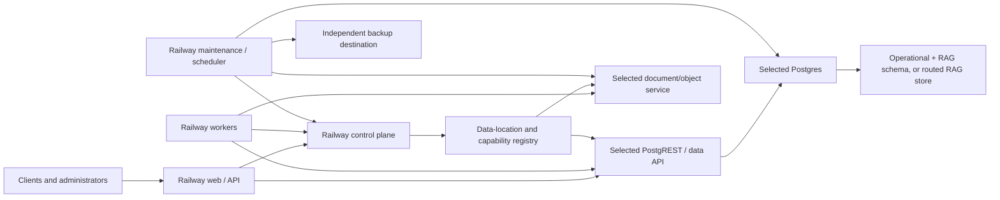

# Railway-First Portable Data Architecture

> Status: Architecture exploration only. This document proposes deployment
> choices and migration boundaries. It does not prescribe an implementation or
> authorize code, infrastructure, or data changes.
>
> Revised: 2026-08-27 to align database attachment, transfer, retry, and source
> cleanup with the approved PostgreSQL/PostgREST implementation plan.

## Purpose

RAG Railway should be able to start as a complete, useful installation on
Railway and expand into a distributed system only when an operator needs more
capacity, durability, regional placement, or managed-service features.

The desired progression is:

1. Deploy the entire starter system on Railway.
2. Keep secrets, settings, provider routing, and system ownership on Railway.
3. Choose where original documents and generated objects should live.
4. Optionally move the operational or RAG database to Supabase or another
   Postgres provider.
5. Transfer each data class independently through verified off-site artifacts,
   pre-activation abort safety, and separately confirmed source cleanup.

This makes Supabase an optional capability provider instead of a requirement
for the first installation. Backblaze B2 is likewise an optional object store,
not a mandatory part of the base architecture.

## Terminology

Three similarly named components need to remain distinct:

- **Postgres** is the database engine.
- **pgvector** is the Postgres extension used for vector storage and search.
- **PostgREST** is an HTTP data API in front of Postgres. The existing
  Supabase client uses PostgREST for database queries and RPC calls.

Supabase packages Postgres, pgvector, PostgREST, Storage, and Vault-like
features into one managed platform. A Railway-first installation can assemble
the same broad responsibilities from separate services.

## Architecture Principles

### 1. Railway is the bootstrap platform

The minimum viable installation should require only Railway resources:

- web and public API
- document-processing worker
- embeddings service
- maintenance and scheduler services
- Postgres with pgvector
- PostgREST
- a private document/object service that encrypts objects before writing them
  to a Railway volume
- encrypted secrets and settings owned by the Railway control plane

An operator can deploy this profile, ingest documents, run vector search, and
use Ask and Extraction before creating accounts with any additional provider.

### 2. The control plane remains stable

Moving document or RAG data should not also move the secrets and settings that
tell the system where that data lives. Railway should remain the control plane
unless an operator explicitly chooses a more advanced control-plane migration.

The Railway control plane owns:

- tenant and administrator identity
- API keys and access policy
- encrypted provider credentials
- application and model settings
- database and object-store destinations
- tenant-to-data-location routing
- migration and verification state
- backup catalogs and restore coordination
- service health and capability records

### 3. Data locations are choices, not application modes

The application should reason about capabilities such as "Postgres with
pgvector" or "S3-compatible object store," rather than branching throughout
the code for Railway, Supabase, or Backblaze.

Provider-specific details belong behind a small number of boundaries:

- data API / database adapter
- RAG data adapter
- object storage adapter
- secret store
- backup and transfer adapter

### 4. Start consolidated, split only for a reason

The Railway starter should use one Postgres database for operational records,
chunks, and vectors. That preserves foreign keys, transactions, joins, and a
simple backup boundary.

Splitting chunks and vectors into a separate RAG database is a later scale or
isolation option. It should not be the default because cross-database joins and
transactions do not exist.

### 5. Every location must be replaceable

Each durable data class needs:

- a declared owner
- a stable identifier independent of its provider
- a portable export format
- checksums or row-count verification
- a maintenance/back-up/copy/verify/switch migration path
- a pre-activation abort path that leaves the source authoritative
- an explicit, audited cleanup or decommissioning step after verification

A transfer must never destroy or modify the only known-good copy in place.
The source remains authoritative until the target has been copied and verified
and the versioned route has been activated. Source cleanup is separately
confirmed. Step 4 verifies the off-site artifact before clearing the source,
then removes that operation-owned transfer artifact so an old encryption or S3
configuration cannot leave it orphaned. After cleanup, recovery relies on the
active target and its normal backup policy rather than a promised live-database
rollback or an ephemeral transfer archive.

## Logical System Boundaries

### Control plane

The control plane should be small, stable, and recoverable. It contains the
information required to locate and authenticate every other component, but it
does not need to contain the tenant's document bodies or vectors.

### Operational data plane

The operational database contains relational workflow state:

- tenants, silos, projects, and memberships
- document metadata and processing status
- processing jobs and durable run state
- usage and audit records
- extraction, conversation, and generated-file metadata

In the starter profile, this database also contains RAG data.

### RAG data plane

The RAG data plane contains:

- canonical document pages and chunk metadata
- chunk text and source offsets
- embeddings and embedding versions
- vector indexes
- optional keyword-search indexes

It can remain in the operational database indefinitely. A separate RAG data
plane becomes useful when vector workloads need independent scaling, regional
placement, tenant isolation, or a managed Supabase database.

### Object data plane

The object data plane contains:

- original uploads
- canonical Markdown files
- page renders and extracted images
- parser diagnostics
- generated files and exports
- temporary processing artifacts

Object placement is independent from database placement. For example, Railway
Postgres can use Backblaze B2, and Supabase Postgres can use the Railway
document service.

## Deployment Profiles

### Profile A: All Railway

This is the default starter profile.

| Responsibility                       | Location                                                              |
| ------------------------------------ | --------------------------------------------------------------------- |
| Application services                 | Railway                                                               |
| Control plane, secrets, and settings | Railway                                                               |
| Postgres + pgvector                  | Railway Postgres                                                      |
| HTTP database API                    | Railway PostgREST service                                             |
| Originals and generated objects      | Railway document service + volume                                     |
| Backups                              | A separate Railway volume initially; off-site S3 strongly recommended |

The document service should be the only service that owns its Railway volume.
Web and workers access it over the private network. This avoids assuming that a
volume can be mounted read/write by several services and creates a clean object
API that can later point to S3-compatible storage.

This profile favors simplicity and quick startup. Its limitations are the
durability and capacity characteristics of a single Railway database and
volume, so backup visibility must be prominent from the beginning.

### Profile B: Railway + external object storage

The application and database remain on Railway while objects move to one of:

- Backblaze B2
- Supabase Storage
- another S3-compatible provider

This is usually the first expansion step because it is independent from the
relational schema and reduces pressure on the Railway document volume.

| Benefit                     | Result                                              |
| --------------------------- | --------------------------------------------------- |
| Larger object capacity      | Documents no longer consume Railway volume space    |
| Independent lifecycle rules | Retention and archive policy can differ by bucket   |
| Direct multipart upload     | Large uploads need not pass through the web process |
| Easier regional selection   | Object storage can follow the document population   |

### Profile C: Railway control plane + Supabase data plane

Railway continues to own the application, encrypted secrets, settings, and
routing. Supabase provides managed Postgres/PostgREST and optionally Storage.

There are two variants:

1. **Complete database placement:** operational and RAG schemas both live in
   Supabase. This is the simpler and safer variant.
2. **RAG-only placement:** chunks, vectors, and search indexes live in
   Supabase while operational records remain in Railway Postgres.

The RAG-only variant is more distributed but introduces consistency work. It
should be selected only when independent vector scaling or data residency is a
real requirement.

### Profile D: Supabase integrated data plane

Supabase owns Postgres, PostgREST, pgvector, and object storage. Railway still
runs the application and may retain the control-plane vault/settings service.

This profile uses more Supabase capability without making Supabase the owner of
provider credentials or application routing. An operator may still choose B2
instead of Supabase Storage.

### Profile E: Bring your own Postgres and object store

An advanced operator supplies:

- any compatible Postgres service
- either a compatible PostgREST endpoint or credentials for a Railway-hosted
  PostgREST service
- pgvector and required standard extensions
- an S3-compatible object store or the Railway document service

Supabase is one valid combined provider for Postgres and PostgREST. It should
not be a special architecture path once the capability contracts are met.

### Profile F: Distributed or tenant-routed data planes

Large installations may route different tenants or regions to different data
planes while sharing the Railway control plane.

Examples:

- North American tenants use Railway Postgres and B2 US.
- European tenants use a European Postgres provider and B2 EU.
- A regulated tenant receives a dedicated Supabase project.
- A high-volume tenant receives a dedicated RAG database while keeping shared
  operational services.

This profile requires explicit routing, health, backup, and migration state per
tenant. It should grow from the same provider contracts rather than from a
separate edition of the application.

## Recommended Data Ownership

| Data class                            | Default owner                  | Optional destinations               | Notes                                                                                  |
| ------------------------------------- | ------------------------------ | ----------------------------------- | -------------------------------------------------------------------------------------- |
| Root encryption keys                  | Railway secret variables       | External secret manager             | Excluded from portable backups; recreate or recover through separate key custody       |
| Tenant provider secrets               | Railway control plane          | Dedicated secret manager            | Requirement metadata is portable; usable secrets are re-entered or separately escrowed |
| Behavioral model/RAG settings         | Railway control plane          | Dedicated control database          | Portable because they explain chunks, vectors, and generated output                    |
| Installation routing/runtime settings | Railway control plane          | Dedicated control database          | Stay with the installation and are not imported from a portable backup                 |
| Tenant and API identity               | Railway control plane          | Dedicated identity database         | Preserve identity/policy; recreate passwords and API key material                      |
| Jobs and run state                    | Railway Postgres               | Selected operational Postgres       | Preserve allowed completed history; never resume stale locks or active source jobs     |
| Chunks and vectors                    | Railway Postgres               | Supabase or compatible Postgres     | Keep together with their vector indexes                                                |
| Original documents                    | Railway document service       | Supabase Storage, B2, compatible S3 | Selected independently and application-encrypted before storage                        |
| Derived objects                       | Same object service by default | Separate low-cost bucket            | Encrypted like originals; can use shorter retention                                    |
| Backup payloads                       | Independent S3 destination     | B2, S3, compatible provider         | Password-encrypted and outside the primary failure domain                              |

## Backup Boundary: Structure Vs Portable State

Where a value is stored does not determine whether it belongs in a portable
backup. The Railway control plane can own both kinds of value:

- **Installation structure** says where this deployment's database, PostgREST,
  object store, services, and backup destination live. The target installation
  supplies these values; they are not restored from the source archive.
- **Portable state** contains user content, relationships, and the settings and
  provenance needed to interpret backed-up content. It travels with the data.
- **Credential material** is excluded from a normal portable archive. The
  archive records what credential is required, while the value is recreated,
  re-entered, or recovered from a separate customer-controlled escrow.
- **Retained history** follows an explicit retention policy. **Ephemeral
  execution state** such as leases, sessions, active jobs, and health samples
  is excluded.

The value-by-value target contract is defined in
[Backup And Restore Data Classification](system/backup-restore-data-classification.md).
That document is normative for future backup-format work and records where the
current implementation still differs from the target.

The portable recovery set must include, at minimum:

- tenants, silos, projects, and every relationship among them
- libraries, library projects, their documents, access grants, and tool
  bindings
- document records, original uploaded bytes, canonical Markdown, pages,
  renders, extracted assets, and generated files
- chunks, chunk hashes/source offsets, embedding vectors, dimensions, models,
  versions, and their document relationships
- RAG chunk/overlap/search settings and content-affecting parser settings
- model, task, extraction, context-management, and library-tool configuration
- user-visible conversations, results, citations, and retained history

The portable archive does not import source database URLs, Supabase project
references, PostgREST routes, physical bucket/prefix choices, Railway volume
paths, backup schedules, or active migration/maintenance state. Release schema,
constraints, RPC functions, and vector indexes are recreated from migrations;
the archive carries only compatibility requirements.

## Secrets And Settings On Railway

The first operational implementation of this control-plane boundary is the
[Railway connection and service reconciliation workflow](setup/railway-connection-and-service-reconciliation.md).
Web receives short-lived bootstrap authority only when maintenance is missing.
After the service layout and database migration are current, the local Settings
Vault owns the encrypted Railway credential and connection identity.
Maintenance reads it privately for OAuth rotation and future service changes,
and owns only the Supabase infrastructure audit record. The Railway connection
is included in an explicit password-encrypted Settings Vault backup; the audit
record remains excluded from both settings and scheduled data-plane backups.

Supabase Vault does not need to move with data stored in Supabase. The Railway
control plane can own secrets throughout every deployment profile.

Use two levels of secrets:

1. **Bootstrap secrets in Railway variables:** the root encryption key,
   control-plane database credentials, and credentials needed to reach the
   configured data planes.
2. **Encrypted tenant secrets in the control-plane store:** provider API keys,
   database credentials, and storage credentials that vary by tenant or
   destination.

The root encryption key must not be stored in the same database as the values
it decrypts. Tenant secrets can use envelope encryption or a standard Postgres
encryption mechanism, with key identifiers and rotation state recorded beside
the ciphertext.

Encryption at rest does not by itself make a secret portable. The normal
archive excludes database, PostgREST, storage, backup, provider, webhook,
password, API-key, session, and signing-key material. It preserves non-secret
identity, scopes, grants, provider/model selection, and a credential requirement
inventory. A restore keeps affected users and integrations disabled until the
required credentials are replaced.

An optional sealed credential escrow may be added for faster recovery of
selected provider or webhook secrets. It must be separately enabled, encrypted
to a customer-held recovery key, and kept distinct from the normal archive.
Database, Railway, PostgREST, and backup-destination roots still belong to the
target installation.

Non-secret settings can live in the same control-plane database:

- model selection and context settings
- chunking and embedding options
- worker and maintenance limits
- database and object-store routing
- backup schedules and retention
- provider capability observations

These values still receive individual backup classifications. Chunking,
embedding, model, task, context, and content-affecting parser settings are
portable. Service locations, routing, concurrency, retries, timeouts, schedules,
capacity limits, and provider health observations stay with the installation.

The control plane should expose a narrow internal secrets/settings API. Data
plane services receive only the credentials they need and should not gain
general access to every stored secret.

## PostgREST As A Portable Database Boundary

The current application uses Supabase's JavaScript client for both PostgREST
queries and Supabase Storage operations. Those are separate capabilities and
should be treated separately in the target architecture.

For relational data, a selected data plane can expose:

- Supabase's managed PostgREST endpoint, or
- a Railway PostgREST service connected to Railway or third-party Postgres.

A portable PostgREST contract needs:

- an agreed database schema and migration head
- stable RPC function signatures
- service roles and JWT claims
- a controlled list of exposed schemas
- connection pooling and timeouts
- health and capability reporting
- private networking where available

Running PostgREST on Railway allows the application to select almost any
compatible Postgres provider without rewriting every query site. A future SQL
driver remains possible, but it is not required to make the deployment model
portable.

## Document Service And Object Placement

The application should refer to objects by stable logical identity rather than
by a Supabase-specific URL. A logical object record should be able to resolve
to a provider, bucket/container, object key, checksum, byte size, and version.

The document service should provide the common object operations:

- initiate and complete upload
- multipart upload where supported
- download or short-lived access ticket
- range read
- list by prefix
- copy and delete
- checksum and metadata verification
- authenticated encryption/decryption and key-version reporting
- lifecycle and retention information

### Mandatory object encryption

Original files must be encrypted before they are written to the Railway
document volume, Supabase Storage, Backblaze B2, or another S3 provider.
Canonical Markdown, renders, extracted assets, parser diagnostics, and generated
files should use the same boundary because they can expose the same document
content.

Provider-side encryption at rest is required where available, but the portable
guarantee comes from application envelope encryption. Each object uses a random
data key; the configured object encryption key wraps those data keys. The
storage configuration holds only encryption mode, algorithm/version, key
reference/version, and fingerprint. The usable key/password stays in the
Railway control-plane secret store.

The object encryption key is distinct from the backup recovery password and
from administrator credentials. Uploads encrypt as a stream, downloads decrypt
only in an authorized application/worker stream, and plaintext is never staged
on a Railway volume or temporary object.

### Railway document service

The starter service owns a persistent volume and exposes only a private API.
It is simple and keeps the first installation entirely on Railway. It is not a
high-availability object store, so portable backups and volume-capacity alerts
are required.

### Backblaze B2

B2 is a natural expansion target because it is S3-compatible and independent
from both Railway and Supabase. It can hold originals, derived objects, or only
off-site backups.

### Supabase Storage

Supabase Storage can be selected whether or not Supabase also owns Postgres.
Keeping this choice independent lets an operator use Supabase's document tools
without moving the database, or use Supabase Postgres with B2 objects.

## Portable Library Packages

Reference libraries need a narrower portability format in addition to system
backups. A library package preserves the expensive editorial and parsing work
without carrying destination-specific search indexes or access assignments.

The package includes:

- library name, description, and safe metadata
- library projects, which are the model tool definitions and contain tool name,
  display name, description, and intended enabled state
- document-to-library-project membership, including documents shared by several
  library projects
- each document's metadata, exact original file, and exact canonical Markdown
- provider-neutral object information, byte sizes, and checksums

It explicitly excludes chunks, embeddings, vector indexes, silos, ordinary
silo projects, `library_project_access`, `library_tool_bindings`, processing
history, credentials, and installation routes. Import therefore creates no silo
access and assigns no tool to Ask or Extraction.

Import writes originals and Markdown through the target encrypted document
service, chunks the Markdown using the target RAG settings, creates embeddings
with the target model/dimensions, verifies representative library searches, and
only then activates the imported tool definitions. It bypasses source parsing,
OCR, vision, and Markdown assembly.

Library-package encryption is optional and requires an explicit choice. An
encrypted export uses a one-time package password that is never stored. An
unencrypted export carries a clear warning because its originals and Markdown
are readable to anyone holding it. Primary storage remains encrypted in either
case; optional encryption applies to the portable package itself.

The full value, format, conflict, security, and verification contract is in
[Portable Library Export And Import](requirements/library-portability.md).

## Splitting Operational And RAG Databases

The clean default is one database. If the RAG data plane is separated later,
the following rules are required:

- UUIDs are generated outside either database and remain globally stable.
- The operational database is authoritative for tenants, documents, status,
  permissions, and job intent.
- The RAG database is authoritative for chunks, embeddings, and search-ready
  versions.
- Cross-database foreign keys are replaced by validated IDs and reconciliation.
- The operational database writes an idempotent outbox event for RAG changes.
- A document becomes `ready` only after the selected RAG data plane confirms
  the expected chunk and embedding version.
- Deletes use tombstones or durable delete jobs so an unavailable RAG data
  plane cannot leave content silently searchable.
- Search requests fail closed when tenant routing or authorization cannot be
  verified.

The application should not attempt a distributed SQL transaction. Durable
jobs, idempotency keys, version checks, and reconciliation are the safer model.

## Capability Contracts

### Postgres data plane

A compatible database should declare:

- supported Postgres version
- installed extensions, including pgvector
- supported vector dimensions and index types
- migration head and checksum state
- PostgREST availability and version
- required roles and exposed schemas
- backup, restore, and maintenance capabilities
- region and network reachability

### Object data plane

A compatible object provider should declare:

- maximum object and multipart sizes
- signed upload/download support
- range-read support
- checksum behavior
- versioning and lifecycle support
- region and egress characteristics
- provider-side encryption and retention controls
- application-envelope-encryption compatibility
- active key reference/version and rotation capability

### Secret store

A compatible secret store should declare:

- encryption mechanism and root-key location
- tenant scoping
- audit history
- rotation support
- backup and restore behavior
- whether secret values can ever be returned to an administrator

The setup flow can use these declarations to enable only features that the
selected profile can safely provide.

## Location And Routing Registry

The control plane needs a conceptual registry for each tenant's active
destinations. The exact schema is an implementation decision, but the registry
must be able to represent:

- operational database location
- RAG database location
- original-object location
- derived-object location
- backup destination
- active provider configuration version
- migration source and target
- migration phase and verification status
- verification manifest and last successful comparison
- source connection-retention and cleanup state
- decommission approval and completion state
- backup retry eligibility and whether the source reopened after backup
- provider health and last successful check

Routing changes should be versioned. Jobs record the routing/configuration
version they were created with so that a location change cannot redirect
half-completed work unpredictably.

The control plane exposes separate `provision`, `attach_existing`, `transfer`,
`switch_data_api`, and `decommission` operations. They must not share a generic
"replace database" action because attaching preserves populated data, transfer
requires S3 and may replace only explicitly approved application-owned target
data after a verified target safety backup, a Data API switch copies no data,
and decommissioning is destructive.

## Local Data Plane Activity And Sleep

Railway PostgreSQL and PostgREST are the sleeping bootstrap and test data plane,
not the high-availability production tier. Web, worker, and Maintenance acquire
short activity leases while they need a selected local service. The web service
coordinates private keep-alives only for dependencies named by the active route
or an approved Maintenance operation; workers and Maintenance renew their
leases while background work continues.

When all leases expire, the PostgREST supervisor terminates its child and closes
the database pool so the open connection cannot keep either service active.
Route keep-alives then stop and Railway may sleep both services after its idle
window. A selected Supabase database and Supabase Data API cause no keep-alives
to the unused local services. Cold-start handling wakes PostgreSQL first,
establishes PostgREST readiness, and retries reads safely without blindly
replaying a write whose outcome is unknown.

## Transfer And Cutover Model

Database movement is provider-neutral. The same process applies from Railway
to Supabase, Supabase to Railway, or between any two compatible Postgres
providers. It is an offline backup, copy, verify, and route-activation process.
The application reports database maintenance while writes, workers, schedules,
and webhooks are drained.

Every provider change should follow the same broad sequence:

1. **Save and analyze:** store an inactive candidate and inspect it read-only.
   Prove source and target identities differ and inventory schema, migration,
   permission, and application-data state.
2. **Drain:** enter the maintenance barrier and stop new database work.
3. **Back up:** write and independently verify the encrypted source artifact in
   S3 before mutating the target.
4. **Normalize when needed:** if the source schema is behind, make the best safe
   play-forward attempt and create a second current-shape artifact after it
   succeeds. Stop for administrator input when it cannot be reconciled.
5. **Protect and prepare target:** skip cleanup when blank. When replacement
   was explicitly approved, independently verify an encrypted target safety
   backup, recheck the approved fingerprint, and remove only listed
   application-owned target data. Never clear provider-managed, unrelated, or
   ambiguous objects.
6. **Provision:** apply the current core and selected provider schema tracks to
   the prepared target.
7. **Restore or resume:** import stable IDs with idempotent, Settings-owned
   checkpoints. A retry may use the same candidate only when it belongs to the
   same operation and has no outside writes.
8. **Verify:** compare migration checksums, row counts, relationships,
   permissions, vectors, and representative searches.
9. **Activate:** atomically update one versioned routing record while
   maintenance remains active, then run internal smoke tests through that route.
10. **Release:** reopen database traffic only after route verification passes.
11. **Clean up:** use the retained source connection in a separate,
    authenticated operation to clear or decommission it when requested.

If backup, copying, verification, or activation fails, routing remains on the
source and maintenance may release the barrier. If the source then accepts new
writes, the prior artifact cannot be reused for a later transfer attempt. A
failed candidate is resumed only through its immutable operation checkpoints or
is re-analyzed for a new attempt. An old approval cannot authorize a target
whose fingerprint or outside-write state changed.

Connecting a new Railway installation to an existing populated Supabase or
PostgreSQL database is not a transfer. The `Attach existing database` operation
saves the connection as an inactive candidate, performs read-only identity and
schema inspection, offers a best-effort ordered migration plan when the
database is recognized and behind, verifies its existing data and selected
PostgREST endpoint, and activates it only after approval. It never purges,
copies, or restores the attached database. A high-risk schema migration still
requires a verified pre-migration backup.

### Moving objects

- New writes can be directed to the target after it passes a write/read/delete
  probe.
- Existing objects are copied with checksum verification.
- Reads temporarily fall back to the source when the target object is absent.
- The object location record changes only after the target copy is verified.

### Moving the complete database

- Apply the same migration contract to the target.
- Require a verified encrypted S3 artifact; provider snapshots are additional
  protection but do not replace it.
- Keep the maintenance barrier active for the complete backup, restore,
  verification, and route-activation sequence.
- Produce a verification manifest covering schemas, migrations, extensions,
  functions, roles, sequences, table-level row counts, constraints, indexes,
  and representative data checksums.
- Verify document, chunk, and embedding relationships, vector counts, and
  representative RAG searches.
- Confirm that queued and in-flight jobs are drained, migrated, or safely
  reconciled before changing the route.
- Switch the PostgREST/data API route, not hundreds of query call sites.
- Keep the source connection secret only until any requested cleanup succeeds.
- Run internal route verification before releasing maintenance mode and record
  its result in Settings.

The source database is eligible for cleanup only when all of the following are
true:

- the target verification manifest has passed
- route-level application and Maintenance smoke tests are healthy
- no missing rows, permissions, relationships, or reconciliation work remains
- a final recoverable source artifact has been independently verified before
  the source-clear boundary; Step 4 then deletes that operation-owned artifact
  after source clearing is durably checkpointed
- an authorized operator has explicitly approved decommissioning

Cleanup is its own operation. Settings retains the inactive source destination
and encrypted credential until cleanup completes. Maintenance confirms that the
active route uses the target, then may remove source application data or delete
the old Railway database service and volume according to provider policy. It
records what was deleted, when, and by whom; revokes the usable secret; and
retains the non-secret identity and audit history. Cleanup failure records
`cleanup_pending` and does not undo the active route.

### Moving only chunks and vectors

Rebuilding is often safer than copying vector rows:

- preserve canonical Markdown and chunking configuration
- create chunks and embeddings in the target RAG data plane
- verify chunk hashes and embedding versions
- compare representative search results
- switch RAG routing after the target is complete

The source vectors remain untouched until their separately confirmed cleanup.

## Backup And Restore In A Distributed Profile

A distributed installation still needs one logical recovery point. The
maintenance service should coordinate a short write barrier or a recorded
consistency boundary, then produce a manifest containing:

- portable control-plane identity, authorization, and behavioral settings
- tenant, silo, project, library, document, and relationship inventories
- operational content export without installation-local execution state
- chunks and embedding vectors with model, dimensions, version, and provenance
- object inventory with checksums
- archive encryption algorithm/version and recovery-key fingerprint
- object encryption algorithm/version and key-version provenance
- credential requirement inventory, never usable secret material
- retained-history cutoffs and every redaction/exclusion decision
- migration head, application version, backup format, and target capability
  requirements

Source routing and physical placement may appear only as non-importable,
non-secret diagnostic provenance. The archive must not restore database URLs,
project references, object buckets, service routes, or backup destinations.

The backup payload should be stored outside the primary failure domain. A
Railway-first installation can run without B2, but it should not claim strong
disaster recovery until an off-site destination is configured.

Every archive must be encrypted. A manual backup requires an administrator to
provide and confirm a backup recovery password before the job can be created.
The password exists only in the maintenance process and must be supplied again
to inspect, verify, or restore the archive.

Enabling or changing a scheduled backup requires administrator
re-authentication plus a backup recovery password. The schedule stores only an
encrypted secret reference, key version, and fingerprint; the password is kept
in the Railway control-plane secret store and the operator retains a separate
external copy. The scheduler retrieves it through a narrowly scoped identity.
If it is unavailable, the scheduled run fails closed and raises an alert. It
must never fall back to an unencrypted archive.

The backup password, scheduled-backup password, and object encryption key are
separate credentials. Rotating a schedule password affects future archives;
older archives retain their original key fingerprint and require the matching
password until they expire.

When object storage uses application encryption, backup streams source-object
decryption directly into archive encryption. Restore streams archive decryption
directly into encryption under the target's object key. This keeps the backup
portable without writing plaintext to disk or forcing the target to reuse the
source storage key.

Restore first provisions the target control plane and routing registry from the
target installation profile, then imports portable state and reconnects each
data plane. It restores silos, projects, libraries, originals, documents,
chunks, and compatible embeddings before lower-priority history so verified
search can return quickly. A destination can change during restore as long as
it satisfies the same capability contract.

## Setup Experience

The first-run setup should offer a simple default and progressively reveal
advanced choices.

### Step 1: Start on Railway

Create the application services, Railway Postgres/pgvector, PostgREST, document
service, control-plane secrets/settings store, and scheduled maintenance. The
installation provisions separate object-encryption and backup-encryption secret
slots before document ingestion or backup scheduling is enabled.

### Step 2: Choose original document storage

- Railway document service
- Supabase Storage
- Backblaze B2
- another compatible S3 provider

The selected destination is tested before use. Existing objects can be moved
later from the same screen. Configuration requires an object encryption
password/key, verifies an encrypted write/read/delete probe, and records only a
secret reference and key fingerprint outside the secret store.

### Step 3: Configure encrypted backups

Select an independent backup destination. Manual backup creation requires a
recovery password each time. Enabling a schedule requires administrator
re-authentication, a confirmed recovery password stored through the secret
store, retention settings, and a successful encrypted test backup/verification.
The interface warns that losing the external copy of the password makes the
archive unrecoverable.

### Step 4: Choose database placement

- Railway Postgres through Railway PostgREST
- Supabase Postgres/PostgREST
- compatible external Postgres through Railway PostgREST
- compatible external Postgres with its own PostgREST

The complete operational + RAG database remains the recommended choice until
the operator explicitly enables a separate RAG data plane.

The Configuration page uses the approved
[Database Configuration UI](setup/database-configuration-ui.md): one top-level
Database section with `PostgREST settings`, `PostgreSQL settings`, and the
four-stage `Transfer Database` workflow. Supabase is a remote provider choice,
not a generic access point. Remote PostgREST is unavailable while PostgreSQL is
local.

The screen distinguishes `Provision new`, `Attach existing`, `Transfer`, and
`Switch data API`. Attaching an existing database never purges or restores it.
Transfer prefers a blank target; replacing populated application-owned target
data requires exact analysis-bound approval, recent re-authentication, and a
verified encrypted target safety backup. Source cleanup remains a separate
fourth UI stage after the new route has been tested.

### Step 5: Optional RAG data-plane split

Choose a dedicated database for chunks and vectors, define tenant scope, build
the target index, compare searches, and cut over through versioned routing.

## Recommended Sequence

1. **Define the control-plane boundary.** Keep secrets, settings, routing, and
   migration state on Railway.
2. **Create the all-Railway profile.** Railway Postgres + pgvector, PostgREST,
   and an encrypting, volume-owning document service form the first complete
   installation.
3. **Abstract encrypted object placement.** Make Railway documents, Supabase
   Storage, and B2 selectable behind one envelope-encrypting document service
   contract.
4. **Require encrypted recovery.** Require a password for manual backups and
   encrypted secret provisioning plus a verification drill for schedules.
5. **Add portable library packages.** Export originals, canonical Markdown,
   library projects/tools, and memberships without vectors or silo assignments;
   import by chunking and embedding on the target.
6. **Make PostgREST selectable.** Support Railway-hosted PostgREST against a
   compatible Postgres, while retaining Supabase's managed endpoint.
7. **Add verified transfers.** Object migration first, complete database
   migration second.
8. **Add a separate RAG data plane only when needed.** Use durable jobs,
   versioning, and reconciliation rather than cross-database assumptions.
9. **Add tenant and regional routing.** Build distributed placement from the
   same contracts and migration workflow.

## Architectural Recommendation

The most capable path is not to make Railway and Supabase competing editions.
Use Railway as the stable application and control plane, then let operators
compose data-plane capabilities:

- **Start:** Railway Postgres + pgvector + PostgREST + encrypted Railway
  document service + password-protected backups.
- **First expansion:** move originals and large derived objects to B2 or
  Supabase Storage.
- **Second expansion:** move the complete database to Supabase or another
  Postgres provider when managed database capabilities justify it.
- **Advanced expansion:** split the RAG data plane or route tenants to separate
  providers only when scale, isolation, or residency requires it.

This gives a new user one place to start and an experienced operator several
places to grow, without tying secrets, settings, documents, and vectors to the
same vendor or requiring an all-at-once migration.
