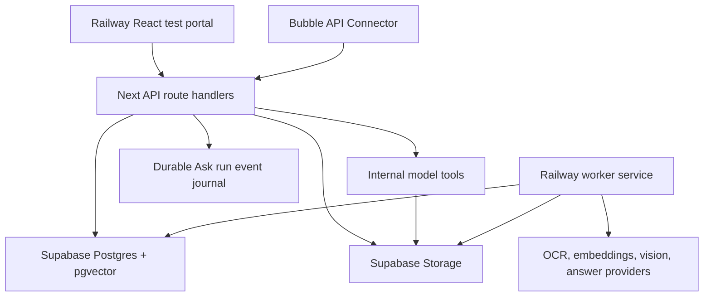

# Architecture

## Services

- `apps/web`: operational portal plus API contracts that Bubble can later reuse.
- `apps/worker`: background job loop for document ingestion, reprocessing, and embedding tasks.
- `packages/rag-core`: shared request/response schemas and model/provider defaults.
- `supabase`: migrations, storage bucket configuration, and safe seed data.

Standalone Ask and Extraction model loops execute in `apps/web`. Ask creates a
durable run/event journal before model work and can be observed through JSON,
NDJSON, and recovery endpoints. Standalone Extraction keeps the HTTP request
open until its run, result, and generated file have been persisted. Saved Task
runs are background workflows started by `apps/web`; they execute their
Extraction items sequentially and expose durable Task run/item status.

## Database Principle

The database stores normalized outputs and metadata. PDF understanding happens before storage in the worker/provider layer.

Task Dataset Phase 3 provides a service-role-only staged write plane for
Task+silo+project-private JSONB facts. Source workers use expiring claim tokens,
bounded idempotent contribution batches, receipt/source sealing, and
active-plus-current-run materialized record heads. Cross-source conflicts keep
dated source variants. Model-callable native and JSON-loop contracts exist only
when trusted server code supplies a saved-Task dataset context; automatic saved
Task context creation, final transaction coordination, and pre-ranking RAG
exclusion are the Phase 4 integration boundary.

Generated AI files are private storage objects tracked in `generated_files`. They always reference the producing task and silo, and can also reference the source document, Ask question log, or extraction run that produced them, including the provider/model used by the configured task. Older filename-based append/overwrite calls still create fresh timestamped generated-file versions after reading the latest file with the same name in the silo. Calls that use a reserved `fileId` update that stable row/object in place, which keeps the download ID stable while a model writes, appends, overwrites, or inserts lines. `is_temporary` marks intermediate files that can be removed after their content has been ingested into RAG.

Model tools are exposed per task from `model_task_configs`. Railway stores tool permissions and model-facing context for `write_file`, `list_files`, `rag_documents`, `rag_search`, `get_document_markdown`, and `render_pdf_page`; API/worker code binds the selected silo before execution. Models never need to know or supply silo IDs. `list_files` inspects silo source/generated files, `rag_documents` ranks distinct documents for 1-12 model-supplied queries, `rag_search` retrieves matching passages and can return text or original-file download paths, and `get_document_markdown` reads exact canonical Markdown ranges only after enforcing the active tenant/silo/project scope. `rag_documents` is read-only and available only to Ask and general Extraction; the staged template planner and Phase 2 workers do not receive it. Its model contract accepts exactly `query` or `queries`, rejects all model-supplied scope/dataset/source identifiers, and returns query-level rank, score, percentile, observation state, and bounded anchors. Score is ranking evidence rather than confidence, and an unobserved match is not verified absence. `rag_search` accepts either one query or a compound request of one to three materially distinct queries. Compound queries execute concurrently and their results are merged fairly so that every query can contribute evidence. Range continuation fields let a model retrieve a complete large document without silent truncation. `render_pdf_page` lets a PDF assembly model request a rendered image for a specific page when extracted layout is uncertain.

Ask and Extraction also receive three fixed, provider-neutral runtime tools whenever model tools are enabled. `sequential_plan` stores a concise checklist, progress states, decisions, and evidence gaps; it is explicitly not a chain-of-thought transcript. `cache_file` holds up to 12 named temporary TXT, Markdown, CSV, or JSON files, supports bounded reads and incremental text or JSON Pointer edits, and publishes one completed cache as the final non-DOCX answer/file body without asking the model to emit that body again. Each named cache is also a coordination slot: it can identify its task owner and purpose, rejects stale writes through `expectedRevision`, and can be sealed as `ready` for a coordinator to consume or deliberately reopen. Independent slots can be read or written concurrently. Server-owned format validation runs before publication so a model can correct malformed output while its tool loop is still active. The tool contract directs the model to start a cache before drafting an output expected to exceed 16,000 characters, about 25 records, or multiple revision passes. If a provider still returns a direct non-DOCX body of at least 16,000 characters, the runtime automatically publishes that body through the cache and records `automatic_publish`; this fallback unifies storage and diagnostics but cannot recover tokens the provider already emitted. A file is limited to 4,000,000 characters and the run to 12,000,000 cached characters. The entire plan and cache workspace is cleared after success or failure.

`model_status` publishes concise user-visible progress at meaningful milestones.
The request may ask for factual, whimsical, or numbered status wording; the
tool still may not claim work that has not happened. Ask writes an ordered
`model.status.updated` event that appears as a live conversation bubble.
Extraction stores the latest status on its run and retains the complete status
history in the final model trace. Saved Task runs also store one status slot per
Task item. The item identity is server-owned and the model may supply a stable
logical `taskKey`, so later parallel Task execution can update independent
statuses without one worker clobbering another.

Ask, standalone Extraction, and saved Task runs may register an optional
webhook when the run starts. Every validated `model_status` call emits a
`model.status.updated` callback containing the authoritative original question
or item request and the structured status update. Callback signing secrets are
encrypted at rest, signed deliveries use HMAC-SHA256, and delivery attempts are
audited against the owning Ask, Extraction, or Task run. Public run-status
responses expose only `webhookConfigured` and `webhookSigned`; they never return
the callback URL or secret.

OpenAI OAuth, capable Ollama models, and capable Modular, Together AI, and OpenRouter routes receive the retrieval and run-workspace tools through native function calling. A same-turn batch of independent retrieval/read calls executes concurrently; state-changing workspace calls remain serialized. Together AI and OpenRouter stream native tool calls, while Modular tool-call turns use its non-streaming OpenAI-compatible contract. If a model rejects the parallel option, Railway retries native tools sequentially; if it rejects function tools entirely, Railway falls back to the existing JSON tool-message loop.

Structured JSON with a top-level `tasks` array is normalized before it is persisted. For each task with source/evidence identity, Railway replaces the model-owned `entityFingerprint` with a versioned SHA-256 fingerprint derived from the silo namespace, source document identity, optional municipality scope, and normalized evidence statement. Model-selected titles, source-page arrays, and prior fingerprint formatting are deliberately excluded, so equivalent reruns over the same evidence receive the same fingerprint.

Ask and Extraction keep separate provider, model, instruction, RAG-mode, Top K,
reasoning, and output settings, but share the same scoped text-agent runtime and
tool executor. Their per-task metadata also stores `maxToolRequests` (1-250,
default 120), `maxRagSearches` (0-100, default 24), `maxRequestCharacters`
(4,000-1,000,000, default 100,000), `referenceLocation`, and an IANA
`referenceTimeZone`. The request limit is enforced only after the applicable
Ask or Extraction task is loaded; both API families share the same absolute
safety ceiling. Railway adds a fresh UTC timestamp and those location settings
to every provider call, including follow-up tool calls and extraction format
repair calls.

Ask and Extraction present the request to the model before retrieval. The model
decides whether scoped evidence is needed, starts with one broad search or one
compound request containing up to three distinct evidence categories, and uses
later searches only to close a specific evidence gap. Each underlying query
counts against the task's independent `maxRagSearches` limit, including queries
sent together in one compound request. Reaching that maximum redirects the model
to continue with the evidence already available; it does not consume the document
editing allowance. OpenAI OAuth models receive retrieval and run-workspace tools
as native application tools inside the provider turn. Providers without that
capability use the same contracts through the JSON tool-message loop. Sequential Task steps use the same
Extraction runner and policy as standalone extraction calls.

DOCX output uses a stateful workspace rather than wrapping final answer text.
The model creates, inspects, and edits numbered blocks or template fields across
bounded tool calls, may copy template media into a blank package, and must call
`finalize_document`. The deterministic engine then writes and validates the
OOXML ZIP parts and persists the generated file.

## Ask Runs And Streaming

Each Ask creates a durable `question_logs` run before retrieval or model work
starts. Ordered `ask_run_events` rows record retrieval, model-call,
provider-supported reasoning/thinking summaries, model output, actual tool calls,
tool results, generated-file work, and terminal completion. The ordinary JSON
endpoint and NDJSON streaming endpoint execute the same bounded agent loop, so
streaming does not create a second behavior path. OpenAI emits supported
reasoning summaries from the Responses API; Ollama emits `message.thinking`
when the selected model supports it. Neither provider is treated as a source of
guaranteed verbatim private chain of thought.

When broad-question coverage is incomplete, the journal records a
`retrieval.expansion.required` event before the model is asked for another
viewpoint-specific search. The event includes completed, required, and remaining
distinct-search counts.

The HTTP stream is only one view over the persisted run. Client cancellation or
network loss does not cancel model execution. Bubble saves the Ask run ID,
tracks the largest event sequence it has seen, and calls
`GET /api/v1/ask-runs/{runId}?afterSequence={sequence}` to recover progress and
the final result. This also makes diagnostics available after the original
request has ended.

Clients that lose the run ID can discover it with
`GET /api/v1/ask-runs?siloId={siloId}` and optionally filter by project,
status, or timestamps. `DELETE /api/v1/ask-runs` clears only terminal history;
active Ask runs and generated files are retained. Ask history responses expose
a `rerunRequest` snapshot of the effective question, silo/project/document
scope, RAG mode, Top K, and output-file settings so a client can prefill a new
run while continuing to use the current model-task configuration.

The editable Ask and Extraction Model Task instructions contain only persistent
quality, evidence, and output expectations. Tool names, argument shapes, usage
rules, and provider-specific invocation guidance are assembled separately from
the currently enabled tool contracts. This avoids stale tool documentation in
saved instructions and reduces duplicated prompt text.

Large PDF understanding should be split across worker steps: native text extraction, page/image rendering, bounded vision analysis for images and visual pages, Markdown assembly with image-description blocks in page order, and then ingestion of that Markdown into the selected silo. Markdown assembly is deterministic by default, but the `pdf_assembly` task can be enabled from Railway to let a selected OpenAI/Ollama/Mistral model perform step-six assembly and call `render_pdf_page` for uncertain pages. The preferred worker tooling is Poppler (`pdftotext` for native text and `pdftoppm` or `pdftocairo` for page images). Use `pdf-lib` only when the pipeline needs actual one-page PDF artifacts, because it is excellent for splitting/copying pages but does not render pages to images for vision calls. Chunking is performed from the final assembled Markdown, not from per-page fragments, and chunks store Markdown source offsets so retrieval can rebuild neighboring context without duplicated overlap. This keeps model calls within practical context limits and lets temporary generated files be cleaned up after ingestion.
