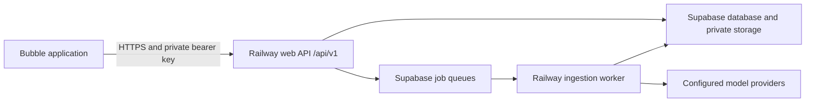

# Bubble API Installation And Usage

Last reviewed against the current API reference: 2026-08-02

This is the start-here guide for installing the RAG Railway API in a Bubble
application. It records the exact Railway URL, where the API key is created,
where the key belongs in Bubble, the shared request rules, and the minimum
workflow needed to prove the installation.

For every endpoint and response field, use the standalone
[REST API command reference](api/rest-api-command-reference.md), generated from
the canonical [api-usage.md](api-usage.md). For
the complete Bubble data model, workflow, polling, file, task, and release
design, use
[bubble-integration-delivery-guide.md](bubble-integration-delivery-guide.md).

## Required Values

Production API base URL:

```text
https://web-production-3bf65.up.railway.app/api/v1
```

Public health URL:

```text
https://web-production-3bf65.up.railway.app/api/v1/health
```

Railway administrator website:

```text
https://web-production-3bf65.up.railway.app/
```

Website and deployment icons:

```text
SVG: https://web-production-3bf65.up.railway.app/brand/bubble-rag-icon.svg
PNG 512: https://web-production-3bf65.up.railway.app/brand/bubble-rag-icon-512.png
PNG 192: https://web-production-3bf65.up.railway.app/brand/bubble-rag-icon-192.png
Apple touch: https://web-production-3bf65.up.railway.app/brand/apple-touch-icon.png
```

Authentication header name:

```text
Authorization
```

Authentication header value:

```text
Bearer brk_your_api_key_here
```

The API base URL is not a secret. The `brk_...` API key is a secret.

Do not use `/api/apitest/v1` from Bubble. That path is the logged-in Railway
API-test website proxy. Bubble must call `/api/v1` directly.

## Architecture



Bubble never needs a Supabase service key, database password, Ollama key, or
OpenAI key. Bubble receives one Railway API key. Railway owns all downstream
connections.

## 1. Create The Railway API Key

1. Open the Railway administrator website.
2. Sign in as an administrator.
3. Open `Configuration`, find `API functionality`, and configure `API keys`.
4. Enter a name that identifies the Bubble environment, such as
   `Bubble Development` or `Bubble Live`.
5. Select the scopes required by that Bubble application.
6. Select the plus button with the `Create API key` tooltip.
7. Copy the generated key. It begins with `brk_`.

For complete feature parity with the Railway API-test website, select:

```text
silos:read
silos:write
documents:read
documents:ingest
documents:delete
documents:reprocess
documents:cancel
rag:ask
rag:extract
generated-files:read
generated-files:delete
api-usage:read
```

Create separate keys for Bubble development and Bubble live. This makes
rotation, deletion, audit filtering, and incident diagnosis independent.

The Railway dashboard encrypts the recoverable key value, stores a hash for
authentication, and lets an administrator copy or delete the key later.

## 2. Install Bubble API Connector

1. Open the Bubble application editor.
2. Select `Plugins`.
3. Select `Add plugins`.
4. Search for `API Connector`.
5. Install the Bubble-maintained API Connector.
6. Open the installed API Connector.
7. Select `Add another API`.
8. Name the provider `RAG Railway`.

Bubble's current API Connector documentation is available in the
[API Connector guide](https://manual.bubble.io/core-resources/api/the-api-connector).

## 3. Put The API Key In Bubble

Configure the `RAG Railway` provider as follows:

| Bubble setting        | Value                        |
| --------------------- | ---------------------------- |
| Authentication        | `Private key in header`      |
| Key name              | `Authorization`              |
| Development key value | `Bearer brk_DEVELOPMENT_KEY` |
| Live key value        | `Bearer brk_LIVE_KEY`        |

Include the word `Bearer`, one space, and the complete `brk_...` key.

Do not place the key in:

- A Bubble data type.
- An option set.
- A page element.
- A custom state.
- A URL parameter.
- Client-side JavaScript.
- A dynamic API call parameter.
- A user-visible workflow or log.

Bubble documents that private API Connector authentication values are kept
server-side. See
[API Connector authentication](https://manual.bubble.io/help-guides/integrations/api/the-api-connector/authentication)
and
[API Connector security](https://manual.bubble.io/help-guides/security/api-security/api-connector-security).

## 4. Configure The First Two Calls

### Health

Name:

```text
BRAG 00 Health
```

Configuration:

| Setting        | Value                                                       |
| -------------- | ----------------------------------------------------------- |
| Use as         | Data                                                        |
| Method         | `GET`                                                       |
| URL            | `https://web-production-3bf65.up.railway.app/api/v1/health` |
| Authentication | Shared provider authentication                              |

Expected response:

```json
{
  "ok": true,
  "version": "v1"
}
```

The health endpoint is public, but it is harmless for the shared private
header to be present.

### Current Key

Name:

```text
BRAG 01 Current Key
```

Configuration:

| Setting        | Value                                                   |
| -------------- | ------------------------------------------------------- |
| Use as         | Data                                                    |
| Method         | `GET`                                                   |
| URL            | `https://web-production-3bf65.up.railway.app/api/v1/me` |
| Authentication | Shared provider authentication                          |

Expected response includes:

```json
{
  "apiKey": {
    "id": "uuid",
    "name": "Bubble Development",
    "scopes": ["silos:read"]
  },
  "requestId": "uuid"
}
```

Initialize both calls. API Connector initialization makes a real request, so
use safe read calls first. Bubble also warns that default initialization
values may become visible in the editor or generated call definition; never
initialize with a secret as a dynamic parameter.

## 5. Shared Call Rules

### Full URL

Each Bubble API Connector call uses the full production URL:

```text
https://web-production-3bf65.up.railway.app/api/v1/<endpoint>
```

Examples:

```text
https://web-production-3bf65.up.railway.app/api/v1/silos
https://web-production-3bf65.up.railway.app/api/v1/tasks
https://web-production-3bf65.up.railway.app/api/v1/usage-logs
```

### JSON Requests

Add this header to each JSON call:

```text
Content-Type: application/json
```

Do not make `Content-Type` a provider-wide header because document upload is
multipart form data.

### Multipart Upload

Document upload uses:

```text
POST /silos/[silo_id]/documents
```

Set the body type to `Form-data`. Bubble's File Uploader value is a URL after
Bubble stores the selected file. Use that URL as `fileUrl`:

| Field             | Bubble type | Required | Notes                                                             |
| ----------------- | ----------- | -------- | ----------------------------------------------------------------- |
| `fileUrl`         | Text/File   | Yes      | File Uploader's value; must be a publicly downloadable HTTPS URL  |
| `fileName`        | Text        | Yes      | File Uploader's value's file name, including the source extension |
| `projectId`       | Text        | No       | Existing project in the selected silo                             |
| `processingDepth` | Text        | No       | `fast`, `standard`, or `deep`                                     |
| `webhookUrl`      | Text        | No       | HTTPS callback URL                                                |

The API also accepts binary bytes in a multipart field named `file` for cURL
and clients that support real multipart file parts. For compatibility, a
Bubble URL sent in `file` is accepted, but `fileUrl` makes the request
contract unambiguous.

Let Bubble create the multipart `Content-Type` and boundary. Do not send a
JSON body and do not add a manual `Content-Type` header for this route.

The remote download is limited to 100 MB by default. Set
`API_REMOTE_UPLOAD_MAX_BYTES` on Railway to change that limit. Railway rejects
non-HTTPS URLs, embedded URL credentials, private/local network addresses, and
redirects to private/local addresses. A private Bubble file URL cannot be
downloaded unless the URL itself grants Railway access.

### Idempotency

Every operation that creates, updates, queues, cancels, reprocesses, or
deletes data requires:

```text
Idempotency-Key: unique-operation-value
```

Make this a dynamic, non-private call header. A practical Bubble value is:

```text
bubble-<RAG API Operation unique id>
```

Create one operation record before the call. Reuse the same idempotency value
only when retrying the exact same request after a timeout. A reused key with a
different route, body, or file returns HTTP `409`.

Do not configure a fixed example value in the Bubble API Connector. Bubble
will otherwise replay the first saved response on every identical create
request. Pass the unique operation value into the call as a dynamic header
parameter.

### Pagination

List endpoints accept:

```text
page=1&pageSize=50
```

Responses contain:

```json
{
  "pagination": {
    "page": 1,
    "pageSize": 50,
    "total": 120,
    "totalPages": 3,
    "hasMore": true
  }
}
```

Bubble should load another page while `hasMore` is `true`.

### Errors

Non-success JSON responses use:

```json
{
  "error": {
    "code": "standard_error_code",
    "message": "Human-readable explanation.",
    "details": {}
  },
  "requestId": "uuid"
}
```

Store `requestId`, HTTP status, `error.code`, and `error.message` on the
Bubble operation record. The request ID can be searched in API usage logs.

### Streaming Ask Calls

Ask can return a live NDJSON event stream while Railway continues the complete
model and tool loop on the server. Configure a second Bubble API Connector call
named `BRAG Ask Stream`:

```text
POST https://web-production-3bf65.up.railway.app/api/v1/silos/[silo_id]/ask/stream
```

Use the call as an **Action**, set Bubble's response type to **Stream**, and use
a JSON request body with the same fields as the ordinary Ask endpoint:

```json
{
  "question": "What are the current sidewalk priorities?",
  "projectId": "<optional_project_id>",
  "searchMode": "vector",
  "outputFile": {
    "enabled": false,
    "format": "md",
    "fileName": "sidewalk-priorities.md"
  }
}
```

Send these headers:

```text
Authorization: Bearer <API_KEY>
Content-Type: application/json
Accept: application/x-ndjson
Idempotency-Key: <unique-operation-value>
```

Every non-empty stream line is one complete JSON event. Parse lines
independently; do not wait for one large JSON array. Stable envelope fields are
`runId`, `sequence`, `type`, `payload`, and `createdAt`. Save `runId` as soon as
the first line arrives. Events can include retrieval progress, reasoning or
thinking summaries, model output deltas, tool calls, tool results, and the
terminal result. The final ordinary Ask response is located at:

```text
ask.completed.payload.result
```

Reasoning events are provider-supported summaries or thinking text. They are
diagnostic progress, not a guaranteed verbatim private chain of thought. Tool
events report the tools Railway actually executes, including their arguments,
success result, duration, or error.

An Ask may emit `get_document_markdown` tool events after RAG search identifies
a source whose chunks are insufficient. Railway retrieves exact canonical
Markdown ranges inside the already selected silo/project; Bubble does not send
the tool call or document content itself. Ask and Extraction loop limits (1-250),
reference location, and IANA time zone are configured in the Railway admin
dashboard. Railway adds current UTC and that location context to every model
call automatically. The Ask and Extraction configurations each include a
separate **Max RAG searches per request** value (0-100, default 8). The request
reaches the configured model before retrieval; the model may issue focused RAG
searches when it determines that more evidence is needed. Bubble does not
generate these queries. It displays the persisted events/traces and final
result or generated file.

### Recover Or Poll An Ask Run

The Ask run continues on Railway if Bubble closes the stream, changes pages, or
temporarily disconnects. Configure a data call named `BRAG Ask Run Status`:

```text
GET /ask-runs/[run_id]?afterSequence=[after_sequence]&eventLimit=100
```

Store the greatest received `sequence` and send it as `afterSequence` to fetch
only later events. Bubble can poll every 1 to 3 seconds until `askRun.terminal`
is `yes`. Terminal statuses are `succeeded` and `failed`. A successful response
contains the final `answer`, sources, model metadata, generated files, elapsed
time, and the requested event page. A failed response preserves the failure
message in the run record and `ask.failed` event.

Do not cancel the server request merely because the stream reader disconnects.
Reconnect through this GET endpoint with the saved run ID instead.

If Bubble did not save the run ID, configure `BRAG Ask Runs` as a data call:

```text
GET /ask-runs?siloId=[silo_id]&projectId=[project_id]&status=[status]&page=1&pageSize=50
```

Leave optional query parameters out when they are blank. Identify the run by
its question, start time, project, and status, then pass its `id` to `BRAG Ask
Run Status`.

Configure `BRAG Clear Ask Runs` as an action call:

```text
DELETE /ask-runs?siloId=[silo_id]&projectId=[project_id]&before=[before]&confirm=true
```

Send a unique `Idempotency-Key`. The cleanup call removes only completed,
failed, or cancelled Ask runs. It keeps active runs and generated files.

## 6. Minimum Working Workflow

Use this sequence to prove the Bubble installation:

1. Call `BRAG 00 Health`.
2. Call `BRAG 01 Current Key` and confirm the expected scopes.
3. Call `GET /silos?page=1&pageSize=50`.
4. Create a temporary silo with `POST /silos`.
5. Upload a small Markdown or text file with
   `POST /silos/[silo_id]/documents`.
6. Save `document.id` and `job.id`.
7. Poll `GET /documents/[document_id]/status` until the document is `ready`
   or `failed`.
8. Call `POST /silos/[silo_id]/rag-search`.
9. Call `POST /silos/[silo_id]/ask/stream`, save its `runId`, and display the
   received NDJSON events.
10. Interrupt the test client once, then recover with
    `GET /ask-runs/[run_id]` until the run is terminal.
11. Optionally call `POST /silos/[silo_id]/ask` when only the final JSON result
    is needed.
12. Download the original or canonical Markdown with a signed download
    ticket.
13. Read `GET /usage-logs?scope=current&page=1&pageSize=50`.

Recommended status polling interval:

```text
3 to 5 seconds
```

Stop polling on:

```text
ready
failed
cancelled
```

The status response includes job stage, progress, heartbeat timing, queue
time, running time, total time, error details, and chunk/embedding/asset
counts.

## 7. Downloads In A Bubble Browser

Do not place the API key in a browser download URL. Request a short-lived
signed ticket from Bubble's server-side API Connector, then navigate the
browser to the returned URL.

Original document:

```text
POST /documents/[document_id]/download-ticket
```

Canonical Markdown:

```text
POST /documents/[document_id]/markdown-download-ticket
```

Generated file:

```text
POST /generated-files/[file_id]/download-ticket
```

Ticket JSON body:

```json
{
  "expiresIn": 120
}
```

To use a generated JSON file directly in a Bubble workflow, add a Data call:

```text
GET /generated-files/[file_id]/json
```

Initialize it with an actual generated JSON file that represents the expected
schema. The call returns the JSON object or array directly and uses the shared
private Authorization header. It does not require an idempotency key.

The returned URL expires and contains no Railway API key.

Bubble's API Connector has a documented 50 MB response limit. Use signed
download tickets for large originals and generated files instead of returning
the bytes through a Bubble data call. See
[Bubble hard limits](https://manual.bubble.io/help-guides/maintaining-an-application/performance-and-scaling/hard-limits).

## 8. Core Capability Map

| Capability                           | Endpoint                                                         |
| ------------------------------------ | ---------------------------------------------------------------- |
| List/create silos                    | `GET/POST /silos`                                                |
| List/create projects                 | `GET/POST /silos/{siloId}/projects`                              |
| Fetch one project                    | `GET /silos/{siloId}/projects/{projectId}`                       |
| Delete a project association         | `DELETE /silos/{siloId}/projects/{projectId}`                    |
| Assign existing documents to project | `PUT /silos/{siloId}/projects/{projectId}/documents`             |
| Upload/list documents                | `POST/GET /silos/{siloId}/documents`                             |
| Status and heartbeat                 | `GET /documents/{documentId}/status`                             |
| Browse chunks                        | `GET /documents/{documentId}/chunks`                             |
| Original download                    | `GET /documents/{documentId}/download`                           |
| Markdown download                    | `GET /documents/{documentId}/text`                               |
| Cancel/reprocess/re-embed            | `POST /documents/{documentId}/cancel`, `/reprocess`, or `/embed` |
| Delete document                      | `DELETE /documents/{documentId}`                                 |
| RAG search                           | `POST /silos/{siloId}/rag-search`                                |
| Ask                                  | `POST /silos/{siloId}/ask`                                       |
| Stream Ask progress                  | `POST /silos/{siloId}/ask/stream`                                |
| Discover/filter Ask runs             | `GET /ask-runs?siloId={siloId}`                                  |
| Clear terminal Ask history           | `DELETE /ask-runs?siloId={siloId}&confirm=true`                  |
| Recover/poll an Ask run              | `GET /ask-runs/{runId}`                                          |
| Standalone extraction                | `POST /silos/{siloId}/extractions`                               |
| Task definitions                     | `GET/POST /tasks`, `GET/PUT/DELETE /tasks/{taskId}`              |
| Task steps                           | `PUT /tasks/{taskId}/items`                                      |
| Run task                             | `POST /tasks/{taskId}/run`                                       |
| Monitor/cancel task run              | `GET /task-runs/{runId}`, `POST /task-runs/{runId}/cancel`       |
| Browse generated files               | `GET /silos/{siloId}/generated-files`                            |
| Read generated JSON                  | `GET /generated-files/{fileId}/json`                             |
| Delete generated file                | `DELETE /generated-files/{fileId}`                               |
| RAG settings                         | `GET/PUT /rag-settings`                                          |
| API diagnostics                      | `GET /usage-logs`                                                |

Ask, extraction, task runs, and RAG search accept a `projectId` where
document-subset filtering is applicable. Omitting `projectId` searches the
complete selected silo.

Standalone Extraction is synchronous and returns HTTP `200` only after its
run, result, and generated file have been persisted. Saved Task execution is
the queued alternative: `POST /tasks/{taskId}/run` returns HTTP `202`, and the
caller monitors `/task-runs/{runId}`.

## 9. Production Security Checklist

- Use separate development and live keys.
- Keep `Authorization` private in API Connector.
- Never return or log the API key in a Bubble workflow.
- Do not let a page user choose the API host.
- Give the key only the required scopes.
- Use Bubble privacy rules for locally mirrored IDs and operation logs.
- Use signed tickets for browser downloads.
- Record API `requestId` values for diagnosis.
- Delete or rotate a key immediately if it is exposed.
- Test revoked and insufficient-scope behavior before release.

## 10. Verified Railway Contract

The production contract was exercised on 2026-07-29 against:

```text
https://web-production-3bf65.up.railway.app/api/v1
```

The automated suite passed 44 checks, including:

- Public health and rejected invalid authentication.
- API key scope inspection.
- Silo and project creation.
- Silo and project detail reads.
- Pagination.
- Idempotent replay and conflict handling.
- Multipart Markdown ingestion and readiness polling.
- Project membership and project-isolated retrieval.
- Original and canonical Markdown downloads.
- Signed download tickets.
- RAG search and Ask.
- Strict JSON extraction.
- Task creation, update, step replacement, project-scoped execution, and
  strict Markdown output.
- Document cancellation, recovery reprocessing, and re-embedding.
- Generated-file listing and download.
- Task-run listing.
- RAG settings read and update.
- Redacted API usage logs.
- Cleanup through public delete endpoints.

Run the same suite with an existing, disposable, fully scoped key:

```powershell
$env:BUBBLE_RAG_API_BASE = "https://web-production-3bf65.up.railway.app/api/v1"
$env:BUBBLE_RAG_API_KEY = "brk_disposable_test_key"
pnpm test:bubble-api
Remove-Item Env:BUBBLE_RAG_API_KEY
```

The suite creates and removes documents, projects, generated files, and a
Task. When run directly, provide `BUBBLE_RAG_SMOKE_SILO_ID` for an existing
test silo. The release verification harness can instead create and remove an
isolated silo.

No software can be guaranteed defect-free under every input, provider
failure, file size, or network condition. The current release has no known
Bubble contract defects after the automated production pass, repository
tests, TypeScript checks, and production build.

## Troubleshooting

### HTTP 401

- Confirm the value starts with `Bearer brk_`.
- Confirm there is one space after `Bearer`.
- Confirm the key has not been deleted or revoked.
- Confirm Bubble is using the intended development or live key.

### HTTP 403

The key is valid but lacks the endpoint's required scope. Call `/me`, compare
the returned scopes with the endpoint reference, and create a correctly
scoped replacement key if needed.

### HTTP 400 With `idempotency_key_required`

Add a dynamic `Idempotency-Key` header to the mutating API Connector call.

### HTTP 409 With `idempotency_key_conflict`

The key was already used for a different operation. Generate a new operation
ID. Reuse the old value only for an identical retry.

### HTTP 409 With `idempotency_replay_resource_deleted`

The call reused the create key for a project that was subsequently deleted.
Create a new `RAG API Operation` and repeat the project creation with that
operation's new idempotency value. Do not reuse the deleted project's original
key.

### Upload Does Not Reach Railway

- Confirm the call body type is `Form-data`.
- Confirm the file parameter is named `file`.
- Remove any manually configured multipart `Content-Type`.
- Confirm Bubble's uploaded file exists before starting the API workflow.

### A Job Remains Queued Or Running

Read `/documents/{documentId}/status` and inspect:

- `document.status`
- `latestJob.status`
- `latestJob.stage`
- `latestJob.progressSummary`
- `latestJob.timing.heartbeatAt`
- `latestJob.timing.isStale`
- `latestJob.error_message`

Use the cancel or reprocess endpoint as appropriate, then search
`/usage-logs` by the saved request ID.

## Documentation Map

- [Bubble installation and usage](bubble-api-installation.md): exact setup
  values and first successful workflow.
- [Bubble delivery guide](bubble-integration-delivery-guide.md): full Bubble
  data types, call inventory, workflows, polling, UI, security, and release
  plan.
- [API usage reference](api-usage.md): wire-level endpoints, bodies,
  responses, scopes, pagination, errors, and examples.
- [Bubble API current state](bubble-api-current-state.md): architecture and
  feature inventory.
