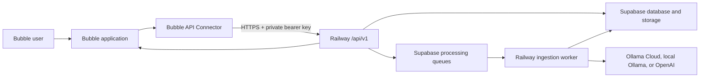

# RAG Railway API Integration and Delivery Guide

Last updated: 2026-08-02

## Purpose

This document is the implementation plan for connecting a Bubble application to the RAG Railway public API hosted on Railway. It is intended to be detailed enough for a Bubble developer and a Railway developer to deliver, test, and release the integration without having to infer the architecture or API workflow.

The Bubble application will be an API client. It will not connect directly to Supabase, Ollama, OpenAI, or the Railway worker. Bubble will send authenticated HTTPS requests to the Railway web API, and Railway will coordinate the database, storage, ingestion worker, RAG retrieval, model calls, extraction tasks, and generated files.

The current production API base URL is:

```text
https://web-production-3bf65.up.railway.app/api/v1
```

The complete wire-level endpoint contract is maintained in [api-usage.md](api-usage.md). This document focuses on installing and using that contract in Bubble.

## Delivery Outcome

When this guide is complete, the Bubble application will be able to:

1. Verify the Railway API and the Bubble API key.
2. List, create, and select silos.
3. List, create, delete, and select projects inside a silo.
4. Add existing silo documents to projects without re-ingesting them.
5. Upload PDF, DOCX, Excel, Markdown, text, CSV, PNG, and JPEG files.
6. Monitor ingestion status, stage, progress, heartbeat, runtime, counts, and errors.
7. Browse documents and chunks.
8. Download original documents and canonical Markdown versions.
9. Search RAG content using keyword, vector, or hybrid retrieval.
10. Run Ask requests against a silo, project, or individual document, stream
    live progress, and recover a run after a client disconnect.
11. Run extraction requests and monitor their completion.
12. Create, edit, duplicate, delete, run, monitor, and cancel sequential extraction Tasks.
13. Browse, download, and delete generated JSON, CSV, Markdown, and text files.
14. Cancel, reprocess, re-embed, or delete documents.
15. Read and update RAG settings when the Bubble role is allowed to administer them.
16. Preserve API errors, request IDs, and operation history for troubleshooting.

## System Architecture



The API key follows this path:

```text
Railway admin creates key
    -> Bubble API Connector stores it as a private header
    -> Bubble server sends it to Railway
    -> Railway validates its hash and scopes
```

The key must never be stored in a Bubble data type, option set, custom state, page element, URL parameter, client-side JavaScript, or user-visible workflow.

## Source Of Truth

Use these ownership rules:

| Information                                               | Source of truth                                                          |
| --------------------------------------------------------- | ------------------------------------------------------------------------ |
| Silos, projects, documents, chunks, jobs, generated files | Supabase through Railway                                                 |
| Provider keys and model configuration                     | Railway admin and the local encrypted settings vault                     |
| Bubble users, roles, page state, and optional UI cache    | Bubble                                                                   |
| API key                                                   | Local settings vault; copied privately into Bubble API Connector for use |
| Long-running ingestion and embedding                      | Railway worker                                                           |
| Ask, RAG search, extraction, and Task API contract        | Railway `/api/v1`                                                        |

Bubble may mirror external IDs and statuses for workflow convenience, but it must not become the authoritative copy of RAG content.

## Current Readiness

The Railway public API now supports the full Bubble delivery contract described in this guide:

1. `GET /api/v1/usage-logs` provides scoped, paginated, redacted diagnostics to authorized API keys.
2. Original, canonical Markdown, and generated-file endpoints can issue short-lived signed download tickets for browser downloads without exposing the bearer key.
3. Multipart idempotency hashes logical fields, file metadata, and file bytes instead of the generated multipart boundary.
4. An authenticated production acceptance suite verifies the contract through real Railway, Supabase, worker, retrieval, model, generated-file, task, and audit-log workflows.

On 2026-07-29, the production suite passed 44 checks against `https://web-production-3bf65.up.railway.app/api/v1`, including project-isolated RAG retrieval, Ask, JSON extraction, Markdown Task output, source/generated downloads, signed tickets, pagination, idempotency, cancellation, recovery reprocessing, re-embedding, and usage logs. The remaining application delivery work is Bubble API Connector configuration, Bubble workflows/UI, environment-specific key creation, and Bubble-side acceptance testing. Start with [bubble-api-installation.md](bubble-api-installation.md).

## Prerequisites

### Railway

Confirm:

- The Railway web service is deployed.
- `GET https://web-production-3bf65.up.railway.app/api/v1/health` returns HTTP `200`.
- The Railway worker is deployed and is claiming jobs.
- Supabase connectivity is configured.
- Model providers and the Vision, Ask, Extraction, and PDF assembly tasks are configured.
- The embedding model is installed and available to the worker.
- The production Railway domain uses HTTPS.

### Railway API Key

Create one API key specifically for each Bubble environment:

- `Bubble Development`
- `Bubble Live`

For complete feature parity, select these scopes:

```text
silos:read
silos:write
documents:read
documents:ingest
documents:delete
documents:reprocess
documents:cancel
rag:ask
rag:extract
generated-files:read
generated-files:delete
api-usage:read
```

Do not reuse an administrator's personal testing key. Separate keys make rotation, revocation, auditing, and incident diagnosis much easier.

Record each key once when it is created or reveal it from the Railway administrator dashboard. The key begins with:

```text
brk_
```

### Bubble

The Bubble application needs:

- Permission to install plugins.
- The API Connector plugin.
- Backend workflows enabled for status polling.
- Bubble privacy rules for local mirror records.
- A development version and a live version.
- A Bubble test user with permission to use the RAG interface.

## Install The Bubble API Connector

1. Open the Bubble application editor.
2. Select `Plugins`.
3. Select `Add plugins`.
4. Search for `API Connector`.
5. Install the Bubble-maintained API Connector.
6. Open the installed API Connector.
7. Select `Add another API`.
8. Name it `RAG Railway`.

Bubble documents the installation and call configuration process in its [API Connector guide](https://manual.bubble.io/help-guides/integrations/api/the-api-connector).

## Configure Authentication

In the `RAG Railway` API provider:

1. Set authentication to `Private key in header`.
2. Set the key name to `Authorization`.
3. Set the development value to:

   ```text
   Bearer brk_DEVELOPMENT_KEY
   ```

4. Set the live value to:

   ```text
   Bearer brk_LIVE_KEY
   ```

5. Keep both values private.
6. Do not mark the key as client safe.
7. Do not repeat the Authorization header on individual calls.

Bubble routes authenticated API Connector calls through its server and stores private authentication values server-side. See Bubble's [API Connector authentication guide](https://manual.bubble.io/help-guides/integrations/api/the-api-connector/authentication) and [API Connector security guide](https://manual.bubble.io/help-guides/security/api-security/api-connector-security).

### Base URL

Use this base URL for every production call:

```text
https://web-production-3bf65.up.railway.app/api/v1
```

Do not use:

```text
/api/apitest/v1
```

That route is a browser-session proxy for the Railway API test page. Bubble must call the public `/api/v1` routes directly.

If development and live Bubble versions need different Railway environments, create two Bubble API provider entries:

- `RAG Railway - Development`
- `RAG Railway - Production`

Hard-code the appropriate HTTPS base URL in each provider's calls. Do not let a page user supply or override the base URL.

## Shared Connector Rules

### Content Type

Do not add `Content-Type` as a shared header because the upload route uses multipart form data.

For each JSON call, add:

```text
Content-Type: application/json
```

For the upload call, select `Form-data` as the body type and let Bubble generate the multipart `Content-Type` and boundary.

### Idempotency

All persistent mutations require:

```text
Idempotency-Key: <unique operation key>
```

The value is not a secret, so it must be dynamic rather than private.

Recommended Bubble pattern:

1. Create a local `RAG API Operation` thing before the API call.
2. Use `bubble-` plus that thing's unique ID as the idempotency key.
3. Save the key on the operation.
4. If the request times out and must be retried, reuse the same operation and the same key.
5. Never reuse the key for a different endpoint, body, file, or selected object.
6. Do not leave the sample initialization value fixed in the connector call. Every new user-triggered operation must receive a new dynamic value.

Example:

```text
bubble-1698842301123x123456789012345678
```

The API accepts up to 160 characters.

### Error Handling

For every connector call:

1. Enable `Include errors in response & allow workflow actions to continue`.
2. Capture the status code.
3. Capture the raw error body.
4. Save `error.code`, `error.message`, and `requestId` when available.
5. Display a friendly message to the user.
6. Display the request ID only in an administrator diagnostic area.

The API error shape is:

```json
{
  "error": {
    "code": "invalid_request",
    "message": "Request body did not match the API contract.",
    "details": {}
  },
  "requestId": "request-uuid"
}
```

### Dynamic Parameters

Use Bubble URL parameters for IDs:

```text
https://web-production-3bf65.up.railway.app/api/v1/silos/[silo_id]/documents
```

Use Bubble dynamic body parameters for JSON values:

```json
{
  "question": "<question>",
  "projectId": "<project_id>"
}
```

Optional UUID fields must be omitted when not selected. Do not send an empty string as `projectId` or `documentId`, because an empty string is not a valid UUID.

### Call Initialization

Bubble initializes a call by actually executing it.

Use these rules:

- Initialize read calls against a disposable test silo.
- Initialize create calls with names beginning with `Bubble Init`.
- Initialize upload with a small non-sensitive text file.
- Initialize Ask and extraction against non-sensitive test content.
- Initialize delete calls only with disposable records.
- Use a new idempotency key for each initialization.
- After initialization, remove sensitive sample data from dynamic fields.
- Keep the bearer key only in the private authentication fields.

Bubble explains that initialization runs the real call and uses the returned response to define the Bubble response type in its [adding calls reference](https://manual.bubble.io/core-resources/api/the-api-connector/adding-calls).

## API Connector Call Inventory

Use the names below so calls remain sorted and easy to find in Bubble.

| Bubble call name                     | Method and path                                          | Use as        | Scope                    | Idempotency |
| ------------------------------------ | -------------------------------------------------------- | ------------- | ------------------------ | ----------- |
| `BRAG 01 Health`                     | `GET /health`                                            | Data          | None                     | No          |
| `BRAG 02 Current Key`                | `GET /me`                                                | Data          | Any key                  | No          |
| `BRAG 10 List Silos`                 | `GET /silos`                                             | Data          | `silos:read`             | No          |
| `BRAG 11 Create Silo`                | `POST /silos`                                            | Action        | `silos:write`            | Yes         |
| `BRAG 12 Get Silo`                   | `GET /silos/[silo_id]`                                   | Data          | `silos:read`             | No          |
| `BRAG 20 List Projects`              | `GET /silos/[silo_id]/projects`                          | Data          | `silos:read`             | No          |
| `BRAG 21 Create Project`             | `POST /silos/[silo_id]/projects`                         | Action        | `silos:write`            | Yes         |
| `BRAG 21B Get Project`               | `GET /silos/[silo_id]/projects/[project_id]`             | Data          | `silos:read`             | No          |
| `BRAG 22 Delete Project`             | `DELETE /silos/[silo_id]/projects/[project_id]`          | Action        | `silos:write`            | Yes         |
| `BRAG 23 List Project Documents`     | `GET /silos/[silo_id]/projects/[project_id]/documents`   | Data          | `documents:read`         | No          |
| `BRAG 24 Replace Project Documents`  | `PUT /silos/[silo_id]/projects/[project_id]/documents`   | Action        | `documents:ingest`       | Yes         |
| `BRAG 30 List Documents`             | `GET /silos/[silo_id]/documents`                         | Data          | `documents:read`         | No          |
| `BRAG 31 Upload Document`            | `POST /silos/[silo_id]/documents`                        | Action        | `documents:ingest`       | Yes         |
| `BRAG 32 Get Document`               | `GET /documents/[document_id]`                           | Data          | `documents:read`         | No          |
| `BRAG 33 Document Status`            | `GET /documents/[document_id]/status`                    | Data          | `documents:read`         | No          |
| `BRAG 34 Document Chunks`            | `GET /documents/[document_id]/chunks`                    | Data          | `documents:read`         | No          |
| `BRAG 35 Download Original`          | `GET /documents/[document_id]/download`                  | Data/File     | `documents:read`         | No          |
| `BRAG 35B Original Download Ticket`  | `POST /documents/[document_id]/download-ticket`          | Action        | `documents:read`         | No          |
| `BRAG 36 Download Markdown`          | `GET /documents/[document_id]/text`                      | Data/File     | `documents:read`         | No          |
| `BRAG 36B Markdown Download Ticket`  | `POST /documents/[document_id]/markdown-download-ticket` | Action        | `documents:read`         | No          |
| `BRAG 37 Reprocess Document`         | `POST /documents/[document_id]/reprocess`                | Action        | `documents:reprocess`    | Yes         |
| `BRAG 38 Re-embed Document`          | `POST /documents/[document_id]/embed`                    | Action        | `documents:reprocess`    | Yes         |
| `BRAG 39 Cancel Document`            | `POST /documents/[document_id]/cancel`                   | Action        | `documents:cancel`       | Yes         |
| `BRAG 40 Delete Document`            | `DELETE /documents/[document_id]`                        | Action        | `documents:delete`       | Yes         |
| `BRAG 50 RAG Search`                 | `POST /silos/[silo_id]/rag-search`                       | Action        | `documents:read`         | No          |
| `BRAG 51 Ask`                        | `POST /silos/[silo_id]/ask`                              | Action        | `rag:ask`                | Yes         |
| `BRAG 51B Ask Stream`                | `POST /silos/[silo_id]/ask/stream`                       | Action/Stream | `rag:ask`                | Yes         |
| `BRAG 51C Ask Run Status`            | `GET /ask-runs/[run_id]`                                 | Data          | `rag:ask`                | No          |
| `BRAG 51D List Ask Runs`             | `GET /ask-runs`                                          | Data          | `rag:ask`                | No          |
| `BRAG 51E Clear Ask Runs`            | `DELETE /ask-runs`                                       | Action        | `rag:ask`                | Yes         |
| `BRAG 60 List Extractions`           | `GET /silos/[silo_id]/extractions`                       | Data          | `rag:extract`            | No          |
| `BRAG 61 Create Extraction`          | `POST /silos/[silo_id]/extractions`                      | Action        | `rag:extract`            | Yes         |
| `BRAG 62 Get Extraction`             | `GET /extractions/[extraction_id]`                       | Data          | `rag:extract`            | No          |
| `BRAG 70 List Tasks`                 | `GET /tasks`                                             | Data          | `rag:extract`            | No          |
| `BRAG 71 Create Task`                | `POST /tasks`                                            | Action        | `rag:extract`            | Yes         |
| `BRAG 72 Get Task`                   | `GET /tasks/[task_id]`                                   | Data          | `rag:extract`            | No          |
| `BRAG 73 Update Task`                | `PUT /tasks/[task_id]`                                   | Action        | `rag:extract`            | Yes         |
| `BRAG 74 Replace Task Steps`         | `PUT /tasks/[task_id]/items`                             | Action        | `rag:extract`            | Yes         |
| `BRAG 75 Delete Task`                | `DELETE /tasks/[task_id]`                                | Action        | `rag:extract`            | Yes         |
| `BRAG 76 Run Task`                   | `POST /tasks/[task_id]/run`                              | Action        | `rag:extract`            | Yes         |
| `BRAG 77 List Task Runs`             | `GET /task-runs`                                         | Data          | `rag:extract`            | No          |
| `BRAG 78 Get Task Run`               | `GET /task-runs/[run_id]`                                | Data          | `rag:extract`            | No          |
| `BRAG 79 Cancel Task Run`            | `POST /task-runs/[run_id]/cancel`                        | Action        | `rag:extract`            | Yes         |
| `BRAG 80 Rebuild Task Run`           | `POST /task-runs/[run_id]/rebuild`                       | Action        | `rag:extract`            | Yes         |
| `BRAG 80 List Generated Files`       | `GET /silos/[silo_id]/generated-files`                   | Data          | `generated-files:read`   | No          |
| `BRAG 81A Read Generated JSON`       | `GET /generated-files/[file_id]/json`                    | Data          | `generated-files:read`   | No          |
| `BRAG 81 Download Generated File`    | `GET /generated-files/[file_id]/download`                | Data/File     | `generated-files:read`   | No          |
| `BRAG 81B Generated Download Ticket` | `POST /generated-files/[file_id]/download-ticket`        | Action        | `generated-files:read`   | No          |
| `BRAG 82 Delete Generated File`      | `DELETE /generated-files/[file_id]`                      | Action        | `generated-files:delete` | Yes         |
| `BRAG 90 Get RAG Settings`           | `GET /rag-settings`                                      | Data          | `silos:read`             | No          |
| `BRAG 91 Update RAG Settings`        | `PUT /rag-settings`                                      | Action        | `silos:write`            | Yes         |
| `BRAG 92 API Usage Logs`             | `GET /usage-logs`                                        | Data          | `api-usage:read`         | No          |

## Configure The Core Calls

The following examples show the Bubble-facing request body. Refer to [api-usage.md](api-usage.md) for complete response examples.

### Health

```text
Method: GET
Use as: Data
URL: https://web-production-3bf65.up.railway.app/api/v1/health
```

Expected result:

```json
{
  "ok": true
}
```

Use this call for the first connectivity test and for a controlled Railway wake-up before a large operation.

### Current API Key

```text
Method: GET
Use as: Data
URL: https://web-production-3bf65.up.railway.app/api/v1/me
```

Confirm that the returned key name and scopes match the intended Bubble environment.

### List Silos

```text
Method: GET
Use as: Data
URL: https://web-production-3bf65.up.railway.app/api/v1/silos?page=[page]&pageSize=[page_size]
```

Use `page=1` and `pageSize=100` for the initial silo selector.

### Create Silo

```text
Method: POST
Use as: Action
Content-Type: application/json
Idempotency-Key: dynamic
```

Body:

```json
{
  "name": "<name>",
  "description": "<description>"
}
```

Store the returned `silo.id`.

### List And Create Projects

List URL:

```text
GET /silos/[silo_id]/projects?page=1&pageSize=100
```

Create body:

```json
{
  "name": "<name>",
  "description": "<description>"
}
```

Deleting a project removes only the project and document membership rows. It does not delete documents, chunks, embeddings, source files, or generated files.

### Replace Project Membership

```text
PUT /silos/[silo_id]/projects/[project_id]/documents
```

Body:

```json
{
  "documentIds": ["<document_id_1>", "<document_id_2>"]
}
```

This endpoint replaces the entire membership list. The Bubble workflow must:

1. Load all documents in the silo.
2. Load the selected project's current `documentIds`.
3. Let the user select the desired complete set.
4. Send all selected document IDs in one request.

Bubble cannot send a raw list of Bubble Things as JSON. Build a JSON array from the external ID text values. A typical expression is conceptually:

```text
["id-one","id-two","id-three"]
```

Do not send Bubble database unique IDs unless they are also the Railway document UUID.

### Upload Document

```text
Method: POST
Use as: Action
Body type: Form-data
URL: /silos/[silo_id]/documents
Idempotency-Key: dynamic
```

Form fields:

| Field             | Bubble value                      | Required |
| ----------------- | --------------------------------- | -------- |
| `fileUrl`         | File uploader's value             | Yes      |
| `fileName`        | File uploader's value's file name | Yes      |
| `title`           | User-entered title                | No       |
| `mimeType`        | File MIME type                    | No       |
| `processingDepth` | `fast`, `standard`, or `deep`     | No       |
| `projectId`       | Selected Railway project UUID     | No       |
| `webhookUrl`      | Bubble backend webhook URL        | No       |
| `webhookSecret`   | Shared webhook secret             | No       |

Important:

- Bubble stores an uploader selection first and exposes its value as a URL.
  Send that value as `fileUrl`; Railway downloads it server-to-server.
- Keep the source extension in `fileName`, because it is used for MIME
  inference and parser selection.
- The API also accepts a real multipart file part named exactly `file`. A URL
  placed in `file` remains supported for existing Bubble calls.
- Do not manually set the multipart `Content-Type` header.
- Omit `projectId` when the whole silo is selected.
- Save `document.id`, `job.id`, `document.status`, and `requestId`.
- The upload response is HTTP `202`; processing continues on the Railway worker.
- The File Uploader must finish uploading before the Send to RAG workflow runs.
  Add a workflow condition that the uploader's value is not empty.
- Bubble private files require a URL that Railway can access. Start with a
  non-private test file, then use a time-limited accessible URL if source files
  must remain private.

### List Documents

Whole silo:

```text
GET /silos/[silo_id]/documents?page=[page]&pageSize=[page_size]
```

Project only:

```text
GET /silos/[silo_id]/documents?projectId=[project_id]&page=[page]&pageSize=[page_size]
```

Ready documents only:

```text
GET /silos/[silo_id]/documents?status=ready&page=[page]&pageSize=[page_size]
```

When the Bubble project selector is blank, omit `projectId` and display all documents in the selected silo.

### Document Status

```text
GET /documents/[document_id]/status
```

Map at least:

- `document.id`
- `document.status`
- `document.file_name`
- `document.last_error`
- `latestJob.id`
- `latestJob.status`
- `latestJob.stage`
- `latestJob.error_message`
- `latestJob.progress`
- `latestJob.progressSummary.label`
- `latestJob.progressSummary.percent`
- `latestJob.timing.queuedMs`
- `latestJob.timing.runningMs`
- `latestJob.timing.totalMs`
- `latestJob.timing.heartbeatAt`
- `latestJob.timing.heartbeatAgeMs`
- `latestJob.timing.isStale`
- `counts.chunks`
- `counts.embeddings`
- `counts.assets`
- `requestId`

Terminal job statuses:

```text
succeeded
failed
cancelled
```

Active job statuses:

```text
queued
running
```

Do not infer that a job is dead only because a large PDF has been running for several minutes. Use the heartbeat age and `isStale`.

### Document Chunks

```text
GET /documents/[document_id]/chunks?page=[page]&pageSize=[page_size]
```

Display chunk index, page number, chunk type, token count, text, and source offsets when present.

### Reprocess, Re-embed, Cancel, And Delete

Reprocess:

```json
{
  "processingDepth": "deep",
  "visionCacheMode": "reuse"
}
```

Use `visionCacheMode=refresh` for a complete vision re-run.

Re-embed:

```text
POST /documents/[document_id]/embed
```

This does not re-run parsing, OCR, vision, Markdown assembly, or chunking.

Cancel:

```json
{
  "jobId": "<job_id>",
  "reason": "<reason>"
}
```

Delete:

```text
DELETE /documents/[document_id]
```

Require a Bubble confirmation dialog before delete. After success, delete or archive only the local Bubble mirror record. The Railway response remains authoritative.

### Direct RAG Search

```text
POST /silos/[silo_id]/rag-search
```

Body:

```json
{
  "query": "<query>",
  "topK": 10,
  "projectId": "<project_id>",
  "documentId": "<document_id>",
  "retrieve": "text",
  "minScore": 0.08,
  "searchMode": "vector",
  "includeNeighborChunks": true,
  "neighborChunkCount": 1
}
```

Rules:

- Omit `projectId` to search the entire selected silo.
- Omit `documentId` to search all documents in the selected silo or project.
- Omit `searchMode` to use the `vector` default, or explicitly use `keyword`,
  `vector`, or `hybrid`.
- Keep both source document name and UUID.
- Show results in descending score order.
- Display `embedding.available` and `embedding.error` so vector fallback is visible.
- Use `chunkContext.combined.text` when available because it avoids duplicated overlap.

### Ask

```text
POST /silos/[silo_id]/ask
```

Body:

```json
{
  "question": "<question>",
  "projectId": "<project_id>",
  "documentId": "<document_id>",
  "searchMode": "vector",
  "webhookUrl": "<bubble_backend_workflow_url>",
  "webhookSecret": "<shared_signing_secret>",
  "outputFile": {
    "enabled": true,
    "format": "md",
    "fileName": "<file_name>"
  }
}
```

The webhook fields are optional. When present, Railway sends a
`model.status.updated` callback after every validated model-status tool call.
The callback includes the original `question` as `request`, the Ask run ID, and
the structured `modelStatus`. Status responses expose only
`webhookConfigured` and `webhookSigned`.

If `topK` or `searchMode` is omitted, Railway uses the configured Ask model task values. If `projectId` is omitted, Ask can retrieve from the entire silo.

Ask is model-first. The configuration's **Max RAG searches per request** value
(`0-100`, default `8`) limits only model-directed retrieval. The independent
overall tool limit (`1-250`, default `64`) also covers full-document and
stateful file-editing calls.

Store or display:

- `answer`
- `confidence`
- `sources`
- `usage`
- `model`
- `askRun.id` (also returned as `questionLog.id` for compatibility)
- `generatedFile.id`
- `requestId`

The ordinary endpoint returns the final response in the same HTTP request. It
still creates a durable Ask run and event journal.

For live progress, configure Bubble's response type as **Stream** and call:

```text
POST /silos/[silo_id]/ask/stream
Accept: application/x-ndjson
```

Use the same JSON body, bearer authorization, `rag:ask` scope, and a unique
`Idempotency-Key`. Railway sends one complete JSON event per line. The event
envelope is:

```json
{
  "runId": "<ask_run_uuid>",
  "sequence": 12,
  "type": "tool.completed",
  "payload": {},
  "createdAt": "2026-07-31T15:10:00.000Z"
}
```

Useful event types include `retrieval.started`, `retrieval.completed`,
`retrieval.expansion.required`,
`model.call.started`, `reasoning.delta`, `model.output.delta`, `tool.started`,
`tool.completed`, `answer.completed`, `generated_file.completed`,
`ask.completed`, and `ask.failed`. `reasoning.delta` contains only reasoning
summaries or thinking text the selected provider supports exposing. It is not a
guaranteed verbatim private chain of thought. Tool events represent the actual
Railway tools and results used by the Ask loop.

Save `runId` immediately and store the largest received `sequence`. The final
ordinary Ask result is at `ask.completed.payload.result`. If the Bubble page,
network connection, or streaming call disconnects, do not submit a second Ask.
Recover the existing run with:

```text
GET /ask-runs/[run_id]?afterSequence=[last_sequence]&eventLimit=100
```

Poll every 1 to 3 seconds until `askRun.terminal` is `yes`. Append the returned
events by sequence and update `afterSequence` to `eventPage.nextAfterSequence`.
On success, read `askRun.answer`, `askRun.sources`, `askRun.generatedFiles`, and
`askRun.elapsedMs`. On failure, display `askRun.errorMessage` and preserve the
run ID for the API diagnostics page. Reusing the original idempotency key only
replays the original completed Ask; it does not start a duplicate model call.

If `runId` was never saved, call:

```text
GET /ask-runs?siloId=[silo_id]&projectId=[project_id]&status=[status]&page=1&pageSize=50
```

Omit blank optional parameters. Select the matching history item and recover
it through `BRAG 51C Ask Run Status`.

To clear old terminal history, call:

```text
DELETE /ask-runs?siloId=[silo_id]&projectId=[project_id]&before=[before]&confirm=true
```

Set `Idempotency-Key` to a new workflow-generated value. Do not send a JSON
body. Railway skips active runs, deletes persisted stream events for removed
runs, and retains generated files.

### Execute And Retrieve Extraction

Create:

```text
POST /silos/[silo_id]/extractions
```

Body:

```json
{
  "projectId": "<project_id>",
  "documentId": "<document_id>",
  "request": "<extraction instructions>",
  "outputFormat": "json",
  "webhookUrl": "<bubble_backend_workflow_url>",
  "webhookSecret": "<shared_signing_secret>",
  "outputFile": {
    "enabled": true,
    "format": "json",
    "fileName": "<file_name>"
  }
}
```

The optional webhook has the same signing and model-status contract as Ask.
Its payload contains the original Extraction `request`, the Extraction run ID,
and `modelStatus`. The persisted Extraction status also exposes the latest
`progress` plus webhook registration/signing booleans.

Use top-level `request` for new calls. `customSchema.request` remains a
compatibility alias, but arbitrary `customSchema` members are not applied by
the current executor.

Extraction uses its own **Max RAG searches per request** setting with the same
`0-100` range and default of `8`. The request reaches the model before
retrieval. The response and persisted execution trace report actual RAG calls;
DOCX output must complete the document workspace and finalization tools.

The call is synchronous. On HTTP `200`, store `extractionRun.id`,
`extractionResult.id`, and `generatedFile.id`; the response reports
`queued: false`. The configured model timeout may make this a long-running
request. Reopen the persisted result later with:

```text
GET /extractions/[extraction_id]
```

On success, load `result` and `generatedFiles`. For durable queued execution,
create a saved Task and run it with `POST /tasks/[task_id]/run`.

### Create And Edit Tasks

Create an empty Task:

```json
{
  "name": "<task_name>",
  "description": "<description>",
  "isActive": true
}
```

Update its metadata:

```text
PUT /tasks/[task_id]
```

Replace the complete step sequence:

```text
PUT /tasks/[task_id]/items
```

```json
{
  "items": [
    {
      "name": "Project list",
      "request": "Extract all named projects, locations, dates, and costs.",
      "outputFileName": "projects.json",
      "outputFormat": "json"
    },
    {
      "name": "Sidewalk findings",
      "request": "Extract every sidewalk-related project or goal.",
      "outputFileName": "sidewalk-findings.md",
      "outputFormat": "md"
    }
  ]
}
```

The order of the `items` array is the execution order. Bubble can implement drag/drop or up/down controls by rebuilding the array and calling the replace endpoint.

Task steps do not store `topK` or RAG search mode. They inherit the current Extraction model task configuration. `outputFileEnabled` defaults to `true`; set it to `false` for a cache-building step that should stage Task Dataset work and complete without a generated file. `outputFileName` is required only when file output is enabled.

Expose `strictTaskDataset` as a yes/no checkbox on every Task step. Leave it
off for the normal model-directed behavior. When it is on, the model must
successfully perform meaningful Task Dataset inventory, reuse, creation, or
staging work before that step can complete; merely viewing the dataset catalog
or description is insufficient. The server snapshots the checkbox value when
the Task run starts. A strict step that cannot satisfy the requirement fails,
which prevents the shared Task Dataset transaction from publishing partial
data.

### Duplicate A Task

Bubble duplicates a Task through public API calls:

1. Load the source with `GET /tasks/[task_id]`.
2. Let the user edit the new name.
3. Call `POST /tasks` with the new name, copied description, and copied items.
4. Store the new `task.id`.
5. Refresh the Task list.

Do not reuse the source Task's ID or the create operation's idempotency key.

### Run And Monitor A Task

Run:

```text
POST /tasks/[task_id]/run
```

```json
{
  "siloId": "<silo_id>",
  "projectId": "<project_id>",
  "inputData": "Town: Smyrna\nStart date: 2026-08-01\nEnd date: 2026-08-31",
  "fileNameModifier": "August 2026",
  "webhookUrl": "<bubble_backend_workflow_url>",
  "webhookSecret": "<shared_signing_secret>"
}
```

Omit `projectId` to run against the entire silo. Omit `webhookUrl` and
`webhookSecret` when polling alone. A blank Task is valid and completes without
creating files.

Add an optional multiline `inputData` field, limited to 8,000 characters, to
the Bubble workflow that launches a Task. The server stores it on that run and
places it at the bottom of every step's model context under **Input data**. Its
run-specific facts and parameters override conflicting data for that run, but
the field is not copied into or concatenated with the saved step request.

Add an optional `fileNameModifier` field, limited to 120 characters. The server
removes spaces and invalid filename characters, prefixes the result with a
dash, and inserts it before the automatically selected extension for every
file-producing step. For example, `August: 2026 / Q3*` produces the suffix
`-August2026Q3`. Leave the value blank to preserve existing filenames.

Poll:

```text
GET /task-runs/[run_id]
```

List with filters:

```text
GET /task-runs?siloId=[silo_id]&projectId=[project_id]&taskId=[task_id]&status=[status]
```

Cancel:

```text
POST /task-runs/[run_id]/cancel
```

Show the overall run and each ordered item:

- Run status.
- Current item position.
- Total, completed, and failed item counts.
- Step status.
- Extraction run ID.
- Generated file ID.
- Preview.
- Model latency.
- Error message.

### Generated Files

List:

```text
GET /silos/[silo_id]/generated-files?page=1&pageSize=20
```

Optional filters:

```text
projectId
taskKey
outputFormat
temporary
```

Use `projectId` when the Bubble project selector is active.

Read a JSON generated file as a Bubble data result:

```text
GET /generated-files/[file_id]/json
```

Initialize `BRAG 81A Read Generated JSON` with a representative generated JSON
file whose fields match the shape Bubble workflows need. The endpoint returns
the JSON value directly, without a Railway response envelope. Because Bubble
derives fields from the initialized response, generated JSON files used by one
call should follow a stable schema.

Delete:

```text
DELETE /generated-files/[file_id]
```

Require confirmation. This deletes both the database row and the Supabase Storage object.

### RAG Settings

Read:

```text
GET /rag-settings
```

Update:

```text
PUT /rag-settings
```

Body:

```json
{
  "chunkMaxTokens": 900,
  "chunkOverlapTokens": 120,
  "searchMinScore": 0.08,
  "neighborChunkCount": 2,
  "neighborChunkMaxChars": 12000,
  "embeddingProvider": "ollama",
  "embeddingModel": "nomic-embed-text",
  "embeddingDimensions": 768
}
```

Validation limits:

- `chunkMaxTokens`: 100 to 2000.
- `chunkOverlapTokens`: 0 to 500 and smaller than `chunkMaxTokens`.
- `searchMinScore`: 0 to 1.
- `neighborChunkCount`: 0 to 10.
- `neighborChunkMaxChars`: 200 to 50000.

Changing the embedding provider, model, or dimensions queues ready documents for embedding-only backfill. It does not rerun parsing, vision analysis, Markdown assembly, or chunking.

This call can change chunking, overlap, embedding, and direct-search behavior for the tenant. Expose it only to a Bubble administrator role. Normal Bubble users should not receive a key with `silos:write` if they do not need configuration access.

## Bubble Data Model

The Railway API remains the source of truth. The following Bubble types are recommended for workflow state, caching, and diagnostics.

### `RAG Silo`

| Field                 | Type |
| --------------------- | ---- |
| `railway_id`          | text |
| `name`                | text |
| `description`         | text |
| `created_at_external` | date |
| `last_synced_at`      | date |

### `RAG Project`

| Field                 | Type |
| --------------------- | ---- |
| `railway_id`          | text |
| `silo_railway_id`     | text |
| `name`                | text |
| `description`         | text |
| `created_at_external` | date |
| `last_synced_at`      | date |

### `RAG Document`

| Field                 | Type   |
| --------------------- | ------ |
| `railway_id`          | text   |
| `silo_railway_id`     | text   |
| `file_name`           | text   |
| `title`               | text   |
| `mime_type`           | text   |
| `status`              | text   |
| `page_count`          | number |
| `last_error`          | text   |
| `latest_job_id`       | text   |
| `latest_job_status`   | text   |
| `latest_job_stage`    | text   |
| `progress_label`      | text   |
| `progress_percent`    | number |
| `heartbeat_at`        | date   |
| `heartbeat_is_stale`  | yes/no |
| `queued_ms`           | number |
| `running_ms`          | number |
| `total_ms`            | number |
| `chunk_count`         | number |
| `embedding_count`     | number |
| `asset_count`         | number |
| `created_at_external` | date   |
| `updated_at_external` | date   |
| `last_synced_at`      | date   |

### `RAG API Operation`

| Field                | Type   |
| -------------------- | ------ |
| `operation_type`     | text   |
| `idempotency_key`    | text   |
| `external_object_id` | text   |
| `external_job_id`    | text   |
| `status`             | text   |
| `request_id`         | text   |
| `http_status`        | number |
| `error_code`         | text   |
| `error_message`      | text   |
| `started_at`         | date   |
| `finished_at`        | date   |
| `poll_count`         | number |
| `next_poll_at`       | date   |
| `owner`              | User   |

### `RAG Extraction Run`

| Field                  | Type |
| ---------------------- | ---- |
| `railway_id`           | text |
| `silo_railway_id`      | text |
| `project_railway_id`   | text |
| `document_railway_id`  | text |
| `status`               | text |
| `result_json_text`     | text |
| `result_markdown`      | text |
| `result_csv`           | text |
| `error_message`        | text |
| `started_at_external`  | date |
| `finished_at_external` | date |
| `last_synced_at`       | date |

### `RAG Task`

| Field            | Type   |
| ---------------- | ------ |
| `railway_id`     | text   |
| `name`           | text   |
| `description`    | text   |
| `is_active`      | yes/no |
| `last_synced_at` | date   |

Task steps can remain API response data while editing. If they must be stored locally, create `RAG Task Step` with a numeric `position`, request text, an `output_file_enabled` yes/no field, a `strict_task_dataset` yes/no field, file name, and output format. Preserve both flags when round-tripping edits so a cache-building step is not accidentally changed back into a file-producing step and strict dataset enforcement is not silently removed.

### `RAG Task Run`

| Field                   | Type   |
| ----------------------- | ------ |
| `railway_id`            | text   |
| `task_railway_id`       | text   |
| `silo_railway_id`       | text   |
| `project_railway_id`    | text   |
| `status`                | text   |
| `current_item_position` | number |
| `total_items`           | number |
| `completed_items`       | number |
| `failed_items`          | number |
| `started_at_external`   | date   |
| `finished_at_external`  | date   |
| `last_synced_at`        | date   |

### `RAG Generated File`

| Field                 | Type   |
| --------------------- | ------ |
| `railway_id`          | text   |
| `silo_railway_id`     | text   |
| `project_railway_id`  | text   |
| `document_railway_id` | text   |
| `question_log_id`     | text   |
| `extraction_run_id`   | text   |
| `file_name`           | text   |
| `output_format`       | text   |
| `mime_type`           | text   |
| `byte_size`           | number |
| `task_key`            | text   |
| `is_temporary`        | yes/no |
| `content_preview`     | text   |
| `created_at_external` | date   |
| `last_synced_at`      | date   |

### Privacy Rules

At minimum:

- Only authenticated users may see integration records.
- Tenant or organization membership must restrict records in multi-tenant Bubble apps.
- Only Bubble administrators may delete documents, delete generated files, alter RAG settings, or view diagnostics.
- Never add the Railway API key to any Bubble data type.
- Do not expose raw extraction content to users who do not have access to the selected silo/project.

## Bubble Page Structure

Create one authenticated RAG page or reusable dashboard with the following full-width sections.

### Header

- Railway connection indicator.
- Current environment.
- Refresh button.
- Silo selector.
- Optional project selector.

### Silos And Projects

- Silo list.
- Create silo dialog.
- Project list for selected silo.
- Create and delete project controls.
- Project document membership editor.

### Upload

- File uploader.
- Processing depth selector.
- Selected silo and optional project.
- Upload button.
- Current upload status.

### Documents

- Paginated document list.
- Status, stage, progress, heartbeat, and runtime.
- View chunks.
- Original download.
- Markdown download.
- Cancel, reprocess, re-embed, and delete commands based on status and role.

### Search, Ask, And Extraction

- Search mode selector.
- Top K, score cutoff, retrieve mode, and neighbor count for direct search.
- Ask input and optional output file controls.
- Extraction input and output file controls.
- Independent Ask and Extraction RAG-search ceilings and actual-call diagnostics.
- Source list showing document name, UUID, page, score, and snippet.

### Tasks

- On mobile, task list above the editor.
- On desktop, full-width task editor with task list and extraction sequence.
- Create, edit, duplicate, delete, reorder steps, and save.
- Separate run section with silo, optional project, Task selector, and Run button.
- Task run queue and per-step progress.

### Generated Files

- Project-aware list.
- File name, format, source task, date, size, and preview.
- Direct JSON result action for files whose output format is `json`.
- Download and delete commands.

### Diagnostics

- Last call method and path.
- HTTP status.
- Railway `requestId`.
- Error code and message.
- Local Bubble operation ID and idempotency key.
- Filtered API usage logs from `BRAG 92 API Usage Logs`.

## Backend Polling Workflows

Enable backend workflows in Bubble under `Settings` -> `API` -> `Enable Workflow API and backend workflows`.

Bubble documents server-side scheduling in [Scheduling API workflows](https://manual.bubble.io/help-guides/integrations/api/the-bubble-api/the-workflow-api/api-workflows/scheduling-api-workflows).

### `rag_poll_document`

Parameters:

- `operation` as `RAG API Operation`
- `document_id` as text
- `attempt` as number

Workflow:

1. Call `BRAG 33 Document Status`.
2. Update the local Document and Operation.
3. If job status is terminal, set `finished_at` and stop.
4. If running and `timing.isStale=yes`, mark the operation `attention_required` but do not automatically cancel.
5. If still active, schedule `rag_poll_document` again.
6. Stop at a configured maximum elapsed time and alert an administrator.

Suggested polling cadence:

| Elapsed time         | Delay before next poll |
| -------------------- | ---------------------: |
| First minute         |              5 seconds |
| 1 to 10 minutes      |             15 seconds |
| More than 10 minutes |             30 seconds |

New Bubble apps may enforce a default recursive workflow chain limit. Configure an intentional upper limit or use a webhook for very long processing. Bubble describes this behavior in its [recursive API workflow guide](https://manual.bubble.io/help-guides/integrations/api/the-bubble-api/the-workflow-api/api-workflows/recursive-api-workflows).

### `rag_refresh_extraction`

Parameters:

- `operation`
- `extraction_id`
- `attempt` when periodic refresh is intentionally desired

Standalone Extraction completes in its original HTTP request, so normal calls
do not need a polling chain. This optional workflow calls `BRAG 62 Get
Extraction` to refresh or reopen an already persisted result. Use
`rag_poll_task_run` for queued multi-step extraction Tasks.

### `rag_poll_task_run`

Parameters:

- `operation`
- `run_id`
- `attempt`

Call `BRAG 78 Get Task Run`, update overall and per-step state, and reschedule until terminal.

### Page Polling

The page may refresh active data every 10 to 30 seconds while open, but backend polling should own persistent monitoring. A user closing the page must not stop tracking document ingestion, a durable Ask run, or a Task run.

## Optional Webhook Workflow

Polling is the recommended first delivery because it is simple to inspect and does not depend on webhook signature verification inside Bubble.

To add ingestion, Ask, Extraction, or Task-run webhooks:

1. Enable Bubble Workflow API and backend workflows.
2. Create backend API workflows such as `rag_ingestion_event`,
   `rag_model_status_event`, and `rag_task_run_event`.
3. Use Bubble's request-data detection with a non-sensitive sample payload.
4. Include request headers in detected data.
5. Pass the Bubble workflow URL as `webhookUrl` during upload, reprocess, Ask,
   Extraction, or Task-run creation.
6. Pass a random shared secret as `webhookSecret`.
7. Verify `x-bubble-rag-signature` against the raw request body using HMAC-SHA256 before updating any record.
8. Match ingestion events to `documentId` and `jobId`; match Ask and Extraction
   model-status events to `askRunId` or `extractionRunId`; match Task events to
   `taskRunId`.
9. Make updates idempotent, keyed on `x-bubble-rag-delivery-id`, so a repeated
   or out-of-order call cannot corrupt the record.
10. Return HTTP `200` promptly. Run callbacks time out after 10 seconds and the
    active run waits for each one, so slow workflows slow the run itself.

Task runs emit `task.run.started`, `task.run.progress` after each completed
step, and one of `task.run.succeeded`, `task.run.failed`, or
`task.run.cancelled`. Ask, standalone Extraction, and Task runs also emit
`model.status.updated` whenever the active model publishes a validated status.
Each status callback carries the authoritative original question or Task item
request plus `modelStatus`. Task progress bodies carry total, completed, and
failed item counts plus the latest completed or failed item.

Task-run callbacks are delivered **once per event with no retry**. A timeout or
non-2xx response is logged to `api_webhook_deliveries` and the run continues
unchanged, so a missed callback is never resent. Keep the polling workflow as
reconciliation even when callbacks update the Bubble record immediately. Full
field, validation, and signature detail is in
[rest-api-command-reference.md](./api/rest-api-command-reference.md#post-apiv1taskstaskidrun).

Bubble documents receiving webhook-shaped requests through [API workflows](https://manual.bubble.io/core-resources/api/the-bubble-api/the-workflow-api).

Do not expose an unsigned Bubble backend workflow and trust a caller-supplied status. If Bubble cannot verify the raw-body HMAC natively, use a reviewed server-side plugin action or keep polling.

## File Upload Strategy

### POC

Use the Bubble File Uploader as the `file` value in the Form-data API Connector call.

Acceptance tests:

- 1 KB text file.
- PNG or JPEG.
- Small PDF.
- 15 MB PDF.
- DOCX with embedded images.
- Excel workbook with multiple sheets.

For each test, confirm that:

- Upload returns HTTP `202`.
- Only one Railway document is created.
- The worker starts.
- Heartbeat changes while running.
- Document becomes `ready`.
- Markdown can be downloaded.
- Chunk and embedding counts are greater than zero.

### Large Upload Production Fallback

If Bubble or the Railway HTTP layer cannot reliably carry the required file size, add a two-step direct-upload flow:

1. Bubble requests a short-lived upload ticket from Railway.
2. Bubble uploads the file directly to the signed storage URL.
3. Bubble calls a Railway finalize endpoint with the storage object metadata.
4. Railway validates the object, creates the document/job rows, and queues ingestion.

This upload-ticket flow is not currently part of `/api/v1`; add it only if large-file testing demonstrates the need.

## Download Strategy

### POC For Files Under 50 MB

Configure each download call so Bubble interprets the response as `File`.

Workflow:

1. User selects Download.
2. Run the appropriate protected API Connector call.
3. Save or expose the returned File value.
4. Open the resulting Bubble-hosted file URL or attach it to a short-lived local download record.
5. Clean up temporary Bubble copies according to the app's retention policy.

Use:

- `BRAG 35 Download Original`
- `BRAG 36 Download Markdown`
- `BRAG 81 Download Generated File`

Bubble's API Connector has a 50 MB outgoing response limit. See Bubble's [hard limits](https://manual.bubble.io/help-guides/maintaining-an-application/performance-and-scaling/hard-limits).

### Production Download Tickets

For large originals or to avoid copying private files into Bubble storage, use the implemented JSON endpoints that return short-lived signed URLs:

```text
POST /api/v1/documents/{documentId}/download-ticket
POST /api/v1/documents/{documentId}/markdown-download-ticket
POST /api/v1/generated-files/{fileId}/download-ticket
```

Response:

```json
{
  "download": {
    "url": "https://short-lived-signed-url",
    "fileName": "source.pdf",
    "mimeType": "application/pdf",
    "byteSize": 15728640,
    "expiresIn": 120,
    "expiresAt": "2026-07-29T12:01:00.000Z"
  },
  "requestId": "request-uuid"
}
```

Configure each Bubble ticket call as an Action:

```json
{
  "expiresIn": 120
}
```

`expiresIn` may be 60 through 300 seconds and defaults to 120. Then:

- Do not store the signed URL in Bubble long-term.
- Open the URL immediately from the user workflow.
- Never put the Railway API key in the URL.
- Use `documents:read` for original/Markdown tickets and `generated-files:read` for generated-file tickets.

This is the preferred production solution for large protected downloads.

## API Usage Logs And Exact Test-Page Parity

Railway writes every authenticated request to `api_usage_logs`. Bubble and the Railway API test page read those records through:

```text
GET /api/v1/usage-logs
```

Supported query fields:

```text
page
pageSize
statusCode
errorCode
method
path
requestId
createdAfter
createdBefore
```

Required scope:

```text
api-usage:read
```

The route:

- Return only the authenticated key's tenant.
- Optionally return only the current API key's rows by default.
- Paginate with a maximum page size of 100.
- Never return API key hashes or ciphertext.
- Return request metadata only after removing secrets.

Bubble should still save its local operation log so client workflow state can be correlated with Railway `requestId` values.

API key creation and model/provider configuration should remain in Railway admin. They are not normal Bubble user functions.

## Security Requirements

1. Use HTTPS only.
2. Store the bearer token only in Bubble private API Connector authentication.
3. Use separate development and live API keys.
4. Give each key only the scopes required by that Bubble application.
5. Do not allow users to select the API base URL.
6. Do not expose RAG configuration changes to non-admin users.
7. Apply Bubble privacy rules to all mirrored records.
8. Confirm a user may access the selected silo/project before making a call.
9. Keep both source document UUID and name in citations.
10. Require confirmation for document, project, Task, and generated-file deletion.
11. Preserve request IDs and status codes, but redact secrets from logs.
12. Rotate the Bubble key immediately if it appears in a screenshot, page source, log, or database record.
13. Remember that current API key scopes are tenant-wide, not restricted to individual silos.

## Railway Sleep And Retry Behavior

The Railway web service may sleep after inactivity and take a short time to wake.

Recommended Bubble behavior:

1. Call Health when opening the RAG dashboard.
2. If a read call fails during a cold start, retry once after a short delay.
3. If a mutation times out, retry with the same idempotency key and identical request.
4. Never create a new idempotency key merely because the user did not see the first response.
5. Show `Connecting to processing service` while waking rather than reporting ingestion failure.

Multipart uploads are canonicalized server-side, so a retry may regenerate its multipart boundary while keeping the same idempotency key, fields, and file bytes.

## Delivery Phases

### Phase 1: Connection And Security

Configure:

- Health.
- Current key.
- List silos.

Acceptance:

- Development and live keys remain private.
- Invalid key returns `401`.
- Missing scope returns `403`.
- Railway request IDs are captured.

### Phase 2: Silos, Projects, And Documents

Configure:

- Silo list, create, and detail calls supported by the public API.
- Project list/create/delete.
- Project document membership.
- Document upload/list/detail/status/chunks.
- Polling workflow.

Acceptance:

- A file can belong to multiple projects without duplicate ingestion.
- Blank project selection means the complete silo.
- Deleting a project does not delete a file.
- Large PDF progress and heartbeat are visible.

### Phase 3: Search And Ask

Configure:

- RAG search.
- Ask.
- Source rendering.

Acceptance:

- Keyword, vector, and hybrid calls work.
- Project-scoped search never returns a document outside the project.
- Source name, UUID, page, and score are visible.
- Ask uses the selected silo/project.

### Phase 4: Extractions And Generated Files

Configure:

- Execute/list/get standalone extraction.
- Persist returned extraction and generated-file IDs.
- Generated-file list/download/delete.

Acceptance:

- JSON, CSV, and Markdown output can be generated.
- Generated files retain silo/project association.
- Failed extraction errors and request IDs are visible.

### Phase 5: Tasks

Configure:

- Task list/create/get/update/delete.
- Replace steps.
- Duplicate.
- Run against silo/project.
- Task run polling and cancellation.

Acceptance:

- Empty Task completes.
- Multi-step Task runs sequentially.
- Each successful step produces its expected file.
- Project-scoped Tasks retrieve only project documents.
- Mobile Task layout remains usable.

### Phase 6: Recovery And Administration

Configure:

- Cancel document.
- Reprocess with reuse or refresh vision.
- Re-embed only.
- Delete document.
- RAG settings for admin role.

Acceptance:

- Stale jobs can be cancelled and restarted.
- Re-embed does not rerun parsing.
- Destructive actions require confirmation.

### Phase 7: Production Hardening

Validate:

- Public scoped usage-log filtering and redaction.
- Short-lived signed download ticket expiry and access.
- Canonical multipart idempotency with a same-key upload retry.
- Webhook HMAC verification if webhooks replace polling.
- Load tests and API key rotation exercise.

## End-To-End Acceptance Script

Run this exact sequence in Bubble development:

1. Open the dashboard and confirm Health.
2. Confirm Current Key shows `Bubble Development` and all expected scopes.
3. Create silo `Bubble Delivery Test`.
4. Create project `Project A`.
5. Upload a small Markdown file to the silo and assign it to Project A.
6. Confirm the upload returns document and job IDs.
7. Poll until the document is ready.
8. Confirm heartbeat, total runtime, chunk count, and embedding count.
9. Download the original and Markdown versions.
10. List chunks and inspect at least two.
11. Run keyword search for a phrase in the document.
12. Run vector and hybrid search for a related concept.
13. Confirm source name, document UUID, page, and score.
14. Run Ask against Project A.
15. Run Ask against the whole silo.
16. Execute an extraction that writes JSON and retain the synchronous result IDs.
17. Reopen the extraction by ID and download the JSON file.
18. Create an empty Task and confirm an empty run completes.
19. Add two Task steps with different output formats.
20. Duplicate the Task under a new name.
21. Run the duplicate against Project A.
22. Confirm the steps run in sequence and produce two generated files.
23. Cancel a disposable queued Task run.
24. Re-embed the test document and monitor the job.
25. Reprocess with vision reuse.
26. Remove the document from Project A while keeping it in the silo.
27. Delete Project A and confirm the document still exists.
28. Delete one generated file.
29. Delete the test document.
30. Review the Bubble operation log and Railway API usage log using request IDs.

Repeat the upload/status/download portion with a 15 MB PDF before production release.

## Troubleshooting

### `401 api_key_required` Or `api_key_invalid`

- Confirm the Authentication method is Private key in header.
- Confirm the header name is `Authorization`.
- Confirm the value includes `Bearer ` followed by the full `brk_` key.
- Confirm the development/live value is in the correct Bubble field.
- Confirm the key is not revoked.

### `403 insufficient_scope`

- Read `error.details.requiredScope`.
- Edit or replace the Railway API key with the required scope.
- Do not give a broad key to a Bubble role that should remain read-only.

### `400 idempotency_key_required`

- Add the dynamic `Idempotency-Key` header.
- Confirm the call is using the locally stored Operation key.

### `409 idempotency_key_conflict`

- The same key was used with a different request shape.
- Do not change the body, URL, query, or file during a retry.
- Start a new Bubble Operation only for a genuinely new request.
- Multipart boundaries and field ordering may change, but field values and file bytes must remain identical.

### `409 idempotency_replay_resource_deleted`

- The request reused a create-project key whose original project was later deleted.
- Create a new Bubble Operation and pass its new idempotency key.
- Retry the project creation with the same name and description only after changing the key.

### `422 invalid_request`

- Inspect `error.details`.
- Remove blank optional UUID fields.
- Confirm output enum values.
- Confirm `documentIds` is a JSON array of Railway UUID strings.

### Upload Says Queued But Does Not Start

- Poll document status.
- Inspect `latestJob.status`, `stage`, heartbeat, and `isStale`.
- Confirm the Railway worker deployment is healthy.
- Use the Railway admin queue for deeper logs.
- Cancel and reprocess only after confirming the heartbeat is stale or the job failed.

### Vector Search Returns No Useful Result

- Confirm embedding count is at least the chunk count expected for the active version.
- Inspect RAG search `embedding.available` and `embedding.error`.
- Run keyword search as a control.
- Confirm the project filter contains the expected document.
- Re-embed the document after changing embedding models.

### Download Does Not Open

- Do not open the protected Railway URL directly in the browser.
- Confirm the API Connector call is typed as File.
- Check Bubble's 50 MB response limit.
- Use a signed download ticket for large files.

### Bubble Repeats A Long Call

- Bubble may retry long-running connector calls.
- Confirm the workflow uses one stable idempotency key.
- Prefer queued Task runs for long or multi-step extraction work. Standalone Extraction is synchronous.
- Inspect Railway API usage logs by request ID and idempotency presence.

## Documentation References

- [RAG Railway public API reference](api-usage.md)
- [Bubble API current state](bubble-api-current-state.md)
- [Bubble API Connector](https://manual.bubble.io/help-guides/integrations/api/the-api-connector)
- [Bubble API Connector authentication](https://manual.bubble.io/help-guides/integrations/api/the-api-connector/authentication)
- [Bubble API Connector security](https://manual.bubble.io/help-guides/security/api-security/api-connector-security)
- [Bubble API Connector call configuration](https://manual.bubble.io/core-resources/api/the-api-connector/adding-calls)
- [Bubble backend and Workflow API](https://manual.bubble.io/core-resources/api/the-bubble-api/the-workflow-api)
- [Bubble scheduled API workflows](https://manual.bubble.io/help-guides/integrations/api/the-bubble-api/the-workflow-api/api-workflows/scheduling-api-workflows)
- [Bubble recursive API workflows](https://manual.bubble.io/help-guides/integrations/api/the-bubble-api/the-workflow-api/api-workflows/recursive-api-workflows)
- [Bubble hard limits](https://manual.bubble.io/help-guides/maintaining-an-application/performance-and-scaling/hard-limits)

## Final Handoff Checklist

- [ ] Railway production URL confirmed.
- [ ] Separate Bubble development and live API keys created.
- [ ] Required scopes selected.
- [ ] Keys stored only in private API Connector authentication.
- [ ] Core calls initialized.
- [ ] Mutation calls use dynamic idempotency keys.
- [ ] Error responses and request IDs are captured.
- [ ] Bubble privacy rules are active.
- [ ] Backend polling workflows are active.
- [ ] Project blank means whole silo in every applicable workflow.
- [ ] Ask, Extraction, Task, and RAG search pass selected project UUID correctly.
- [ ] Original, Markdown, and generated-file downloads tested.
- [ ] 15 MB PDF upload tested.
- [ ] Task create/edit/duplicate/run/cancel tested.
- [ ] Destructive actions require confirmation.
- [ ] API usage-log call initialized and tested.
- [ ] Signed download-ticket calls initialized and tested.
- [ ] Same-key multipart retry verified with unchanged fields and file bytes.
- [ ] Development acceptance script passed.
- [ ] Live smoke test passed with non-sensitive content.
