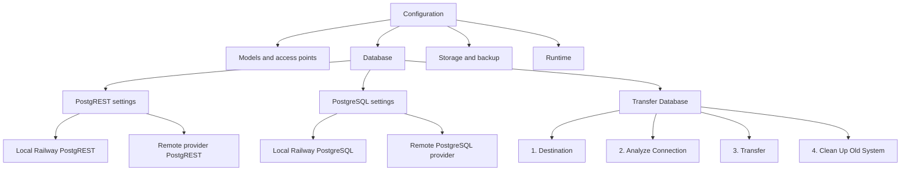
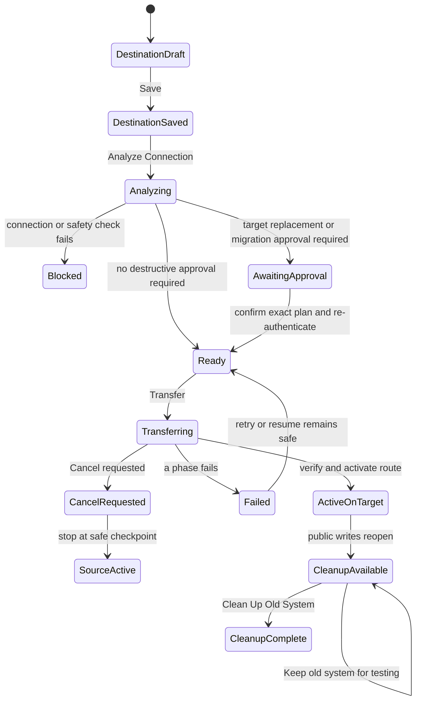

# Database Configuration UI Specification

> Status: Approved functional layout for implementation planning.
>
> Prepared: 2026-08-27. This specification resolves the remaining
> pre-implementation decision for the PostgreSQL, PostgREST, transfer, and
> retained-source controls on the Configuration page. It does not authorize a
> live database transfer.

## 1. Outcome

The website Configuration page will gain a top-level **Database** section at
the same visual level as **Embedding / Vector Options and Access Points**.
Supabase will no longer appear as a generic access point or as an independent
connection panel. It will appear only where it is a provider for a database,
PostgREST endpoint, object store, or another capability.

The Database section contains three settings rows:

1. **PostgREST settings** - choose the relational Data API placement.
2. **PostgreSQL settings** - choose or attach the database placement.
3. **Transfer Database** - move the current database through a guarded,
   four-stage workflow.

The default installation displays:

```text
PostgREST: local (Railway)
PostgreSQL: local (Railway)
Transfer Database: ready to configure; S3 status shown
```

## 2. Information Architecture



The current Configuration page implementation places Supabase in the provider
access-point list, exposes a `database setup` row, and renders a separate
`SupabaseConnectionPanel`. Implementation will remove those database-specific
entries from their current locations and replace them with one database panel.
Model-provider and embedding settings remain unchanged.

Object storage remains a separate capability. Moving PostgreSQL must not
silently move Supabase Storage, S3 objects, or document storage.

### 2.1 Repository placement

The page assembly remains in `apps/web/src/app/configuration/page.tsx`. The
existing `SupabaseConnectionPanel` import/render and Supabase-specific
`database setup` entry are retired only after their still-required validation,
secret-rotation, and audit behavior has moved into the database capability.

The preferred component boundary is one `DatabaseSettingsPanel` with focused
PostgREST, PostgreSQL, Transfer, operation-status, and source-cleanup children.
Website API handlers may validate requests and expose redacted read models, but
they must delegate durable configuration to Settings and execution to
Maintenance. The browser and web process never run migration SQL, `pg_dump`,
restore, target cleanup, or Railway service deletion directly.

## 3. Database Section Summary

Each row uses the existing setting-row/bubble pattern. Its collapsed state
shows a human-readable summary, a status pill, and a settings button. Secrets
are never returned to the browser after saving; only safe provider metadata and
credential fingerprints are shown.

| Row                 | Collapsed summary                                                                             | Main action              |
| ------------------- | --------------------------------------------------------------------------------------------- | ------------------------ |
| PostgREST settings  | `Local - Railway`, `Remote - Supabase`, or an actionable state such as `waiting for database` | Open placement settings  |
| PostgreSQL settings | `Local - Railway` or `Remote - <provider>` plus schema status                                 | Open database settings   |
| Transfer Database   | Current placement -> permitted destination, S3 readiness, and latest operation state          | Open four-stage workflow |

The section also shows the active route revision and whether each local
service is active, waking, sleeping, unused, or unavailable. It must not wake a
sleeping service merely to repaint the page; a deliberate analyze, test, or
transfer action may wake it.

## 4. Placement Rules

PostgreSQL and PostgREST are separate selections, but only valid combinations
are displayed or accepted.

| PostgreSQL                 | PostgREST          | UI behavior                                                    |
| -------------------------- | ------------------ | -------------------------------------------------------------- |
| Local Railway              | Local Railway      | Default and supported                                          |
| Local Railway              | Remote Supabase    | Invalid; the remote choice is not rendered or selectable       |
| Remote Supabase            | Local Railway      | Supported; local PostgREST connects to the remote database     |
| Remote Supabase            | Remote Supabase    | Supported when both endpoints prove the same database identity |
| Remote compatible provider | Local Railway      | Supported after capability and network checks                  |
| Remote compatible provider | Provider-owned API | Future provider capability; hidden until implemented           |

The server enforces the same rules as the browser. A stale browser or direct
API request cannot save an invalid route.

### 4.1 PostgREST settings

When PostgreSQL is local, the bubble offers **Local** only. Remote is not a
disabled radio button that can be forced; it is absent, with helper text:

> Move or connect PostgreSQL to a supported remote provider before selecting a
> remote PostgREST service.

When PostgreSQL is remote, the bubble offers:

- **Local (Railway)** - Railway PostgREST connects to the selected remote
  PostgreSQL database.
- **Remote** - initially Supabase managed PostgREST. The provider list is
  capability-driven so another compatible provider can be added later.

Saving a PostgREST change does not copy database data and does not require a
new backup. Before activation, Analyze proves that the direct database and the
candidate API report the same installation identity, schema head, permissions,
and RPC contract.

If PostgreSQL is moved back to local while remote PostgREST is active, the move
plan includes the required switch to local PostgREST. There is no moment in
which an invalid combination becomes active.

### 4.2 PostgreSQL settings

The default is **Local (Railway)**. The remote placement control contains two
levels:

1. placement: local or remote; and
2. provider: Supabase initially, with a provider registry for future compatible
   PostgreSQL services.

For **Provision new blank database**, the implemented location selector has
three choices:

- **Local Railway PostgreSQL** - reconcile the template-owned local service;
- **Remote PostgreSQL** - manually enter a PostgreSQL URL, PostgREST URL, and
  backend PostgREST credential; and
- **Supabase database** - enter a connection name, Supabase project URL,
  Supabase access token, and database password.

The Supabase-specific workflow sends those values to Maintenance. Maintenance
extracts the project reference, reads the documented Supavisor configuration
through the Supabase Management API, tries candidate routes until the IPv4
Session Pooler on port 5432 accepts a read-only connection, derives the
`/rest/v1` endpoint, and retrieves a modern server secret or legacy
`service_role` key. It then saves one linked, inactive PostgreSQL/PostgREST
target in encrypted Settings. Neither the browser nor the response receives a
database connection string or project API key.

The access token must have `database_pooling_config_read` and
`api_gateway_keys_read` permissions (or equivalent OAuth scopes). It is used
only for discovery and is discarded afterward. The database password remains a
required field because Supabase cannot retrieve an existing role password from
the Management API. Saving this target does not activate it or copy data; the
operator continues to **Analyze Connection** for blank provisioning or opens
**Transfer Database** to move the active local data.

This settings bubble saves and validates candidate connection details. It does
not silently erase, copy, or replace data.

If a blank Railway application needs to use an existing populated Supabase
database, the operator chooses **Attach Existing Database**. That is a
non-destructive workflow: inspect, optionally approve ordered schema upgrades,
verify, and activate. It never runs the Transfer Database target-replacement
steps.

If an installation already has active data and the selected placement changes,
the UI directs the operator to **Transfer Database**. Connection settings and a
data transfer must never be presented as the same Save action.

## 5. Transfer Database: Four-Stage Workflow

The four visible stages are persistent. A completed operation may be reopened
to view its status, evidence, and logs.



### Stage 1: Destination

The destination selector offers the opposite of the active PostgreSQL
placement:

- active database local -> destination remote only;
- active database remote -> destination local or another supported remote
  provider, excluding the active database identity; and
- a target that resolves to the source database is always rejected.

Remote provider is Supabase in the first release. Provider options come from a
capability registry rather than hard-coded UI branches so compatible database
and Data API providers can be added later.

The operator enters the target credentials and selects the intended PostgREST
placement. **Save Destination** stores an inactive candidate in encrypted
Settings. It does not change the active route and does not touch either
database. Saving enables **Analyze Connection**.

Changing any saved destination field invalidates the previous analysis and
all approvals. Analyze and Transfer become unavailable until the new draft is
saved and analyzed.

### Stage 2: Analyze Connection

Analyze is read-only. Maintenance wakes the required service, uses the saved
candidate, and reports:

- connection, TLS, authentication, and database identity;
- PostgreSQL version, required extensions, capacity, and writable privileges;
- application schema ownership, tables, approximate row counts, and unknown
  objects;
- migration ledger head, checksums, expected head, missing migrations, ahead
  state, and schema drift;
- PostgREST availability, exposed schemas, roles, RPCs, and identity match;
- whether the target is blank, recognized and current, recognized and behind,
  ahead, drifted, populated, or unrecognized;
- whether source and target are actually the same database;
- S3 configuration and write/read/delete probe status; and
- the exact target actions a transfer would take.

Analyze stores an immutable result hash and expiry time. Transfer approval is
bound to that hash. Maintenance rechecks destructive preconditions immediately
before mutation so an externally changed target cannot use an old approval.

An ahead, drifted, aliased, or unrecognized target is blocked and requires
administrator intervention. The UI never guesses that matching table names
mean compatible structure.

### Stage 3: Transfer

If the target is blank and the migration plan is non-destructive, Analyze
enables **Transfer** after S3 passes.

If the target contains application-owned data or needs an approved schema
change, the stage displays an unchecked confirmation. The label is generated
from the actual analysis; examples are:

- **Replace the analyzed target application data**
- **Apply the listed database schema upgrades**
- **Replace the analyzed target application data and apply the listed schema
  upgrades**

The confirmation panel shows provider, safe host/project identity, database
identity fingerprint, affected application schemas/tables, estimated rows,
schema versions, and target safety-backup requirement. It states that target
data will be erased. It never includes secrets or provider-managed objects.

For a destructive plan, Transfer becomes available only after:

1. the checkbox is selected;
2. the administrator completes recent re-authentication;
3. the operator enters the displayed confirmation phrase;
4. the S3 destination is healthy; and
5. the server revalidates the analysis and reports no conflicting operation.

Clicking Transfer starts the backup work. The operation cannot cross the target
mutation gate until the source backup has completed and independently verified.
It cannot remove target application data until a target safety backup has also
completed and independently verified.

Only application-owned data named by the ownership manifest and analysis may
be replaced. Supabase-managed `auth`, `storage`, `realtime`, `vault`, and
`extensions` schemas, provider metadata, and unrelated objects are never
purged. An unknown same-name object blocks the operation.

#### Internal transfer phases

The user described five transfer actions. Their safe execution order is
adjusted so no target cleanup can happen before recoverable S3 evidence exists:

1. **Prepare and back up source** - enter maintenance mode, drain writes, back
   up the source to S3, and independently verify the archive. If the source is
   behind, retain this safety backup, apply ordered migrations, and create a
   second verified current-shape transfer artifact.
2. **Protect and prepare target** - re-run the target fingerprint. If target
   replacement was approved, create and verify a target safety backup, then
   remove only the approved application-owned target data. This cleanup is
   skipped for a blank target.
3. **Update target schema** - apply the provider-neutral and target-provider
   migration tracks in order and verify the required schema head.
4. **Restore and verify** - restore the current-shape source artifact, resume
   from stable checkpoints when safe, repair sequences/indexes, and verify
   counts, relationships, permissions, vectors, RPCs, and representative RAG
   searches.
5. **Activate the new connection** - atomically write a new Settings route
   revision, test through the selected PostgREST route while maintenance is
   still active, and only then reopen database-dependent APIs.

This satisfies the rule that a transfer cannot begin without usable S3 and
prevents an early cleanup from destroying the only copy of target data.

### Stage 4: Clean Up Old System

After activation, the old database becomes a retained source and its encrypted
connection remains available to Maintenance. The stage offers:

- **Verify New System Again**
- **Keep Old System for Now**
- **Clean Up Old System**

Keeping the source temporarily allows real testing. The UI warns that once the
new target accepts writes, the retained source is stale. Switching back would
discard newer target changes and is not an automatic rollback.

Clean Up Old System is a separate destructive operation with fresh analysis,
recent re-authentication, an exact inventory, a typed confirmation, and proof
that the transfer's recoverable S3 artifact still exists. It deletes
application-owned records and then deletes every S3 backup set owned by that
transfer, including any target-safety set. Scheduled and manually created
backups are not part of this deletion. For Railway, cleanup may also
decommission the local database service and its volume. A checkpoint records
that source data was cleared before S3 deletion begins, so a partial object
deletion resumes safely. A cleanup failure records `cleanup_pending`; it does
not undo the successful route activation.

After Step 4 succeeds, the transfer artifact is intentionally unavailable for
future restore. Recovery then depends on the active database and its normal
backup policy. This prevents a transfer archive encrypted or addressed with an
older instance configuration from becoming an orphaned object set.
For versioned buckets, the S3 credential must also list and delete object
versions and delete markers (`s3:ListBucketVersions` and
`s3:DeleteObjectVersion`, or provider equivalents). Analyze fails its S3 probe
when those cleanup permissions are unavailable.

## 6. Maintenance Mode, Status, Logs, And Cancellation

Starting Transfer enables the database maintenance barrier. Database-dependent
API calls return `503 database_maintenance` with an operation ID, current
stage, and optional retry guidance. Authentication, health, and transfer-status
routes remain available. Workers stop taking database work before the backup
boundary.

### 6.1 Public and authenticated presentation

The website remains reachable without login and displays a sanitized
maintenance page:

- database maintenance is in progress;
- current high-level stage and percentage/range;
- start time and most recent update;
- success, cancellation, or general failure state; and
- when the site should retry automatically.

Only an authenticated administrator can see provider identity, database
fingerprints, table inventory, row counts, migration names, checkpoints,
detailed errors, logs, approvals, Retry/Resume, or Cancel. The public page must
not expose hosts, usernames, SQL, secrets, or internal stack traces.

Operation logs are stored in Settings with timestamp, phase, safe event code,
outcome, attempt, actor, and redacted details. Large diagnostic artifacts may
be encrypted in S3 with an indexed reference in Settings. The UI supports
copying or downloading a redacted support report.

### 6.2 Cancel behavior

Cancel means **request cancellation at the next safe checkpoint**, not kill a
database process at an arbitrary instruction. The button remains visible to an
authenticated administrator while cancellation is safe and explains the
current consequence.

| Point                                                            | Result of cancellation                                                                                                                   |
| ---------------------------------------------------------------- | ---------------------------------------------------------------------------------------------------------------------------------------- |
| Before maintenance or target mutation                            | Discard the candidate operation; active route is unchanged                                                                               |
| During drain or source backup                                    | Finish/abort the current safe unit, release the barrier, and keep the source active                                                      |
| During source schema play-forward                                | Stop after the current transaction; committed migrations remain and are re-inspected                                                     |
| After target replacement begins                                  | Stop at a checkpoint; source remains active, target remains inactive, and the target safety backup is retained                           |
| During restore                                                   | Stop after the current idempotent batch; permit Resume only when fingerprints and checkpoints still match                                |
| During verification before activation                            | Leave the source route active and retain the inactive candidate for inspection or a safe retry                                           |
| After route revision is prepared but before public writes reopen | Restore the prior Settings route revision and verify it before releasing maintenance                                                     |
| After public writes reopen on target                             | Transfer cancellation is no longer offered; use the separately designed recovery operation, not an automatic switch to stale source data |

If a phase cannot stop immediately, the UI changes the button to **Cancel
requested** and shows which safe unit must finish.

## 7. Button And State Rules

| Control                  | Enabled when                                                                                                        | Invalidated by                                                                              |
| ------------------------ | ------------------------------------------------------------------------------------------------------------------- | ------------------------------------------------------------------------------------------- |
| Save Destination         | Required destination fields are syntactically complete                                                              | Not applicable                                                                              |
| Analyze Connection       | Destination is saved and unchanged                                                                                  | Any destination or credential change                                                        |
| Destructive confirmation | Current immutable analysis requires it                                                                              | Analysis expiry, target fingerprint change, or field change                                 |
| Transfer                 | Analysis passes, S3 passes, required approvals are current, and no conflicting operation is active                  | Failed recheck, expired approval, unhealthy S3, or route change                             |
| Cancel                   | An authenticated administrator owns an active cancellable operation                                                 | Activation followed by reopened target writes                                               |
| Resume/Retry             | The operation, artifact, target identity, and checkpoints still match                                               | Outside target writes, changed credentials, changed manifest, or changed candidate identity |
| Clean Up Old System      | Target route is active and verified, retained source is reachable, and the operation-owned recovery artifact exists | Failed preflight or missing recovery evidence                                               |

The primary action is never enabled solely because the browser believes a
condition passed. The server returns the authoritative allowed actions for the
current operation revision.

## 8. Responsive And Accessible Behavior

- Desktop uses the normal Configuration list with one Database panel and a
  four-column or horizontal stage indicator inside Transfer Database.
- Narrow screens stack the stages vertically in the same order and keep the
  current action immediately below the active stage.
- Status is conveyed with text and icon, never color alone.
- Progress changes use a polite live region; destructive warnings require
  deliberate focus and are not announced repeatedly.
- Dialogs trap focus, restore it to the originating row, support Escape only
  before irreversible work, and provide explicit Close/Cancel buttons.
- Disabled actions include adjacent plain-language reasons.
- Logs and table inventories use semantic tables with a mobile card fallback.
- The interface preserves operation state across refresh, logout/login, and a
  different administrator session; it never relies on an open browser tab to
  continue work.

## 9. Ownership And Service Boundaries

| Location                   | Responsibility                                                                                                                                                           |
| -------------------------- | ------------------------------------------------------------------------------------------------------------------------------------------------------------------------ |
| Web Configuration page     | Render current route, collect candidates, show server-authorized actions, approvals, progress, and redacted logs                                                         |
| Settings service           | Encrypt candidate credentials; store analysis hashes, approvals, active/prior route revisions, operation checkpoints, audit events, and retained-source connection state |
| Maintenance service        | Analyze, acquire locks, control maintenance mode, back up, migrate, replace approved target data, restore, verify, activate, cancel safely, resume, and clean the source |
| PostgreSQL target          | Record its permanent installation identity and append-only migration/checksum ledger                                                                                     |
| PostgREST service/provider | Prove the same database identity and required API/RPC/permission contract                                                                                                |
| S3-compatible storage      | Hold verified encrypted source transfer sets and required target safety backups until Step 4 removes the operation-owned sets; retain unrelated scheduled/manual backups |

The Maintenance service keeps all of its current bootstrap, update, backup,
restore, retention, and Railway reconciliation responsibilities. Database
schema upkeep is an added execution responsibility; Settings remains the
durable package and control plane.

## 10. Required Backend Contracts

Exact route names may follow repository conventions, but the UI needs these
logical operations:

1. read the active route, configured candidates, service sleep state, schema
   summary, S3 readiness, and allowed actions;
2. save or rotate an inactive PostgreSQL/PostgREST candidate without exposing
   saved secrets;
3. run and retrieve a read-only candidate analysis;
4. record an approval bound to analysis hash, action inventory, actor, and
   recent re-authentication;
5. create a transfer only when Settings and Maintenance revalidate all gates;
6. stream or poll sanitized public progress and detailed administrator events;
7. request cancellation, resume an eligible attempt, or retry from a newly
   analyzed state;
8. activate a verified route in one Settings revision; and
9. analyze and execute retained-source cleanup as a separate operation.

All mutating operations require an idempotency key and operation revision.
Analyze, Transfer, Resume, Cancel, route activation, and Cleanup must be
auditable independently.

## 11. Implementation Phases

| Phase                                        | Website work                                                                                                                                    | Settings/API work                                                                                                    | Maintenance/data-plane work                                                                                                                             | Exit gate                                                                                                    |
| -------------------------------------------- | ----------------------------------------------------------------------------------------------------------------------------------------------- | -------------------------------------------------------------------------------------------------------------------- | ------------------------------------------------------------------------------------------------------------------------------------------------------- | ------------------------------------------------------------------------------------------------------------ |
| 1. Database section shell                    | Remove Supabase from general access points and the standalone connection panel; add the three rows and placement summaries                      | Add provider-capability and active-route read model                                                                  | None beyond read-only status                                                                                                                            | Local/local renders correctly and secrets never return to browser                                            |
| 2. Candidate configuration                   | Implement PostgreSQL and PostgREST bubbles, placement dependency, Save, fingerprints, and Attach Existing entry                                 | Store versioned inactive candidates and enforce the placement matrix                                                 | Add connection and endpoint identity probes                                                                                                             | Invalid local-DB/remote-API combinations fail in UI and server                                               |
| 3. Analyze Connection                        | Add Stage 1/2, analysis report, blocked/ready states, S3 status, and analysis invalidation                                                      | Persist immutable analysis snapshots and server-authorized actions                                                   | Inventory schema/data/version/permissions without mutation                                                                                              | Blank, behind, populated, ahead, drifted, aliased, and unreachable targets classify correctly                |
| 4. Transfer controls                         | Add dynamic destructive consent, re-authentication, Stage 3 progress, authenticated logs, public maintenance display, Cancel, Retry, and Resume | Store approvals, operation state, prior route, checkpoints, and redacted/public event projections                    | Implement verified source/target backups, safe replacement, schema play-forward, restore, verification, cancel checkpoints, and atomic activation       | Every failure before activation leaves source active; no cleanup occurs before required S3 verification      |
| 5. PostgREST switching                       | Enable remote PostgREST only for a supported remote database; show same-database switch status                                                  | Version Data API routes independently                                                                                | Run identity, RPC, authorization, and parity checks without a database copy                                                                             | Railway and Supabase PostgREST switch over the same Supabase database without backup                         |
| 6. Retained-source cleanup                   | Add Stage 4, re-verification, keep-for-now warning, cleanup inventory, transfer-artifact deletion notice, and destructive confirmation          | Retain old credentials until cleanup completes; checkpoint source clearing and S3 deletion; record `cleanup_pending` | Remove only approved source data, delete that transfer's source/target-safety S3 sets, or decommission the Railway service/volume after recovery checks | Successful cleanup removes operation-owned transfer objects, remains auditable, and does not undo activation |
| 7. Responsive, accessibility, and release QA | Complete narrow-screen layout, keyboard/focus behavior, refresh recovery, and help text                                                         | Stabilize error/event codes and support-report export                                                                | Run the full live provider, failure, sleep/wake, transfer, cancellation, and cleanup matrix                                                             | UI and data-plane acceptance suites pass before the Railway template advertises portability                  |

These UI phases align with the portability plan: phases 1-3 can be developed
against read-only and inactive candidates; phase 4 must wait for the S3 and
transfer state-machine gates; phase 5 follows endpoint portability; phase 6
follows successful activation; and phase 7 is a release gate.

## 12. Acceptance Scenarios

The feature is not complete until at least these UI scenarios pass:

- local PostgreSQL hides the remote PostgREST choice;
- remote PostgreSQL enables local and supported remote PostgREST choices;
- Save enables Analyze, and any edit invalidates the analysis;
- Analyze never changes target schema or data;
- a blank target skips cleanup and does not require a target safety backup;
- a populated target cannot transfer until the exact replacement is approved
  and its encrypted target safety backup verifies;
- provider-owned and unrelated target objects are never included in cleanup;
- no healthy S3 destination means Transfer remains blocked;
- maintenance mode shows sanitized public progress and full admin detail;
- cancel stops only at a safe checkpoint and leaves the source route active
  before activation;
- refreshing or logging back in reconstructs the same operation state;
- successful activation exposes Stage 4 but does not automatically clean the
  source;
- successful Stage 4 cleanup deletes the source and target-safety S3 sets owned
  by that transfer without deleting scheduled or manual backups;
- the stale-source warning appears after the target accepts writes; and
- Attach Existing remains non-destructive and visually distinct from Transfer.
