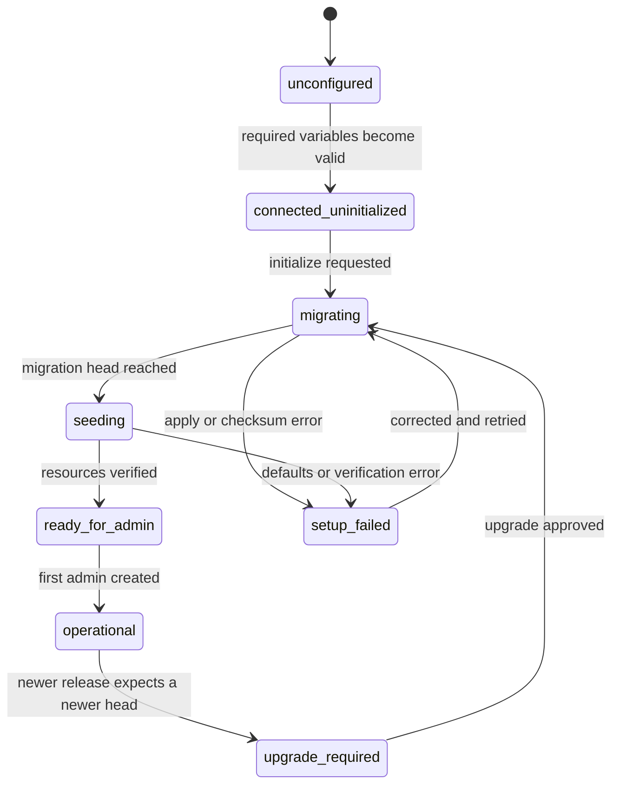

# Railway Deployment Phase 2: Maintenance And Blank-Project Bootstrap

Last reviewed: 2026-08-06.

## 1. Purpose And Completion Boundary

Phase 2 turns a blank Supabase project into an operational RAG Railway
installation without a local CLI command or installation-specific GitHub
Actions secret. It adds a fourth Railway service, a signed internal control
plane, a resumable migration protocol, the `/setup` state machine, live
operation progress, and the first-administrator handoff.

The normal `web` and `worker` processes remain fail-closed when the schema is
missing or incompatible. They never apply migrations on startup. Only the
`maintenance` service receives the owner-level Postgres URL and can change the
schema.

## 2. Service Boundary

| Service       | Public | Database access                                      | Phase 2 role                                                                  |
| ------------- | ------ | ---------------------------------------------------- | ----------------------------------------------------------------------------- |
| `web`         | Yes    | Supabase Data/Storage API through the service role   | Setup UI, readiness, signed maintenance requests, first-admin handoff         |
| `worker`      | No     | Supabase Data/Storage API through the service role   | Ingestion and model jobs only after readiness is `operational`                |
| `embeddings`  | No     | No owner-level schema access                         | Local Ollama embeddings                                                       |
| `maintenance` | No     | Direct owner-level Postgres plus Supabase API values | Migrations, defaults, live schema verification, later backup/restore commands |

Use [railway.maintenance.json](../../railway.maintenance.json) and
[Dockerfile.maintenance](../../Dockerfile.maintenance) for the maintenance
service. It listens on Railway's assigned `PORT`; local development defaults to
`8081`. Its `/health` endpoint is suitable for Railway health checks, but its
operation endpoints require a signed internal request.

## 3. Required Railway Variables

Generate every installation secret independently. Do not reuse a value from
another Railway template instance.

### 3.1 Shared Supabase values

Each value below is stored once in the Railway environment's Shared Variables.
The listed services contain `${{ shared.NAME }}` references, never independent
copies.

| Variable                    | Services                       | Value                                                                                |
| --------------------------- | ------------------------------ | ------------------------------------------------------------------------------------ |
| `SUPABASE_URL`              | `web`, `worker`, `maintenance` | `https://<project-ref>.supabase.co`                                                  |
| `SUPABASE_SERVICE_ROLE_KEY` | `web`, `worker`, `maintenance` | The server-only service-role key from Supabase API settings                          |
| `SUPABASE_DB_PASSWORD`      | `maintenance`, `scheduler`     | The project database password; the services safely assemble the owner connection URL |
| `SUPABASE_DB_HOST`          | `maintenance`, `scheduler`     | Optional session-pooler hostname; leave empty to derive the direct database host     |
| `SUPABASE_DB_URL`           | `maintenance`, `scheduler`     | Optional complete owner URL retained as an advanced compatibility override           |

The maintenance service validates that the Supabase API hostname's project
reference also appears in the database hostname or pooler username. This
prevents a service-role key and database password from silently targeting
different projects.

### 3.2 Setup and internal security values

| Variable                 | Services             | Requirement                                                         |
| ------------------------ | -------------------- | ------------------------------------------------------------------- |
| `MAINTENANCE_URL`        | `web`                | Private URL, normally `http://maintenance.railway.internal:8081`    |
| `INTERNAL_SERVICE_TOKEN` | `web`, `maintenance` | One shared cryptographically random value of at least 32 characters |
| `ADMIN_AUTH_ENABLED`     | `web`                | `true`                                                              |
| `ADMIN_SETUP_ENABLED`    | `web`                | `true` during setup or recovery; `false` otherwise                  |
| `ADMIN_SETUP_TOKEN`      | `web`                | Temporary random value of at least 24 characters                    |
| `ADMIN_SESSION_SECRET`   | `web`                | Random value of at least 32 characters                              |

`SUPABASE_DB_PASSWORD`, `SUPABASE_DB_URL`, `SUPABASE_SERVICE_ROLE_KEY`,
`INTERNAL_SERVICE_TOKEN`, `ADMIN_SETUP_TOKEN`, and `ADMIN_SESSION_SECRET` are
shared sealed server values. Never copy them into service-local literals or put
them in `NEXT_PUBLIC_*`, browser fields, source control, generated files, or API
logs.

The derived URL uses the owner role, database `postgres`, port `5432`, and
`uselibpqcompat=true&sslmode=require`. Password characters are URL-encoded by
the service. If `SUPABASE_DB_HOST` ends in `.pooler.supabase.com`, maintenance
automatically uses the project-qualified `postgres.<project-ref>` role required
by Supabase's session pooler.

## Reaching Supabase From Railway

Supabase's direct database endpoint, `db.<project-ref>.supabase.co`, publishes
only an AAAA record. Railway containers do not have IPv6 egress by default, so a
connection to it fails with `connect ENETUNREACH <ipv6-address>:5432` — not a
database that is down or a password that is wrong, an address with no route to
it.

Set `SUPABASE_DB_HOST` on `maintenance` and `maintenance-scheduler` to the
session pooler host from the Supabase dashboard (**Connect -> Session pooler**).
It looks like `aws-0-<region>.pooler.supabase.com` and resolves over IPv4.
`resolveSupabaseDatabaseUrl` recognises a `.pooler.supabase.com` host and
rewrites the user to the `postgres.<project-ref>` form the pooler requires, so
only the host needs setting.

Use the **session** pooler on port 5432, not the transaction pooler on 6543.
Backups shell out to `pg_dump`, which needs session features the transaction
pooler does not provide, so a transaction-mode host would migrate happily and
then fail every backup.

The alternative is enabling IPv6 egress on the Railway services, which keeps the
direct connection. Either works; the pooler needs no Railway-side change.

`PORT=8081` is pinned on `maintenance` in the template. It was documented here
long before it was actually set, and in the meantime Railway supplied `8080`
while `web` dialled the `8081` this page describes — so `web` could never reach
`maintenance`, and the apply step that waits for maintenance to come online
waited forever against a service that was running perfectly well. If that
symptom ever returns, compare the port in `MAINTENANCE_URL` against the port in
the maintenance startup log before looking anywhere else.

Set `PORT=8081` on `maintenance` so the private URL is stable across template
instances. Railway's health check and the maintenance process use the same
port.

## 4. First-Run State Machine



`GET /api/setup/status` is public but returns no credentials. It reports:

- Application version and expected migration head.
- Presence of each required connection/security value.
- Supabase and maintenance reachability.
- Normalized schema readiness.
- First-admin requirement.
- The latest maintenance operation summary when its table exists.

The root dashboard and login page redirect to `/setup` while
`requiresSetup=true`.

## 5. Setup Authorization

The operator enters `ADMIN_SETUP_TOKEN` on `/setup`. The browser sends it once
to `POST /api/setup/session`. A successful response sets an HttpOnly,
SameSite=Strict setup cookie with a 30-minute lifetime.

The cookie contains only the setup-token hash, issue time, and expiration. It
is signed by `ADMIN_SESSION_SECRET`. Rotating `ADMIN_SETUP_TOKEN` immediately
invalidates existing setup sessions. When the schema is operational, a setup
token already present in `admin_setup_tokens` is rejected before a new setup
session is issued. Token attempts are rate-limited per forwarded client address
inside each web instance.

## 6. Signed Maintenance Protocol

The browser cannot call `maintenance` directly. `web` signs each private
request with `INTERNAL_SERVICE_TOKEN` and supplies:

```text
Authorization: Bearer <INTERNAL_SERVICE_TOKEN>
X-RAG-Timestamp: <Unix milliseconds>
X-RAG-Nonce: <UUID>
X-RAG-Signature: <lowercase SHA-256 HMAC hex>
```

The canonical HMAC input is:

```text
timestamp\nnonce\nMETHOD\n/path\nexact-body
```

Maintenance accepts a five-minute clock window, compares the signature in
constant time, and rejects nonce replay for ten minutes. These endpoints are
private implementation APIs, not part of `/api/v1`:

| Method | Path               | Purpose                                                                       |
| ------ | ------------------ | ----------------------------------------------------------------------------- |
| `GET`  | `/health`          | Non-secret Railway health and configuration-presence check                    |
| `POST` | `/operations`      | Start or retrieve an idempotent `bootstrap`, `upgrade`, or `verify` operation |
| `GET`  | `/operations/{id}` | Retrieve live or persisted operation progress                                 |

The public web proxies are `POST /api/setup/initialize` and
`GET /api/setup/operations/{id}`. Both require the setup-session cookie.

## 7. Migration Execution Contract

Each operation follows this order:

1. Validate the Supabase API/database project identity and TLS requirement.
2. Connect with a 15-second connection timeout.
3. Set a 15-minute SQL statement timeout and 30-second lock timeout.
4. Obtain `pg_try_advisory_lock(hashtext('rag-railway-schema-v1'))` on one
   dedicated Postgres session.
5. Ensure `supabase_migrations.schema_migrations` exists.
6. Read applied versions and reject a database migration absent from this
   release.
7. Compare any existing in-database checksum rows with the immutable repository
   ledger and reject drift before applying more SQL.
8. Apply each pending migration in filename order, one transaction per file.
9. Record each committed version in Supabase migration history.
10. Run `bootstrap_bubble_rag_defaults` and ensure the deterministic PDF
    assembly task exists.
11. Verify the live resource contract.
12. Synchronize all applied SHA-256 checksums into
    `platform_migration_checksums`.
13. Mark `platform_installations` operational at the expected release head.
14. Release the advisory lock and close the owner connection.

### One correction, found in Phase 5

Steps 5 to 12 read files from the repository: the migrations directory and the
platform contracts. Those paths were resolved from `process.cwd()`, and the
container starts the service with `pnpm --filter @bubble-rag/maintenance start`,
which runs a package script from the package directory. The working directory is
therefore `/app/apps/maintenance` while the files are at `/app`.

Nothing here ever failed on it, because migrations are applied through GitHub
Actions in this repository's own deployments and never took that path. The first
backup on a real installation did fail on it, immediately, and the same fault
would have broken a genuinely blank-project bootstrap — the case this phase
exists for.

Paths are now resolved by walking up from the module's own location until a
directory holds at least two of `pnpm-workspace.yaml`, `platform` and
`supabase`. That works under `tsx` from source, from `dist` after a build, and
from any working directory. Requiring two markers matters: `apps/maintenance`
has neither, but a stray `supabase` folder somewhere up the tree should not win
on its own.

### A second one, found the same way

`20260727000400_silo_projects` replaced the plain unique on
`projects (tenant_id, slug)` with two partial unique indexes: one for projects
inside a silo, one for global projects. `bootstrap_bubble_rag_defaults`, written
three days earlier, kept conflicting on the old target — and a partial index can
only arbitrate an `ON CONFLICT` when the statement carries a matching `WHERE`.
Every call raised `42P10`.

`supabase db push` applies migrations without ever calling that function, so
nothing noticed for ten days. Only the maintenance service calls it, during
bootstrap or upgrade, which is the same reason the working-directory fault
survived: **this path is the least exercised code in the repository and holds
the most defects.**

`pnpm docs:check` now rejects an `ON CONFLICT` whose arbiter was dropped, or
whose only arbiter is partial and has no matching `WHERE`. It judges the last
definition of each function rather than every superseded one, and it was tested
by reintroducing the bug and confirming rejection.

### The blind spot, in full

Installation verification required `allocate_conversation_message_sequences`,
which `20260803000200` creates and `20260803000300` drops and never recreates.
The resource inventory was built by matching `create function` across every
migration with no regard for drops, so the manifest demanded a function no
database could have and every verification failed on it.

Then verification demanded `document_embeddings_vector_idx`, created by the
initial schema, dropped and recreated when the embedding dimensions changed, and
finally dropped for good.

Three faults, three resource kinds, one assumption: **a contract generated from
CREATE statements alone describes a database nobody has.**

| Dropped and never recreated                    | Found by                                 |
| ---------------------------------------------- | ---------------------------------------- |
| `projects (tenant_id, slug)` unique constraint | Seeding raised 42P10 on every upgrade    |
| `allocate_conversation_message_sequences`      | Verification required an absent function |
| `document_embeddings_vector_idx`               | Verification required an absent index    |

Creates and drops are now replayed as one ordered sequence, for constraints in
`pnpm docs:check` and for indexes and policies in the maintenance service.
Order is what matters, not presence: `match_document_embeddings` is dropped nine
times and recreated after each, and `document_embeddings_vector_384_idx` is
dropped and recreated three lines later in the same file. Both must survive.

That last case caught a wrong test before it caught a wrong implementation. The
first version asserted the 384 index was gone, which was the test being wrong -
and it is exactly the distinction the function exists to draw, so it is pinned
now in both directions.

One-transaction-per-migration is the restart boundary. A failure rolls back the
current migration, leaves earlier migrations committed, records the exact
`currentMigration`, and can be retried after correction. The same `requestKey`
returns the existing persisted operation instead of running it twice.

If Railway restarts maintenance, a persisted queued/running operation with no
heartbeat for two minutes is checked against the same advisory lock. It is
changed to `maintenance_interrupted` only when the lock is free, proving no old
process is still applying SQL. The setup page can then retry from the last
committed migration. A long-running SQL statement remains active while its
process still owns the lock even when its last visible heartbeat is older.

## 8. Live Verification

The maintenance image consumes
`platform/supabase-resources.v1.json` and all checked-in migration files. Before
an installation becomes operational, it verifies:

- Required Postgres extensions.
- Every inventoried public table and function.
- Every required private Storage bucket.
- Every index and policy declared by checked-in migrations.
- Row-level security on every inventoried application table.
- Exact expected migration head and checksum ledger.

The `gte-small-embedding` Edge Function is reported as externally managed and
does not block Postgres bootstrap. Installations that use that legacy embedding
path must deploy it separately. Current Railway-local Ollama embeddings do not
depend on that Edge Function.

## 9. Operation Progress And Errors

`platform_maintenance_operations` records request identity, type, status,
stage, current migration, total/completed migrations, applied migrations,
progress details, error code/message/details, request metadata, heartbeat, and
start/finish times.

Stages are `connecting`, `locking`, `inspecting`, `migrating`, `seeding`,
`verifying`, `finalizing`, `complete`, and `failed`. Common error codes include:

| Code                          | Meaning                                                                              | Recovery                                                                  |
| ----------------------------- | ------------------------------------------------------------------------------------ | ------------------------------------------------------------------------- |
| `connection_identity_invalid` | Supabase API and database URLs do not identify the same project, or TLS is absent    | Correct Railway connection roots                                          |
| `maintenance_lock_busy`       | Another migration operation owns the advisory lock                                   | Wait for it, then retry status rather than creating competing work        |
| `maintenance_interrupted`     | Railway restarted maintenance and no process still owns the schema lock              | Retry; committed migration boundaries are preserved                       |
| `migration_history_unknown`   | The database contains a migration unavailable in this release                        | Deploy a compatible/newer application release; do not delete history      |
| `migration_checksum_drift`    | A previously recorded migration differs from the release file                        | Restore the released file or investigate database provenance              |
| `migration_apply_failed`      | The named current migration failed and was rolled back                               | Correct the reported SQL/environment cause and retry                      |
| `schema_verification_failed`  | A required table, function, bucket, index, policy, extension, or RLS state is absent | Repair the named resource or migration, then retry verification/bootstrap |

## 10. First Administrator Handoff

After verification, `/setup` enters `ready_for_admin`. The operator supplies an
email, optional display name, and password of at least 12 characters. The web
route:

1. Revalidates the signed setup session.
2. Requires operational schema readiness.
3. Rejects an already-consumed setup-token hash.
4. Creates or activates the primary admin with a salted scrypt password hash.
5. Records the token hash in `admin_setup_tokens`.
6. Issues the normal HttpOnly admin session.
7. Clears the temporary setup cookie and opens the dashboard.

No default username or password is shipped. For later primary-admin recovery,
rotate `ADMIN_SETUP_TOKEN` and use `/setup-admin`. Delegated API-user
administrators cannot use primary-admin recovery.

## 11. Fresh Installation Procedure

1. Create a blank Supabase project and wait for database provisioning.
2. Collect its API URL, service-role key, and owner Postgres connection URI.
3. Create the four Railway services from the same release source.
4. Assign each service its repository config file.
5. Add the variables from section 3 to only the listed services.
6. Give `web` a public domain. Keep `maintenance`, `worker`, and `embeddings`
   private.
7. Deploy `maintenance`, then `web`; verify both health endpoints.
8. Open the web domain. It redirects to `/setup`.
9. Correct any missing requirement shown in Connection requirements.
10. Paste `ADMIN_SETUP_TOKEN` and start Initialize database.
11. Follow migration count, current migration, stage, heartbeat, and any exact
    error. Refreshing the page is safe.
12. Create the first administrator when verification completes.
13. Deploy or wake `worker` and `embeddings`; `/api/health` should report schema
    `operational` and queue claims allowed.
14. Rotate or disable the temporary setup token according to the recovery
    policy.

## 12. Upgrade And Existing GitHub Deployment Compatibility

The current repository release helper and GitHub Supabase workflow remain
supported. A normal GitHub-managed migration updates
`platform_installations` to the Phase 2 head. The maintenance service then
serves future Railway-template bootstrap and approved upgrades.

Do not run the GitHub Supabase workflow and a maintenance upgrade against the
same project at the same time. The maintenance advisory lock protects
maintenance operations, but the external CLI workflow does not currently
participate in that lock.

## 13. Verification Commands

Run before publishing Phase 2:

```powershell
pnpm install --frozen-lockfile
pnpm platform:check
pnpm docs:check
pnpm typecheck
pnpm test
pnpm build
git diff --check
```

The automated suite covers request signing, timestamp expiry, migration order,
unknown-history rejection, checksum drift, setup-state resolution, setup-token
rotation, field-help coverage, TypeScript, and the complete application build.
The final template acceptance test should still use a disposable, genuinely
blank Supabase project so schema, Storage, and Railway private DNS are exercised
outside mocks.

That test has still not been run, and the working-directory fault above is the
argument for running it. A defect that only appears when the service reads a
repository file in a container survived every check in this list.
