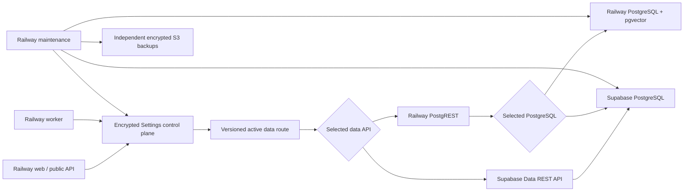

# Railway PostgreSQL And PostgREST Portability Implementation Plan

> Status: Implementation started. The architectural direction and functional
> Database settings layout are accepted. The first Phase 0 Settings/domain
> contract slice is implemented; the two services, runtime routing, Maintenance
> execution, UI replacement, and live transfer operations are not yet
> implemented or authorized against live infrastructure.
>
> Prepared: 2026-08-26. Revised: 2026-08-27 after architecture review.

## 1. Executive Decision

Add two services to the default Railway template:

1. `postgres-sql`: the installation's default relational and RAG database, with
   `pgvector` and a persistent Railway volume.
2. `postgrest`: the installation's default private HTTP data API in front of
   the selected PostgreSQL database.

Keep the existing encrypted SQLite Settings service as the stable control
plane. It stores which database, PostgREST endpoint, object store, and backup
destination are active. Application services do not decide whether they are in
"Railway mode" or "Supabase mode"; they resolve the selected capabilities from
the Settings service.

The two new choices are independent where the platforms permit it:

- PostgreSQL can move from Railway to Supabase while Railway PostgREST remains
  active.
- After PostgreSQL is in Supabase, the data API can later switch from Railway
  PostgREST to Supabase's managed PostgREST without another database copy.
- PostgreSQL can move from Supabase back to Railway, but Supabase's managed
  PostgREST cannot remain the data API after that cutover. It is tied to the
  default `postgres` database inside the Supabase project.

Moving a database uses the existing Maintenance and S3 backup capabilities.
Switching PostgREST while it still points to the same database is a verified
configuration change and does not create or restore a database backup.
Connecting a blank Railway installation to an existing populated Supabase or
compatible PostgreSQL database is a third operation: attach and verify it in
place, optionally play its known schema forward, and never purge or restore its
data. The separate Transfer Database workflow may replace analyzed,
application-owned target data only after explicit destructive approval and a
verified encrypted target safety backup.

## 2. Scope

### In scope

- a Railway PostgreSQL + pgvector service
- a Railway PostgREST service
- independent database and data-API destination records
- provider-neutral application data access
- schema provisioning for Railway and Supabase PostgreSQL
- encrypted S3-mediated PostgreSQL transfer in either direction
- separate provision, attach-existing, transfer, API-switch, and source-cleanup
  operations
- target preflight, resumable restore, verification, atomic route activation,
  and explicit source decommissioning
- scale-to-zero behavior and cold-start handling
- inclusion of both services in the Railway template and release process

### Deliberately separate

- moving original documents and generated files between Supabase Storage, S3,
  or a future Railway document service
- splitting operational records from chunks and vectors
- tenant-by-tenant database routing
- browser-direct access to PostgREST
- merging two populated installations
- logical replication for near-zero-downtime migrations

The current application uses Supabase for both relational queries and object
storage. These must be separated in code before moving only PostgreSQL is safe.
A database move must not silently change or invalidate the selected object
store.

## 3. Proposed Architecture



The public `/api/v1` application API remains the supported external API. The
Railway PostgREST service remains private and is used only by trusted web,
worker, and maintenance services.

## 4. Valid Placement Combinations

| PostgreSQL location               | Railway PostgREST                        | Supabase managed PostgREST | Decision                                                                          |
| --------------------------------- | ---------------------------------------- | -------------------------- | --------------------------------------------------------------------------------- |
| Railway PostgreSQL                | Supported and the default                | Not supported              | Supabase cannot expose an external Railway database through its managed Data API. |
| Supabase PostgreSQL               | Supported                                | Supported                  | This is the flexible state in which PostgREST can be switched independently.      |
| Compatible third-party PostgreSQL | Supported if network and extensions pass | Not supported              | A provider-owned compatible data API may be added later.                          |

This produces three supported initial profiles:

1. `railway-postgres + railway-postgrest`
2. `supabase-postgres + railway-postgrest`
3. `supabase-postgres + supabase-postgrest`

There is intentionally no `railway-postgres + supabase-postgrest` profile.

## 5. Architecture Decisions

### Decision 1: Settings remains the control plane

The encrypted Settings service remains on Railway and owns:

- database and data-API destination definitions
- active routing revision
- encrypted connection credentials
- immutable schema-package registry for every supported release/provider track
- migration state and audit records
- S3 backup destination and secret references
- transfer, candidate, route-activation, and source-cleanup state

Migration state must not live only in the database being moved. If that
database becomes unavailable midway through a transfer, Railway still needs to
know what happened and how to recover.

This does not make Settings responsible for executing infrastructure changes.
The responsibility split is:

| Component            | Durable responsibility                                                                                                                 | Runtime responsibility                                                                         |
| -------------------- | -------------------------------------------------------------------------------------------------------------------------------------- | ---------------------------------------------------------------------------------------------- |
| Release/build        | Produce the immutable, release-bound schema package and compatibility manifest.                                                        | None inside a customer installation.                                                           |
| Settings service     | Own destinations, credentials, desired versions, schema packages, per-destination schema state, operation history, and active routing. | Serve narrowly scoped configuration/packages to authorized internal services.                  |
| Maintenance service  | Own no irreplaceable configuration or migration package.                                                                               | Inspect, plan, back up, lock, execute, verify, reconcile Railway services, and report results. |
| Target PostgreSQL    | Record the migrations and checksums actually committed to that database.                                                               | Enforce the resulting schema, roles, policies, and data constraints.                           |
| Web/worker/PostgREST | Record the route/schema revision used by each job or request.                                                                          | Consume only verified routes; never receive owner migration authority.                         |

Maintenance can therefore be replaced, upgraded, or allowed to sleep without
losing the installation's desired state. Settings can point it at Railway
PostgreSQL today and a Supabase or other compatible PostgreSQL destination
tomorrow. Each destination has its own observed schema head and execution
history; no schema version is assumed to be global merely because another
database was already upgraded.

### Decision 2: Database and data API are separate connections

Replace the current single Supabase-shaped connection concept with three
independent capabilities:

- `DatabaseDestination`: direct or session PostgreSQL connection used by
  migrations, `pg_dump`, restore, and database probes
- `DataApiDestination`: PostgREST base URL and trusted authentication used by
  normal relational queries and RPC calls
- `ObjectDestination`: Supabase Storage, S3-compatible storage, or the future
  Railway document service

An active route references one destination of each required type and carries a
monotonically increasing revision. Every long-running job snapshots that route
revision so a cutover cannot redirect half of a job to another database.

### Decision 3: Prove endpoint identity, not just connectivity

Every candidate route must return the same database installation identity by:

- a direct SQL probe through `DatabaseDestination`; and
- a protected RPC or view through `DataApiDestination`.

The candidate is rejected if those identities, schema migration heads, or
checksums differ. This prevents the dangerous state in which Maintenance is
backing up one database while the application is querying another.

### Decision 4: Keep Railway PostgREST private

Version 1 supports only trusted server-to-server access. It does not expose an
anonymous role or allow browsers to connect directly.

The local database contains a no-login application role and a narrowly scoped
PostgREST authenticator role. The service validates a short-lived internal JWT
whose signing key is derived with domain separation from the installation
security root. The signing key is injected only into the PostgREST child
process; it is not displayed in Railway or returned to the browser.

Public client authentication continues through the existing `/api/v1`
application API, API keys, and tenant/silo authorization.

### Decision 5: Migrations define the current structure

The repository's migration ledger is the source of truth for tables, indexes,
functions, RLS policies, and RPC signatures. Table names alone are not a schema
compatibility check.

The current migrations contain Supabase-specific `storage` and `vault`
operations. They must be separated into:

- provider-neutral core and RAG migrations
- Supabase Storage/Vault integration migrations
- Railway PostgREST role and permission migrations
- provider-specific resource verification

The preferred database-move path uses an empty target at the current migration
head and restores a current-shape transfer artifact into that known structure.
An explicitly approved replacement first protects and cleans only the analyzed
application-owned target data, then reaches the same known structure. If the
source is behind, Maintenance first creates a verified safety backup, then
makes a best-effort attempt to play the source forward. After success it creates
a second, current-shape transfer artifact. The release does not promise
arbitrary historical backup transformations.

### Decision 6: Attach preserves; transfer replacement is explicitly guarded

`Attach Existing Database` and `Transfer Database` have different target
policies:

- Attach is always non-destructive. It inspects and optionally plays a
  recognized schema forward, but never purges, restores, or replaces data.
- Transfer prefers a new or verified-empty target. It may replace an analyzed
  target's application-owned data only when the operator deliberately selects
  replacement, confirms the exact inventory, completes recent
  re-authentication, and Maintenance creates and independently verifies an
  encrypted target safety backup in S3 before deletion.

Provider-managed Supabase schemas such as `auth`, `storage`, `realtime`,
`vault`, and `extensions`, provider metadata, and unrelated objects are never
eligible for replacement. An unrecognized object in an application-owned
schema blocks automatic transfer rather than being dropped because its name
conflicts.

After a failed restore, the candidate remains inactive. Maintenance may resume
the same immutable backup only when Settings proves that the candidate belongs
to that operation, the restore is idempotent and checkpointed, and no outside
writer has changed it. Otherwise the operator must re-analyze the target and
begin a new approved attempt. A populated-database merge remains out of scope.

### Decision 7: Database transfers use S3; API switches do not

A database transfer creates an encrypted, checksum-verified S3 transfer set.
It reuses the existing volume-splitting and backup catalog work:

- a versioned portable relational payload split into stable-ID batches for the
  idempotent importer
- a manifest containing versions, migration head, extension requirements,
  row counts, checksums, source identity, batch inventory, checkpoints, and
  restore instructions
- an optional same-head custom-format `pg_dump` as additional recovery
  evidence, never as a substitute for the resumable importer contract
- optional portable application/object archive when object storage is also
  selected for movement

The dump uses `--no-owner --no-privileges`. Supabase-managed schemas such as
`auth`, `storage`, `realtime`, `vault`, and `extensions` are never recreated on
a Supabase target. Target-specific roles and extensions are provisioned before
data restore.

Changing only the active PostgREST endpoint does not move data and therefore
does not require an S3 dump. It requires endpoint identity, schema, RPC,
authorization, and query-parity checks.

### Decision 8: Abort before activation; clean the source separately

There is no promised post-cutover database rollback window. While maintenance
mode is active, the source remains authoritative and unchanged, the target is
an inactive candidate, and any failure simply aborts activation and returns the
application to the source.

After the target passes direct SQL, PostgREST, permission, relationship, row,
vector, and application-route verification, Settings atomically activates the
new route while public database traffic remains blocked. Final internal smoke
tests run through that route. Source cleanup is then offered as a separate,
explicit, authenticated operation. It may remove source application data or
delete the Railway database service and volume.

Once source cleanup succeeds, recovery depends on the active target and its
normal backup policy; the old database is no longer an immediate fallback. The
operation-owned source and target-safety S3 sets are deleted during Step 4 so
they cannot become orphaned after encryption or object-storage settings change.
Cleanup failure does not undo a successful transfer; Settings records
`cleanup_pending` and resumes source or S3 cleanup from its durable checkpoint.

### Decision 9: Start with one operational + RAG database

The default PostgreSQL service holds operational records, chunks, embeddings,
and indexes together. This preserves transactions, foreign keys, and a single
cutover boundary. A separate RAG database is a later architecture project, not
part of these two services.

### Decision 10: Scale-to-zero is a verified capability, not an assumption

Railway Serverless determines inactivity from outbound packets, not simply
from the absence of incoming requests. A connection pool or periodic database
poll can prevent sleep even when no user is active.

The proposed behavior is:

- enable Railway Serverless on `postgrest` and `postgres-sql`;
- have web, worker, and Maintenance acquire short activity leases whenever they
  need the selected local data plane;
- have the web service coordinate pings to only the Railway services required
  by the active route or an approved Maintenance operation while at least one
  lease is live; workers and Maintenance renew their leases with that
  coordinator while background work continues;
- have a lightweight supervisor in the PostgREST service close its PostgREST
  child and database pool after all activity leases expire;
- keep the worker's existing quiet-idle behavior;
- close Maintenance database sessions on every operation path;
- avoid background health polling that wakes the data plane;
- let a private incoming request wake PostgREST;
- have the supervisor retry its PostgreSQL connection while the database wakes;
- perform a readiness probe before writes, and never blindly replay a write
  whose outcome is unknown; and
- show cold-start/retry state rather than reporting a sleeping service as
  unhealthy.

The keep-alive for PostgreSQL is a private SQL readiness probe; the PostgREST
keep-alive is a private HTTP readiness request. When the active database and
data API are both in Supabase, neither local service receives a keep-alive and
both may sleep. Maintenance holds its own lease for the complete duration of a
backup, migration, restore, verification, or cleanup operation.

Railway considers a service eligible for sleep after more than ten minutes
without outbound traffic. This is not a guarantee of shutdown exactly ten
minutes after the last user request. Both services must pass a live idle/wake
test on Railway. The local profile is intended as a sleeping bootstrap and test
platform rather than the high-availability production tier. The template must
not claim this profile complete until the selected image, activity-lease flow,
and cold-start retries prove that both local services can sleep and wake safely.

### Decision 11: Application releases and database upgrades are separate

Repository-based Railway template services receive upstream update
notifications when changes reach the template's root branch. Consumers choose
when to apply them; updates are not forced.

The PostgREST supervisor should therefore live in this GitHub repository so it
participates in normal template updates. PostgreSQL and PostgREST versions are
pinned. A template application update may run compatible migrations through
Maintenance, but it must not silently change the PostgreSQL major version or
destroy a database volume.

## 6. The Two New Railway Services

### 6.1 `postgres-sql`

| Property    | Proposal                                                                                                         |
| ----------- | ---------------------------------------------------------------------------------------------------------------- |
| Role        | Default operational + RAG PostgreSQL database                                                                    |
| Engine      | Pinned PostgreSQL major with `pgvector` available                                                                |
| Networking  | Railway private network only; no public TCP proxy by default                                                     |
| Storage     | One persistent Railway volume at the image's PostgreSQL data directory                                           |
| Credentials | Generated by the Railway template; imported into the encrypted Settings service through bootstrap reconciliation |
| Backups     | Existing Maintenance service to independent S3; a volume snapshot alone is not a portable backup                 |
| Sleep       | Railway Serverless enabled only after the live idle/wake acceptance gate passes                                  |
| Upgrade     | Explicit backup, compatibility check, staged major-version upgrade, and verified recovery plan                   |

The database image must not use `latest`. Its major version must be represented
in the capability record, and the Maintenance image must carry a compatible
`pg_dump`/`pg_restore` client. The existing version guard remains mandatory.

### 6.2 `postgrest`

| Property        | Proposal                                                                                    |
| --------------- | ------------------------------------------------------------------------------------------- |
| Role            | Private REST/RPC interface to the selected PostgreSQL destination                           |
| Source          | Repository-owned supervisor plus a pinned PostgREST release                                 |
| Networking      | Private HTTP only                                                                           |
| Configuration   | Reads the active Data API/database binding through a narrow signed Settings endpoint        |
| Authentication  | Trusted internal JWT and database role; no browser-direct anonymous access in version 1     |
| Exposed schemas | Explicit allowlist; never `pg_catalog`, `information_schema`, `auth`, `storage`, or `vault` |
| Pooling         | Small bounded pool; terminated when the supervisor enters idle state                        |
| Schema refresh  | Reload after successful migrations and verify RPC signatures before readiness               |
| Sleep           | Railway Serverless plus supervisor-managed idle connection shutdown                         |

The service needs separate liveness and readiness semantics. Liveness means the
supervisor can answer. Readiness means PostgREST is running, its selected
database is reachable, and the expected migration head is loaded.

During migration, a signed candidate probe must be able to validate a target
database without replacing the active route. Promotion occurs only after the
candidate passes direct-SQL and PostgREST verification.

### 6.3 Existing `maintenance` service extension

Maintenance remains the installation's general infrastructure executor. None
of its existing responsibilities move to the Settings service. It continues to
own:

- blank-database bootstrap and ordinary schema migrations
- database connection probes and safe connection promotion
- portable and disaster-recovery backup/restore
- backup barriers, queue drain, retention, and verification
- Railway credential and service reconciliation
- required-resource, extension, index, function, policy, and RLS verification
- long-running operational maintenance and recovery reporting

The portability work adds these responsibilities:

- request the selected database destination and immutable schema package from
  Settings
- execute distinct provision, attach-existing, transfer, API-switch, and
  source-cleanup operation types without conflating their safety rules
- inspect and classify each candidate database independently
- construct the ordered play-forward plan from the candidate's observed head
  to the release's required head
- make a best-effort source schema play-forward after a verified safety backup
  and create a new current-shape transfer artifact when that succeeds
- restore into a blank target or an analyzed target whose application-owned
  data was explicitly approved, safety-backed-up, and replaced; use stable IDs,
  idempotent writes, and Settings-owned checkpoints for safe continuation
- attach and upgrade a recognized existing database without purging, copying,
  or restoring its data
- apply the correct provider-specific schema track
- start/reload and verify the selected PostgREST service against that database
- retain inactive source credentials until an explicitly authorized cleanup
  succeeds, then revoke secrets while preserving the non-secret audit record
- report progress, findings, committed migrations, and final readiness back to
  Settings

Maintenance remains an engine and worker. It does not become the durable owner
of connection settings, schema packages, desired service topology, active
routing, or operation history.

## 7. Configuration Contract

The exact Settings record names can be chosen during implementation, but the
contract must represent the following concepts.

### Database destination

```text
id
provider: railway_postgres | supabase_postgres | external_postgres
display name
encrypted connection secret reference
TLS and connection mode
database identity
PostgreSQL version
required/observed extensions
migration head and checksum status
network reachability
health and last verified time
state: active | candidate | retained_source | cleanup_pending | decommissioned | failed
owning operation id when candidate or retained
```

### Data API destination

```text
id
provider: railway_postgrest | supabase_postgrest | external_postgrest
display name
base URL / exact REST root
encrypted authentication secret reference
linked database destination and observed database identity
PostgREST version/capabilities
exposed schemas
health and last verified time
```

### Active route

```text
revision
database destination id
data API destination id
object destination id
activated time and actor
activating operation id
predecessor route revision for audit and pre-write abort only
maintenance barrier state
```

### Database operation

```text
id
type: provision | attach_existing | transfer | switch_data_api | decommission
source and target destination ids
source and target database identities
previous and proposed route revisions
state and current stage
actor, approvals, and destructive confirmation
S3 backup id, checksum, source schema head, and write-barrier time
source_reopened_after_backup
restore checkpoints and attempt counts
verification manifest and result
source cleanup state
created, updated, activated, completed, and failed times
redacted errors and secret fingerprints only
```

Settings also keeps append-only stage events for authorization decisions,
backup creation and verification, migration commits, restore checkpoints,
route activation, and cleanup. Maintenance reports events but cannot rewrite
their history. A redacted final operation summary is stored beside the S3
artifact for as long as that artifact exists. Source maintenance jobs, locks,
leases, and connection secrets are never imported into the target application
database as live state.

### Data-plane activity lease

```text
holder service and instance
route revision or maintenance operation id
required local database and Data API destination ids
issued and expires times
last renewal time
```

Leases are short-lived and expire without a release call after a crashed
service. They contain no database credential. The web coordinator derives its
keep-alive set from live leases plus the active route; it never pings a local
service merely because that service exists in the template.

### Database configuration experience

The existing database/Supabase configuration is expanded into one **Data
plane** section backed by Settings. It presents:

- the active PostgreSQL destination and its observed/required schema heads
- every configured Railway, Supabase, or external PostgreSQL destination
- the PostgREST destination linked to each database
- the independently selected object-storage destination
- PostgreSQL/PostgREST versions and required capability results
- available schema-package version, pending migrations, checksum state, risk
  level, and backup requirement
- active provision/attachment/transfer/upgrade/cleanup stage, last
  verification, retained source, and candidate retry eligibility

The principal actions are:

1. `Provision new database`
2. `Attach existing database`
3. `Inspect schema`
4. `Plan schema upgrade`
5. `Backup and transfer database`
6. `Apply pending schema package`
7. `Select or switch PostgREST`
8. `Verify candidate`
9. `Activate route`
10. `Clean up or decommission source`

Adding a connection only saves and inspects it. It never makes that database
active or executes SQL automatically. The operator sees the exact migration
IDs, descriptions, risk classes, backup decision, and expected head before an
upgrade is approved. Raw credentials and editable migration SQL are never
shown.

Only one database-mutating operation may hold the installation lock at a time.
Route activation is one atomic Settings transaction that binds mutually
compatible database, Data API, and object destinations. Web and worker snapshot
that route revision and never assemble a mixed route from independently
changing settings.

The default Railway template seeds two connected destinations without manual
input:

```text
Database: Railway PostgreSQL service
Data API: Railway PostgREST service -> Railway PostgreSQL
Schema: installed release's required core + Railway tracks
State: candidate until Maintenance bootstrap and verification pass
```

After successful bootstrap, Settings makes that route active. Later database
or PostgREST additions use the same records and workflow rather than replacing
the local defaults.

Database URLs, API keys, JWT roots, S3 credentials, and passwords are never
returned to the browser after they are saved. User interfaces show provider,
host-safe metadata, health, and secret fingerprints only.

## 8. Database Operations And Transfer Workflows

### S3 is a hard transfer prerequisite

The normal `Move database` operation does not start unless Settings contains a
configured S3-compatible backup destination and Maintenance has passed a
write/read/delete probe against it.

Before Maintenance creates an executable transfer or mutates the target
database, it must:

1. enter the source maintenance barrier and drain writes;
2. create the encrypted S3 transfer set;
3. finish every upload volume and sidecar manifest;
4. download/stream-verify the set independently;
5. confirm row/object counts, volume ordering, and checksums; and
6. store the verified backup ID in the Settings transfer operation.

If S3 is absent, unreachable, full, unauthorized, or fails verification, the
transfer is refused. Saving a candidate and running read-only Analyze
Connection are allowed so the operator can diagnose the destination, but the
target remains untouched. Migration, cleanup, restore, and activation remain
blocked until the source backup is verified.

The S3 destination must remain outside the source and target database failure
domains. A provider's database snapshot or attached Railway volume is useful
additional protection but does not satisfy this transfer gate.

### Normalize the source before the transfer artifact

The release does not guarantee that a current importer understands every old
database shape. If the source is already at the required schema head, its first
verified backup is the transfer artifact. If it is behind, Maintenance:

1. creates and independently verifies an encrypted safety backup;
2. reads the source's applied-migration ledger and schema fingerprint;
3. attempts every available missing migration in immutable order;
4. stops and requests administrator intervention if the chain, checksum, live
   schema, or data cannot be reconciled safely; and
5. after a successful play-forward, creates and verifies a second,
   current-shape transfer artifact.

The target therefore receives data that matches the release schema installed
there. This is best-effort forward recovery, not a promise to support arbitrary
legacy versions. The first safety backup is retained for recovery evidence and
is never treated as the current-shape transfer artifact unless their schema
heads match.

### Target analysis and guarded replacement

After the current-shape S3 artifact passes, Maintenance follows this order:

1. Connect to the new database as a non-active candidate.
2. Prove its permanent database identity differs from the source identity.
3. Inventory its application-owned tables, migration ledger, extensions,
   roles, row counts, and schema fingerprint.
4. Refuse a target containing untrusted migration history, unknown objects in
   an application schema, or an ahead/drifted structure that cannot be
   reconciled safely.
5. For a blank target, skip cleanup. For an analyzed populated target, require
   an approval bound to the current analysis, recent administrator
   re-authentication, a typed confirmation, and a separately verified encrypted
   target safety backup before replacing only the approved application-owned
   data.
6. Apply the complete core and provider-specific migration chain to a truly new
   target. For a recognized initialized target, apply only its missing verified
   migrations after any approved data cleanup.
7. Verify the required head and PostgREST roles before restore.

Release-owned defaults created by migrations are structural target state. The
portable transfer excludes them and restore verification confirms their current
values rather than treating them as source user data.

Provider-owned Supabase schemas may exist, but the transfer never clears them.
Unrelated and unrecognized objects are also excluded from cleanup and block the
operation when they make the plan ambiguous. An operator who wants to preserve
the target installation uses `Attach existing database`; an operator who
chooses Transfer replacement receives an exact destructive plan and a target
safety backup first.

### Resumable restore and candidate isolation

The transfer artifact contains a portable/current-shape relational payload,
not target connection settings or provider-managed structure. Its manifest
records the source identity, schema head, release/build identity, stable IDs,
table and sequence inventory, row counts, checksums, and object references in
scope.

Restore uses deterministic IDs, idempotent writes, and per-table or per-batch
checkpoints owned by the Settings operation. The target remains inaccessible
to ordinary application traffic until final activation. After interruption:

- the same immutable backup may resume against the same candidate when its
  operation identity and checkpoints match and no outside writer touched it;
- completed batches are verified and skipped or safely reapplied;
- sequences, relationships, indexes, row counts, hashes, vectors, and selected
  objects are reconciled again after the final batch; and
- an altered or ambiguous candidate invalidates its approval and must be
  re-analyzed before a new attempt.

If the source maintenance barrier is released and the source accepts any new
writes, the old backup becomes ineligible for another transfer attempt. A later
attempt requires a new barrier and a newly verified S3 artifact.

The disaster-recovery `.bragdump` remains a different operation. It may contain
both schema and data and has its own empty-database restore ordering. It is
never silently substituted for the resumable portable `Move database`
workflow.

### Maintenance response and route activation

During transfer, database-dependent application endpoints return HTTP 503 with
a stable `database_maintenance` code, operation ID, stage, and optional
`Retry-After`. Health, authentication, maintenance status, and progress
endpoints remain available. Workers stop claiming new work; schedules and
webhooks pause; active work drains before the backup boundary.

After restore and candidate verification, Settings atomically selects the new
database and compatible Data API while maintenance mode remains enabled. Final
smoke tests run through that actual route. A failure before activation leaves
the original route authoritative. After successful internal smoke tests,
Maintenance may release the barrier and offer the separately confirmed source
cleanup operation. There is no automatic post-cleanup route rollback.

### 8.1 Railway PostgreSQL to Supabase, keeping Railway PostgREST

1. Require and probe the configured S3 destination.
2. Enter the source maintenance barrier and create the encrypted safety backup.
3. If Railway PostgreSQL is behind, attempt to play it forward and create a
   second current-shape transfer artifact; otherwise use the first artifact.
4. Connect to the analyzed Supabase database as an inactive candidate and prove
   it is not the source database.
5. If approved replacement is required, create and verify an encrypted target
   safety backup, then remove only the application-owned data listed in the
   approved analysis. Never clear provider-managed or unrelated objects.
6. Apply and verify the required core and Supabase-target schema tracks.
7. Restore or resume the current-shape artifact with stable IDs and checkpoints.
8. Rebuild/validate sequences and indexes; compare counts, relationships,
   hashes, vector dimensions, and representative RAG searches.
9. Start a candidate Railway PostgREST process against Supabase and run API/RPC
   and permission contract tests.
10. Atomically activate the database binding and PostgREST candidate while the
    maintenance barrier remains active, then run route-level smoke tests.
11. Release maintenance mode. Offer Railway source cleanup separately; retain
    its encrypted connection until cleanup completes.

Later, the operator may switch only the Data API from Railway PostgREST to
Supabase PostgREST by following section 8.3. No second dump is needed.

### 8.2 Supabase PostgreSQL to Railway PostgreSQL

1. Require and probe the configured S3 destination.
2. Enter source maintenance mode and create the verified Supabase safety backup.
3. If Supabase is behind, attempt to play it forward and create a second
   current-shape transfer artifact; otherwise use the first artifact.
4. Wake/connect to the analyzed Railway PostgreSQL candidate and prove it is
   not the source database.
5. If approved replacement is required, create and verify an encrypted target
   safety backup, then remove only the approved application-owned data.
6. Apply and verify the required core and Railway-target schema tracks.
7. Restore or resume the current-shape artifact while preserving stable IDs.
8. Run sequence/index repair, direct database verification, and local
   PostgREST/RPC and permission contract tests.
9. Atomically switch the active database and Data API route while maintenance
   mode remains active, then run route-level smoke tests.
10. Release maintenance mode. Offer Supabase source cleanup separately and keep
    its encrypted connection until cleanup completes.

If Supabase PostgREST was active, the Data API switch is mandatory in this
workflow because it cannot point to Railway PostgreSQL.

### 8.3 Railway PostgREST to Supabase PostgREST, same Supabase database

1. Verify that both endpoints report the same database identity and migration
   head.
2. Compare exposed schemas, authentication role behavior, headers, filters,
   pagination, RPC signatures, and representative reads/writes.
3. Run shadow reads and compare normalized results.
4. Change only the Data API destination in a new route revision.
5. Observe the new endpoint. Because both endpoints use the same database, the
   API selection may be changed again without a database transfer.

No database backup or restore occurs.

### 8.4 Supabase PostgREST to Railway PostgREST, same Supabase database

Use the inverse of section 8.3. Validate the Railway candidate through a
Supabase direct or session connection, switch only the Data API route, and let
the unused local service sleep when Supabase PostgREST is active.

### 8.5 Move database and PostgREST together

The UI may offer one combined choice, but the orchestrator implements it as two
gates:

1. transfer and verify PostgreSQL; then
2. verify and switch the PostgREST endpoint.

Keeping the gates separate makes failures attributable and allows the Data API
selection to change again without copying the successfully moved database.

### 8.6 Attach an existing Supabase or PostgreSQL database

Attaching is not a transfer and never purges or restores data:

1. Save the database and optional Data API credentials as inactive candidates.
2. Inspect database identity, schema head, migration checksums, extensions,
   application ownership, row counts, permissions, and provider capabilities.
3. Reject an unrecognized or drifted database rather than guessing how to
   repair it.
4. If it is a recognized database that is behind, show the best-effort ordered
   migration plan. Require a verified S3 backup before any high-risk or
   destructive migration, but not merely to save or inspect the connection.
5. Apply approved migrations, stopping for administrator intervention if the
   chain cannot complete safely.
6. Verify its existing data and the chosen Railway or Supabase PostgREST
   endpoint without copying or deleting records.
7. Atomically activate the route after explicit approval.

This is the workflow for a blank Railway application reconnecting to an older
but functional Supabase installation. Its selected Supabase Auth, Storage, or
other provider capabilities must be registered independently when the existing
installation relies on them.

## 9. Schema Conflict And Best-Effort Forward Policy

The preflight inventory compares:

- database identity and PostgreSQL major version
- migration identifiers and immutable checksums
- required extensions and versions
- application-owned schemas, tables, columns, types, defaults, constraints,
  sequences, functions, triggers, indexes, and RLS policies
- PostgREST roles, exposed schemas, and RPC signatures
- source/target row counts and whether user-created target data exists

Version 1 policy:

- the S3 artifact records the exact source schema head, migration checksums,
  database identity, and whether it was created before or after a source
  play-forward;
- Maintenance keeps the immutable ordered migrations that it has and makes a
  best-effort attempt to bring a recognized behind database forward;
- there is no contractual promise that every historical or drifted database
  can be upgraded or that an old data artifact can restore directly into the
  latest shape;
- if source play-forward succeeds, Maintenance creates a new current-shape
  transfer artifact before touching the target;
- if inspection, migration, or backup fails, the operation stops, preserves
  the verified evidence it has, and requests administrator intervention;
- Attach Existing never deletes or restores target data;
- Transfer may replace analyzed application-owned target data only after an
  approval bound to the current fingerprint and a verified target safety
  backup;
- provider-managed, unrelated, unknown, ahead, and drifted structures are not
  automatically deleted; and
- automatic merge and deletion based only on matching table names are not
  offered.

The application ownership manifest remains required for inspection, archive
classification, verification, and decommissioning, but it is not authority to
clear a transfer target.

## 10. Version Upgrades And The Migration Chain

Every retained schema change must remain an ordered migration. The system must
never infer a production upgrade merely by comparing the live database with a
current development database. Retaining the chain enables best-effort forward
migration; it does not promise that every unknown historical state is
automatically recoverable.

For example:

| Installed schema | Release expects | Pending work                                    |
| ---------------- | --------------- | ----------------------------------------------- |
| Version 1        | Version 4       | Apply version 2, then version 3, then version 4 |
| Version 2        | Version 4       | Apply version 3, then version 4                 |
| Version 4        | Version 4       | Verify checksums and resources; apply nothing   |

Each database exposes a convenient one-row `database_schema_state` summary with
the current head, schema track, verified fingerprint, and verification time.
That summary is not sufficient by itself. An append-only migration ledger
records every committed migration ID, checksum, package, track, and applied
time. Maintenance derives and verifies the current head from that ledger before
using the summary to select the next migration.

Each application release records its expected migration head and the range of
heads with which its code can safely operate.

### 10.1 Migration source of truth

Every development database change must produce a checked-in migration file:

```text
supabase/migrations/
  20260901000100_add_sources_table.sql
  20260901000200_add_documents_source_id.sql
  20260901000300_backfill_document_sources.sql
```

The filename determines order. The file content receives an immutable SHA-256
checksum. After a migration has reached a shared or production database, it is
never edited, renamed, reordered, or deleted; a correction is a new migration.

Each release packages those files as an immutable migration bundle. During an
installation or application update, the release updater presents that bundle
to the Settings service. Settings verifies its release identity, package
format, ordering, signature/checksums, and compatibility manifest before
storing an insert-only copy. Settings can therefore hold the complete retained
ordered SQL catalog needed to attempt a forward migration to the installed
release, even when the selected database, PostgREST provider, or Maintenance
service is currently offline.

Maintenance contains the generic migration engine, not the migration catalog.
When work is approved, it requests an execution envelope from Settings
containing one immutable package version, one database destination, only the
credential required for that destination, the expected current/target heads,
and the operation/backup policy. Maintenance verifies the package again before
execution, does not persist the credential or rewrite the package, and reports
progress/results back to Settings.

Settings is the execution/control-plane copy, not the only copy. Three records
must agree:

1. **Release bundle:** the migrations delivered by the installed Git commit or
   release artifact; this is the authored source of truth.
2. **Settings migration catalog:** the locally retained, immutable execution
   catalog and migration plan for this installation.
3. **Target database ledger:** the migrations and checksums actually committed
   to that particular PostgreSQL destination; this is the applied-state source
   of truth.

Maintenance compares all three before applying anything. This prevents a lost,
stale, or modified Settings database from causing old SQL to be replayed, and
it prevents a database changed outside the migration system from being treated
as current merely because Settings says it should be.

A conceptual Settings migration record contains:

```text
migration id and immutable order
schema track: core | railway_postgrest | supabase_integration
application version introduced
expected previous and resulting migration heads
SQL payload
SHA-256 checksum and release identity
package format and minimum Maintenance engine version
provider/capability conditions
transaction policy and statement timeout
risk class and pre-backup requirement
created/imported time; never an editable SQL field
```

Separate per-destination execution records contain the observed head, planned
migrations, committed migrations, current/failed migration, timestamps, actor,
backup reference, and verification result. Credentials remain in their normal
secret records rather than being embedded in migration SQL or history.

When a new application release becomes available, the schema package and
service compatibility manifest are synchronized before any database or service
is upgraded:

1. The release updater submits the release-bound package to Settings.
2. Settings verifies it and inserts new package/migration records; it rejects
   any existing ID whose SQL, signature, or checksum differs.
3. Settings records the desired application/service version without yet
   changing the active database route.
4. Maintenance confirms that its engine supports the package format, then
   requests a scoped execution envelope for the selected or candidate target.
5. Maintenance connects in inspection mode and reads the target's applied
   ledger and live schema fingerprint.
6. It classifies that database as `empty`, `known_behind`, `current`,
   `known_ahead`, `drifted`, or `unrecognized` and reports the observation to
   Settings.
7. For `empty`, it plans the baseline/full chain. For `known_behind`, it plans
   every missing migration in order. For `current`, it verifies only.
8. It refuses automatic execution for `known_ahead`, `drifted`, or
   `unrecognized`. A recognized populated database may be upgraded only by an
   approved `Attach existing database` or active-database upgrade operation;
   it can never be selected as a transfer target.
9. After approval and any required backup, Maintenance takes its lock and
   commits each migration together with its target-ledger entry.
10. Maintenance reports the committed result to Settings, which updates the
    per-destination schema state only after independent final verification.
11. Settings changes the active route only when the target schema and required
    application/PostgREST service versions are mutually compatible.

Connecting to a database therefore performs read-only inspection first. A
routine application request must never discover a mismatch and immediately run
owner-level SQL. Upgrade execution is a distinct Maintenance operation with an
auditable plan, authorization, lock, maintenance barrier, and risk-based backup
policy. An installation may opt into approved migrations during a deployment,
but they still follow this same operation rather than running implicitly on
every connection.

If the Settings database is restored or rebuilt, the installed release bundle
can repopulate its catalog. Maintenance then reconciles from the target
database ledger and checksums without rerunning committed migrations.

The migration registry should be a dedicated internal package area within the
Settings service rather than ordinary editable configuration. It can use
separate SQLite tables or protected collections such as `schema_packages`,
`schema_package_migrations`, `database_schema_targets`, and
`schema_upgrade_operations`. Package payloads are content-addressed and
integrity-checked; the administration UI can view metadata and plans but cannot
edit SQL.

The current repository already implements the core mechanics:

- ordered files in `supabase/migrations`
- `supabase_migrations.schema_migrations` as the applied-version ledger
- SHA-256 entries in `platform_migration_checksums`
- one advisory lock so only one migrator can run
- one transaction per migration file
- rejection of unknown history and edited historical migrations
- retry from the last committed migration after interruption

The portability work generalizes those mechanics from a Supabase-only target
to both Railway and Supabase PostgreSQL.

### 10.2 Development and release workflow

Every schema change follows this path:

1. Make the change in a disposable local/development database.
2. Write the migration explicitly or capture the development diff into a new
   migration file.
3. Review generated SQL, especially drops, type changes, defaults, RLS, and
   long-running index operations.
4. Rebuild a blank database from the full migration chain and verify its final
   schema.
5. Apply the retained chain from representative known older heads and verify
   that failures stop safely; this is regression evidence, not an unlimited
   historical-support promise.
6. Apply the migration to staging through Maintenance, not by manually editing
   the staging database.
7. Run application, PostgREST/RPC, backup/restore, and schema verification
   tests.
8. Merge the migration and its checksum/expected-resource updates with the
   application release.
9. Let each installation's Maintenance service inspect its current head and
   apply only the missing files in order.

If a developer changes a development database but forgets the migration, CI
must fail because rebuilding from the repository will not match the declared
schema/resource manifest. Direct production schema edits are drift, not a new
version, and must block automated upgrades until reconciled deliberately.

### 10.3 Safe application deployment order

Schema and application code can briefly run at different versions during a
rolling or multi-service deployment. Migrations should therefore use an
expand/backfill/contract pattern:

1. **Expand:** add a table, nullable column, index, or compatible function
   without breaking the old application.
2. **Deploy compatible code:** new code understands both the old and new shape.
3. **Backfill:** populate or transform existing rows in bounded, resumable
   batches where necessary.
4. **Enforce:** add `not null`, validation, or uniqueness only after the
   backfill proves every row is valid.
5. **Contract later:** remove an old column, table, function, or compatibility
   path in a later release after no supported service uses it.

An installation whose schema is behind the application's minimum supported
head reports `upgrade_required` and does not process jobs. An older application
that encounters a schema ahead of its maximum supported head also fails closed.

Example: adding a required field should usually be at least two steps, not one
blocking statement:

```sql
-- Migration 2: safe expansion
alter table public.documents add column source_type text;

-- Migration 3: backfill after compatible code is available
update public.documents
set source_type = 'upload'
where source_type is null;

-- Migration 4: enforce the final rule
alter table public.documents
alter column source_type set not null;
```

For large tables, the backfill should be a resumable Maintenance job rather
than one unbounded transaction.

### 10.4 Backup policy for schema upgrades

An additive migration such as creating a table or adding a nullable column does
not need a special database-transfer backup every time when a recent verified
scheduled backup exists.

A pre-migration backup is mandatory when a migration:

- drops or rewrites data
- changes a column type nontrivially
- replaces a table or primary key
- performs a large backfill with destructive cleanup
- changes ownership, RLS, or security in a way that could lock out recovery
- crosses a PostgreSQL major version; or
- is otherwise marked high risk in its migration metadata

That backup uses the existing encrypted S3 mechanism and must verify before the
destructive migration begins. Rolling the application back does not reverse an
already committed schema migration; production schema corrections roll forward
through a new migration or restore from the verified backup when data recovery
is actually necessary.

### 10.5 Migration history retention and baselines

Keep every migration that may be needed by a known installation. Do not squash
or delete versions 2 and 3 while Settings or an attached database may still
report version 1. The chain is retained to make the best possible forward
attempt, not as a guarantee that every historical database can be recovered
without administrator input.

When the chain eventually becomes large, a tested baseline may accelerate new
installations. A baseline is allowed only when:

- no known installation needs to upgrade directly from a schema older than
  that baseline;
- the original chain remains available in immutable release tags/archives;
- rebuilding from the baseline produces the same verified schema as replaying
  the historical chain; and
- existing installations retain truthful migration history instead of having
  old rows silently deleted.

Fresh installations can use the baseline plus later migrations. Existing
installations continue from their recorded head through the retained chain and
stop for administrator intervention when inspection or execution cannot prove
a safe next step.

### 10.6 Provider-specific migrations

Each logical release may contain separate ordered tracks:

- core PostgreSQL/RAG migrations applied everywhere
- Railway PostgREST roles and grants
- Supabase Data API integration checks
- Supabase Storage/Vault resources when those capabilities are selected

The release manifest records the expected head for every selected track. A
database is ready only when the core head and every required provider track
match. Moving between providers applies the target-specific track before data
cutover without replaying unrelated provider resources.

## 11. Object Storage Independence

A PostgreSQL move does not automatically move stored files.

If the database moves away from Supabase while files remain in Supabase
Storage, the Settings route retains a separate Supabase Storage destination and
its credentials. Database queries use the selected PostgREST endpoint; file
operations continue using the selected object destination.

If the source Supabase project will be deleted, object storage must be moved as
a separate operation before decommissioning. The existing `.bragbackup`
portable archive and object checksums are the basis for that workflow.

Therefore, the two new services make the relational data plane local by
default, but they do not by themselves make the entire installation independent
of Supabase Storage. A fully Supabase-free starter also requires the Railway
document/object service described in the broader portable-data architecture.

## 12. Phased Implementation Plan

### Phase 0: Approve contracts and safety policy

**Work**

- approve the valid placement matrix
- approve private-only PostgREST for version 1
- approve non-destructive Attach Existing and explicitly guarded Transfer
  replacement, including the mandatory target safety backup
- define distinct provision, attach-existing, transfer, API-switch, and
  decommission operations
- define database, Data API, object, route, migration, candidate, checkpoint,
  audit, and source-cleanup records in the Settings control plane
- define the application-owned database object manifest
- define encrypted transfer manifest additions
- define best-effort schema-forward failure handling and the release
  compatibility manifest
- define the Settings migration-catalog and per-destination execution records,
  with the release bundle and target ledger remaining independently verifiable
- require administrator authorization, recent re-authentication for destructive
  actions, and an independent encrypted Settings backup
- implement the approved functional Data Plane settings experience summarized
  in section 15 and specified in
  [Database Configuration UI](database-configuration-ui.md)

**Gate**

The repository contracts can represent all three supported profiles and refuse
the invalid Railway PostgreSQL + Supabase PostgREST combination. The approved
interaction flow covers configuration, inspection, attachment, transfer,
progress, failure, cancellation, activation, and source cleanup.

#### Phase 0 implementation status: complete

Implemented on 2026-08-27:

- provider-neutral, versioned schemas for encrypted connection-secret
  references, PostgreSQL and PostgREST destinations, active routes, analyses,
  approvals, operations, append-only events, schema packages, per-destination
  schema state, ownership manifests, and activity leases
- the local/remote placement matrix, including refusal of remote PostgREST
  while PostgreSQL is local
- direct-SQL/PostgREST database-identity and current-schema requirements for an
  active route
- immutable analysis, approval, event, schema-package, ownership-manifest, and
  rotated-secret records in Settings
- cross-record reference validation for destinations, secrets, operations,
  analyses, approvals, schema targets, events, leases, and the active route
- monotonic active-route revisions, guarded maintenance-barrier transitions,
  activating-operation checks, and forward-only operation-stage transitions
- validation of data-plane records on normal Settings writes and encrypted
  Settings-backup restore
- stable Settings API errors plus focused shared-contract, encrypted-store, and
  HTTP-boundary tests

Completed on 2026-08-28:

- a release-owned loader materializes the checked-in migration checksum ledger
  and SQL files into one immutable, content-addressed Settings schema package;
  the Settings service imports it at startup and refuses checksum drift or an
  immutable package-ID collision
- the first generated application ownership manifest covers every inventoried
  public application table and function while explicitly protecting Supabase
  provider schemas; documentation checks fail when that inventory or its digest
  becomes stale
- the credential-free database-transfer sidecar contract binds the source
  barrier and route revision, analyzed target, release package, ownership
  manifest, verified encrypted S3 backup, and current-shape dump checksums
- the dedicated approval endpoint verifies the active primary administrator's
  password inside Settings, requires the exact current analysis actions and
  target-bound confirmation phrase, creates a ten-minute immutable approval,
  and advances the waiting operation atomically; generic record writes cannot
  create approvals or release catalogs
- the idempotent Railway bootstrap operation creates fixed local PostgreSQL and
  PostgREST candidate identities, encrypted connection/JWT-root records, safe
  display metadata, and the installed release head without returning secrets;
  a changed bootstrap credential fails closed for a later audited rotation
- focused release-loader, ownership, transfer-manifest, Settings persistence,
  bootstrap, password re-authentication, approval, and HTTP-boundary tests

Phase 0 is therefore closed. Phase 1 begins the runtime data-client separation;
the Railway bootstrap operation is invoked when Phase 3 supplies the actual
PostgreSQL and PostgREST service references.

### Phase 1: Separate data API from Supabase Storage

**Work**

- introduce one data-client factory driven by `DataApiDestination`
- use a PostgREST-specific client boundary for relational queries and RPCs
- keep object operations behind a separate storage client
- remove query-site assumptions that one Supabase URL/key owns both
  capabilities
- snapshot the active route revision into long-running jobs
- add database/data-API identity verification
- ensure runtime connection checks report schema mismatch but never execute
  owner-level migrations from an ordinary application request

**Gate**

The existing Supabase profile passes all tests with separate database, Data
API, and object destination records and no behavior change.

#### Phase 1 implementation status: complete

Completed on 2026-08-28:

- Settings now materializes a verified Supabase profile as separate database,
  PostgREST, and object destination records and serves them through one
  authenticated, atomic active-route snapshot.
- the shared runtime factory sends relational queries and RPCs through a
  standalone PostgREST client while object operations use an independently
  configured Supabase Storage client; the compatibility facade preserves
  existing query-site behavior without sharing destination ownership
- the Supabase connection gate compares direct PostgreSQL and protected
  PostgREST installation identity, migration head, checksum count, Data API
  access, Storage access, and lock availability before activation
- schema mismatch remains a read-only readiness result; ordinary web requests
  do not invoke migration execution
- web returns an explicit maintenance-offline response and worker holds one
  route fingerprint for the complete job, records the route snapshot on
  claimed job progress, and stops before another claim if the route changes
- focused shared-runtime and Settings tests plus the complete existing web,
  worker, and Maintenance suites pass with the Supabase profile unchanged

The detailed delivered contract is recorded in
[PostgreSQL/PostgREST Portability Phase 1: Runtime Separation](railway-postgres-postgrest-portability-phase-1.md).

### Phase 2: Make the database schema provider-neutral

#### Phase 2 implementation status: complete

Implemented on 2026-08-28:

- schema-package format 2 retains immutable release order while selecting
  provider-neutral core, Supabase resource/API, or Railway PostgREST tracks;
- the compatibility manifest declares PostgreSQL, extension, role, function,
  role-administration, Storage, and Vault requirements per provider;
- Settings issues idempotent ten-minute execution envelopes bound to one
  approved operation attempt, destination credential fingerprint, package,
  provider profile, backup policy, and expected target state;
- Settings accepts only strictly ordered, envelope-bound Maintenance reports,
  stores append-only events, and persists verified per-destination heads,
  fingerprints, capabilities, and applied checksum ledgers;
- Maintenance negotiates engine/package versions, probes capabilities,
  classifies the target, plans only the missing ordered prefix, locks, applies,
  records, and independently verifies the result;
- the Railway track defines private PostgREST roles/grants and a
  credential-free compatibility substrate for immutable Storage/Vault-era
  migrations, while runtime secrets remain in encrypted Settings;
- Supabase Storage/Vault checks are conditional on the selected provider;
- blank, representative known-head, drift, resume, and report-order fixtures
  are covered; and
- the complete 110-step Railway track builds from empty on disposable
  PostgreSQL 16/pgvector with 113 of 113 public tables using RLS.

The detailed delivered contract is recorded in
[PostgreSQL/PostgREST Portability Phase 2: Provider-Neutral Schema Engine](railway-postgres-postgrest-portability-phase-2.md).

**Work**

- implement the protected Settings schema-package registry, release-package
  import/verification, per-destination state, and upgrade-operation records
- make Maintenance obtain a scoped execution envelope from Settings and report
  every plan/progress/result transition back to it
- add package-format/engine-version negotiation so an older Maintenance service
  cannot execute a newer package it does not understand
- split core migrations from Supabase Storage/Vault migrations
- define Railway-compatible roles, grants, RLS behavior, and RPC exposure
- replace runtime dependencies on Supabase Vault with the encrypted Settings
  service where required
- make storage-resource verification conditional on the object provider
- add capability probes for PostgreSQL version, pgvector, extensions, roles,
  functions, and migration checksums
- split provider-neutral and provider-specific migration tracks without
  changing their immutable order
- add blank-build and representative known-head play-forward fixtures

**Gate**

The same core/RAG schema builds from empty on both a disposable Railway
PostgreSQL database and a disposable Supabase project. Settings retains the
package and per-destination state, while a replaced compatible Maintenance
instance can reconstruct/resume an operation from Settings plus the target
ledger without owning either source of truth.

### Phase 3: Add the Railway PostgreSQL service

**Implementation status: complete on 2026-08-28.** The digest-pinned private
PostgreSQL 16/pgvector service, persistent Railway volume, generated credential
references, Settings bootstrap reconciliation, Maintenance schema execution,
PostgreSQL 17 dump/restore compatibility guard, and disposable lifecycle gate
are implemented. See
[PostgreSQL/PostgREST Portability Phase 3: Railway PostgreSQL](railway-postgres-postgrest-portability-phase-3.md).

**Work**

- add the pinned PostgreSQL/pgvector service and persistent volume to the
  template contract
- generate credentials through Railway references
- import the local connection into Settings during bootstrap reconciliation
- keep the database private
- extend Maintenance probes, migrations, backup, and restore for a generic
  PostgreSQL destination
- add version-compatible dump/restore tooling

**Gate**

A fresh template creates the database, applies all core migrations and seeds,
and passes direct SQL, vector, backup, restore, and restart persistence tests.

### Phase 4: Add the Railway PostgREST service

**Implementation status: complete on 2026-08-28.** The digest-pinned private
PostgREST 14.16 service, repository-owned supervisor, narrow Settings contract,
scoped JWT/role handling, readiness/reload/retry behavior, Maintenance
registration, and real relational/RPC lifecycle gate are implemented. See
[PostgreSQL/PostgREST Portability Phase 4: Railway PostgREST](railway-postgres-postgrest-portability-phase-4.md).

**Work**

- add the repository-owned supervisor and pinned PostgREST binary/image
- implement the narrow Settings configuration endpoint
- create local authenticator/application roles and internal JWT handling
- implement explicit exposed-schema configuration
- implement liveness, readiness, schema reload, candidate probing, and
  connection retry
- run the relational/RPC contract suite through local PostgREST

**Gate**

Web and worker complete their database and RPC operations through private
Railway PostgREST without a Supabase Data API.

### Phase 5: Implement the database transfer state machine

Implementation: complete. See
[PostgreSQL/PostgREST Portability Phase 5: Database Transfer](railway-postgres-postgrest-portability-phase-5.md).

**Work**

- store transfer state outside the moving database
- extend existing S3 dump/volume/encryption code for database-transfer jobs
- close the current manual/scheduled encryption gaps so every transfer archive
  fails closed when its recovery credential is unavailable
- refuse creation of a transfer operation until the S3 destination passes a
  write/read/delete probe
- allow read-only candidate analysis before transfer, but complete and
  independently verify the encrypted source backup before target mutation
- add permanent database identity, source/target preflight, analysis-bound
  destructive approval, and a verified target safety backup before replacing
  any approved application-owned target data
- add maintenance `503` responses, drain, source play-forward, current-shape
  export, target inspection, schema provisioning, restore, sequence/index
  repair, and verification
- record the source head, migration checksums, write-barrier time, and whether
  the source later reopened in the transfer manifest and Settings operation
- implement stable-ID, idempotent, checkpointed restore continuation and refuse
  a retry when outside writes or operation identity cannot be ruled out
- keep full schema-and-data disaster recovery restore as an explicitly separate
  mode with its own ordering
- add atomic route activation that leaves the active route on the source for
  every failure before activation
- retain source credentials until a separately confirmed cleanup succeeds;
  record cleanup failures as `cleanup_pending`
- implement `Attach existing database` without S3 transfer, data deletion, or
  restore, while requiring a verified backup before high-risk schema changes

**Gate**

Railway to Supabase and Supabase to Railway transfers preserve IDs, counts,
relationships, embeddings, and representative search results; a failed
transfer never changes the active route. No S3 means no transfer. A behind
source receives a safety backup and a best-effort schema play-forward; only a
newly verified current-shape artifact may restore into the current target. A
blank Railway installation can separately attach an existing recognized
Supabase database without deleting or copying its records.

### Phase 6: Implement independent Data API cutover

Implementation: complete. See
[PostgreSQL/PostgREST Portability Phase 6: Independent Data API Cutover](railway-postgres-postgrest-portability-phase-6.md).

**Work**

- add candidate endpoint identity and capability checks
- compare PostgREST query and RPC behavior
- add shadow-read comparison
- make Data API promotion a single versioned Settings change
- offer separate choices for provisioning, attaching, moving a database,
  switching its API, moving both components, and decommissioning
- enforce compatibility rules in both UI and server
- implement the Data-plane configuration actions and schema/transfer status
  described in section 7

**Gate**

With PostgreSQL in Supabase, an operator switches Railway PostgREST to Supabase
PostgREST and back without creating a dump or interrupting stored data.

### Phase 7: Harden sleep and cold starts

**Implementation status: complete on 2026-08-28.** Route-derived activity
leases, PostgREST child/pool idle shutdown, bounded cold wake, read-only retry,
single-attempt write behavior, lifecycle visibility, and local idle acceptance
are implemented. Deployed Railway service-state observation remains part of
the Phase 9 live certification evidence. See
[PostgreSQL/PostgREST Portability Phase 7: Sleep and Cold Starts](railway-postgres-postgrest-portability-phase-7.md).

**Work**

- add supervisor-managed PostgREST idle shutdown
- implement web, worker, and Maintenance activity leases plus route-aware
  keep-alives that never ping unused local services
- prove all workers and maintenance paths release database connections
- add safe wake/readiness retries
- handle the possible first-request Railway 502 without blind write replay
- add sleep/wake visibility and metrics
- run idle tests long enough to prove Railway actually sleeps each service

**Gate**

After an idle window, PostgREST sleeps and wakes from a private request. The
PostgreSQL service also sleeps and wakes without data loss. Unused local
services receive no route keep-alives when Supabase provides the selected data
plane.

### Phase 8: Package and release the updated Railway template

**Implementation status: complete on 2026-08-28.** Template version 4,
six-service upgrade preservation, pinned release metadata, fresh local route
activation, setup UI, generated-artifact checks, and release CI gates are
implemented. Live Railway publication evidence remains Phase 9. See
[PostgreSQL/PostgREST Portability Phase 8: Template Release](railway-postgres-postgrest-portability-phase-8.md).

**Work**

- add both services and reference variables to
  `platform/railway-template.v1.json` through a versioned contract update
- update template verification scripts, setup screens, help, deployment docs,
  backup docs, and acceptance checks
- keep application services on the protected GitHub root branch for Railway
  update notifications
- pin database/API versions and publish upgrade notes
- test a new installation and an upgrade from the current six-service template
- require release CI to rebuild from empty and test the retained migration chain
  from representative known heads

**Gate**

A new user deploys the template with local PostgreSQL and PostgREST selected by
default, creates the first administrator, configures providers, ingests a
document, searches it, takes an encrypted backup, and sees an available
template update without manually constructing either service.

### Phase 9: Live attachment, transfer, and decommission certification

**Implementation status: certification framework complete on 2026-08-29;
live release certification pending.** The canonical 34-scenario matrix,
checksum-bound redacted evidence contract, independent-review requirement,
sanitized Railway state collector, template advertising lock, CI contract
check, and strict release command are implemented. Both local data-plane
services have been observed sleeping on staging. Transfer, failure-injection,
attachment, cleanup, and decommission evidence must still be run against one
deployed candidate revision; destructive scenarios remain subject to separate
approval. See
[PostgreSQL/PostgREST Portability Phase 9: Live Certification](railway-postgres-postgrest-portability-phase-9.md).

**Work**

- run the full profile and direction matrix against staging
- record backup hashes, migration manifests, smoke results, cold starts, and
  pre-activation abort evidence
- test S3 failure, corrupt dump, version mismatch, target conflict, route
  mismatch, expired credentials, interrupted restore, idempotent continuation,
  and source writes after a failed attempt
- attach a populated existing Supabase installation without modifying its data
- perform separately approved source cleanup and Railway volume decommissioning

**Gate**

No release advertises portable placement until each movement, attachment,
pre-activation abort, retry rule, and cleanup path has succeeded between live
installations.

## 13. Required Acceptance Matrix

| Scenario                                  | Expected result                                                                                                                                                                                            |
| ----------------------------------------- | ---------------------------------------------------------------------------------------------------------------------------------------------------------------------------------------------------------- |
| Fresh Railway template                    | Local PostgreSQL + local PostgREST become the selected relational data plane without manual database/API entry.                                                                                            |
| Local idle                                | All activity leases expire, PostgREST closes its pool, route-aware keep-alives stop, and both local services are observed sleeping.                                                                        |
| Supabase route active                     | Unused Railway PostgreSQL and PostgREST receive no keep-alives and remain asleep.                                                                                                                          |
| Cold read                                 | Sleeping services wake and the read succeeds after bounded retry.                                                                                                                                          |
| Cold write                                | Readiness is established before one idempotent write attempt; no duplicate row is created.                                                                                                                 |
| Maintenance barrier                       | Database-dependent APIs return structured `503` responses while status and progress remain available and workers claim no new work.                                                                        |
| Public transfer status                    | Unauthenticated users see only sanitized stage/progress; authenticated administrators see detailed redacted logs and controls.                                                                             |
| Local database placement                  | Remote PostgREST is not rendered or accepted until PostgreSQL is on a supported remote provider.                                                                                                           |
| Save and analyze gating                   | Saving an inactive candidate enables Analyze; any candidate change invalidates the analysis and destructive approval.                                                                                      |
| Attach existing Supabase                  | A populated recognized database is inspected, optionally played forward, and activated without transfer, purge, or data replacement.                                                                       |
| Attach unrecognized database              | Inspection remains read-only and refuses automatic migration or activation.                                                                                                                                |
| Railway DB to Supabase DB, keep local API | Data transfers through encrypted S3 and local PostgREST reconnects to the verified Supabase target.                                                                                                        |
| Local API to Supabase API                 | The same database identity is proven; the endpoint switches without a database backup.                                                                                                                     |
| Supabase DB/API to Railway                | Database backup/restore and the required Data API change occur as one guarded route activation.                                                                                                            |
| Source and target aliases                 | Direct, pooled, and API probes reveal the same identity and a transfer to the source itself is rejected.                                                                                                   |
| Populated transfer target                 | Replacement requires exact analysis-bound approval, recent re-authentication, and a verified encrypted target safety backup.                                                                               |
| Provider-managed target data              | Supabase-managed and unrelated objects are excluded from replacement; ambiguity blocks transfer.                                                                                                           |
| No configured/healthy S3 destination      | Read-only analysis may run, but transfer is refused before maintenance mode, target mutation, restore, or activation.                                                                                      |
| Failed S3 upload or checksum              | Transfer fails before target mutation and the source can resume after the barrier is released.                                                                                                             |
| Behind source                             | A safety backup verifies first; migrations run in order; a second current-shape artifact is required before target restore.                                                                                |
| Source play-forward fails                 | Transfer stops, preserves its verified evidence, leaves the target untouched, and requests administrator intervention.                                                                                     |
| Interrupted restore                       | The inactive candidate resumes the same immutable artifact only when source and target WAL checkpoints plus the operation marker prove isolation.                                                          |
| Candidate changed externally              | Continuation and prior approval are refused; the target must be re-analyzed before a new attempt.                                                                                                          |
| Cancel before activation                  | Cancellation stops at a safe checkpoint, leaves the source route active, and retains evidence required for a safe resume or new attempt.                                                                   |
| Source changed after failed attempt       | A changed WAL position makes the previous artifact ineligible; the next attempt requires a new maintenance barrier and backup.                                                                             |
| Failed target verification                | Target is not activated and the original route remains authoritative.                                                                                                                                      |
| Atomic route activation                   | Database, Data API, and object selections change in one Settings revision while maintenance remains active.                                                                                                |
| Source cleanup                            | The retained source credential enables separately confirmed cleanup; source clearing is checkpointed before operation-owned S3 deletion, and failure records `cleanup_pending` without undoing activation. |
| Source decommission                       | The service/volume may be deleted only after target and transfer-artifact verification; the transfer's source and target-safety S3 sets are then deleted and usable source secrets are revoked.            |
| Transfer recovery artifact                | It is deliberately ephemeral: Step 4 deletes it to prevent orphaning under changed encryption or S3 settings; ongoing recovery uses the active target's normal backup policy.                              |
| Object store unchanged                    | Database movement leaves file reads/writes on the independently selected object destination.                                                                                                               |
| Schema version 1 to version 4             | Maintenance applies versions 2, 3, and 4 exactly once, in order, and records each checksum.                                                                                                                |
| One-row version mismatch                  | The append-only ledger and live fingerprint win; drift blocks mutation.                                                                                                                                    |
| Historical migration edited               | Checksum drift blocks execution before any new migration runs.                                                                                                                                             |
| Interrupted migration                     | The current migration rolls back, earlier committed migrations remain recorded, and retry resumes at the missing migration.                                                                                |
| High-risk attached-database migration     | A verified encrypted pre-migration backup is required before mutation.                                                                                                                                     |
| Rebuilt Settings service                  | The release bundle repopulates the catalog and the target ledger prevents committed migrations from running again.                                                                                         |
| Replaced Maintenance service              | A compatible replacement reads the operation/package from Settings, reconciles checkpoints and the target ledger, and resumes safely.                                                                      |
| Full disaster-recovery dump selected      | The UI identifies the different schema-and-data restore order and never treats it as the normal transfer artifact.                                                                                         |
| Existing Maintenance duties               | Bootstrap, backup/restore, Railway reconciliation, retention, and resource verification continue without regression.                                                                                       |

## 14. Approved Architecture Decisions

The approved decisions are:

1. **Default profile:** Railway PostgreSQL + Railway PostgREST for bootstrap,
   test, and new low-to-moderate-traffic installations; managed external
   PostgreSQL is the intended path when stronger production availability is
   required.
2. **PostgREST exposure:** private server-to-server only in version 1.
3. **Database shape:** one combined operational + RAG database.
4. **Operation types:** provision, attach existing, transfer, switch Data API,
   and decommission remain distinct workflows with distinct safety rules.
5. **Target policy:** Attach Existing is always non-destructive. Transfer
   prefers a blank target but may replace only analyzed application-owned data
   after exact approval, recent re-authentication, and a verified encrypted
   target safety backup. Provider-managed, unrelated, or ambiguous objects are
   never purged. Populated-database merge remains unsupported.
6. **Transfer security:** a completed and verified encrypted S3 transfer set is
   mandatory before the target database is mutated. Read-only analysis may run
   first. Target replacement additionally requires a verified target safety
   backup. The normal transfer uses a current-shape portable artifact; no
   backup is needed for a same-database PostgREST switch.
7. **Schema-forward policy:** retain immutable ordered migrations and make the
   best safe forward attempt. Do not promise arbitrary legacy compatibility;
   stop for administrator intervention when inspection, migration, or backup
   cannot prove a safe path.
8. **Cutover and cleanup:** failures before route activation leave the source
   authoritative. There is no promised post-cleanup rollback. Source cleanup is
   separately authenticated and retains its connection until completion.
9. **Sleep promise:** route-aware activity leases keep only required Railway
   services awake. PostgREST releases its pool when leases expire; live
   acceptance must prove both local services sleep and wake safely.
10. **Object scope:** keep object storage selection independent; do not claim a
    fully Supabase-free template until the Railway document service exists.
11. **Template updates:** application updates are opt-in; PostgreSQL major
    upgrades remain separate, backed-up maintenance operations.
12. **Schema state:** expose a one-row current-head summary, but verify it from
    an append-only per-database migration/checksum ledger and live fingerprint.
13. **Migration catalog:** store the installed, immutable migration bundle and
    execution state in Settings, while retaining the release artifact as the
    authored source and each target database ledger as the applied-state source.
    Maintenance is the replaceable execution engine, not a durable package
    store. Never make migration SQL editable from the administration UI.
14. **Audit and authorization:** Settings owns redacted operation logs,
    checkpoints, route revisions, approvals, and cleanup state. Administrative
    authentication and recent re-authentication protect connection promotion,
    restore, and deletion.
15. **Settings recovery:** the encrypted Settings database is backed up
    independently. If rebuilt, the release bundle restores the migration
    catalog and each target ledger restores applied state; operation summaries
    and S3 manifests remain sufficient to explain completed transfers without
    importing stale jobs into an application database.

## 15. Approved Configuration UI

The functional Data Plane settings layout is approved and specified in
[Database Configuration UI](database-configuration-ui.md). It resolves the
previously open pre-implementation UI decision.

The Configuration page will remove Supabase from the generic provider access
points and remove the standalone Supabase connection panel. A new top-level
**Database** section, parallel to the existing embedding/vector area, contains:

1. **PostgREST settings** - local or remote Data API placement. Remote is not
   rendered or accepted while PostgreSQL is local.
2. **PostgreSQL settings** - local by default, with Supabase as the first remote
   provider and a provider-capability model for future additions.
3. **Transfer Database** - a four-stage Destination, Analyze Connection,
   Transfer, and Clean Up Old System workflow.

Save records an inactive candidate. Analyze is read-only and reports identity,
tables/data, migration state, drift, permissions, PostgREST capability, and S3
readiness. Transfer remains unavailable until the current analysis and all
required approvals pass. A populated target requires an exact destructive
confirmation and verified target safety backup; a blank target skips cleanup.

During Transfer, unauthenticated users see only sanitized maintenance progress.
Authenticated administrators retain detailed logs, safe-checkpoint Cancel,
Retry/Resume, and failure evidence. Source cleanup remains a separate final
phase so the new database can be tested first. Once the target accepts new
writes, the retained source is explicitly labeled stale and is not presented as
an automatic rollback.

The linked UI specification is authoritative for button enablement,
cancellation semantics, public-versus-admin status, responsive/accessibility
behavior, service ownership, implementation phases, and acceptance scenarios.

## 16. Recommendation

Proceed in the order above. The critical path is not creating two containers;
it is separating the current Supabase-shaped connection and migrations into
portable database, Data API, and object-storage capabilities. Once that seam is
real, Railway PostgreSQL and PostgREST become clean default services, database
moves can reuse the implemented S3/dump machinery, and PostgREST can be switched
later without copying the database again.

## 17. Current Platform References

- [Railway Serverless behavior](https://docs.railway.com/deployments/serverless)
- [Railway PostgreSQL service](https://docs.railway.com/databases/postgresql)
- [Railway template updates](https://docs.railway.com/templates/updates)
- [Supabase Data REST API](https://supabase.com/docs/guides/api)
- [Supabase PostgreSQL connection modes](https://supabase.com/docs/guides/database/connecting-to-postgres)
- [Supabase database migrations](https://supabase.com/docs/guides/deployment/database-migrations)
- [Supabase primary-database integration boundary](https://supabase.com/docs/guides/troubleshooting/manually-created-databases-are-not-visible-in-the-supabase-dashboard-4415aa)
- [PostgREST authentication](https://postgrest.org/en/stable/references/auth.html)
- [PostgREST exposed schemas](https://postgrest.org/en/stable/references/api/schemas.html)
- [PostgreSQL `pg_restore` data-only restore](https://www.postgresql.org/docs/current/app-pgrestore.html)
