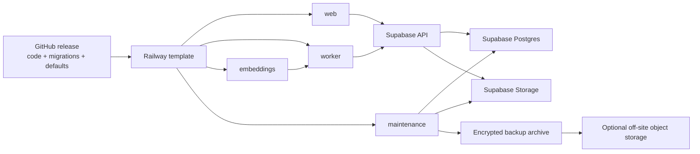
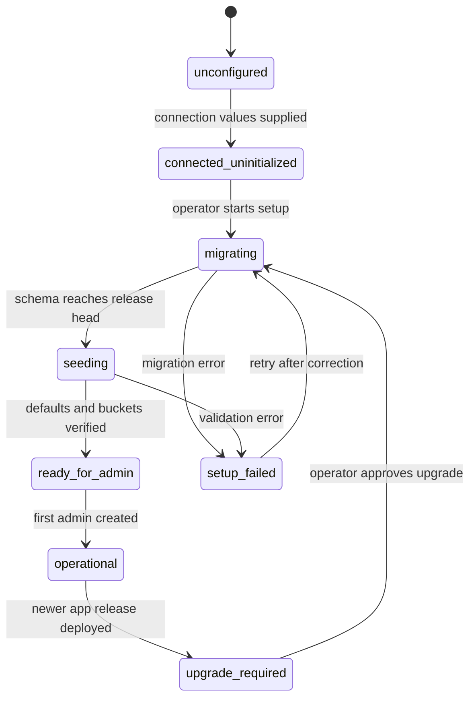

# Railway Template, Supabase Bootstrap, Backup, And Restore Roadmap

**Status:** Active implementation; Phases 0 and 1 complete
**Last reviewed:** 2026-08-04
**Scope:** Distribution of RAG Railway as a reusable Railway template connected
to a new or existing Supabase project.

## 1. Executive Decision

The target is practical, but the phrase "source of truth" needs to be divided
into three explicit ownership domains:

| Domain             | Source of truth   | Examples                                                                                                                                                                                    |
| ------------------ | ----------------- | ------------------------------------------------------------------------------------------------------------------------------------------------------------------------------------------- |
| Product definition | GitHub release    | Application code, SQL migrations, storage bucket definitions, defaults, backup format, documentation, Railway service configuration                                                         |
| Installation state | Supabase          | Runtime settings, silos, libraries, projects, documents, chunks, embeddings, jobs, users, API keys, audit data, and provider configuration                                                  |
| Deployment roots   | Railway variables | Supabase connection credentials, Railway project-control token, bootstrap token, session signing secret, internal service credentials, and optional external backup destination credentials |

GitHub should therefore be the source of truth for what a release is, but it
must not become the source of truth for customer data or live secrets. Supabase
is the source of truth for each installed instance. Railway stores only the
credentials required to find, initialize, operate, and recover that instance.

The recommended target consists of four Railway services:

1. `web`: admin portal, API, setup wizard, and backup management UI.
2. `worker`: ingestion, Ask, Extraction, Tasks, and background jobs.
3. `embeddings`: the local Ollama embedding service and model volume.
4. `maintenance`: one-shot schema bootstrap, migration, backup, verification,
   and restore commands.

The fourth service is the important addition. Schema changes and complete
backups require privileged database access and should not run as a side effect
of starting the public web application.

## 2. Current State

The repository already contains most of the release definition:

- Versioned SQL migrations in `supabase/migrations/`.
- Storage bucket configuration and storage-related migrations.
- An idempotent `bootstrap_bubble_rag_defaults` database function.
- A first-admin flow controlled by `ADMIN_SETUP_TOKEN`.
- Separate Railway definitions for `web`, `worker`, and `embeddings`.
- GitHub Actions that run `supabase db push` for the currently linked
  production project.
- Runtime settings and provider secrets stored in Supabase.
- A versioned Phase 0 platform contract for environment ownership, required
  Supabase resources, portable-backup metadata, and secret redaction.
- A release-gate check that detects undocumented variables, migration-head
  drift, checksum drift, resource drift, and unsafe secret backup policies.
- Installation metadata and a service-role readiness RPC.
- Shared web and worker guards that pause work on incompatible schemas.
- Connection, schema, queue-worker, and embedding-worker health reporting.

The present `POST /api/setup/supabase` route is a post-migration initializer.
It calls functions that are themselves created by migrations. It can populate
defaults and provider secrets, but it cannot initialize a truly blank Supabase
project.

No complete application backup or restore facility currently exists. A
database dump by itself is not complete because the original files, canonical
Markdown files, extracted assets, page renders, and generated files are stored
as Storage object bytes rather than inside Postgres.

### 2.1 Implementation ledger

| Date       | Milestone                     | Result                                                                                                                                                                                                                                                                                           |
| ---------- | ----------------------------- | ------------------------------------------------------------------------------------------------------------------------------------------------------------------------------------------------------------------------------------------------------------------------------------------------ |
| 2026-08-04 | Contextual help foundation    | Global accessible field-help layer, `FieldHelp` and `SectionHelp`, 82 typed definitions, and a required-surface coverage test shipped.                                                                                                                                                           |
| 2026-08-04 | Phase 0 platform contract     | Classified 111 environment/build values; inventoried 51 tables, 23 functions, 6 buckets, 3 extensions, and 1 Edge Function; froze backup and redaction v1.                                                                                                                                       |
| 2026-08-04 | Contract release gate         | `pnpm docs:check` blocks undocumented environment, Supabase resource, expected-head, release-version, and migration-checksum drift.                                                                                                                                                              |
| 2026-08-04 | Phase 1 readiness             | Added installation metadata, build identity, readiness RPC, web/API and worker claim guards, expanded health, and automatic recovery polling.                                                                                                                                                    |
| 2026-08-04 | Phase 2 maintenance service   | Added a fourth Railway service, signed internal control plane, resumable one-transaction-per-migration protocol, `/setup` state machine, and first-administrator handoff.                                                                                                                        |
| 2026-08-05 | Phase 3 runtime configuration | Moved 53 settings into Supabase behind a snapshotted revision, returned 3 to the environment, added the Environment variables screen with help for every field, and built connection rotation with a read-only probe and per-service health gates.                                               |
| 2026-08-05 | Phase 4 template packaging    | Specified the Railway template as a checked artifact with six mutation-proven rejection rules, plus a fresh-install acceptance script. Template creation and the two deploy tests remain operator steps.                                                                                         |
| 2026-08-06 | Phase 5 portable backup       | Added the maintenance barrier, streaming tar.zst export with per-entry digests, contract-driven redaction, S3 destination with volume splitting, optional customer-key encryption, and an independent verifier. Proven by a real backup on staging.                                              |
| 2026-08-06 | Phase 6 blank-project restore | Added sidecar archive inspection, compatibility and blank-target preflight, an id-preserving importer, storage restoration, queue recovery, optional re-embedding, a typed destructive confirmation, and the administrator and retired-key recovery screens. The A-into-B gate has not been run. |

Counts in this table are as they stood on the date of the row. The current
numbers are printed by `pnpm docs:check`.

The implementation details and change procedure are maintained in
[Railway Deployment Phase 0: Platform Contract](railway-deployment-phase-0-platform-contract.md).
Phase 1 behavior is documented in
[Railway Deployment Phase 1: Installation Readiness](railway-deployment-phase-1-readiness.md).

## 3. Non-Negotiable Boundaries

### 3.1 Service-role access is not schema bootstrap

`SUPABASE_URL` and `SUPABASE_SERVICE_ROLE_KEY` are sufficient for normal
server-side application operations. They are not a general database-owner SQL
connection and must not be treated as a migration mechanism.

A blank project must also provide its database password to maintenance. The
service derives the direct owner URL from `SUPABASE_URL`, URL-encodes the
password, and supplies the fixed owner role, port, database, and TLS options.
An optional session-pooler hostname supports platforms without direct IPv6;
an explicit `SUPABASE_DB_URL` remains available for existing installations.
This does not require a Supabase personal access token.

### 3.2 Supabase cannot contain its own only recovery key

Provider secrets such as Ollama and OpenAI keys can continue to live in
Supabase Vault. The credentials required to reach or restore Supabase cannot
exist only inside that same Supabase project. That would create a circular
dependency during an outage or restore.

Railway must retain these connection roots:

- Supabase API URL.
- Supabase server-side service key.
- Supabase database password, plus an optional pooler host or explicit
  connection URL for migrations and logical backups.
- A Railway project token that permits the authenticated admin application to
  stage validated connection rotations across this installation's services.
- Optional Supabase Storage S3 access key and secret, if the optimized bulk
  backup path is enabled.
- Backup archive encryption key or external backup destination credentials.

### 3.3 A database backup is not a file backup

Supabase documents that database backups contain Storage metadata but not the
stored object bytes. The application must export both the database and every
referenced private Storage object. A successful backup is not declared until
both layers have passed checksum and reference validation.

### 3.4 Do not migrate on every service start

Automatic migrations on every `web` or `worker` startup create race conditions,
make ordinary deployments destructive, and make failures hard to recover. The
maintenance service should own migrations and use a Postgres advisory lock.
The other services should report `upgrade_required` until the expected schema
version is installed.

### 3.5 Dashboard configuration still needs an initial connection

`SUPABASE_URL`, `SUPABASE_SERVICE_ROLE_KEY`, and the database password or
advanced connection override must be configurable from the authenticated admin
dashboard. However, the first admin
record and the active settings database are stored in Supabase. The application
cannot authenticate that administrator or load settings before it has made its
first Supabase connection.

The template therefore prompts for the API URL, service key, and database
password once at deployment. Once the schema and first administrator exist,
the dashboard becomes the supported place to test, rotate, and apply them. The
dashboard persists active values by
updating sealed Railway variables through a project-scoped Railway token; it
must not store the only usable copy of Supabase's root credentials inside the
same Supabase project.

## 4. Target Topology



All five services must be built from the same tested release commit. That
commit is merged to the protected template root branch and receives an
immutable Git tag. The release must advertise:

- Application version.
- Expected migration head.
- Backup format version.
- Minimum compatible restore version.
- Git commit SHA.

## 5. Railway Template Variables

### 5.1 Required user-supplied connection values

| Variable                    | Services                 | Purpose                                                                       |
| --------------------------- | ------------------------ | ----------------------------------------------------------------------------- |
| `SUPABASE_URL`              | web, worker, maintenance | Supabase project API URL                                                      |
| `SUPABASE_SERVICE_ROLE_KEY` | web, worker, maintenance | Server-side Data and Storage API access                                       |
| `SUPABASE_DB_PASSWORD`      | maintenance, scheduler   | Database secret used to derive the owner connection                           |
| `SUPABASE_DB_HOST`          | maintenance, scheduler   | Optional non-secret session-pooler hostname                                   |
| `SUPABASE_DB_URL`           | maintenance, scheduler   | Optional complete compatibility override                                      |
| `RAILWAY_TOKEN`             | web only                 | Project/environment-scoped Railway API access for validated variable rotation |

`NEXT_PUBLIC_SUPABASE_URL` and an anon/publishable key should remain optional
and should eventually be removed if all browser requests continue to pass
through Railway. They are not needed merely because Supabase is used on the
server.

The Railway token is a deployment-control credential, not an application API
key. It must be project/environment scoped, sealed, available only to `web`, and
excluded from logs, responses, Supabase settings, and backups. If the operator
does not provide it, the dashboard may still test proposed Supabase values but
must report that applying them requires a manual Railway variable update.

### 5.2 Template-generated values

Railway template variable functions should generate a unique value for every
installation:

| Variable                 | Recommended generation                 | Purpose                                                       |
| ------------------------ | -------------------------------------- | ------------------------------------------------------------- |
| `ADMIN_SETUP_TOKEN`      | `secret(48)` or longer                 | Authorizes first-admin creation and later controlled recovery |
| `ADMIN_SESSION_SECRET`   | `secret(64)` or longer                 | Signs admin and API-user sessions                             |
| `INTERNAL_SERVICE_TOKEN` | `secret(64)` or longer                 | Authenticates web-to-worker and maintenance callbacks         |
| `BACKUP_ENCRYPTION_KEY`  | Cryptographically random 32-byte value | Encrypts sealed backup archives, when enabled                 |

The template must never publish a universal default username or password.
Railway recommends generated template secrets rather than hardcoded default
credentials.

### 5.3 Optional operational values

| Variable                                | Purpose                                               |
| --------------------------------------- | ----------------------------------------------------- |
| `SUPABASE_STORAGE_S3_ENDPOINT`          | Faster bulk Storage export/import                     |
| `SUPABASE_STORAGE_S3_ACCESS_KEY_ID`     | Server-only Storage S3 authentication                 |
| `SUPABASE_STORAGE_S3_SECRET_ACCESS_KEY` | Server-only Storage S3 authentication                 |
| `BACKUP_DESTINATION_URL`                | Off-site S3-compatible target                         |
| `BACKUP_DESTINATION_ACCESS_KEY_ID`      | Off-site target authentication                        |
| `BACKUP_DESTINATION_SECRET_ACCESS_KEY`  | Off-site target authentication                        |
| `BACKUP_RETENTION_DAYS`                 | Automated retention after scheduled backups are added |

Connection, security, provider, and backup credentials have one canonical value
per Railway environment under **Shared Variables**. Services contain only
`${{ shared.NAME }}` references. A secret must never be copied into two service
variable records, even when the values currently match.

The upgrade reconciler promotes matching legacy service-local values into the
shared scope without printing them, replaces every consumer with a reference,
and removes obsolete duplicates after the references exist. It then seals each
canonical secret at environment scope. It stops before mutation when
fingerprints disagree or a required value is unavailable. A credential is
requested again only when no existing Railway value can be referenced or
recovered; later runs recognize sealed values from metadata without reading
them.

## 6. First-Run Experience

The public site needs an installation state machine rather than a single
binary health response.



### 6.1 First request behavior

1. `web` checks whether required Railway connection variables exist.
2. It performs a read-only connectivity probe.
3. It reads a minimal installation-version record if the table exists.
4. If the schema is absent, it redirects to `/setup`.
5. `/setup` asks for `ADMIN_SETUP_TOKEN` before exposing any bootstrap action.
6. The user starts initialization.
7. `web` creates a signed, short-lived maintenance request. It does not execute
   SQL itself.
8. `maintenance` obtains a Postgres advisory lock and applies migrations.
9. It runs safe seed/default operations and verifies buckets, extensions,
   functions, indexes, RLS policies, and the migration head.
10. The UI advances to first-admin creation without asking the user to discover
    another URL.
11. The first admin chooses the username and password. The setup token is
    recorded as consumed.
12. The user is signed in and redirected to the admin dashboard.

### 6.2 Recovery behavior

The setup token remains a break-glass mechanism, not an everyday login. A new
token in Railway must be able to authorize recovery even when an earlier token
was consumed. Recovery actions must be audited, rate-limited, and unavailable
without the exact current Railway token.

After first setup, keep `ADMIN_SETUP_ENABLED=false`. Deliberate recovery
requires an operator to set that shared Railway switch to `true` and rotate the
token. The switch is never stored in the settings vault, and switching it off
immediately invalidates existing setup sessions.

### 6.3 Admin-managed Supabase connection

After login, the admin dashboard must provide a **Supabase Connection** section
with these masked fields:

- Supabase URL.
- Supabase service-role key.
- Supabase database URL.

The page shows only the project reference, connection state, and short
fingerprints for saved secrets. It never returns full stored keys to the
browser. Replacing a secret requires entering its complete new value.

The workflow is deliberately staged:

1. **Edit:** enter one or more replacement values without affecting active
   jobs.
2. **Validate format:** require HTTPS for the API URL and TLS for Postgres;
   reject malformed keys and connection strings.
3. **Verify identity:** derive and compare the project reference represented by
   all three values so credentials from different projects cannot be mixed.
4. **Test API access:** make read-only Data API and Storage API requests with the
   proposed service key.
5. **Test database access:** have `maintenance` open a read-only Postgres
   session, inspect the installed migration head, and prove it can obtain the
   migration advisory lock without applying changes.
6. **Classify:** identify the target as the current project, a compatible Bubble
   RAG project, a blank Supabase project, or an incompatible project.
7. **Initialize when blank:** require a second confirmation and run the normal
   migration/default bootstrap before promotion.
8. **Stage:** use the Railway Public API to write the three proposed values to
   all required services with deployments suppressed until the complete set is
   staged.
9. **Promote:** redeploy `maintenance`, then `web`, then `worker`, using health
   checks before advancing. The embeddings service does not need Supabase
   credentials unless its architecture changes.

   > **Implemented as `web`, `worker`, `maintenance`.** Promotion is orchestrated
   > by `maintenance`, so promoting it first would terminate the process running
   > the loop and take the rollback with it. The reason maintenance was listed
   > first - that it owns migrations - is satisfied differently: it migrates and
   > probes a target through a database URL passed in the request, so its own
   > variables need not change to prepare that target. It adopts the new values
   > in a separate, explicitly triggered restart once the outcome is known. See
   > [Phase 3](railway-deployment-phase-3-runtime-configuration.md#why-promotion-runs-in-maintenance).

10. **Verify:** test admin authentication, schema compatibility, worker access,
    Storage access, and a non-mutating queue query.
11. **Finalize:** remove temporary rollback values and record an audit event
    containing actor, time, old/new project references, secret fingerprints,
    and health results, but no plaintext credentials.

For same-project key or password rotation, the current credentials should be
placed temporarily into sealed `SUPABASE_PREVIOUS_*` Railway variables before
promotion. If any service fails its health gate, the application restores those
values and redeploys the affected services. Remove the temporary values after a
successful stability window.

Changing to a different Supabase project is not an ordinary credential edit.
It is a migration operation: back up the current installation, initialize or
restore the destination, prove first-admin continuity, then promote the new
connection. The dashboard must label these actions separately as **Rotate
credentials** and **Move to another project**.

## 7. Migration And Bootstrap Service

### 7.1 Recommended repository additions

```text
apps/maintenance/
  src/cli.ts
  src/bootstrap.ts
  src/migrate.ts
  src/backup.ts
  src/restore.ts
  src/verify.ts
  package.json
packages/platform-config/
packages/backup-format/
Dockerfile.maintenance
railway.maintenance.json
```

The maintenance image should contain the supported Supabase CLI/Postgres client
versions and the repository's `supabase/migrations` directory. Pin these tool
versions in the image. Do not install `latest` at runtime.

Supabase CLI `db dump` runs `pg_dump` through a container. The Railway
maintenance service must not depend on nested Docker. Package a native,
version-compatible `pg_dump`, `pg_restore`, and `psql` in the maintenance image
and invoke them directly for disaster-recovery export and restore. Continue to
use the Supabase migration history and CLI migration behavior for schema
deployment.

### 7.2 Installation metadata

Add a migration that creates an installation control surface such as:

```text
platform_installations
  id
  installation_id
  application_version
  migration_head
  backup_format_version
  state
  maintenance_mode
  installed_at
  upgraded_at
  last_verified_at
  last_error

platform_migration_checksums
  migration_version
  filename
  sha256
  applied_at
  release_version
```

The Supabase CLI already maintains migration history. The checksum table adds
release-integrity and drift detection; it does not replace the CLI history.

### 7.3 Bootstrap algorithm

1. Validate the database host belongs to the configured Supabase project.
2. Connect using TLS and set conservative statement and lock timeouts.
3. Acquire one advisory lock dedicated to RAG Railway schema management.
4. Inspect remote migration history and the application checksum ledger.
5. Reject edited historical migrations. Only new migrations may be applied.
6. Apply pending migrations in timestamp order.
7. Run the existing idempotent defaults bootstrap.
8. Verify all required Storage buckets, extensions, RPC functions, indexes, and
   RLS policies.
9. Write the installed application and schema versions.
10. Release the lock and return a structured report to the web UI.

Every step must be restartable. An interrupted migration remains visible with
its exact failing file and database error. A second run must either continue
safely or stop with a drift report.

### 7.4 Upgrade algorithm

Deploying a newer GitHub release does not immediately let workers claim jobs.
On startup, each service compares `EXPECTED_MIGRATION_HEAD` from its build with
the installed head:

- Equal: service is ready.
- Database newer than code: service is incompatible and must not start work.
- Database older than code: health reports `upgrade_required`; admin approves
  the maintenance migration.

For urgent security releases an explicitly configured auto-upgrade mode may be
added later. Manual approval is safer for the first template release.

## 8. Runtime Configuration Consolidation

The goal that Railway holds only connection information requires an explicit
environment-variable inventory.

### 8.1 Keep in Railway

- Supabase URL, service key, and database URL.
- The project-scoped Railway token used only for admin-approved connection
  rotation and service redeployment.
- Setup, session, and internal-service secrets.
- Service topology such as private embedding-worker URL.
- Backup encryption and off-site destination credentials.
- Process-level settings required before Supabase is reachable, such as `PORT`.

### 8.2 Store in Supabase

- Model provider access-point lists and allowed concurrency.
- Model names, reasoning effort, context limits, instructions, and tool access.
- PDF parsing and vision configuration.
- Chunk size, overlap, embedding model, retrieval mode, top K, and cutoff.
- Ask and Extraction loop limits and search-expansion behavior.
- Job policies, file size policies, and non-secret feature flags.
- Webhook settings, API key records, library grants, and task definitions.

### 8.3 Configuration delivery to workers

Add a monotonically increasing configuration revision. Workers should:

1. Load a validated configuration snapshot when they start a job.
2. Cache it only for a short, bounded period.
3. Record the revision used on every job and generated file.
4. Poll or subscribe for revision changes.
5. Continue an active job with its captured snapshot so mid-job edits do not
   produce mixed behavior.

Defaults belong in migrations or an idempotent seed function. The GitHub
release defines the default; the Supabase row records the installation's live
choice.

## 9. Complete Backup Design

### 9.1 Two backup products

Provide two clearly named modes:

1. **Portable application export:** preferred for migration, support, and
   long-term compatibility. It contains application records as versioned JSONL
   plus every referenced Storage object.
2. **Disaster-recovery backup:** contains a Supabase/Postgres logical dump plus
   every Storage object. It is more exact but more sensitive to Postgres,
   extension, Vault, and target-project version differences.

The first release should implement the portable application export first, then
add disaster recovery after automated restore tests exist.

### 9.2 Archive format

Use a versioned extension such as `.bragbackup`, internally a streaming
`tar.zst` archive. An optional Zip64 export can be added for users who need to
inspect an archive without specialist tools.

```text
bubble-rag-2026-08-04T160000Z.bragbackup
  manifest.json
  checksums.sha256
  release/
    application-version.json
    migrations.json
  database/
    application-data/*.jsonl
    database.dump
  storage/
    storage-manifest.jsonl
    original-documents/**
    generated-files/**
    page-renders/**
    extracted-assets/**
    table-exports/**
    parser-debug/**
  reports/
    backup-summary.json
    validation-report.json
```

`database.dump` is present only in disaster-recovery mode. The portable export
must include all application tables needed to reproduce:

- Silos, projects, libraries, memberships, and grants.
- Documents, document files, canonical Markdown, pages, extracted assets, and
  generated files.
- Chunks, character offsets, token counts, embeddings, model/version metadata,
  and document processing state.
- Ask, Extraction, Task, queue, event, webhook, and audit records according to
  the chosen retention policy.
- Runtime configuration and non-secret provider configuration.

The manifest must include counts and hashes by table, bucket, and object. Each
Storage entry records bucket, path, byte length, media type, database owner
record, ETag when available, and SHA-256.

### 9.3 Secret policy

The default portable export must not expose:

- Raw API keys.
- Admin or API-user password material beyond what is explicitly required for a
  controlled restore.
- Session secrets.
- Supabase connection credentials.
- Plaintext provider tokens.

Use one of these policies per field: `included`, `encrypted`, `redacted`, or
`regenerate_on_restore`. The manifest records the policy without recording the
secret.

An optional sealed disaster-recovery archive may include recoverable encrypted
configuration. It must be encrypted with a customer-controlled key before it
leaves the maintenance process. The key itself is never written into the
archive or Supabase.

### 9.4 Consistency model

Postgres and Storage do not provide one shared transaction. A complete backup
therefore needs an application-level maintenance barrier:

1. Set `maintenance_mode = backup_requested`.
2. Stop new uploads and mutating API requests.
3. Allow active jobs to finish, or let the administrator cancel them.
4. Wait until workers report no claimed mutating jobs.
5. Record a database high-water timestamp and begin a consistent database
   snapshot/export.
6. Export exactly the Storage object paths referenced by that snapshot.
7. Re-read object metadata and reject objects changed during export.
8. Validate table counts, object counts, byte sizes, and checksums.
9. Mark the backup complete and release maintenance mode.

If the user elects a non-blocking backup, label it `fuzzy` in the manifest and
record the consistency window. It must not be presented as a guaranteed restore
point.

### 9.5 Streaming and large installations

The maintenance process must not assemble the archive in RAM or rely on the
ephemeral Railway filesystem. It should stream database rows and object bytes
through the compressor to a multipart destination.

For a first release, the output can be written to a private `backups` bucket and
downloaded through a short-lived signed URL. This is convenient but is not an
off-site disaster-recovery copy. Production operators should be able to stream
the same archive to an independent S3-compatible destination.

The `backups` bucket and active backup artifact must be excluded from the
archive's Storage inventory so a backup can never recursively include itself.

Supabase Storage exposes an S3-compatible API and supports list, get, put, and
multipart operations. S3 credentials are server-side credentials and bypass
RLS, so they must remain sealed in Railway. The service-role Storage API can be
the initial implementation; S3 should be the optimized bulk path.

### 9.6 Backup job tables

Add database records such as:

```text
backup_jobs
  id, requested_by, mode, status, consistency_mode
  started_at, heartbeat_at, completed_at
  current_stage, rows_exported, objects_exported, bytes_exported
  archive_bucket, archive_path, archive_sha256
  application_version, migration_head, backup_format_version
  error_code, error_message

backup_job_objects
  backup_job_id, bucket, object_path, expected_size
  actual_size, sha256, status, attempts, error_message

backup_artifacts
  backup_job_id, destination, path, size_bytes, sha256
  encryption, created_at, expires_at
```

The admin UI needs Create, Cancel, Retry, Verify, Download, and Delete actions,
plus current stage, heartbeat, elapsed time, row/object counts, bytes, and full
errors. Backups should be admin-only initially. A public API can be added later
behind a dedicated `system:backup` scope.

## 10. Restore Design

Restore is at least as important as export. A backup is not accepted until it
has been restored in an automated test.

### 10.1 Safe first release

Support restore only into a blank Supabase project. In-place restore and merge
are substantially riskier and should be deferred.

### 10.2 Restore sequence

1. Upload or select the encrypted archive.
2. Verify archive signature, format version, and all checksums before mutation.
3. Verify the target is blank or has only the expected Supabase managed schema.
4. Apply the GitHub release migrations required by the archive.
5. Enter restore maintenance mode.
6. Import application records in dependency order while preserving stable IDs.
7. Upload Storage objects to their original bucket and path.
8. Reconcile every file row with an existing object and every object with a
   manifest entry.
9. Restore non-secret settings.
10. Require operators to supply or rotate redacted provider, API, session, and
    connection secrets.
11. Rebuild derived indexes and verify vector dimensions/model metadata.
12. Optionally mark chunks for re-embedding when the configured embedding model
    differs from the archive.
13. Run health, RAG search, original download, Markdown download, and generated
    file download smoke tests.
14. Create or recover the first admin and leave maintenance mode.

Never restore stale signed URLs; restore stable bucket/object paths and generate
new signed URLs when requested.

## 11. Admin UI And Internal API

Add a top-level `System` or `Maintenance` page with these sections:

- Installation: app version, migration head, database connectivity, bucket
  readiness, schema drift, and available upgrade.
- Setup: migration progress, exact migration filename, structured errors, and
  retry.
- Backup: mode, consistency choice, destination, progress, verification, and
  download.
- Restore: archive inspection and blank-target restore workflow.
- Recovery: admin setup-token status and credential rotation guidance.
- Supabase Connection: masked active values, validation results, schema status,
  key rotation, project migration, rollback status, and configuration audit
  history.

### 11.1 Contextual field help

**Foundation status (2026-08-04): implemented.** The web application now loads
a shared portal-based `FieldHelp` layer on every page. It discovers current and
dynamically rendered form fields, preserves their accessible names, associates
open help with the control, and supplies mouse, keyboard, touch, Escape,
outside-click, focus restoration, single-popover, collision, and mobile
behavior. High-impact setup fields use a typed help catalog; newly introduced
fields receive a safe generated explanation until reviewed copy is added to the
catalog. The final field-by-field copy and section-help audit remains in Phase 7.

Every configurable section, field, checkbox, selector, and advanced option must
have contextual help available without requiring the operator to leave the
current workflow. This is part of the interface contract, not optional polish.

Use two presentation levels:

1. **Tooltip:** one or two sentences for a straightforward field. It answers
   what the value controls and when it is used.
2. **Help popover:** structured detail for fields with security implications,
   dependencies, units, ranges, restart behavior, or destructive side effects.

Place a small Lucide `CircleHelp` or `Info` icon button beside the associated
label or section heading. The control must have an accessible name such as
`Explain chunk overlap`. Do not place instructional paragraphs permanently in
the form, and do not use placeholders as the only explanation.

The contextual help for a field should cover the applicable items below:

- Plain-language purpose.
- When and where the value is used.
- Valid format, unit, range, default, and a safe example.
- Relationship to other fields and which value takes precedence.
- Whether changing it affects new jobs only, active jobs, or requires a service
  redeployment or reprocessing.
- Security classification and where an administrator obtains a secret value.
- Data-loss, cost, performance, model-quality, or compatibility consequences.
- A documentation anchor for unusual workflows that need more detail.

Never display a current secret, connection password, service-role key, API key,
or token inside help content. Secret help explains the source and handling of
the value, while the field itself remains masked and requires explicit
replacement.

#### Interaction requirements

- Desktop: open on hover or keyboard focus; keep the content available while
  the pointer moves between the trigger and popover.
- Touch: open on tap and close on a second tap, outside tap, or close button.
- Keyboard: open with Enter or Space, close with Escape, and restore focus to
  the trigger.
- Screen readers: associate short descriptions with the field through
  `aria-describedby`; expose expanded popovers through `aria-expanded` and
  `aria-controls`.
- Responsive layout: render through a portal with collision detection so help
  is never clipped by panels, hidden under adjacent controls, or pushed outside
  a mobile viewport.
- Only one nonmodal help popover should be open at a time.
- Opening help must never change a field value, submit a form, resize a stable
  control row, or block normal form navigation.
- Respect reduced-motion preferences and do not require animation to understand
  state.

#### Implementation model

Create shared `FieldHelp` and `SectionHelp` components rather than implementing
individual tooltip behavior on every page. Help copy should live in a typed,
version-controlled registry keyed by a stable field identifier:

```ts
type FieldHelpDefinition = {
  id: string;
  summary: string;
  details?: string[];
  example?: string;
  unit?: string;
  defaultValue?: string;
  validRange?: string;
  security?: "public" | "sensitive" | "secret";
  activation?: "immediate" | "next_job" | "reprocess" | "redeploy";
  docsAnchor?: string;
};
```

The GitHub release is the source of truth for product help content. Supabase may
store administrator-entered field values, but it should not hold the only copy
of the explanations required to configure a blank installation. Tests should
fail when a registered configuration field has no help definition.

#### Delivery sequence

Implement the shared component, registry, accessibility behavior, and automated
coverage check early in the roadmap. Add help definitions whenever a setup or
configuration field is introduced or modified. Near the end of the roadmap,
perform a complete copy, accessibility, mobile layout, and accuracy audit. This
avoids a large retrofit while still allowing final wording to reflect the
finished system.

Suggested internal admin routes:

```text
GET  /api/system/installation
POST /api/system/bootstrap
POST /api/system/migrate
GET  /api/system/operations/{operationId}
GET  /api/system/supabase-connection
POST /api/system/supabase-connection/test
POST /api/system/supabase-connection/rotate
POST /api/system/supabase-connection/move
GET  /api/system/supabase-connection/operations/{operationId}
POST /api/system/supabase-connection/operations/{operationId}/rollback
POST /api/system/backups
GET  /api/system/backups
GET  /api/system/backups/{backupId}
POST /api/system/backups/{backupId}/cancel
POST /api/system/backups/{backupId}/verify
GET  /api/system/backups/{backupId}/download
DELETE /api/system/backups/{backupId}
POST /api/system/restores/inspect
POST /api/system/restores
GET  /api/system/restores/{restoreId}
```

These routes should not be added to public `/api/v1` during the first release.
They require an authenticated administrator, CSRF protection for browser
requests, audit logging, idempotency on mutating requests, and explicit
confirmation for restore operations.

## 12. GitHub Release And Template Strategy

### 12.1 Protected release branch and immutable release tags

Railway's automatic template update notifications require a GitHub-backed
template whose updates are merged to the repository's root branch, normally
`main` or `master`. The public template should therefore reference a protected
root release branch, not an unrestricted development branch. Only commits that
pass the complete release pipeline may be merged there, and every merged
release commit receives an immutable version tag.

This provides both behaviors needed by the platform:

- Railway detects a new root-branch release and notifies existing template
  consumers that an update is available.
- The application records the immutable version tag and Git SHA for migration,
  backup, restore, and support history.

Template updates are opt-in for consumers. Railway does not silently replace a
consumer's running installation merely because the template changed. The
consumer reviews the changelog and chooses when to apply the update.

Each release pipeline should:

1. Validate migrations from an empty local Supabase instance.
2. Upgrade a fixture from the previous supported release.
3. Run application tests.
4. Create a complete fixture backup.
5. Restore that backup to a second empty instance.
6. Compare record counts, stable IDs, object hashes, Markdown, chunks, and a set
   of known RAG results.
7. Build versioned images.
8. publish the release manifest.
9. Update the Railway template only after all gates pass.

The existing GitHub Action can remain useful for the developer-owned production
environment. Template consumers should not be required to fork the repository
and configure GitHub Supabase secrets merely to initialize their database. The
maintenance service applies the same checked-in migrations for each template
installation.

### 12.2 Template composition

The Railway template should define:

- All five services and their health checks.
- An embeddings model volume.
- Private networking between services.
- Shared Supabase variables referenced by each service.
- Required descriptions and links showing where Supabase values are found.
- Generated setup, session, and internal-service secrets.
- Public networking only for `web`.
- The protected GitHub root release branch as the source.
- A first-deploy message directing the operator to `/setup` and telling them
  where the generated `ADMIN_SETUP_TOKEN` is stored.

### 12.3 Updating the template itself

The template is created once and maintained in place:

1. Normal application changes are merged into the protected root release
   branch after the release gates pass.
2. Railway detects the GitHub-backed template source change and notifies users
   with deployed copies that an update is available.
3. Each user chooses when to apply the update to their installation.
4. The maintenance coordinator applies that release's pending Supabase
   migrations before the updated application becomes active.
5. The template changelog identifies application, migration, variable, and
   operational changes plus any required manual action.

The template author does not recreate the template for each release. When the
infrastructure definition itself changes, edit the existing template in the
Railway template composer and publish the updated definition. Examples include:

- Adding or removing a Railway service.
- Adding the maintenance service or embeddings volume.
- Adding required variables or reference variables.
- Changing health checks, networking, start commands, or resource defaults.

Existing installations must never assume that a new service appeared
automatically. The infrastructure reconciler creates or identifies each
required service, then binds its variables to the existing environment-level
shared values. Adding a consumer must not require re-entering an available
secret. The update workflow verifies every resource and reference before any
legacy variable is removed.

### 12.4 GitHub-to-Railway-to-Supabase release flow

The intended production behavior is:

1. A maintainer adds application changes and, when required, a new immutable SQL
   file under `supabase/migrations/`.
2. The change is reviewed and merged into the protected release branch.
3. GitHub CI runs documentation, type, unit, build, empty-database migration,
   upgrade, and backup/restore tests.
4. CI creates an immutable release version and commit SHA.
5. Railway detects that release through the connected GitHub source and builds
   only the services affected by their watch paths.
6. Before new application containers become active, one release coordinator
   invokes the maintenance service for the target installation.
7. Maintenance compares the release migration head with Supabase, obtains the
   advisory lock, and applies only pending committed migrations in order.
8. Maintenance runs schema verification and post-migration defaults.
9. If migration or verification fails, the new application deployment is
   blocked and the currently healthy release remains active.
10. If it succeeds, Railway promotes `web` and `worker`; their health checks
    confirm the exact application version and migration head.
11. The release record, Git SHA, migration list, timing, and result are written
    to the Supabase installation audit history.

Railway supports GitHub autodeploys and pre-deploy commands, but this
multi-service application must not independently run the same migration as a
pre-deploy command on every service. Use one release coordinator plus the
database advisory lock. A pre-deploy hook may invoke that coordinator and wait
for its result; it must not duplicate migration logic in `web`, `worker`, and
`embeddings`.

Only files in `supabase/migrations/` alter an installed database. Editing a
TypeScript type, table name string, seed example, or documentation does not
implicitly change Supabase. Historical migration files are immutable after
release; every later database adjustment is a new migration.

The repository's current production workflow is transitional:

- Railway services may autodeploy from their connected GitHub branch when a
  service watch path changes.
- GitHub tests run on pushes to `main` and `dev`.
- Staging Supabase migrations run automatically for matching changes on `dev`.
- Production Supabase migration is currently `workflow_dispatch` and is invoked
  by the release helper, not by an ordinary push to `main`.

Therefore, until the maintenance release coordinator is implemented, use
`update-and-deploy.bat --Commit` or explicitly run the production Supabase
workflow. A plain GitHub push must not be described as an atomic application and
database release yet.

## 13. Phased Implementation Roadmap

### Phase 0: Inventory and contract freeze

**Implementation status:** Completed on 2026-08-04. The typed required-surface
inventory and missing-help test were completed with Phase 1; the final rendered
copy and accessibility audit remains intentionally scheduled for Phase 7.

**Work**

- Inventory every environment variable and classify it as connection root,
  secret, runtime setting, build setting, or obsolete compatibility value.
- Inventory every application table, RPC, extension, storage bucket, and Edge
  Function.
- Inventory every setup and configuration field and assign a stable contextual
  help identifier.
- Define backup format version `1` and the secret-redaction matrix.
- Decide which audit/job history tables are included by default.

**Deliverables**

- [x] Configuration ownership matrix.
- [x] Configuration-field and contextual-help coverage inventory, including
      typed required surfaces, 82 reviewed definitions, and dynamic fallback
      behavior.
- [x] Machine-readable required-resource manifest.
- [x] Backup manifest JSON Schema.
- [x] Machine-readable secret-redaction and history-retention policy.
- [x] Automated contract drift check in the normal release gate.

**Gate**

No live setting lacks an owner, default, validation rule, and backup policy.

### Phase 1: Installation metadata and readiness

**Implementation status:** Completed on 2026-08-04. See
[Railway Deployment Phase 1: Installation Readiness](railway-deployment-phase-1-readiness.md)
for the database schema, state contract, health response, fail-closed behavior,
checksum process, and verification procedure.

**Work**

- Add installation/version/checksum tables.
- Add expected migration head and release version to builds.
- Expand `/api/health` to distinguish connection, schema, and worker health.
- Make web and workers reject incompatible schema versions safely.
- Add the shared `FieldHelp` and `SectionHelp` components, typed help registry,
  responsive portal, keyboard/touch behavior, and missing-help test.

**Gate**

A deployment can report `unconfigured`, `upgrade_required`, `operational`, or a
specific incompatibility without crashing or claiming jobs. New fields can use
the contextual-help system before setup and configuration screens are expanded.

**Delivered**

- [x] `platform_installations` metadata and
      `platform_migration_checksums` ledger tables.
- [x] Service-role `get_platform_readiness` compatibility RPC.
- [x] Application version, expected migration head, and backup format compiled
      into the shared web/worker build.
- [x] SHA-256 repository migration ledger and release-gate drift enforcement.
- [x] Expanded `/api/health` connection, schema, queue-worker, and embedding
      worker reporting.
- [x] Shared web/API readiness guard with structured `503` responses.
- [x] Worker pre-claim readiness guard with automatic recovery polling.
- [x] Shared `FieldHelp` and `SectionHelp`, responsive portal behavior, typed
      required-surface inventory, and missing-help tests.

### Phase 2: Maintenance service and blank-project bootstrap

**Implementation status:** Completed on 2026-08-04. See
[Railway Deployment Phase 2: Maintenance And Blank-Project Bootstrap](railway-deployment-phase-2-maintenance-bootstrap.md)
for service boundaries, signed requests, locked migration execution, setup
states, recovery, first-admin handoff, and the fresh-install acceptance path.

**Work**

- Add `apps/maintenance`, its Dockerfile, and Railway definition.
- Implement locked, idempotent migration execution.
- Convert the existing Supabase setup route into post-migration defaults only.
- Add the `/setup` state machine and maintenance-operation status.
- Integrate the existing first-admin setup form as the final setup stage.
- Add contextual help to every initial connection, migration, recovery, and
  first-admin field as those screens are built.

**Gate**

A new Supabase project can be connected to the Railway template, initialized,
verified, and given its first administrator without running commands locally or
adding GitHub Actions secrets.

**Delivered**

- [x] Dedicated `apps/maintenance` HTTP control plane, production Dockerfile,
      Railway service definition, and health endpoint.
- [x] Supabase project-identity/TLS validation, Postgres advisory lock,
      migration-history validation, immutable SHA-256 drift checks, ordered
      per-file transactions, restart boundaries, and durable idempotency keys.
- [x] Post-migration defaults, required-resource verification, checksum-ledger
      synchronization, and installation-state finalization.
- [x] Durable maintenance operation table with stages, counts, heartbeat,
      exact current migration, structured errors, and refresh recovery.
- [x] Signed and replay-resistant web-to-maintenance requests over Railway
      private networking.
- [x] Public non-secret setup status, short-lived setup authorization, full
      `/setup` state machine, first-admin creation, token consumption, and
      dashboard handoff.
- [x] Contextual help for initial connection, setup token, migration, recovery,
      and first-admin surfaces.
- [x] Unit, contract, type, application-build, and documented fresh-project
      acceptance checks.

### Phase 3: Runtime configuration normalization

**Implementation status:** Completed on 2026-08-05. All fifty operational
settings are stored in Supabase with a revision workers snapshot per job, every
one has a reviewed help definition and an entry on the admin settings screen, and
the Supabase Connection panel rotates the three connection roots behind a
read-only database probe and per-service health gates. See
[Railway Deployment Phase 3: Runtime Configuration Normalization](railway-deployment-phase-3-runtime-configuration.md)
for the implementation, and
[Phase 3: The Second Settings Migration](railway-deployment-phase-3-remaining-environment-settings.md)
for the per-setting decisions in the second pass. The gate is met.

**Work**

- Move remaining operational settings out of Railway variables.
- Add configuration revisioning and worker snapshot behavior.
- Add the admin Supabase Connection panel, read-only validation service, Railway
  variable staging, ordered redeployment, health gates, and rollback workflow.
- Add reviewed help definitions for all existing model, PDF, RAG, Ask,
  Extraction, provider, queue, storage, API-key, library, and task settings.
- Remove duplicated environment fallbacks after a deprecation period.
- Prevent provider configuration changes from taking effect midway through a
  job.

**Gate**

Except for connection/security roots and service topology, a fresh installation
can be configured entirely through the admin application and Supabase. An admin
can rotate the three Supabase connection values without visiting each Railway
service or exposing a secret back to the browser.

### Phase 4: Railway template packaging

**Implementation status:** Repository side completed on 2026-08-05. The template
is specified in `platform/railway-template.v1.json`, enforced against the
platform contract by `scripts/verify-railway-template.mjs`, and the phase gate is
asserted by `scripts/verify-fresh-install.mjs`. See
[Railway Deployment Phase 4: Template Packaging](railway-deployment-phase-4-template-packaging.md).
Creating the template and running the two deploy tests happen in a Railway
account and remain outstanding, so the gate is specified and verified but not yet
demonstrated.

> **The Railway token moved to maintenance.** The work item below says to expose
> it only to the web service. Phase 3 moved connection promotion into
> maintenance, which is where the token now belongs: it can rewrite any variable
> and redeploy any service in its environment, and maintenance is not
> internet-facing.

**Work**

- Generate a private template from a clean staging Railway project.
- Define variable prompts, generated secrets, references, private networking,
  health checks, volume, and release source.
- Document creation of the environment-scoped Railway project token and expose
  it only to the web service as a sealed variable.
- Run first-deploy and upgrade tests using a different Railway account and a
  fresh Supabase project.

**Gate**

An operator can go from the Railway template to the first-admin dashboard using
the required Supabase connection values, an environment-scoped Railway token,
and the generated setup token.

### Phase 5: Portable backup and verification

**Implementation status:** Completed on 2026-08-06. See
[Railway Deployment Phase 5: Portable Backup And Verification](railway-deployment-phase-5-portable-backup.md).
The maintenance barrier, streaming tar.zst export, redaction, S3 destination
with volume splitting, optional customer-key encryption, the verifier and the
admin interface are implemented.

> **S3 is the only destination.** Section 9.5 suggests writing the first release
> to a private Supabase `backups` bucket. That was implemented and then removed:
> a copy stored in the project being backed up is lost with that project, which
> is the failure a backup exists to survive. Backblaze B2 is the default
> endpoint; any S3-compatible provider works.

> **Archives are split into volumes.** Section 9.5 does not mention splitting.
> Without it an archive is capped by the destination's single-object limit,
> which for some providers is far below what a large installation produces.

**Work**

- Add backup job schema and maintenance queue handling.
- Stream JSONL data and all referenced Storage objects into `.bragbackup`.
- Add checksums, progress, heartbeats, cancellation, retry, and signed download.
- Add optional off-site S3-compatible destination.
- Add admin backup UI and audit events.

**Gate**

The backup verifier proves all expected records and object bytes are present,
and no plaintext secret appears in the default archive.

### Phase 6: Blank-project restore

**Implementation status:** Completed on 2026-08-06. See
[Railway Deployment Phase 6: Blank-Project Restore](railway-deployment-phase-6-blank-project-restore.md).
Archive inspection, compatibility and blank-target checks, the id-preserving
importer, storage restoration, queue recovery, optional re-embedding, the typed
destructive confirmation and the recovery log are implemented. The gate below
needs two live installations and has not been run.

> **Blank means empty of content, not of configuration.** A freshly migrated
> installation seeds a default tenant, project, silo, model configuration and
> runtime settings, so "every table empty" would only be true of an installation
> the migrations had never run against. The check counts the tables that hold
> what a person made, and `admin_users` is excluded because reaching the restore
> screen requires being signed in.

> **Identity is preserved, not regenerated.** Every relation in an archive is
> expressed as an id, and outside systems hold those ids too. Reassigning them
> would break references this installation cannot see.

**Work**

- Add archive inspection, compatibility checks, and blank-target enforcement.
- Restore stable IDs, database relations, and Storage paths.
- Reconcile data and objects and support optional re-embedding.
- Add destructive-action confirmation and recovery logs.

**Gate**

A backup from installation A restores into installation B with matching table
counts and object hashes, and passes ingestion, download, RAG, Ask, Extraction,
Task, library, and API smoke tests.

### Phase 7: Disaster recovery and release automation

**Work**

- Add the logical-dump backup mode and encrypted secret policy.
- Test supported Supabase/Postgres version combinations.
- Add scheduled backups, retention, off-site replication, and restore drills.
- Make backup/restore compatibility a mandatory GitHub release gate.
- Complete the final contextual-help copy, accessibility, mobile layout, field
  coverage, and behavior-accuracy audit.

**Gate**

Every published template release has both empty-install and previous-release
upgrade evidence plus a successful automated backup/restore drill. Every setup
and configuration field also passes the contextual-help coverage and
accessibility gates.

## 14. Acceptance Test Matrix

At minimum, automate these cases:

| Test                        | Expected result                                                               |
| --------------------------- | ----------------------------------------------------------------------------- |
| Empty Supabase bootstrap    | All migrations, extensions, buckets, policies, RPCs, and defaults are present |
| Bootstrap rerun             | No duplicate data and no destructive change                                   |
| Two simultaneous bootstraps | One obtains the advisory lock; the other waits or exits cleanly               |
| Interrupted migration       | Exact failed migration is recorded and retry is deterministic                 |
| Historical migration edited | Checksum drift blocks deployment                                              |
| First admin                 | Unique template token creates one admin and is consumed                       |
| Setup recovery              | Rotated Railway token authorizes an audited recovery                          |
| Supabase key rotation       | Proposed values are tested, staged together, deployed, and health-checked     |
| Mixed-project credentials   | URL, service key, and DB URL from different projects are rejected             |
| Rotation health failure     | Previous sealed values are restored without losing administrator access       |
| Project move                | Backup, restore, and admin continuity pass before connection promotion        |
| Contextual-help coverage    | Every registered setup and configuration field has a reviewed help definition |
| Help keyboard/touch access  | Help opens, closes, restores focus, and remains usable without hover          |
| Help responsive layout      | Popovers avoid clipping and overlap on supported mobile and desktop viewports |
| Secret help                 | Explanations identify secret sources without exposing current credential data |
| Schema behind application   | Services report `upgrade_required` and do not process jobs                    |
| Schema ahead of application | Older services fail closed                                                    |
| Portable backup             | All selected rows and referenced object bytes are included                    |
| Backup during active ingest | Quiesce waits, cancels, or labels the backup non-atomic                       |
| Corrupt object              | Verification fails with the bucket/path and checksum mismatch                 |
| Restore to nonblank target  | Operation refuses before mutation                                             |
| Restore to blank target     | IDs, relations, files, chunks, embeddings, and settings match                 |
| Redacted secrets            | Restore requests rotation and no plaintext secret leaked                      |
| Changed embedding model     | Restore can retain compatible vectors or queue re-embedding                   |

## 15. Recommended Decisions Now

1. Treat a new Supabase project as a prerequisite. Do not make the first
   template release create Supabase organizations or projects through a personal
   access token.
2. Require `SUPABASE_DB_PASSWORD` in the template and derive the owner URL.
   Keep the pooler host and complete URL as optional compatibility inputs.
3. Provide a project/environment-scoped `RAILWAY_TOKEN` so authenticated admins
   can test, stage, apply, and roll back Supabase connection rotations from the
   dashboard. Do not use an account-wide token.
4. Add the dedicated maintenance service before building the setup wizard.
5. Generate unique admin setup and session secrets in the Railway template.
   Never ship a default username/password.
6. Build the contextual-help component and coverage test early, add help content
   alongside every field change, and finish with an accessibility and copy
   audit.
7. Implement portable application backups before exact disaster-recovery dumps.
8. Include all original, Markdown, generated, and extracted Storage objects;
   never call a database-only export complete.
9. Default to redacting credentials from portable exports.
10. Store downloadable backups privately and support an independent off-site
    target for production recovery.
11. Restore only to an empty target in the first version.
12. Use a protected root branch containing only tested releases so Railway can
    provide template update notifications; tag every release commit immutably.

## 16. Definition Of Done

The distribution goal is complete when a new operator can:

1. Create a blank Supabase project.
2. Deploy the RAG Railway template.
3. Enter the Supabase URL, service key, and database connection URL.
4. Open `/setup`, paste the generated Railway `ADMIN_SETUP_TOKEN`, and initialize
   the database without using a local CLI or GitHub secrets.
5. Create the first administrator and configure model providers through the web
   interface.
6. Test and rotate the three Supabase connection values from the authenticated
   admin dashboard with staged deployment and automatic rollback.
7. Open contextual help for every setup and configuration field by mouse,
   keyboard, or touch without interrupting the current form workflow.
8. Ingest and search a test document successfully.
9. Create a verified backup containing database records, originals, canonical
   Markdown, generated files, extracted assets, chunks, and embeddings.
10. Restore that archive into a second blank Supabase project.
11. Promote the restored project through the dashboard without losing admin
    access.
12. Pass automated integrity and functional smoke tests on the restored system.

## 17. Official Platform References

- [Railway: create a template](https://docs.railway.com/templates/create)
- [Railway: template best practices](https://docs.railway.com/templates/best-practices)
- [Railway: variables and sealed variables](https://docs.railway.com/variables)
- [Railway: Public API and project tokens](https://docs.railway.com/integrations/api)
- [Railway: manage variables through the Public API](https://docs.railway.com/integrations/api/manage-variables)
- [Supabase CLI: `db push` and `db dump`](https://supabase.com/docs/reference/cli/supabase-projects-create)
- [Supabase: database backups](https://supabase.com/docs/guides/platform/backups)
- [Supabase: CLI backup and restore](https://supabase.com/docs/guides/platform/migrating-within-supabase/backup-restore)
- [Supabase: download Storage objects](https://supabase.com/docs/guides/storage/management/download-objects)
- [Supabase: Storage S3 compatibility](https://supabase.com/docs/guides/storage/s3/compatibility)
- [Supabase: Storage S3 authentication](https://supabase.com/docs/guides/storage/s3/authentication)
