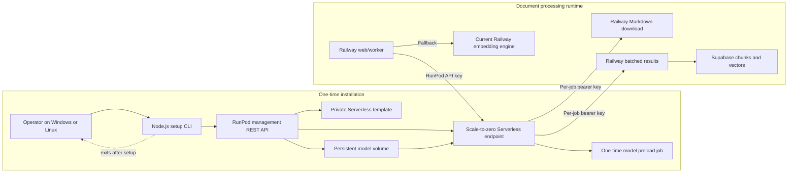
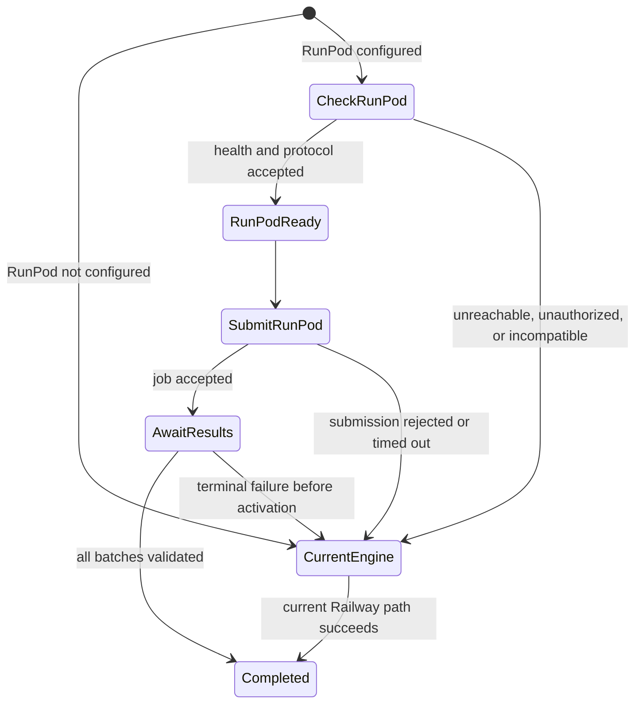

# Optional RunPod Chunking And Embedding Accelerator

> Status: the provisioning CLI, `0.3.1` worker image, selectable
> 1024/2560-dimensional Qwen output, Vault-backed settings, authenticated
> callback staging, atomic activation, version-aware query routing, automatic
> Railway fallback, enable switch, and sample-vector connection test are
> implemented. Validate the dev/staging rollout before enabling production.

## Install Node.js And pnpm First

The installer requires Node.js 22 or newer and this repository pins pnpm
11.7.0. Installing Node.js also installs `npm`, which is then used to install
the correct pnpm version. Use the [official Node.js download page](https://nodejs.org/en/download)
and [official pnpm installation guide](https://pnpm.io/installation) if the
commands below need to be compared with their latest instructions.

### Windows

1. Download a Windows LTS `.msi` installer from the
   [Node.js download page](https://nodejs.org/en/download). Choose the x64
   installer for most Windows computers or ARM64 for a Windows-on-ARM device.
2. Run the installer with its default options, including the option that adds
   Node.js to `PATH`.
3. Close every open PowerShell or Command Prompt window, then open a new one so
   it receives the updated `PATH`.
4. Run these commands in the new PowerShell or Command Prompt window:

```powershell
node --version
npm --version
npm install --global pnpm@11.7.0
pnpm --version
```

`node --version` must report version 22 or newer, and `pnpm --version` should
report `11.7.0`. Then change into the downloaded or cloned BubbleAPI root
folder and install its dependencies:

```powershell
Set-Location "C:\path\to\BubbleAPI"
pnpm install
```

Replace `C:\path\to\BubbleAPI` with the actual folder. You are in the correct
folder when this command finds `package.json`:

```powershell
Get-Item .\package.json
```

If Windows still says that `pnpm` is not recognized, close and reopen the
terminal once more and run:

```powershell
npm install --global pnpm@11.7.0
where.exe pnpm.*
pnpm --version
```

If `node` or `npm` is also not recognized, rerun the Node.js `.msi`, make sure
the `PATH` option is enabled, and open a new terminal. As a temporary fallback
after Node.js is working, any repository command can be run without a global
pnpm installation by replacing `pnpm` with `npx --yes pnpm@11.7.0`. For
example:

```powershell
npx --yes pnpm@11.7.0 runpod:setup -- --help
```

### Linux

The most portable setup uses `nvm`, so Node.js and global npm tools can be
installed for the current user without `sudo`. Run these commands in Bash:

```bash
curl -o- https://raw.githubusercontent.com/nvm-sh/nvm/v0.40.6/install.sh | bash
. "$HOME/.nvm/nvm.sh"
nvm install 22
nvm use 22
node --version
npm --version
npm install --global pnpm@11.7.0
pnpm --version
```

`node --version` must report version 22 or newer, and `pnpm --version` should
report `11.7.0`. Then change into the BubbleAPI root and install dependencies:

```bash
cd /path/to/BubbleAPI
pnpm install
```

Replace `/path/to/BubbleAPI` with the real directory. Confirm that it contains
the repository's `package.json`:

```bash
test -f package.json && echo "BubbleAPI root found"
```

If a newly installed `pnpm` is not found, open a new terminal. For the `nvm`
installation above, also reload it in the current Bash session and verify the
command locations:

```bash
. "$HOME/.nvm/nvm.sh"
command -v node
command -v pnpm
pnpm --version
```

As on Windows, `npx --yes pnpm@11.7.0` can temporarily replace `pnpm` in any
command after Node.js is working.

## Quick Shell Commands

Open PowerShell, Command Prompt, or a Linux terminal in the root `BubbleAPI`
folder - the folder containing `package.json`. These commands work the same way
on Windows and Linux:

```shell
# Print installer instructions. No API key, network call, or charge.
pnpm runpod:setup -- --help

# Print the complete provisioning plan without contacting RunPod.
pnpm runpod:setup -- --dry-run

# Run the local mocked installer test suite. No RunPod account is needed.
pnpm --filter @bubble-rag/runpod-setup test

# Start the live interactive installer.
pnpm runpod:setup
```

Run `pnpm install` once before using these commands. The first three commands
are safe to run now. The final command asks for the
RunPod API key, opens the model/resource dialog, prints a final cost-impacting
resource summary, and requires confirmation before creating anything. Press
Enter at each dialog question to preload only `Qwen3-Embedding-4B` and make it
the default model.

Keep production traffic on Railway until the staging checks in this document
pass. The RunPod endpoint and sample-vector test can be exercised without
turning on document acceleration.

## Purpose

RunPod is an optional GPU accelerator for document chunking and embedding. It
does not replace the existing Railway embedding service. When RunPod is not
configured, is unhealthy, rejects a job, or fails during a job, BubbleAPI uses
the current Railway path.

The accelerator accepts the complete canonical Markdown document, creates the
same deterministic chunk boundaries as Railway, embeds the chunks on a GPU,
and sends character offsets plus compact vectors back to Railway in retryable
batches. Railway reconstructs the chunk text from those offsets and remains the
system of record.

This design deliberately does not require Backblaze or an installer process
that remains online. It uses a small RunPod network volume to retain the models
selected during setup after workers scale to zero.

## Component Boundaries



### The setup CLI

The CLI is a disposable provisioning tool. It:

1. Runs anywhere Node.js runs, including Windows and Linux.
2. Asks for an operator-created RunPod API key without echoing it.
3. Calls RunPod's management REST API directly. `runpodctl`, Python, Git, and
   Docker are not required on the operator's computer.
4. Reuses an existing matching endpoint or creates a private Serverless
   template and queue-based endpoint.
5. Creates or reuses a persistent model volume and attaches it at RunPod's
   `/runpod-volume` path.
6. Submits an asynchronous `preload_models` job and polls it until the worker
   reports a verified manifest for every selected Hugging Face model.
7. Configures scale-to-zero and cost limits.
8. Checks the RunPod endpoint and, unless told not to, runs the worker's health
   operation once. This worker check can start a billable GPU worker.
9. Prints the endpoint ID, URL, model manifest, and settings needed by
   BubbleAPI.
10. Exits. It is not a proxy, daemon, monitor, or runtime dependency.

### BubbleAPI on Railway

Railway owns job creation, Markdown, page spans, authentication, result
validation, fallback, and database persistence. It never delegates database
authority to RunPod.

### RunPod worker

The RunPod container owns only a bounded computation:

- Download one authorized Markdown document.
- Apply a versioned deterministic chunker on the worker CPU.
- Embed document chunks in batches on the GPU.
- POST offset/vector batches back to Railway.
- POST a completion or failure record.

The GPU accelerates embedding. Chunking remains CPU work, but moving the whole
operation keeps Railway from spending its limited CPU on that job and avoids a
second chunk upload.

## One-Time Installation

### Prerequisites

- Node.js 22 or newer.
- A funded RunPod account.
- A RunPod API key created in the RunPod dashboard. RunPod's documented API can
  create templates and endpoints, but it does not provide an operation for this
  installer to mint an account API key.
- The published BubbleAPI RunPod worker image. The development CLI contains its
  planned versioned image name,
  `ghcr.io/jeffvan302/rag-runpod-worker:0.3.1`, and also accepts `--image` for
  testing or a controlled override. Until the image is published, use
  `--dry-run`.

Create a restricted RunPod key with the minimum Serverless/template access the
installer and BubbleAPI need. Treat it as a password. The CLI does not save,
write, or print it.

### Future published-package command

After `@bubble-rag/runpod-setup` is published, Windows and Linux use the same
command:

```shell
npx @bubble-rag/runpod-setup
```

The operator first pastes the RunPod key at a hidden prompt. The installer then
walks through the model and resource settings. Pressing Enter for every answer
uses the safe defaults.

The first two model questions look like this:

```text
Models to preload, separated by commas [Qwen3-Embedding-4B]:
Default model [Qwen3-Embedding-4B]:
```

Pressing Enter at those questions selects only Qwen3-Embedding-4B and makes it
the default. Additional public Hugging Face repositories can be entered as a
comma-delimited list:

```text
Qwen/Qwen3-Embedding-4B,Qwen/Qwen3-Embedding-0.6B
```

The installer accepts the short names `Qwen3-Embedding-4B` and
`Qwen3-Embedding-0.6B` and normalizes them to the full IDs shown above. Other
models must use Hugging Face's `owner/repository` form. The selected setup list
becomes the worker's model allowlist, and the installer validates that the
default model appears in that list.

The complete default dialog is:

```text
RunPod API key (input hidden):

RunPod setup dialog
Press Enter to accept any value shown in brackets.

Models to preload, separated by commas [Qwen3-Embedding-4B]:
Default model [Qwen3-Embedding-4B]:
Worker container image [ghcr.io/jeffvan302/rag-runpod-worker:0.3.1]:
RunPod endpoint name [bubble-rag-embedding]:
Persistent model volume size in GB [30]:
RunPod data center [US-TX-3]:
GPU types in preference order, separated by commas [NVIDIA GeForce RTX 4090,NVIDIA L40S,NVIDIA RTX A5000,NVIDIA L4,NVIDIA GeForce RTX 3090,NVIDIA RTX A4000,NVIDIA RTX A4500]:
Maximum workers [1]:
Worker idle timeout in seconds [5]:
Queue scale-up target in seconds [4]:
Maximum job time in seconds [3600]:
Ephemeral worker disk in GB [30]:
Download and verify the selected models now? [Y/n]
Run a worker health check (can start a billable GPU)? [Y/n]
```

The dialog then prints a resource and cost summary and requires a final `y`
before it creates or reuses anything. Invalid values are explained and asked
again rather than silently accepted.

Qwen's public embedding repositories do not require a Hugging Face token. The
first worker downloads them from Hugging Face into the attached network volume.
Private or gated repositories are deliberately not supported by this initial
installer because their token would need a separate RunPod-secret flow.

### Testing from this repository

Preview the exact RunPod payloads without an API key, network call, GPU, or
charge:

```shell
pnpm runpod:setup -- --dry-run
```

Run the installer tests:

```shell
pnpm --filter @bubble-rag/runpod-setup test
```

Provision a real endpoint only after the worker image exists:

```shell
pnpm runpod:setup
```

For non-interactive automation, provide the key through the process
environment and acknowledge resource creation explicitly. `--yes` accepts the
flags and built-in defaults without opening the dialog:

```powershell
$env:RUNPOD_API_KEY = "<runpod-key>"
pnpm runpod:setup -- --yes
Remove-Item Env:RUNPOD_API_KEY
```

```bash
RUNPOD_API_KEY='<runpod-key>' \
  npx @bubble-rag/runpod-setup --yes
```

Do not use an API-key command-line argument. Command-line arguments can be
retained in shell history or process listings.

### Default provisioned resources

The setup CLI creates:

- One private Serverless template using the versioned worker image.
- One persistent 30 GB model volume in the selected data center.
- One queue-based GPU Serverless endpoint.
- Zero minimum workers so idle cost can reach zero.
- One maximum worker by default as a cost and concurrency guard.
- Queue-delay scaling with a short threshold.
- FlashBoot enabled.
- A one-hour execution timeout for large documents.
- A 30 GB ephemeral container disk.
- A preload job that downloads the selected model list and records a verified
  manifest on the persistent volume. A failed download leaves the endpoint and
  volume available for inspection or a later retry, but the installer marks
  the setup as not ready.

Re-running setup with the same endpoint name is also the supported worker-image
upgrade path. When only the tag changes within the same image repository, the
installer updates the existing template in place and rechecks the worker. It
refuses to replace an existing template with an image from another repository;
use `--new` or a different endpoint name for that intentional change.

Qwen/Qwen3-Embedding-4B is the default and only preloaded model when every
wizard question is accepted with Enter. Models are loaded into GPU memory one
at a time; selecting several models does not require all their weights to fit
in GPU memory simultaneously. The persistent volume must, however, be large
enough for all selected model files.

The models are not baked into a new Docker image on the operator's computer.
The provisioned RunPod template carries the selected model allowlist and
default, while the durable model files and manifest live on the attached
network volume. That preserves the downloads when the endpoint scales to zero
and avoids requiring Docker on Windows or Linux installer machines. The volume
continues to incur RunPod storage charges until it is deleted.

GPU candidates are configurable. The default preference list favors GPUs with
enough memory for Qwen3-Embedding-4B while retaining multiple availability
choices:

1. NVIDIA GeForce RTX 4090
2. NVIDIA L40S
3. NVIDIA RTX A5000
4. NVIDIA L4
5. NVIDIA GeForce RTX 3090
6. NVIDIA RTX A4000
7. NVIDIA RTX A4500

The defaults are starting points, not a price guarantee. Re-check RunPod
availability and pricing before customer deployment.

### Installer output

The CLI prints a non-secret configuration bundle similar to:

```json
{
  "provider": "runpod",
  "endpointId": "abc123",
  "endpointUrl": "https://api.runpod.ai/v2/abc123",
  "runUrl": "https://api.runpod.ai/v2/abc123/run",
  "healthUrl": "https://api.runpod.ai/v2/abc123/health",
  "templateId": "template123",
  "networkVolumeId": "volume123",
  "models": ["Qwen/Qwen3-Embedding-4B"],
  "defaultModel": "Qwen/Qwen3-Embedding-4B",
  "apiKey": "<use the same RunPod API key supplied to the installer>"
}
```

The placeholder is intentional; the actual key is never emitted. The operator
enters the endpoint URL and the same RunPod key in BubbleAPI's Configuration
panel, where the key will be stored as a provider secret rather than ordinary
configuration metadata.

## BubbleAPI Configuration

The Embedding / Vector configuration panel includes an optional RunPod
accelerator section with:

- Enable RunPod accelerator.
- Endpoint URL or endpoint ID.
- RunPod API key, stored in the encrypted local settings vault.
- Connect and test button.
- Last successful health check, latency, protocol version, worker image
  version, supported models, and maximum document size.
- Automatic fallback toggle, enabled and required by default.

Selecting Qwen3-Embedding-4B does not by itself force RunPod. BubbleAPI uses
RunPod only when the accelerator is enabled and passes its health policy.

The RunPod management key and the per-job key are different credentials:

| Credential     | Created by         | Scope                                | Lifetime                         |
| -------------- | ------------------ | ------------------------------------ | -------------------------------- |
| RunPod API key | Operator in RunPod | Submit/check RunPod jobs             | Until rotated or revoked         |
| Job bearer key | Railway            | One job's download and result routes | Job timeout plus recovery window |

## Railway Integration Decision

RunPod is an accelerator profile layered over the existing Railway embedding
profile. It does not replace or rewrite the embedding provider and model saved
under Document Embeddings. Railway remains the control plane, persistence
boundary, and fallback engine:

1. Railway extracts a document and stores its canonical Markdown.
2. When RunPod is enabled and healthy, Railway submits the document to RunPod.
3. RunPod chunks and embeds the document, then returns authenticated result
   batches.
4. Railway validates the complete result before any RunPod vectors become
   active.
5. If submission, processing, validation, or activation fails, Railway uses the
   existing Document Embeddings configuration.
6. Query embedding uses the same RunPod model, revision, dimensions, and
   instruction as the stored RunPod document vectors. A query may fall back to
   Railway only against vectors produced by the Railway fallback profile.

### Configuration layout

The Configuration page presents these rows in this order under
**Embedding / Vector options**:

1. **RunPod settings** opens a dedicated connection dialog containing the
   endpoint URL or ID, Vault-backed API key, model, output dimensions, native
   endpoint scaling controls, Connect and test action, and the last validated
   worker details.
2. **Document embeddings** retains the current Railway model, dimensions,
   chunk size, and overlap. It adds **Use RunPod for accelerated embeddings**
   only after the runtime dispatch and fallback path is available.

The RunPod dialog applies these native endpoint settings through RunPod's
management API when the operator saves a changed value:

- **Minimum workers** controls the always-running worker floor. Use `0` for
  scale-to-zero or set it to `1` manually before a period of expected traffic.
- **Maximum workers** limits concurrent RunPod workers and spend.
- **Idle timeout** controls how long an idle autoscaled worker remains warm.
- **Scale-up queue delay** is the number of seconds a request may remain queued
  before RunPod adds a worker. It is a scaling threshold, not the duration of a
  GPU cold start.

When several document embedding or re-chunk jobs are queued, the Railway worker
submits them concurrently up to **Maximum workers**. It refills that set as each
document finishes, allowing the RunPod queue-delay scaler to observe enough
work to start additional GPU workers. PDF parsing and full-document reprocess
jobs remain serial so increasing RunPod capacity does not multiply vision,
rendering, or database load.

The recommended balanced defaults are zero minimum workers, three maximum
workers, a 60-second idle timeout, and an 8-second queue-delay threshold. The
scaler type remains `QUEUE_DELAY`. RunPod applies one idle timeout to all
autoscaled workers; setting a nonzero minimum pins that many workers until the
operator changes it again.

Enabling RunPod never changes the saved Railway embedding model. The UI shows
both the accelerator profile and the fallback profile so operators can see what
will run when RunPod is healthy and what will run only after a RunPod failure.

### Qwen output dimensions

Qwen3-Embedding-4B supports Matryoshka Representation Learning (MRL), so the
RunPod worker can ask the model to produce a shorter embedding directly. This
is model-supported truncation during inference, not PCA or arbitrary slicing on
Railway. The initial product choices are:

| Output          | Use                                                | Database path                               |
| --------------- | -------------------------------------------------- | ------------------------------------------- |
| 1024 dimensions | Recommended first rollout and quality baseline     | Existing `vector(1024)` partial HNSW index  |
| 2560 dimensions | Full model output for measured quality comparisons | Existing `halfvec(2560)` partial HNSW index |

The actual output dimension is part of the embedding version. Reducing the
dimension can trade some retrieval quality for smaller payloads and indexes, so
the choice must be tested on representative retrieval and sentiment-labelled
queries rather than treated as lossless.

### Version-aware fallback

Qwen3-Embedding-0.6B at 1024 dimensions and Qwen3-Embedding-4B truncated to
1024 dimensions are different vector spaces. A query vector from one must never
be compared with document vectors from the other merely because both arrays
have the same length.

BubbleAPI keeps one active embedding version per chunk:

- When RunPod succeeds, only the RunPod accelerator vector is stored. Railway
  does not run a second embedding pass.
- When RunPod fails before activation and automatic fallback is enabled, only
  the unchanged Railway fallback vector is stored.
- Query embedding uses the exact provider, model, revision, dimensions, and
  embedding version selected for the vector search. It never searches 4B
  document vectors with a 0.6B query vector or the reverse.

This is operational fallback, not transparent vector-space failover. During a
RunPod query outage, Railway can search documents that were indexed with the
Railway fallback profile, but it cannot vector-search RunPod-indexed documents.
Hybrid retrieval may continue through its keyword branch. Transparent vector
failover for RunPod-indexed documents would require another runtime serving the
exact same pinned 4B model and revision; equal vector dimensions are not enough.

Migration `20260813000400_single_active_runpod_embeddings` removes an existing
Railway vector only when the same chunk already has an activated RunPod vector.
Fallback-only documents are preserved.

### Implementation work

The integration is delivered in independently testable stages:

1. Persist endpoint, model, dimensions, health metadata, and the enable flag;
   store the RunPod key in the encrypted local settings vault.
2. Add the RunPod settings row, modal, and authenticated connection test.
3. Add dimension-aware document inference and lightweight query embedding to
   the RunPod worker, with a pinned model revision.
4. Railway attempt persistence, one-time job credentials, Markdown download,
   idempotent result callbacks, pending batches, and atomic activation are
   implemented.
5. Version-aware query selection, single-vector storage, a health cache, and
   circuit breakers are implemented.
6. Automated contract checks are implemented. Large-document timing, cold
   starts, 1024/2560 retrieval quality, and cost measurements remain staging
   acceptance checks before production rollout.

## Runtime Health And Selection



BubbleAPI should cache a successful lightweight health result briefly so every
document does not perform a separate health request. It must stop selecting the
accelerator after repeated connection or protocol failures and periodically
probe it again. Configuration tests may use the worker health operation and
therefore wake a GPU; routine selection should prefer RunPod's inexpensive
endpoint health request.

Fallback must be safe and idempotent:

- A RunPod attempt writes into a pending result set.
- Pending RunPod vectors are not active for retrieval.
- Railway activates a result only after every expected batch and checksum is
  valid.
- On failure, Railway discards or expires the pending attempt and queues the
  same document through the current engine.
- Only one completed embedding version becomes active.

## Document Job Protocol

### 1. Railway submits an asynchronous RunPod job

Railway generates a cryptographically random key for the job, stores only its
SHA-256 hash, and calls RunPod's queue-based `/run` operation:

```json
{
  "input": {
    "operation": "chunk_and_embed",
    "protocolVersion": 1,
    "jobId": "railway-job-uuid",
    "jobToken": "one-time-per-job-secret",
    "downloadUrl": "https://example.com/api/v1/runpod/download/railway-job-uuid",
    "resultsUrl": "https://example.com/api/v1/runpod/results",
    "document": {
      "sha256": "document-sha256",
      "byteSize": 1234567
    },
    "pageSpans": [
      {
        "pageNumber": 1,
        "startOffset": 0,
        "endOffset": 8421
      }
    ],
    "chunking": {
      "chunkSizeTokens": 900,
      "overlapTokens": 120,
      "version": "bubble-markdown-v1"
    },
    "embedding": {
      "model": "Qwen/Qwen3-Embedding-4B",
      "revision": "pinned-model-revision",
      "dimensions": 2560,
      "purpose": "document"
    }
  },
  "policy": {
    "executionTimeout": 3600000
  }
}
```

The Markdown is not included in the `/run` payload. This keeps the submission
far below RunPod's asynchronous request limit.

### 2. RunPod downloads Markdown

```http
GET /api/v1/runpod/download/{jobId}
Authorization: Bearer <jobToken>
Accept: text/markdown
```

Railway validates the token hash, job state, expiration, expected HTTP method,
and document association before streaming the canonical UTF-8 Markdown.

```http
Content-Type: text/markdown; charset=utf-8
Content-Length: 1234567
ETag: "document-sha256"
X-Document-SHA256: document-sha256
```

The implementation will enforce its own 50 MB Markdown limit. That is a
product safety limit, not a claim about Railway's current proxy limit. The web
application presently allows up to 80 MB for incoming proxied bodies, while
this route is an outgoing streamed response.

### 3. RunPod chunks and embeds

The Python worker ports the versioned Railway chunker exactly. It returns
UTF-16 code-unit offsets into the original Markdown so Railway can use native
JavaScript string slicing, and never offsets into a normalized copy. For every
chunk it applies the configured document prefix,
embeds in GPU batches, and validates vector dimensions and finite values.

### 4. RunPod sends result batches

```http
POST /api/v1/runpod/results
Authorization: Bearer <jobToken>
Idempotency-Key: <jobId>:<attemptId>:<batchIndex>:<batchSha256>
Content-Type: application/json
```

```json
{
  "protocolVersion": 1,
  "jobId": "railway-job-uuid",
  "runpodJobId": "runpod-job-id",
  "attemptId": "attempt-uuid",
  "kind": "batch",
  "batchIndex": 0,
  "firstChunk": 0,
  "lastChunk": 9,
  "totalChunks": 35,
  "batchSha256": "batch-sha256",
  "chunks": [
    {
      "chunkIndex": 0,
      "startOffset": 0,
      "endOffset": 4382,
      "tokenCount": 982,
      "overlapTokens": 0,
      "contentSha256": "chunk-sha256",
      "vectorEncoding": "float32-le-base64",
      "vector": "base64-encoded-vector"
    }
  ]
}
```

Chunk text is not returned. Railway reconstructs it with
`markdown.slice(startOffset, endOffset)` and verifies `contentSha256` before
persistence. Float32 little-endian base64 is substantially smaller than a JSON
array of decimal numbers.

Callbacks may arrive more than once or out of order. Railway returns success
for an identical duplicate. Reusing the same attempt/batch index with different
content returns a conflict and fails that attempt.

### 5. RunPod completes or fails the attempt

```json
{
  "protocolVersion": 1,
  "jobId": "railway-job-uuid",
  "runpodJobId": "runpod-job-id",
  "attemptId": "attempt-uuid",
  "kind": "complete",
  "totalChunks": 35,
  "totalBatches": 4,
  "documentSha256": "document-sha256",
  "resultSha256": "complete-result-sha256",
  "timings": {
    "downloadMs": 420,
    "chunkingMs": 1850,
    "embeddingMs": 7250,
    "callbackMs": 690
  }
}
```

A failure callback contains a stable error code, a safe error message, the
attempt ID, and the last successfully acknowledged batch. Railway records it
and selects the current embedding path.

## Result Validation And Activation

Railway activates a RunPod result only when:

- The document checksum still matches the submitted version.
- Model name, pinned revision, dimensions, prefixes, and embedding version
  match the job.
- Chunker version, size, and overlap match the job.
- All chunk indices from zero through `totalChunks - 1` exist exactly once.
- Offsets are ordered, within the Markdown bounds, and produce the advertised
  hashes.
- Every vector decodes to the configured number of finite float32 values.
- Batch and complete-result checksums match.

Page numbers and other metadata can then be recreated from the submitted page
spans. Supabase credentials never leave Railway.

## Query Embeddings

Stored document vectors and query vectors must use the same model, revision,
dimensions, and query/document prefixes. The full-document callback protocol
is only for ingestion. A later lightweight RunPod operation will embed query
text and return one small vector directly. If RunPod is unavailable at query
time, BubbleAPI may fall back only to an engine that produces the exact same
embedding version; it must never compare vectors from different models.

## Security Requirements

- Use HTTPS for every public connection.
- Store the RunPod account key in the encrypted local settings vault and never in ordinary metadata
  or logs.
- Generate job keys from at least 32 random bytes.
- Store only job-key hashes on Railway.
- Send keys in `Authorization`, never query strings.
- Scope a job key to one job and only the download/results operations.
- Expire and revoke job keys after completion or the recovery window.
- Redact authorization, webhook, token, and vector bodies from usage logs.
- Restrict callbacks to the expected job, attempt, model, and document hash.
- Use pinned worker images and model revisions in production.
- At runtime, accept only model IDs recorded in the setup-created allowlist and
  verified manifest; do not accept arbitrary remote model downloads from
  document-job requests.
- Rate-limit downloads and result callbacks per job.

## Failure And Recovery Matrix

| Failure                         | Railway behavior                                                    |
| ------------------------------- | ------------------------------------------------------------------- |
| RunPod is not configured        | Use current embedding engine.                                       |
| Health/authentication fails     | Mark accelerator unhealthy and use current engine.                  |
| `/run` is rejected              | Record attempt failure and use current engine.                      |
| RunPod cannot download Markdown | Expire attempt and use current engine.                              |
| A result batch is malformed     | Reject batch, fail attempt, and use current engine.                 |
| Callback is interrupted         | RunPod retries the same idempotent batch.                           |
| Completion has missing batches  | Do not activate; use current engine.                                |
| Railway restarts                | Recover attempt state from Supabase and continue receiving batches. |
| RunPod finishes after fallback  | Reject the expired attempt; do not overwrite fallback vectors.      |

## Installer CLI Reference

```text
bubble-rag-runpod-setup [options]

--model <id[,id...]>           Model to preload; repeatable or comma-delimited
--default-model <id>           Default model (default: Qwen/Qwen3-Embedding-4B)
--model-volume-gb <size>       Persistent model volume (default: 30)
--data-center <id>             Volume and endpoint location (default: US-TX-3)
--skip-model-preload           Create resources without downloading models
--image <name>                 Override the versioned worker container image
--name <name>                  Endpoint name (default: bubble-rag-embedding)
--gpu <id[,id...]>             Ordered RunPod GPU type IDs
--workers-max <count>          Maximum workers (default: 1)
--idle-timeout <seconds>       Worker idle timeout (default: 5)
--queue-delay <seconds>        Scale-up queue target (default: 4)
--execution-timeout <seconds>  Job timeout (default: 3600)
--container-disk <gb>          Ephemeral worker disk (default: 30)
--skip-worker-test             Do not wake a GPU for worker health
--new                          Do not reuse a matching endpoint
--dry-run                      Print payloads without contacting RunPod
--yes                          Skip the resource/cost confirmation
--json                         Print machine-readable output
--help                         Show help
```

Advanced test-only URL overrides exist so automated tests can use a local mock
server rather than RunPod.

## Enable And Test In Staging

1. Upgrade the RunPod endpoint template to
   `ghcr.io/jeffvan302/rag-runpod-worker:0.3.1` and wait for the image to be
   available.
2. Apply the BubbleAPI maintenance update through migration
   `20260815000100_modular_provider_and_pdf_routing` and deploy web and worker
   from the same commit.
3. Open **Configuration**, then **RunPod settings**. Save the endpoint, key,
   model, and dimensions. Select **Connect and test**. Success now means the
   worker returned a finite vector with the selected dimension count, not only
   a health response.
4. Open **Document embeddings**, select **Use RunPod for accelerated
   embeddings**, and save. The Railway model shown in the same dialog remains
   the fallback profile.
5. Queue one representative document. Its completed job progress reports
   `runpodAccelerated: true` and a `runpodEmbeddingVersion`. The database keeps
   one `runpod:` embedding per activated chunk and does not run Railway again.
6. Run a vector search for text present in that document. Query telemetry
   reports provider `runpod` with the same model revision and dimensions as the
   document vectors.
7. Queue all ready documents only after the representative test passes. This
   re-chunks documents that have stored Markdown and builds one vector version
   per chunk.
8. Test fallback with a separate representative document while RunPod is
   unavailable. It must receive only the Railway embedding version. Do not use
   a Railway query vector against documents indexed by RunPod.

### Reading The Queue During A Rebuild

- **Queue all** creates jobs for every eligible document, even when the admin
  queue is filtered to one silo or project. The queue heading reports the
  visible document count separately from the total count when a filter is
  active.
- A RunPod endpoint's maximum worker count is a capacity limit. The current
  Railway queue dispatcher submits one document at a time, so RunPod normally
  shows one running job and one active worker even when more documents are
  waiting in BubbleAPI.
- After RunPod activates the accelerated vectors, the BubbleAPI job completes
  without running the Railway embedding model. The dispatcher can immediately
  submit the next document.
- The admin job result labels distinguish `RunPod in progress`, `RunPod
accelerated`, and `Railway fallback`. A successful job labeled `Railway
fallback` should be investigated before a model-wide rebuild is considered
  complete.

## Implementation Sequence

1. **Provisioning CLI (implemented):** interactive model selection, persistent
   model storage, scale-to-zero provisioning, preload submission/polling, dry
   run, and mocked API tests.
2. **RunPod worker image (implemented):** Python handler, exact chunker port,
   Qwen document/query embedding, model-supported 1024/2560 output, compact
   vector callbacks, health operation, and `preload_models` operation.
3. **Railway protocol (implemented):** job-attempt persistence,
   download/results routes, validation, activation, expiration, and fallback.
4. **Configuration UI (implemented):** optional endpoint/key, model,
   dimensions, native worker scaling controls, connection/sample-vector test,
   and acceleration enable switch.
5. **Query path (implemented):** same-version query embedding with compatible
   fallback and no cross-model vector comparisons.
6. **Production validation (staging in progress):** real large-document tests, interruption/retry
   tests, GPU memory tuning, cost measurements, and retrieval-quality tests.

## External References

- [RunPod Serverless endpoint overview](https://docs.runpod.io/serverless/endpoints/overview)
- [RunPod request, webhook, and execution policy documentation](https://docs.runpod.io/serverless/endpoints/send-requests)
- [RunPod template creation API](https://docs.runpod.io/api-reference/templates/POST/templates)
- [RunPod template update API](https://docs.runpod.io/api-reference/templates/POST/templates/templateId/update)
- [RunPod endpoint creation API](https://docs.runpod.io/api-reference/endpoints/POST/endpoints)
- [RunPod network-volume storage](https://docs.runpod.io/storage/network-volumes)
- [RunPod network-volume API](https://docs.runpod.io/api-reference/network-volumes/POST/networkvolumes)
- [RunPod asynchronous job operations](https://docs.runpod.io/serverless/endpoints/operation-reference)
- [RunPod API-key management](https://docs.runpod.io/get-started/api-keys)
- [Railway public-network specifications](https://docs.railway.com/networking/public-networking/specs-and-limits)
